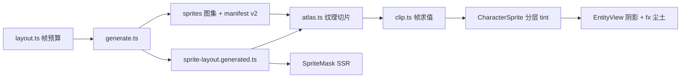

## 产品概述
《牛马》是一座 2D 像素风、多人在线的办公园区。本次优化把角色与场景的整体观感，提升到接近 pony.town 的精致度：保留 48×48 的像素栅格与四向视角，但让造型更有辨识度、动作更有生命感、场景不再像黑底上的剪影。

## 核心功能
- **造型重塑**：牛与马在剪影上一眼可分——牛为宽吻、短颈、方身、带角；马为长颈、窄吻、长腿、带鬃与长尾。整体采用大头小身、厚描边，增加背线高光与眼神光；胸腹分界、分段腿与蹄、分节尾巴也都更有层次。侧面视角下，前后腿在明暗与形状上要能区分。
- **动画系统**：行走时重心起伏、四肢交替、尾巴摆动；待机时呼吸起伏并偶尔眨眼；坐下与躺下各有一次落座过渡，之后保持轻微呼吸；「叫唤」动作真正播放出来，播放结束后自动回到站立；不同角色的动画相位错开，避免所有人同步动作。
- **场景与氛围**：角色脚下有贴着地面的接触阴影；走动时脚下带起短促的尘土；地面砖缝、纸屑、线缆槽等细节更耐看；昵称与聊天气泡随更高的头型上移，不压住耳朵与角。
- **配件与捏人预览**：工牌、领带、咖啡杯、笔记本等配件按更细的网格重绘并 1:1 叠加，不再糊成一团；捏人页预览同步获得阴影、眨眼与落座过渡，姿态切换可直接看到动画差别。


## 技术栈

| 层 | 选型（沿用现有） |
|---|---|
| 生成器 | TypeScript strict + Bun 执行 `packages/pixel-assets/scripts/generate.ts`；零依赖 PNG（`src/png.ts`）+ `mulberry32` 确定性随机 |
| 渲染 | PixiJS 8（WebGPU 优先、回落 WebGL2）；分层灰度图 + `Sprite.tint`（ADR-0002） |
| 像素栅格 | `apps/web/lib/game/pixel-scale.ts`：1 纹素 = 整数设备像素（ADR-0005） |
| 契约 | `apps/web/public/sprites/manifest.json` 升 v2 + 生成式常量 `apps/web/lib/game/sprite-layout.generated.ts` |
| 协议 | 不改：帧索引纯客户端概念，外观仍是 20 字节 / 5 色 |

## 实现策略

### 1. 帧布局升级为数据契约
- 新增 `packages/pixel-assets/src/layout.ts` 作为唯一真相：`FRAME_SIZE=48`、`COLUMNS=16`、`ROWS=4`、`CLIPS`、`poseOfColumn()`。帧预算铺满 16 列：idle 0-2、walk 3-8、sit 9-10、lie 11-12、emote 13-15。
- `manifest.json` 升 `version: 2`：`clips` 由 `{ frames, fps }` 改为 `{ frames, frameMs[], loopFrom, loop }`，支持逐帧时长与一次性过渡帧。
- 生成器同时输出 `sprite-layout.generated.ts`（frame/columns/rows/clips/cosmeticSize/directions），供 SSR 的 `SpriteMask.tsx` 与 `atlas.ts` 共用，避免服务端渲染时拿不到列数。
- `atlas.ts` 删除 `FRAME_COUNT = 32`、`COLUMNS = 8` 与 `frameForPose` 里的 110ms / 400ms 魔数；版本不等于 2 时抛可读错误，防止旧图集被静默错帧。

### 2. 造型与高光
- `quadruped.ts` 重写为「剪影 → 体积 → 细节 → 描边」四段式：新增 `topLight()`（沿每列最上方主体像素落高光，跳过描边与眼睛）、分段腿（大腿/小腿/蹄）、耳朵、颈线、胸腹分界、2-3 节尾巴。
- 物种剪影：牛 = 宽吻 + 短颈 + 方身 + 角；马 = 长颈 + 窄吻 + 长腿 + 鬃 + 长尾。侧视前后腿分别用 `BodyShade` / `Body` + 蹄色区分。
- `palette.ts` 新增 `BodyLight` / `EyeLight`（白 255，独立图层 `bodyLight` / `eyeLight`）。tint 只能乘不能提亮，这是唯一不引入 shader 的高光路径。
- `generate.ts` 对每个 tail 变体额外输出 `bodyLight-{0,1}.png`，`eyeLight.png` 只出一张（眼睛不随尾部/斑纹变化）。
- `character.ts` 叠层顺序：back → body → pattern → bodyLight → hoof → extra → eyes → eyeLight → snout → tie → badge → mouth。高光 tint 由协议内 5 色派生：`mixHex(body, 0xffffff, 0.22)`、`mixHex(eyes, 0xffffff, 0.72)`，在 `lib/color.ts` 新增 `mixHex()`；不新增外观字段、不改 20 字节编码。
- 成本：每角色多 2 个 Sprite（同图集、可合批）；图集由约 6.4 MiB 升到约 16-17 MiB。

### 3. 动画播放器
新增 `apps/web/lib/game/clip.ts`（纯函数、每帧零分配）：
- `buildClipTracks(manifest)` 把每个 clip 预编译为 `{ frameIndex[], at[], loopFrom, loop, durationMs }`，避免每帧查 manifest。
- `frameAt(track, elapsedMs)` 顺序查表；循环 clip 取模，一次性 clip 末尾钳制。
- 相位：`Motion.phase` 在 spawn 时按 netId 确定性赋值（`(netId * 131) % 480`），只对 idle / walk 生效；sit / lie / emote 必须从第 0 帧开始。
- 过渡：`Motion.since`（Float32Array）在 pose 或 direction 变化时写当前时间；`sit` / `lie` 的 `loopFrom = 1` 让落座帧只播一次。
- Emote：远端不再折成 Idle，改由 `frameAt` 播完约 440ms 自动回落；本地在 `perform('emote')` 后计时把 `Motion.pose` 置回 Idle 并广播，避免服务端状态永久停在 Emote。
- `CharacterSprite.setFrame` 改为 `setPose(direction, clip, frameInClip)`，把 `direction * columns` 收进角色层，删除 `session.ts` / `preview.ts` 里的 `* 8`。

### 4. 场景氛围
- `renderer.ts` 一次性用 `Graphics` 生成 40×12 硬边椭圆纹理作接触阴影，每个 `EntityView` 一枚 Sprite（同纹理同批次），位置吸附整纹素，alpha 0.42，脚底线仍在 y = 45。
- 新增 `apps/web/lib/game/fx.ts`：3 帧 8×8 尘土纹理由 `Graphics` 一次性生成；48 个 Sprite 对象池；`spawnDust(x, y, dir)` 在 walk 落脚帧触发（`frameInClip` 跨过 0 / 3），260ms 内上浮 2 纹素并线性淡出，结束后回池。每帧只写 `position / alpha / visible`。
- 地面：tile 128 → 256，32px 铺装 + 1px 缝线，加入排线槽、纸屑、咖啡渍、线缆等 8-10 处确定性细节；仍走 `generateTexture({ resolution: 1, scaleMode: 'nearest' })` + `TilingSprite`。
- 昵称 `-50`、气泡 `-56 - height` 的偏移随更大头型上移，避免压住耳朵与角。

### 5. 配件与捏人预览
- `COSMETIC_SIZE` 12 → 16，删除 `K = 12/16` 的 `Math.floor` 有损落笔；每个图标按 16 格重绘：工牌（挂绳 + 卡面 + 色条 + 头像块）、领带（领结 + 收腰 + 条纹）、手持（咖啡杯 + 热气 / 草叶 / 笔）、背包（笔记本屏幕微光 / 公文包锁扣）。
- 重校 `cosmeticAnchors`（四向 × 四类）并同步 `manifest.cosmeticSize`；`character.ts` 仍按 1:1 叠加。
- `preview.ts` 改走同一 clip 播放器 + 接触阴影；`PreviewStage.tsx` 的姿态按钮直接切 clip，落座过渡可见。
- `Hero.tsx` 的 `frame={2}` 在新布局里会变成眨眼帧，改为 `frame={0}` 并补 `bodyLight` 层；`Sections.tsx` / `JoinGate.tsx` 只用 `preview-*.png`，重新生成即可。

### 6. 关键取舍

| 决策 | 备选 | 理由 |
|---|---|---|
| 16 列 | 12 列 | 12 列放不下 3+6+2+2+3；16 是 2 的幂，768px 宽对齐纹理 |
| 新增高光层 | 只调 luma | tint 只能乘、不能提亮，luma 255 已用满 |
| 客户端 Emote 计时 | 服务端新包 | 不改协议、不加服务端状态机，20Hz 同步包足以驱动 |
| 共享纹理阴影 / 尘土 | 每实体 Graphics | 每帧重建 Graphics 会产生对象与额外绘制调用 |

## 执行注意
- 确定性：同输入同字节，`mulberry32` 种子固定，重新生成时可直接用 git diff 审图。
- 顺序不变式：描边最后画 + `closeDiagonalGaps`；斑纹禁绘面部矩形；高光不得覆盖描边与眼睛。
- 像素栅格：所有位置 `snapTexel`，缩放只取整数；禁止 blur、软阴影、亚像素位移（ADR-0005）。
- 显存：16 列是「PNG 张数不变、单张面积翻倍」，约 16-17 MiB；超预算时优先砍 `bodyLight` 的变体数量，不砍帧。
- 兼容：manifest v2 只有 `atlas.ts` 一个读者，版本不匹配时抛错并提示 `pnpm assets`；`SpriteMask` 读生成常量，未重跑生成会类型报错而非静默错位。
- 改动边界：不改协议、不改服务端、不改 20 字节外观编码；`packages/shared-types` 不新增字段。
- 性能：200 实体时每角色约 8 个 tint 层 + 至多 4 个配件 + 1 阴影，全部共享少量纹理，仍可合批；帧循环内不 new 对象。

## 架构



## 目录结构

```
niuma/
├── packages/pixel-assets/
│   ├── src/
│   │   ├── layout.ts                  # [NEW] 帧尺寸/列数/CLIPS/poseOfColumn，生成器与绘制共用的唯一真相
│   │   ├── palette.ts                 # [MODIFY] 新增 BodyLight / EyeLight slot 与图层名
│   │   ├── canvas.ts                  # [MODIFY] 新增 topLight() 背线高光、脚底接触阴影辅助
│   │   ├── quadruped.ts               # [MODIFY] 重写四向绘制：大头小身、物种剪影、分段腿、分节尾、16 帧
│   │   ├── cosmetics.ts               # [MODIFY] 16×16 重绘，去掉 0.75 有损降采样
│   │   └── __tests__/layout.test.ts   # [NEW] 校验 clip 帧索引越界、区间不重叠、pose 反查一致
│   ├── package.json                   # [MODIFY] 增加 "test": "bun test"
│   └── scripts/generate.ts            # [MODIFY] 输出 manifest v2、bodyLight/eyeLight、generated.ts、预览图
├── apps/web/
│   ├── lib/color.ts                   # [MODIFY] 新增 mixHex() 用于派生高光色
│   ├── lib/game/
│   │   ├── sprite-layout.generated.ts # [NEW] 生成物：columns/rows/clips/cosmeticSize
│   │   ├── clip.ts                    # [NEW] clip 预编译、frameAt、相位与过渡状态
│   │   ├── atlas.ts                   # [MODIFY] 读生成布局与 manifest v2，删硬编码与魔数
│   │   ├── character.ts               # [MODIFY] 高光层叠序、setPose、配件 16×16
│   │   ├── ecs.ts                     # [MODIFY] Motion 增加 since / phase
│   │   ├── session.ts                 # [MODIFY] 每实体相位、pose 起点、Emote 计时、方向乘列数
│   │   ├── renderer.ts                # [MODIFY] 接触阴影、尘土触发、地面细纹、标签偏移
│   │   ├── fx.ts                      # [NEW] 阴影纹理与 48 个尘土 Sprite 对象池
│   │   └── preview.ts                 # [MODIFY] 复用 clip 播放器与阴影
│   └── components/
│       ├── site/SpriteMask.tsx        # [MODIFY] 用生成常量算 mask 尺寸与行偏移
│       ├── site/Hero.tsx              # [MODIFY] 帧号与 bodyLight 层同步
│       └── creator/PreviewStage.tsx   # [MODIFY] 姿态切换走 clip，构图微调
├── apps/web/public/sprites/**         # [REGENERATE] 全部图集、manifest.json、preview-*.png
├── docs/adr/0006-sprite-atlas-v2.md   # [NEW] 记录列数、高光层、显存取舍与回滚路径
└── README.md                          # [MODIFY] 更新图集与动画说明
```

## 关键结构

```ts
// apps/web/lib/game/clip.ts 与 manifest v2 共用的形状
export interface SpriteClip {
  frames: readonly number[];   // 列索引，允许重复：idle 用重复帧把眨眼摊稀
  frameMs: readonly number[];  // 逐帧时长，长度必须等于 frames
  loopFrom: number;            // 循环起点；大于 0 表示首帧为一次性落座过渡
  loop: boolean;
}

export interface SpriteManifestV2 {
  version: 2;
  frame: { w: number; h: number; columns: number; rows: number };
  clips: Record<string, SpriteClip>;
  cosmeticSize: number;
  // species / cosmeticFiles / cosmeticAnchors 沿用现有结构，新增 bodyLight / eyeLight 路径
}
```


## Agent Extensions

### Skill
- **layer-pixel-art**
  - Purpose: 为 48×48 四向图集提供行走循环节拍、剪影可读性与图集排布的工艺基准
  - Expected outcome: 一套可逐帧比对的构图清单（落脚点、重心起伏、尾巴相位），生成器输出逐条对齐
- **impeccable**
  - Purpose: 捏人预览与落地页静态展示的视觉收尾（阴影、构图、像素对齐）
  - Expected outcome: 预览区与 Hero 无亚像素模糊，静态图与新造型一致
- **principal-software-architect**
  - Purpose: 把图集 v2 的取舍（16 列 vs 12 列、高光层、显存上限）落成 ADR
  - Expected outcome: `docs/adr/0006-sprite-atlas-v2.md` 含备选方案、后果、回滚成本与复核信号
- **verification-before-completion**
  - Purpose: 收尾前逐项跑生成、类型检查、单测与压测取证
  - Expected outcome: 命令输出与 preview 图作为完成依据，而非口头判断
