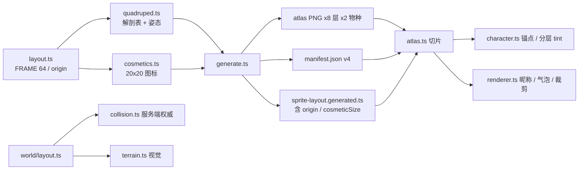

## 产品概述

「牛马 NIOMA」是一座 2D 像素多人在线办公园区，角色与地形全部由代码程序化生成。本次对整套像素美术做一次彻底重设计：把角色画布从 48×48 升到 64×64，改用硬朗卡通的画法，重塑牛与马的剪影差异，并把地形件与世界尺度一起校准，让角色、动物、场景三者比例协调。

## 核心功能

- **画布升级**：角色帧由 48×48 提到 64×64，图集由 768×192 变为 1024×256；16 列帧预算（待机 3 / 行走 6 / 坐 2 / 躺 2 / 叫唤 3）与四向排布保持不变，动画节奏不变。
- **画法改清晰**：统一为 1px 深色硬描边 + 2 阶明暗 + 干净大色块；取消逐列扫描式的背线高光与右缘压暗，取消随机撒点斑纹，改为人工排布的硬边斑块；眼睛放大为 3×4 并保留 1px 眼神光。
- **牛马比例统一**：两者整体身高差控制在 2 个像素内（牛含角约 51、马含鬃约 52）；牛是方身、短腿、宽吻、垂耳；马是窄身、长腿、长颈、窄吻、立耳。并排站在一起时一眼能分出物种，不再出现「方身子的棕牛」。
- **地图比例校准**：树高由角色身高的 1.7 倍提到 2.25 倍；围栏由齐腰提到齐胸；花箱、石头、芦苇同步放大；地砖由强对比棋盘格改为低对比大板 + 错缝，地面不再抢角色的视觉焦点。
- **世界尺度同步**：广场、围栏、门洞、道路、湖泊、河流、木桥、花箱与出生半径按 1.25 倍重排，移动速度同比提升，走完整张地图的体感时长不变。
- **配件全部保留**：5 种帽子、3 种眼镜、3 种颈饰、2 种背包、4 种角 / 3 种鬃、3 种斑纹、2 种吻型、2 种尾巴一个都不删，只在更细的网格上重画。
- **视觉一致性**：角色在落地页、捏人工作台与游戏内的显示尺寸都改为帧长的整数倍，放大后不会出现半像素模糊。


## 技术栈

沿用现有栈，不引入新依赖：

- 生成器：`packages/pixel-assets`（TypeScript + Bun，零依赖 PNG 编码）
- 渲染：PixiJS 8（WebGPU / WebGL2），`Sprite.tint` 分层染色
- 共享契约：`packages/shared-types`（服务端与客户端共用地形与移动常量）
- 构建：pnpm + Turborepo；命令 `pnpm assets` / `typecheck` / `test`

## 实现方案

### 总体策略

保持「单一真相」链路不变，只在三处改数值与画法：`layout.ts`（帧几何）、`quadruped.ts` + `cosmetics.ts`（画法）、`world/layout.ts`（尺度）。客户端这次的重点不是加功能，而是**消除全部写死的帧几何魔法数**，把它们统一到生成物 `sprite-layout.generated.ts`。

链路：



### 美术规范（本次的核心设计决策）

**网格**：64×64，脚底线 `FEET = 59`（底部留 5px 放描边与阴影），原点 `(32, 59)`，躯干中心 `BODY_CX = 26`，头心 `HEAD_CX = 42`。

**明度阶梯**（`palette.ts`，这些是 tint 乘数，0–255）。原阶梯在深色身体上被压成一坨：马身 `0xA96C3C` 乘 0.44 只剩近黑的 `0x4A2F1A`，这就是「糊」的根因。

| 槽位 | 旧 | 新 | 说明 |
|---|---|---|---|
| Body | 255 | 255 | 主体 |
| BodyShade | 176 | 206 | 阴影面，亮度 0.81，深色上仍看得出色相 |
| BodyDeep | 112 | 158 | 只用于远端肢体 |
| Outline | 56 | 44 | 描边更深，任何体色上都立得住 |
| Pattern | 255 | 255 | 斑纹 |
| PatternShade | 150 | 200 | |
| Hoof / HoofShade | 236 / 132 | 236 / 160 | |
| Eye / EyeShade | 255 / 140 | 255 / 150 | |
| Extra / ExtraShade | 255 / 142 | 255 / 190 | |
| Snout / SnoutShade | 232 / 168 | 240 / 196 | 吻部靠明度差，不描深边 |
| BodyLight / EyeLight | 255 | 255 | 纯白提亮层保留，但改用法 |

**绘制纪律**（逐条对应「不清楚」）：

1. 描边只允许 1px 且必须闭合，沿用 `outline()` + `closeDiagonalGaps()`；新增 `seam()` 在肢体与躯干交界补 1px 内描边，否则同色腿和身体会连成一块。
2. 明暗只在迎光面与背光面**成块**出现。删除 `topLight()` 的逐列扫描与 `rightShade()` 的逐列扫描，改为 2–3 处整块高光（头顶、肩线）与一条右侧 2px 宽暗面。
3. 斑纹改成 3 块固定坐标的硬边圆斑（人工排布、写死坐标），删除 `stampBlobs()` 的 `mulberry32` 随机撒点。
4. 眼睛固定 3×4：2×3 眼珠 + 1px 左上高光；闭眼只留一条 3×1 眼线。
5. 禁止抗锯齿、羽化、半透明、抖动噪点（索引位图天然满足，但要在注释里写死这条纪律）。

**剪影参数**（`ANATOMY`，目标同屏身高差 ≤2 texel）：

| 量 | 牛 | 马 |
|---|---|---|
| bodyRx × bodyRy | 11.5 × 7.6（方） | 9.5 × 6.6（窄） |
| legH | 17.5（短腿） | 20（长腿） |
| legW / hoofH | 4 / 4 | 3.4 / 4 |
| headR | 8.8（大） | 7.6（小） |
| neckH / neckW | 7.5 / 5（几乎无颈） | 10.5 / 4（长颈） |
| muzzleRx × Ry | 5 × 3.4（宽钝） | 3.4 × 3.2（窄长） |
| 耳 | 4 × 2.5 横向垂耳 | 2 × 4 竖向立耳 |
| 站立总高（含角 / 鬃） | 约 51 | 约 52 |

侧视时四条腿可以真正分开画（前近 / 前远 / 后近 / 后远各 4–5px 间距），不再是「两根柱子错开 2px」，这也是升到 64 的直接收益。

**配件**：`COSMETIC_SIZE` 16 → 20（中线 10）。帽子相对头宽的比例不变（新头径 17，20/17 与旧 16/13.6 相等）。帽檐基准行由 7 移到 9，镜圈内空保持 2×3 让眼珠透出来，背包由 13×8 放到 16×10。所有图标在 20 格上重画，`COSMETIC_CATALOG` 与 `catalog.ts` 一个字节都不动。

**地形（1.25 校准系数）**：

| 件 | 旧 | 新 |
|---|---|---|
| 树画布高 / 树干高 / 冠宽 / 行高 | 68 / 15 / 30 / 3 | 108 / 26 / 58 / 4 |
| 广场板 / 草地格 / 土路格 / 水面 | 32 / 32 / 32 / 32 | 40 / 48 / 40 / 40 |
| 围栏立柱 / 柱距 / 栏板高 | 20 / 56 / 13,6 | 30 / 84 / 19,9 |
| 花箱 / 石头 / 芦苇 | 24×32 / 10×6 / 9×16 | 34×44 / 15×9 / 14×24 |

广场从「强对比 32px 棋盘」改为「低对比 40px 大板 + 上下错缝 + 1px 缝」，草地从 32px 棋盘改为 48px 有机色块 + 草簇，去掉地面棋盘对角色剪影的干扰。

**世界坐标（`shared-types/src/world/layout.ts`，双端同步发版）**：

- PLAZA 900×750 → 1120×936；FENCE_RECT 1400×1100 → 1760×1384；GATE_WIDTH 80 → 128
- PATHS 宽 96 → 128，长度与坐标 ×1.25；BRIDGES 244×144 → 304×180
- 湖面 20 个顶点绕 (5700, 5300) ×1.25 后取整并重新写死；RIVERS 180 / 360 → 225 / 450
- PLANTERS 间距 200 → 260，`PLANTER_RADIUS` 10 → 16；`SPAWN_RADIUS` 240 → 300
- `TREE_CELL` 96 → 120，`TREE_JITTER` 26 → 32，`TREE_MARGIN` 32 → 40，`TREE_TRUNK_RADIUS` 9 → 12
- `LAKE_SHORE` 18 → 22；`FOREST_RECTS` 与 `REGIONS` 同步 ×1.25
- `isPlantable()` 的全部留白（PLAZA+48 / FENCE+56 / PATHS+44 / RIVERS+52 / BRIDGES+40 / LAKE+56）按 1.25 重算，否则树会重新长进广场
- `MOVE_SPEED` 132 → 165（世界放大 1.25 倍，体感速度不变；`MAX_STEP` 由它派生，自动跟着变）
- 服务端 `config.ts` 的 `spawnRadius` 默认 240 → 300，与 `SPAWN_RADIUS` 对齐

### 关键实现决策

1. **列数不动，只动帧边长**：16 列预算与 `CLIPS` 时长表是动画契约，`CLIPS` 一改，客户端播放、相位错开、落地页 CSS mask 全要跟着调。这次只改 `FRAME_SIZE`，把风险压在几何层。
2. **origin 下沉到生成物**：`sprite-layout.generated.ts` 新增 `origin: { x, y }` 与 `cosmeticSize`，`character.ts` 用 `origin.y / frame.h` 当锚点。这是本次唯一的结构性改动，价值在于以后改网格只需重跑 `pnpm assets`，客户端零改动。
3. **图集版本号 v3 → v4**：`atlas.ts` 已有 `manifest.version !== SPRITE_LAYOUT.version` 就抛错的机制，直接利用——旧图集配新客户端会白屏报错而不是静默错帧。
4. **地形视觉与碰撞分离**：树、花箱、围栏的纹理放大只改 `terrain-textures.ts`；碰撞半径改 `layout.ts` 常量。两者分开改，才不会出现「看着能过其实过不去」。
5. **不做半分辨率档位**：用户未选择「渲染放大一档」，`BASE_CSS_PER_TEXEL` 保持 3。角色变大只来自 64 网格内站得更高（48 texel vs 41 texel，屏幕 144px vs 123px）。

### 性能与可靠性

- 图集 768×192 → 1024×256，面积 +78%；8 层 × 2 物种常驻纹理由约 9.4MB 增至约 16.8MB。每角色 Sprite 数不变（图层数不变），draw call 不变，帧循环零新增分配。
- 地形纹理由 68px 高增到 108px，4 种树变体面积 ×2.5，仍在初始化阶段一次性烘焙，可忽略；`cull` 仍按视口剔除。
- 世界放大 1.25 倍后同屏树木数量下降约 36%，AOI 与广播协议完全不变，服务端负载略降。
- 双端一致性：`world/layout.ts` 与 `MOVE_SPEED` 是服务端权威碰撞与客户端预测共用的常量，必须同版本发版。旧客户端连新服务端会被服务端拉回，这是 ADR 必须写明的风险与发布纪律。

### 执行注意事项

- 生成脚本补一行日志：网格、图集尺寸、配件尺寸；不要打印颜色表。
- 每画完一个物种就跑一次 `pnpm assets`，用 `preview-*.png` 目视；不要攒到最后一次性验证。
- 删除的辅助函数（`topLight`、`rightShade`、`stampBlobs`）要连调用点一起删，不要留死代码。
- 改动集中在美术与常量，不要顺手重构 `character.ts` 的图层顺序或 `renderer.ts` 的 y 排序。

## 目录结构

```
niuma/
├── packages/pixel-assets/
│   ├── src/
│   │   ├── layout.ts                  # [MODIFY] FRAME_SIZE 48→64；新增 ORIGIN 常量并导出；COLUMNS/ROWS/CLIPS 一字不动
│   │   ├── palette.ts                 # [MODIFY] SLOT_TABLE 明度按新阶梯重写；层名与层序不变
│   │   ├── canvas.ts                  # [MODIFY] Px 默认画布改 64；新增 seam() 肢体接缝描边、blockLight() 整块高光、edgeShade() 成块暗面；保留 outline/closeDiagonalGaps
│   │   ├── quadruped.ts               # [REWRITE] ANATOMY 换成新参数表；FEET/BODY_CX/HEAD_CX 重定；drawSideBody/drawFacingBody/drawLeg/drawTail/drawEye/drawHornOrMane 全部按 64 重画；四条腿分开画
│   │   ├── cosmetics.ts               # [REWRITE] SIZE 16→20；5 帽 + 3 镜 + 3 颈饰 + 2 背包在 20 格重画，帽檐基准行 7→9
│   │   └── __tests__/
│   │       ├── layout.test.ts         # [MODIFY] 图集尺寸断言随 FRAME_SIZE 自动成立，补 origin 在画布内的断言
│   │       ├── cosmetics.test.ts      # [MODIFY] 图标边界改用 COSMETIC_SIZE=20
│   │       └── proportions.test.ts    # [NEW] 比例契约：牛马站立总高差 ≤2、总高落在 46..56、所有姿态不越帧边界、描边闭合
│   └── scripts/generate.ts            # [MODIFY] origin.y 由 FEET 导出而非字面量；version 3→4；写 cosmeticSize 20；额外输出 3x 校对图与 4 向接触表
├── packages/shared-types/src/
│   ├── constants.ts                   # [MODIFY] MOVE_SPEED 132→165
│   ├── world/layout.ts                # [MODIFY] PLAZA/FENCE/GATE/PATHS/LAKE/RIVERS/BRIDGES/PLANTERS/FOREST/REGIONS/TREE_*/SPAWN_RADIUS/LAKE_SHORE 全部 ×1.25；isPlantable 留白重算
│   └── __tests__/collision.test.ts    # [MODIFY] 区域名、树不进屋等用例里的硬编码坐标改成按新布局取值
├── apps/game-server/src/config.ts     # [MODIFY] spawnRadius 默认 240→300，与 SPAWN_RADIUS 对齐
├── apps/web/
│   ├── lib/game/
│   │   ├── sprite-layout.generated.ts  # [AUTO] 由 pnpm assets 重写，新增 origin / cosmeticSize
│   │   ├── character.ts               # [MODIFY] 锚点改读 origin.y / frame.h；去掉 45/48
│   │   ├── atlas.ts                   # [MODIFY] SpriteManifest 的 origin 标记为必填，供 character 消费
│   │   ├── renderer.ts                # [MODIFY] 昵称 -47、气泡 -54、cull 的 48/96 全部由 frame.h - origin.y 与树高常量推导
│   │   ├── terrain.ts                 # [MODIFY] WATER_TILE/FENCE_POST_GAP 与围栏栏板高度、树与花箱 cull pad 改由纹理尺寸与常量推导
│   │   ├── terrain-textures.ts        # [REWRITE] 草/广场/土路/水/树/石/花箱/芦苇按 1.25 重画；广场改低对比大板错缝，草地去掉棋盘
│   │   ├── fx.ts                      # [MODIFY] 接触阴影 16×7 → 22×9，阴影宽度随角色变宽
│   │   └── preview.ts                 # [MODIFY] BASE_CSS_PER_TEXEL 6→5；站台椭圆尺寸跟着放大
│   └── components/
│       ├── site/SpriteMask.tsx        # [MODIFY] zoom 上限 4→6，注释由「48 的整数倍」改为读 FRAME
│       ├── site/Hero.tsx              # [MODIFY] SpriteStack size 144→192（64 的 3 倍）
│       ├── site/Sections.tsx          # [MODIFY] 物种预览图标 96/144 改为 64/128 整数倍
│       └── game/JoinGate.tsx          # [MODIFY] 预览图标 96 改为 64/128 整数倍
├── docs/adr/
│   ├── 0010-sprite-grid-64.md         # [NEW] 64 网格决策：背景、问题（细节密度 / tint 压缩 / 牛马同构 / 地形比例）、决策、后果（显存 +78%、双端同步发版）、回滚路径、复核信号
│   └── 0006-sprite-atlas-v2.md        # [MODIFY] 顶部加一行「48×48 网格部分已由 ADR-0010 取代」，不改历史正文
└── README.md                          # [MODIFY] 美术行 48→64；角色与动画、地图与地形、已知边界三段的尺寸描述同步
```

## 关键代码结构

```ts
// packages/pixel-assets/scripts/generate.ts 写入客户端生成物的形状（新增 origin / cosmeticSize）
export const SPRITE_LAYOUT: {
  version: number;
  frame: { w: number; h: number; columns: number; rows: number };
  /** 脚底原点，帧内像素坐标；客户端锚点与 DOM mask 都读它 */
  origin: { x: number; y: number };
  directions: readonly string[];
  clips: Record<string, { frames: number[]; frameMs: number[]; loopFrom: number; loop: boolean }>;
  cosmeticSize: number;
};
```

```ts
// packages/pixel-assets/src/quadruped.ts 解剖表新增字段，供剪影契约与锚点共用
interface Anatomy {
  bodyRx: number; bodyRy: number;
  legH: number; legW: number; hoofH: number;
  headR: number;
  neckH: number; neckW: number;
  muzzleRx: number; muzzleRy: number;
  earW: number; earH: number;
  /** 站立总高（脚底→头顶，不含角/鬃），比例契约测试直接读它 */
  standHeight: number;
}
```


## Agent Extensions

### Skill
- **layer-pixel-art**
  - Purpose: 用户明确要求调用相关技能。该技能的「先命名网格与调色板、排除抗锯齿与柔化、逐帧对齐同一参考帧」三项纪律，直接转译为本次生成的硬约束：64×64 固定网格、受限明度阶梯、禁止抗锯齿与抖动、每一列都以第 0 列为唯一参考做剪影一致性校对。
  - Expected outcome: 生成器注释与 ADR 中形成可执行的像素纪律清单，并据此产出 64×64 的硬边图集与 3 倍校对图，无任何柔化边缘。
- **principal-software-architect**
  - Purpose: 本次涉及不可逆的网格升级与双端同步发版（地形坐标 + 移动速度），需要按权衡分析给出决策记录：至少两个可选方案（只重画 48 / 升 64 / 升 96）、收益与代价、回滚路径。
  - Expected outcome: 产出 `docs/adr/0010-sprite-grid-64.md`，含约束、非目标、反向成本、回滚成本与复核信号，并明确推翻 ADR-0006 中「48×48 已经够用」的判断。
- **improve-codebase-architecture**
  - Purpose: 把散落在 `character.ts`、`renderer.ts`、`terrain.ts`、`fx.ts` 的帧几何魔法数（45/48、-47、-54、48/96、16×7）收敛为「生成物写入 origin + 消费方派生」的单一真相，避免下次改网格再逐个文件找数值。
  - Expected outcome: 客户端不再出现任何写死的帧边长与脚底偏移，改网格只需重跑 `pnpm assets`；交付说明中给出可复核的搜索证据（全仓无 `45 / 48` 之类字面量）。
