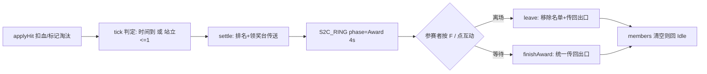

## 用户需求
擂台赛不该被固定时长卡住：当场上的胜负已经确定（冠军产生）时，应当立刻颁奖，而不是空等 2 分钟倒计时走完。

## 产品概述
三人擂台从「固定时长赛」改为「结果决定时长」：最后一名对手倒下即进入颁奖，2 分钟降级为上限；颁奖窗口由 9 秒压缩到 4 秒，并且参赛者在颁奖期间可以随时离场，不必站满。

## 核心功能
- 存活人数 ≤ 1 且本局至少 2 人参赛时，下一拍立即结算并进入颁奖，倒计时不再强制走完。
- 场上仍有 2 人站立时比赛继续，先倒下一个不会提前结束；断线导致只剩 1 人参赛的情况保持原样，不提前结算。
- 颁奖窗口由 9 秒缩短到 4 秒；未离场的参赛者在窗口结束时统一传送回擂台出口。
- 颁奖期间参赛者可主动离场（桌面按 F、触屏点「互动」按钮），提示文案变为「领奖离场」；围观者仍看到「颁奖中，稍后再来」。
- 被淘汰的玩家保持现状：躺到本局结算，不提前起身。
- 名次、奖牌入账、领奖台与彩带表现沿用既有口径，同一局不重复入账。


## 技术栈
- Monorepo：pnpm + Turborepo；`apps/game-server`（Bun + TypeScript，20Hz 权威 Tick）、`apps/web`（Next.js + React + TypeScript，PixiJS 渲染 + `game-ui` 快照订阅）、`packages/shared-types`（协议与规则常量唯一真相）。
- 测试：`bun:test`；根脚本 `pnpm test`（turbo）、`pnpm typecheck`、`pnpm changelog:check`。
- 不新增任何依赖，不新增协议 opcode。

## 实现方案
1. **把「比赛是否已分出结果」变成状态机内部判定**：在 `RingRuntime.tick()` 的 Running 分支上，把「时间到」扩展成「时间到 或 冠军已定」，仍然只在唯一的 `settle()` 入口结算，`moved` / 网格刷新 / 广播链路完全不变。
2. **颁奖窗口从 9 秒压到 4 秒，并允许提前离场**：`RING_AWARD_MS = 4_000`，`leave()` 从「仅 Waiting」扩到「Waiting 与 Award」，复用现有 `C2S_RING_LEAVE` 与 `teleport(RING_EXIT)`。
3. **客户端只加一个意图出口**：`ringHint()` 在本人参赛且 Award 时返回新文案「领奖离场」，`interactRing()` 直接 `sendRingLeave()`；HUD、协议、奖牌入账零改动。

关键决策与取舍：
- **判定放在 `tick()` 而不是 `applyHit()`**：`server.ts` 先跑 `ring.tick`、再跑 `resolveVents`。在 `applyHit` 里结算，`moved` 不会被当拍消费，空间索引与视野刷新要等下一拍，广播最坏延迟到 1Hz 心跳。放在 `tick` 只多 50ms，且保留单一结算路径。
- **判定条件用「参赛 ≥ 2 且站立 ≤ 1」而不是「名单 ≤ 1」**：断线剩 1 人时 `members.length === 1`，不触发提前结算，与用户确认的「退赛不提前结束」一致，也不会把冠军白送给剩下的人。
- **离场即从 `members` 移除**：`isFrozen` / `snapshot` / `finishAward` 三个消费方全部沿用现有分支，不需要给协议加 `left` 字段；奖牌已在 Award 首包按 `matchId` 幂等入账，移除成员不会回滚。
- **客户端 `perform()` 的硬直门必须在颁奖分支前放行 `interact`**：被淘汰者的本地 `stunUntil` 仍停在「本局剩余时间」（最长 120 秒），不先短路就会「提示写了领奖离场，却怎么也按不动」。
- **颁奖表现必须配套**：彩带按 3.6 秒生成、最长存活 6.2 秒，窗口砍到 4 秒后会在中途被 `resetAward()` 硬切；因此缩短生成窗口并补一段 240ms 淡出，避免出现明显的视觉突变。

性能与可靠性：
- `isDecided()` 每 Tick 扫 ≤3 个成员，O(3)、零分配（用计数器而非 `filter`），20Hz 下可忽略。
- 不新增定时器、不新增广播：提前结算复用 `tick` 的 `changed` 标志，服务端仍只在阶段/血量变化与 1Hz 心跳发包。
- 无协议变更，旧客户端不升级也能正常工作（只是不能提前离场，4 秒颁奖由服务端时间决定）。

## 实现要点
- `settle()` 不需要改：`rankByHp` 已能正确处理 0 血席位与并列。
- `leave()` 在 Award 中把 `members` 清空时必须把 `phaseEndsAt` 归零，否则下一次 `tick` 会拿旧时间戳判断。
- 颁奖期离场后 `phase` 仍是 Award（其他人还在颁奖），此时不能重新报名；全员离场立即回 Idle 才重新开放。
- `HINT.ringAward`（「颁奖中，稍后再来」）必须保留给非参赛者，不要原地改字，否则围观者也会看到「领奖离场」。
- `ring.ts`（表现层）的淡出只动 `overlayRoot.alpha`，`phase` 仍立即更新，防止漏播下一局的 Award 动画；`resetAward()` 内把 alpha 复位成 1，保证 `destroy()` 后状态干净。
- 改动范围严格限定在擂台：不碰老板、执法、考勤与移动求解器。

## 架构设计
数据流不变：`shared-types` 常量 → `RingRuntime` 状态机 → `S2C_RING` 快照 → HUD / `RingView`。新增能力全部收敛在既有模块内部，不引入新层、新服务或新事件通道。



## 目录结构
```
niuma/
├── packages/shared-types/src/world/
│   └── ring.ts                       # [MODIFY] RING_AWARD_MS 9_000→4_000；更新文件头规则注释（颁奖可离场、120 秒是上限）与 RING_ROUND_MS/RING_AWARD_MS 注释
├── apps/game-server/src/sim/
│   ├── ring.ts                       # [MODIFY] 新增 private isDecided()（members>=2 且站立<=1）；tick 的 Running 分支改为「到点 或 isDecided()」；leave() 放开 Award；成员清空时 phaseEndsAt=0；类注释补充提前结算
│   ├── vent.ts                       # [MODIFY] 仅改注释：淘汰者「躺到本局结算」而非「躺到 120 秒结束」，无逻辑变更
│   ├── ring.test.ts                  # [MODIFY] 改写「打空血量不结束」用例为「打空即结算」；新增三人局先倒一人仍 Running、颁奖期离场、全员离场回 Idle；保留断线剩 1 人仍走完计时的用例作为边界保护
│   └── __tests__（同目录）
├── apps/web/lib/game/
│   ├── ring.ts                       # [MODIFY] CONFETTI_SPAWN_MS 3_600→2_400；新增 240ms 淡出（AWARD_FADE_MS / fadeOutAt）避免 4 秒窗口硬切；擂台垫文案改为「10 血 · 三人为限 · 打完即开奖」
│   ├── session.ts                    # [MODIFY] perform() 颁奖期放行 interact；ringHint() 参赛者 Award 返回 HINT.ringAwardLeave；interactRing() Award 发 sendRingLeave 并回执；ringStunRemainMs 注释改为「躺到本局结算」
│   ├── hint-copy.ts                  # [MODIFY] 新增 HINT.ringAwardLeave='[F] 领奖离场'，同步 HINT_BUTTONS（interact/领奖离场/F）与 TOUCH_HINTS
│   └── __tests__/hint-copy.test.ts   # [MODIFY] BUTTONS 表补一行 ringAwardLeave，确保「键帽在桌面文案、动作名在触屏文案」
├── apps/web/data/
│   └── release-notes.json            # [MODIFY] entries 最前插入 2026-11-13-21：打完即颁奖 / 颁奖 4 秒可提前离场
└── docs/adr/
    └── 0076-ring-early-award.md      # [NEW] 记录「存活≤1 立即结算、120 秒降为上限、颁奖 4 秒可离场」；显式声明反转 ADR-0073 第 3 节与「KO 即结束」备选结论，不改写旧 ADR
```

## 关键代码结构
```ts
// apps/game-server/src/sim/ring.ts
/** 冠军已定：至少两人参赛，且站立的只剩 1 人（或全部倒下）。断线剩 1 人不算。 */
private isDecided(): boolean {
  if (this.members.length < 2) return false;
  let standing = 0;
  for (const member of this.members) if (member.hp > 0) standing += 1;
  return standing <= 1;
}

// tick(): 唯一结算入口，到点与提前决出共用一条路径
if (this.phase === RING_PHASE.Running && (now >= this.phaseEndsAt || this.isDecided())) {
  this.settle(now, world);
  changed = true;
}

// apps/web/lib/game/session.ts
// perform(): 颁奖期只放行「领奖离场」，站位与名次仍由服务端定格
const awardFrozen = this.ringAwardFrozen();
if (awardFrozen) {
  if (action !== 'interact') return;
} else if (this.elapsed < this.stunUntil || this.escortLocked) {
  return;
}
```


## Agent Extensions
### Skill
- **principal-software-architect**
  - Purpose: 为「反转 ADR-0073 严格 120 秒承诺」给出权衡分析与决策记录
  - Expected outcome: 产出 `docs/adr/0076-ring-early-award.md`，包含约束、非目标、备选方案与 30 天回滚路径
- **tdd**
  - Purpose: 先写失败的擂台结算/离场测试，再改 `RingRuntime` 使其通过
  - Expected outcome: `ring.test.ts` 覆盖提前结算、三人局不误结算、颁奖期离场、全员离场回 Idle
- **impeccable**
  - Purpose: 颁奖窗口从 9 秒砍到 4 秒后的表现收尾（彩带节奏与结束淡出）
  - Expected outcome: 颁奖结束不再硬切，4 秒内领奖台/奖杯/彩带节奏完整可读
