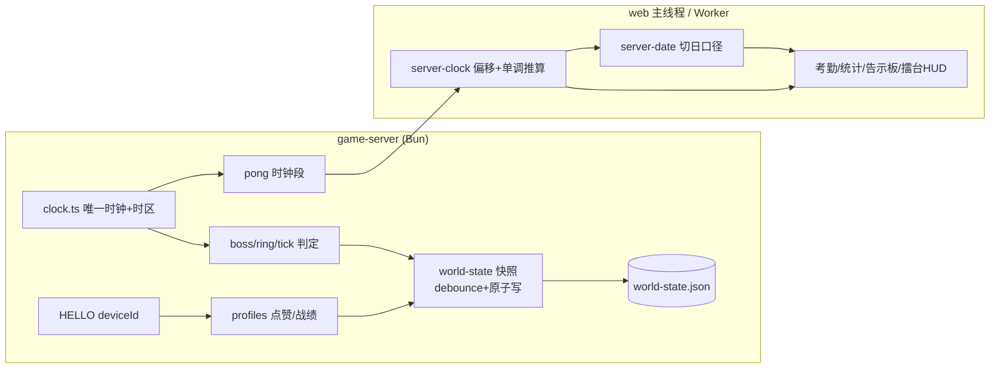

## 产品概述
把“园区运行态”的权威来源从“进程内存 + 各客户端本地时钟”改为**服务端时钟与持久化快照**：所有涉及擂台、老板、点赞、今日统计、签到、节日季节的时间判定，一律以服务器时间为唯一标准，关键共享状态写入本地 JSON 快照，进程重启后恢复。

## 核心功能
- **服务端时间权威**：服务端解析并固定一个园区时区偏移（可配置，容器跑 UTC 也不错位），擂台倒计时、老板跨日回满、限频与会话续算全部用该时钟；周期性随心跳向客户端下发服务器时刻与时区偏移。
- **客户端只做显示**：浏览器维护“服务器时间 = 单调时钟 + 偏移”，用 RTT 校正、平滑收敛、异常跳变直接对齐；断线期间按单调时钟推算，联网后重新校准。
- **口径统一**：擂台 HUD 倒计时、被淘汰后的躺倒时长、考勤“今日/本周”、行为统计日桶、上香日、木鱼账本、放假告示板与跑马灯、季节与冬景判断、聊天气泡时间，全部改用服务器时间与服务器时区切日；客户端本地日历口径仅保留给纯本机交互计时。
- **共享运行态持久化**：老板血量与下一次回满时刻；擂台局号、阶段、阶段截止时刻与席位战绩；按匿名设备 ID 累计的工牌点赞数与擂台名次战绩。重启后恢复：老板血量不凭空回满、点赞不归零、局号不从 1 重新数、擂台不残留“幽灵比赛”。
- **健壮性**：启动时容错加载（版本校验、坏档备份为 .bad 且不阻塞开服）、变更后节流原子写盘、退出与异常前强制落盘、配置留空即可整体关闭持久化回滚。
- **玩家可感知的变化**：电脑时钟不准或处在别的时区时，擂台剩余时间、老板刷新点、“今天”的工时与榜单仍与园区一致；服务重启后自己收到的赞与工牌口碑延续。

## 视觉与交互
不新增界面与页面结构。可感知为：擂台 HUD 的剩余秒数、告示板周末/假期倒计时、工牌“今日工时/收到的赞”在客户端时钟异常时依旧准确；重启后工牌赞数与擂台局号连续，不再出现“一夜回到解放前”。


## 技术栈
- **服务端**：沿用 Bun + `Bun.serve`（零新增第三方依赖）。持久化只用 `node:fs/promises`（临时文件 + `rename` 原子写），零依赖、可读、可回滚。
- **协议**：沿用 `@niuma/shared-types` 手写二进制帧，只做**尾部追加**扩展（本仓已有 `0xfa/0xfb/0xfc/0xfd/0xfe` 尾段先例）。
- **客户端**：Next.js 15 / React 19 / Zustand 5 / PixiJS Worker，新增两个纯计算模块（服务器时钟、服务器日历），不引入时区库。
- **存储介质**：单文件 `world-state.json`（v1 版本号），配置留空即关闭。

## 实施策略
1. **服务端单一时钟源**：新增 `apps/game-server/src/clock.ts`，启动时解析一次园区时区偏移（配置优先，缺省取系统时区），对外暴露 `now()`（默认 `Date.now`，测试可注入）、`nextServerMidnight(now, tzOffsetMin)`、`toEpochSec`。擂台/老板/Tick/限频/落盘时间戳统一从这里取。
2. **时间下行不新增 opcode**：`S2C_PONG` 尾部追加 `[serverSec u32][tzOffsetMin i16]`（旧客户端 `decodePong` 只读前 5 字节，尾字节天然忽略），心跳本就 1Hz，等于免费拿到 1Hz 时钟样本；`C2S_HELLO` 尾部追加 `[0xf9][deviceId 8B]` 匿名设备段。
3. **客户端时钟模块**：`lib/game/server-clock.ts` 保存 `{epochBase, monoBase}`，`serverNow()` 用 `performance.now()` 自增，消除系统时钟跳变；每次样本按 `serverSec*1000 + rtt/2` 计算，偏差 >500ms 直接对齐、否则 EMA 收敛；同时记录 `tzOffsetMin`。Worker 与主线程各持一份实例，各自用自身单调时钟落同一 epoch；Worker 侧由自身连接直接吃 pong，主线程经 `WorkerToMain { t:'clock' }` 被动同步并节流。
4. **时间口径迁移**：新增 `lib/game/server-date.ts`（`serverDateKey/startOfServerDay/startOfServerWeek/serverDayDiff/serverHour`，按 `tzOffsetMin` 平移后走 UTC getter，不依赖运行地时区）；`attendance/career/incense-day/almanac-store/holiday-calendar/bulletin/season/clock` 改为显式传入服务器时刻；`local-date` 保留原样给纯本机交互用。
5. **倒计时不改协议**：擂台不回 `endsAt` 字段，客户端收到快照时记 `endsAtServer = serverNow() + remainingMs`，HUD 用 `endsAtServer - serverNow()` 显示，误差仅半个 RTT（120s 倒计时可忽略），同时规避 `decodeRing` 对尾字节的严格校验导致旧端整包丢弃。
6. **持久化**：`src/persist/world-state.ts` 定义 v1 快照（`boss` / `ring` / `profiles`），`load()` 校验版本与字段、坏档改名 `.bad` 后空档启动；变更只 `markDirty()`，1s 级 debounce 合并写盘，写盘串行化（tmp → rename），`stop()`/SIGINT/SIGTERM 走同步 `flushSync()`；`profiles` 按上限 + 最久未见淘汰 + 90 天过期，控制文件体积。
7. **重启恢复语义**：老板恢复 `hp` 与 `resetAt`（已过期则按当前服务器日重算并满血）；擂台恢复 `matchId` 计数与上一局战绩摘要，未完成的局因参赛者已全断线而收尾为 `idle`（不复活幽灵比赛），日志留一行摘要。
8. **性能与可靠性**：pong 多 6 字节、1Hz；`serverNow()` 为两次减法；落盘只发生在状态变更且被 debounce 合并，绝不在 Tick 内同步写盘（50ms 帧预算）；`profiles` 查找 O(1)。读写失败只告警并保留 dirty，下窗口重试，不影响帧循环与准入。

## 实施注意
- **协议兼容**：只用尾部追加 + 长度分支；不新增 OpCode。改 `decodePong` 时保留原 `decodePong(): number`，新增 `decodePongClock()` 读尾段，旧测试与旧调用点零改动。
- **勿动 ring 包**：`decodeRing` 对尾字节直接抛错，追加字段会让未刷新客户端丢整包；改用第 5 条的“收包时刻 + 剩余毫秒”换算绝对截止时间。
- **回滚开关**：`GAME_STATE_PATH` 留空即完全回到今日“零持久化”行为（时间下行仍保留，仅展示用），便于排查与灰度。
- **日志纪律**：保存失败 `console.warn` 带路径与错误码，不打印完整 JSON；deviceId 只打前 4 位；恢复摘要每进程一行，不逐玩家刷屏。
- **不做账号**：deviceId 仅用于聚合同一台浏览器的点赞与战绩，宁可错合并也不提供找回；HELLO 段长度非法一律忽略（视为匿名新设备）。
- **爆炸半径**：纯本机计时场合（面板返回键守卫、重连退避、日志）的 `Date.now()` **不改**，只改影响玩法与“今日”口径的判定。
- **文档纪律**：不修改历史 ADR 正文，新增 ADR-0081 取代 ADR-0004 的边界；同步改 README 顶部约束与相关段落、AGENTS.md 约束行；`apps/web/data/release-notes.json` 追加一条玩家可感知的版本工报。
- 按仓库约定，本次不运行测试与类型检查。

## 架构设计


## 目录结构
```
niuma/
├── packages/shared-types/src/
│   ├── constants.ts        # [MODIFY] 新增 DEVICE_EXTENSION_MAGIC=0xf9/BYTES=9、PONG_CLOCK_BYTES=6；注释说明尾段纪律与旧端忽略依据
│   ├── protocol.ts         # [MODIFY] encodeHello/decodeHello 增设备段（排在 session 段之后，长度非法即忽略）；encodePong(timestamp, clock?) 追尾时钟；新增 decodePongClock()，保留 decodePong()
│   ├── index.ts            # [MODIFY] 导出新增常量与 ServerClockStamp 类型
│   └── __tests__/protocol.test.ts # [MODIFY] 新旧包双向兼容用例：旧端忽略尾段 / 新端读出 serverSec+tz
├── apps/game-server/src/
│   ├── clock.ts            # [NEW] 时区偏移解析（GAME_TZ_OFFSET_MIN 优先，缺省系统）、now() 注入缝、nextServerMidnight、toEpochSec
│   ├── config.ts           # [MODIFY] 增 state{path, saveMs, maxProfiles} 与 time.tzOffsetMin；沿用 readInt/readBool 风格，允许 path 为空串
│   ├── persist/world-state.ts # [NEW] v1 快照类型、load/校验/坏档 .bad、markDirty+debounce、写盘串行化、flushSync、profiles 容量与过期
│   ├── persist/profiles.ts # [NEW] deviceId → {likes, ringMedals, name, lastSeenAt}：get/upsert/prune/toJSON
│   ├── sim/boss.ts         # [MODIFY] 接受 tzOffsetMin；新增 snapshot()/restore(hp, resetAt)；nextLocalMidnight 换成 nextServerMidnight
│   ├── sim/ring.ts         # [MODIFY] 新增 snapshotForSave()/restore()（matchId 计数、lastMatch 摘要、重启收尾为 idle）；settle 触发落盘回调
│   ├── sim/world.ts        # [MODIFY] Player 增 deviceId（reset 清零）、档案预置赞标记；World 构造接受时钟参数
│   ├── sim/like.ts         # [MODIFY] 点赞成功后累加档案计数并通知落盘（同连接一人一次逻辑不变）
│   ├── sim/tick.ts         # [MODIFY] 接收 now 形参（由 server.ts 传 clock.now），避免 tick 内再取时间
│   ├── server.ts           # [MODIFY] 启动 hydrate、pong 带时钟、HELLO 取 deviceId 并预置赞/战绩、擂台/老板/点赞变更 markDirty、stop() flushSync
│   └── index.ts            # [MODIFY] 启动日志改为“共享运行态写入 <path>，其余仍在内存”，退出路径保证落盘
├── apps/web/
│   ├── lib/game/server-clock.ts  # [NEW] 偏移/单调推算/EMA 收敛/跳变对齐、tzOffsetMin、同步订阅；无 window 依赖，Worker 可用
│   ├── lib/game/server-date.ts   # [NEW] 纯函数：按服务器时区切日/切周/日差/小时，非法值返回空串或 NaN
│   ├── lib/game/device-id.ts     # [NEW] 匿名设备 ID：localStorage 生成并复用（crypto 优先，退化到随机），经 browserStorage 收口
│   ├── lib/net/client.ts         # [MODIFY] HELLO 带 deviceId；pong 走 decodePongClock 并回调 onClock(sample)
│   ├── lib/game/session.ts       # [MODIFY] onClock 接服务器时钟；handleRing 记 endsAtServer；ringStunRemainMs 改服务器口径；ring-status 调用点显式传 now
│   ├── lib/game-ui.ts            # [MODIFY] ring 状态增 endsAtServer（保留 receivedAt 作旧服务端回退）
│   ├── components/game/RingHud.tsx # [MODIFY] 倒计时改 endsAtServer - serverNow()，200ms 跳动机制不变
│   ├── lib/game/runtime/worker-protocol.ts # [MODIFY] WorkerToMain 增 { t:'clock'; epochMs; tzOffsetMin }（低频、非每帧量）
│   ├── lib/game/runtime/worker-host.ts     # [MODIFY] session 时钟回调节流转发主线程，低频不刷屏
│   ├── lib/game/client/worker-client.ts    # [MODIFY] 收到 clock 消息即 apply 到服务器时钟并节流
│   ├── lib/game/ring-status.ts   # [MODIFY] 去默认 now，要求显式传服务器时刻
│   ├── lib/game/attendance.ts    # [MODIFY] tick 与 dayKey 改服务器时刻/服务器日历
│   ├── lib/game/career.ts        # [MODIFY] 全部日桶入账改 serverNow + serverDateKey
│   ├── lib/game/incense-day.ts / almanac-store.ts # [MODIFY] 首页/木鱼日期判定改服务器口径
│   ├── lib/game/holiday-calendar.ts # [MODIFY] 函数增 tzOffsetMin 入参，内部改 startOfServerDay/Week
│   ├── lib/game/bulletin.ts      # [MODIFY] 跑马灯每整秒重算改读 Worker 侧 serverNow
│   ├── lib/game/season.ts        # [MODIFY] 冬景判断改服务器日期（仍为纯表现层）
│   ├── lib/game/clock.ts         # [MODIFY] 气泡时间按服务器时区渲染
│   ├── components/BulletinModal.tsx # [MODIFY] 1s 跳动改 serverNow + 服务器时区
│   └── components/game/GameViewport.tsx # [MODIFY] 本人榜兜底值与日桶读取改 serverNow
├── docs/
│   ├── adr/0081-server-clock-and-persistent-world-state.md # [NEW] 取代 ADR-0004 边界：哪些状态必须落盘、客户端时间只能用于渲染、回滚开关与 90 天清理
│   ├── README.md / AGENTS.md / promo.md / deploy-multi-park.md # [MODIFY] 同步“零持久化”表述
│   └── .gitignore          # [MODIFY] 忽略运行时快照文件与 .bad 备份
└── apps/web/data/release-notes.json # [MODIFY] 新增一条：园区时间与赞/擂台状态不再随重启清零
```

## 关键结构
```ts
// apps/game-server/src/persist/world-state.ts
interface WorldStateV1 {
  version: 1;
  savedAt: number;                       // 服务器毫秒
  tzOffsetMin: number;                   // 写入时的园区时区，便于跨部署校验
  boss: { hp: number; resetAt: number };
  ring: { matchId: number; nextMatchId: number; lastMatch: { matchId: number; endedAt: number; top: { name: string; rank: number; hp: number }[] } | null };
  profiles: { id: string; likes: number; gold: number; silver: number; bronze: number; name: string; lastSeenAt: number }[];
}
```
```ts
// apps/web/lib/game/server-clock.ts（Worker 与主线程各一份）
interface ClockSample { serverSec: number; rttMs: number; tzOffsetMin: number }
function applyClockSample(sample: ClockSample): void; // 偏差>500ms 对齐，否则 EMA
function serverNow(): number;      // epochBase + (performance.now() - monoBase)
function serverTzOffsetMin(): number;
function isServerClockSynced(): boolean;
```
	

## Agent Extensions
### SubAgent
- **code-explorer**
  - Purpose: 全仓清点客户端“业务时间”调用点（`Date.now/new Date` 与 `localDateKey/startOfLocalDay/startLocalWeek` 的使用）以及服务端所有 `Date.now()` 位置，输出按“必须改 / 保持不动”分类清单，避免迁移遗漏或误伤纯本机计时。
  - Expected outcome: 一份可直接对照执行的调用点清单（文件 + 行号 + 归类 + 建议替换函数），作为时间口径迁移任务的验收底稿。
### Skill
- **lsp-code-analysis**
  - Purpose: 对 `RingRuntime.tick/settle`、`BossRuntime.hit/syncDay`、`AttendanceTracker.tick`、`CareerTracker.record*` 做引用与调用层级分析，确认持久化 hook 与服务器时刻注入点不遗漏、无隐藏调用方。
  - Expected outcome: 关键符号的调用方与实现映射，验证改造点覆盖全部入口，并识别可安全下沉到 `clock.now()` 的函数边界。
