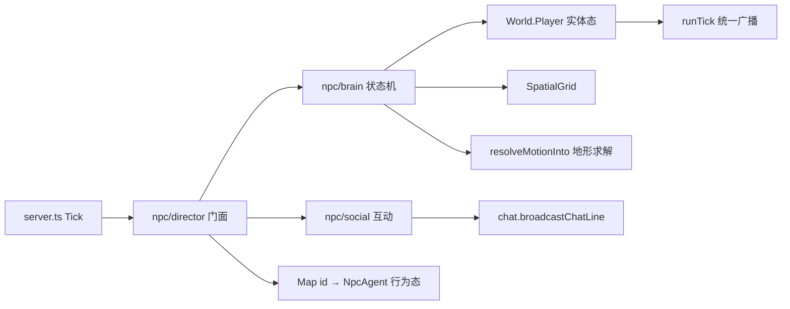

## 产品概述
园区开服后自动出现 10 位「同事」，与真人玩家共享同一套世界规则：有名字、外观、常驻状态与工牌，会沿着园区道路走走停停、四处张望、给人让路，也会在频道里偶尔说句话。玩家无需任何操作，也看不出他们与真人的差别；**在线人数、排队名额、牛马榜与准入闸门只认真人**，NPC 不计入服务器可承载的人数口径。

## 核心功能
- 开服即生成 10 位同事（数量与开关可配），名字、外观、班次、工龄、常驻状态各不相同，每次开服重新随机
- 走走停停：在广场、工位、宿舍、会议室与庭院之间随机选点，走走看看，停留时长从几秒到一分钟不等
- 逼真细节：停下时随机转头、驻足张望、长时间发呆；步速有快有慢，同一屏内不会整齐划一地行动
- 互动：与迎面走来的人让路，与附近的人对视，偶尔抬手打招呼；每隔几分钟在园区频道说一句职场黑话
- 受击反应：被玩家创飞后躺一会儿，随后自己爬起来继续走，不还手
- 回避障碍：不穿墙、不穿树、不下海，走进死角会自己换个方向重新出发
- 工牌：点开能看到合理的在岗时长与考勤，但不进入牛马榜，也不占用真人名额
- **不占服务器人数口径**：NPC 不减少可容纳真人数量、不触发排队闸门、不计入 `/health.online`；自身耗时单独采样，可证明开销可忽略
- 可配置：数量、开关、随机种子、区域权重、停顿与发言节奏、名字与台词池均可调整；配置异常时退回默认值并继续开服
- 可观测：健康检查同时给出真人数量、同事数量与 NPC 更新耗时，三者互不混淆


## 技术栈与现有约束

| 项 | 选型 |
|---|---|
| 运行时 | Bun（`apps/game-server`）+ TypeScript strict |
| 循环 | 20Hz 固定 Tick（`TICK_MS = 50`），`runTick` + `refreshView` + 空间哈希 AOI |
| 协议 | 手写二进制，**本次不改任何字节** |
| 客户端 | **零改动**：NPC 复用 `S2C_ENTITY_SPAWN` / `S2C_SYNC_ENTITIES` / `S2C_CHAT_BROADCAST` / `S2C_STATUS` |
| 状态 | 进程内存，零持久化；进程重启即重新生成 |
| 测试 | `bun:test`（`apps/game-server`） |

## 方案选择

| 方案 | 结论 | 理由 |
|---|---|---|
| **A. 服务端内存实体，复用 `Player` 与现有实体通道** | **采用** | 直接获得 AOI、双向 `known`、去脏广播、地形碰撞、工牌渲染与聊天历史；不需要双端发版；`GAME_NPC_COUNT=0` 即可完整回滚 |
| B. 新增独立 NPC 类型与专属协议 | 否决 | 双端必须同版本发布，需复制一套 spawn/sync/AOI，回滚成本高 |
| C. 纯客户端本地生成 | 否决 | 各人看到的 NPC 不一致，无法被玩家击中、点赞或共同观察，违背「模拟真人」 |

关键权衡：复用 `Player` 会让「连接」与「角色」的耦合外溢到 4 处（容量水位、榜单、发言通道、NPC 自身下行），因此本次的核心工作不是写一个 AI，而是**把真人口径从实体口径里切出来**，同时保持热路径零额外分配。

## 实现路径

### 分层与数据流



- **实体态**：`Player` 只增加 `isNpc` 一个维度，其余全部复用。
- **行为态**：路点、停顿计时、台词冷却、卡住计数放在 director 私有的 `Map<number, NpcAgent>`，**不污染 `Player`**，也不进 `reset()`。
- **渲染**：`state` 由 `packState(direction, pose, moving, vent, jump, wave)` 生成，朝向即「视线」，`wave` 即挥手，全部是现有位。

### 边界修正（4 处，必须做）

1. **容量与在线人数**：`World` 增加 O(1) 的 `humans` / `npcCount`；`admission.decide/observe/drain/snapshot` 与 `/health.online` 全部改用 `world.humans`，`/health` 追加 `npcs` 字段。`world.size` 保留为总实体数，语义不变。**NPC 永远不占名额、不参与闸门滞回、不会因为存在而让真人排队。**
2. **榜单**：`buildBoardSnapshot` 遍历时跳过 `isNpc`，保证在岗榜与六项榜单只排真人。
3. **发言**：把 `handleChat` 的「分配 msgId → 写 history → 广播给 known」抽成 `broadcastChatLine`，`handleChat` 与 NPC 共用同一份，禁止复制计数器。
4. **下行短路**：`view.ts` / `tick.ts` 对 `wsId === 0` 跳过编码与发送，但**保留 `known` 双向维护**，NPC 才能感知附近的人。

### 性能核算口径（NPC 不计入人数性能，但物理开销如实可观测）

- **人数维度**：NPC 完全不计入。准入容量、队列位置、闸门水位、牛马榜、`/health.online` 全部只读 `world.humans`；NPC 从 10 调到 0 不会改变真人的可容纳数量。
- **NPC 自身耗时**：`director.update()` 的耗时单独采样（`RingSampler`），暴露在 `/health.npc.updateMs`，用于证明 10 位同事每 Tick 只占几十微秒；**`tickMs` 仍是真实总耗时，不做拆分造假**。
- **下行流量**：NPC 没有 socket，`wsId === 0` 直接短路，不产生任何「发给 NPC」的包；发给玩家的 NPC 同步条目是真实字节，计入出口水位。理由是带宽是物理共享的，若把它从水位里扣掉，会让闸门在带宽已满时误判为「还很空」，反而害了真人。控制方式仍是三个来源：静止 NPC 零发包、只广播给视野内玩家、`GAME_NPC_COUNT` 可随时调低。
- **稳态预算**：10 NPC × 20Hz，行走时每 Tick 一次距离判定 + 一次 `resolveMotionInto`（≤2 子步），邻居感知摊还到 500ms；无对象分配。最坏全同屏下行约 7 KB/s，实际分散后更低。

### 行为系统

- **随机源**：mulberry32 种子随机，`GAME_NPC_SEED` 固定时整场可复现，测试可断言。
- **区域与路点**：活动区域按权重表（广场最高，保证进场就能看到几位；工作区、宿舍、会议室、南侧庭院、主路依次递减）。区域内随机角度与距离采样，先 `isBlocked` 重采样，连续失败回退 `findFreePoint`；兴趣点（工位旁、售货机、长椅、公告栏、湖边）按权重参与选点。
- **走走停停**：`Walk → Pause → Look → Walk`。停顿三档：短 1–3s（10%）、常规 3–12s（70%）、长 20–60s（20%）；停顿时每 0.8–2.5s 随机换向。步速 `MOVE_SPEED × 0.6–0.95`。
- **障碍回避**：每 Tick 用 `resolveMotionInto` 推进（4px 子步 + 单轴滑动），跨格 `grid.update` 后置 `needsViewRefresh`；每 600ms 比对位移，连续两次小于 6px 则换路点，连续五次则原地静置 20–40s 后重选，**绝不传送**。
- **互动**：每 500ms 用 `grid.queryNear(x, y, 160)` 做一次邻居感知。停顿中有人靠近则概率转向（对视）；迎面 80px 内有来者则停下让路；小概率挥手，`wave` 位约 1s 后由服务端清位，避免吞掉后续动作；被 `resolveVents` 命中后保持躺姿到 `stunUntil` 结束，再站起换路点，不还手。
- **低频发言**：首次 60–180s，之后 240–600s，且 `known` 非空才发；台词来自内置池，外置 JSON 的台词在加载时走与昵称同一套审核，不合格直接丢弃（fail-closed），不让未审核文本进频道。

### 可靠性与运维

- 外置配置读取失败、字段越界、JSON 损坏：告警一次并整体回退默认值，不阻断启动（与 `GAME_MODERATION_LEXICON` 同风格）。
- 坐标有限性校验：任何非有限值立刻把该 NPC 拉回广场安全点；单个 NPC 异常不影响 Tick。
- 日志只在启动打印一条「数量 + 种子 + 是否启用发言」，运行期不打点，避免刷屏与泄露配置内容。
- 回滚：`GAME_NPC_COUNT=0` 重启即可完全关闭；无协议、无客户端、无数据迁移。

## 目录结构

```
apps/game-server/src/
├── npc/                          # [NEW] NPC 能力全部收在这里，server.ts 只接触门面
│   ├── index.ts                  # [NEW] 导出 director 与配置类型，模块唯一入口
│   ├── rng.ts                    # [NEW] mulberry32 种子随机：next/range/int/pick/chance，全场唯一随机源
│   ├── config.ts                 # [NEW] NpcConfig 与 loadNpcConfig：环境变量 + 可选 JSON，越界钳制与降级告警
│   ├── roster.ts                 # [NEW] 名字/状态/配色/配件池与 buildNpcProfile：生成合法外观与合成 CareerSummary
│   ├── spots.ts                  # [NEW] 活动区域权重表、兴趣点、pickWaypoint（isBlocked 重采样 + findFreePoint 兜底）
│   ├── brain.ts                  # [NEW] 每 NPC 状态机：walk/pause/look、视线换算、挥手机制、卡住恢复、stun 恢复
│   ├── social.ts                 # [NEW] 500ms 邻居感知、对视、让路、招手、低频台词（走 broadcastChatLine）
│   ├── director.ts               # [NEW] 生成、Map<id, NpcAgent> 行为态、每 Tick 驱动、count 与 updateMs 采样
│   ├── roster.test.ts            # [NEW] 名字唯一与宽度、外观 sanitize、考勤字段上限
│   ├── spots.test.ts             # [NEW] 采样点全部可行走、区域归属正确、同种子可复现
│   ├── brain.test.ts             # [NEW] 停顿区间、步速上限、跨格刷新、卡住换点、stun 与 wave 到期
│   ├── director.test.ts          # [NEW] 生成 10 个、2000 Tick 不卡死不越界、静止不产生 dirty
│   └── integration.test.ts       # [NEW] fake transport + 真实 World/Grid/refreshView/runTick：spawn/sync/known 对称
├── sim/world.ts                  # [MODIFY] Player.isNpc；World.createNpc/humans/npcCount；Player.markDirtyIfChanged
├── sim/movement.ts               # [MODIFY] 私有 markIfChanged 改为调用 Player.markDirtyIfChanged，行为不变
├── sim/tick.ts                   # [MODIFY] wsId===0 不写自身同步包，保留 known 广播路径
├── sim/view.ts                   # [MODIFY] wsId===0 跳过下行编码与 selfPacket 构造，保留双向 known
├── sim/chat.ts                   # [MODIFY] 抽出 broadcastChatLine，handleChat 改为调用它
├── sim/board.ts                  # [MODIFY] 遍历跳过 isNpc
├── config.ts                     # [MODIFY] ServerConfig 挂载 npc: NpcConfig
├── server.ts                     # [MODIFY] 创建并 spawn director、Tick 内 update、容量与 /health 改用 humans、追加 npcs 与 npc.updateMs
├── sim/board.test.ts             # [MODIFY] 补 NPC 不进榜
└── sim/chat.test.ts              # [MODIFY] 补 broadcastChatLine 的 msgId/history/AOI
docs/adr/0060-server-side-npcs.md # [NEW] 决策、备选、代价、回滚、前提假设
README.md                         # [MODIFY] 新增「园区 NPC」小节与配置表，修正「不含寻路」的边界描述
apps/web/data/release-notes.json  # [MODIFY] 追加 2026-11-12-5（玩家可感知的变化，最多 4 条）
```

## 关键接口

```ts
export interface NpcConfig {
  enabled: boolean;
  count: number;
  seed: number;
  chat: boolean;
  interact: boolean;
  speeds: { min: number; max: number };
  pause: { shortMs: number; normalMs: number; longMs: number };
  chatIntervalMs: { firstMin: number; firstMax: number; repeatMin: number; repeatMax: number };
  regions: ReadonlyArray<{ id: string; weight: number; radius: number }>;
}

export interface NpcDirector {
  spawn(): void;
  update(now: number): void;
  readonly count: number;
  /** 最近一帧 director.update 的耗时（毫秒），供 /health 单独展示，不进 capacity 判定 */
  readonly updateMs: number;
}
```

`/health` 追加：

```json
{ "online": 0, "npcs": 10, "npc": { "count": 10, "updateMs": { "avg": 0.04, "p95": 0.09 } } }
```

`online` 仍只算真人，`npcs` 与 `npc.updateMs` 只用于观测，不参与任何准入计算。

## 文档与发布

- `docs/adr/0060-server-side-npcs.md`：记录「复用实体通道 vs 独立协议」的取舍、**NPC 不计入人数容量与准入但计入物理带宽水位的理由**、玩家不可分辨的代价、`GAME_NPC_COUNT=0` 回滚路径、前提假设（NPC 只用于氛围，不参与任何权威排名）。
- `README.md`：数量、开关、种子、发言开关、配置表、`/health` 字段、性能口径（人数只认真人；带宽按实测）、压测口径。
- `apps/web/data/release-notes.json`：追加 `2026-11-12-5`，只写玩家能感知的结果，不写文件名、实现与内部拓扑，提交前跑 `pnpm changelog:check`。

## 验证

```bash
pnpm --filter @niuma/game-server typecheck
pnpm --filter @niuma/game-server test
pnpm typecheck
pnpm test
pnpm changelog:check
```

手动验收：
- `pnpm dev` 进园观察 10 位同事走走停停、看人、让路、偶尔发言；
- `/health` 确认 `online` 只算真人、`npcs: 10`、`npc.updateMs` 处于微秒级；
- 把 `GAME_NPC_COUNT=60` 临时拉高重启，确认 `admission` 的 `capacity` 与 `online` 口径不因 NPC 变化而变化（只有实测带宽可能上升）；
- 连续观察 5 分钟确认无卡墙、无瞬移、无抖动。

可选压测：`BENCH_BOTS=60 BENCH_MS=12000 pnpm bench` 对比 Tick p95 与单客户端下行，并在同一份报告里记录 `npc.updateMs`。

## 非目标

- 不做全图寻路、NPC 占座、上下班作息、NPC 之间的完整对话树。
- 不做运行时热更与运维 API；扩展通过 `GAME_NPC_CONFIG` 与 `NpcProfile` 钩子完成。
- 不改协议字节、不改客户端、不做 NPC 身份标识。
- **不从实测带宽水位里扣掉 NPC 流量**：带宽是物理共享的，扣掉会让闸门误判；控制手段是数量、视野广播与静止零发包。