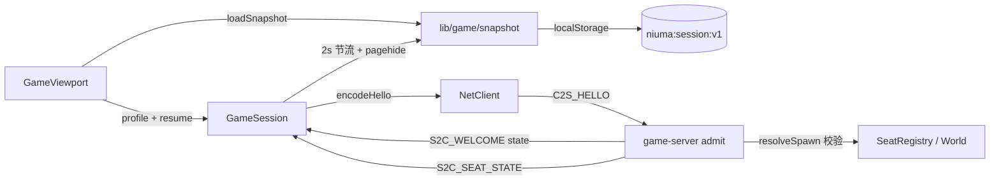

## 用户需求
同一个浏览器退出（关闭标签页/浏览器）或刷新后再次进入园区时，恢复上次的状态，而不是从随机出生点重新开始。

## 产品概述
把角色状态从「会话内」升级为「浏览器本地持久化」：再次打开 `/play` 直接回到上次所在位置，不再显示入场页或随机出生。

## 核心功能
- **持久化范围**：工牌昵称、外观配色与配件、世界坐标、朝向、姿态（站立/坐/躺）、具体座位（椅子/床/沙发/马桶/凳子）。新增的状态字段也走同一份快照，后续扩展不需要再改存储层。
- **恢复规则**：
  - 上次在某把椅子或床上，且座位仍空着 → 直接回到该座位，姿态沿用座位种类。
  - 上次的座位已被他人占用 → 站到座位旁边，姿态回站立，朝向保留。
  - 上次坐标非法（水面/障碍/越界）→ 就近找可通行点，仍失败才回落随机出生点。
- **触发场景**：关闭标签页/浏览器后重开、刷新页面、断线重连，三种都恢复。
- **不删除场景**：点「打卡下班」只回首页，不清空本地记录；记录只在用户显式清除浏览器数据时消失。
- **文案同步**：首页「不留痕」与 README/宣传稿改为「服务端不留痕，记录只留在你自己的浏览器里」，避免与实现矛盾。


## 技术选型
沿用现有栈，不引入新依赖：Next.js 15 + React 19 客户端、Bun + WebSocket 权威服务端、`@niuma/shared-types` 手写二进制协议、Zustand 与 Pixi 帧循环保持不变。持久化用浏览器原生 `localStorage`。

## 实现思路
位置的权威来源在服务端 `World`，纯客户端把角色画到缓存坐标会在首个 sync 包被 `LOCAL_DRIFT_LIMIT`（128px）拉回，且其他玩家会看到位置瞬移。因此采用「客户端上报、服务端校验、服务端下发」三段式：

1. 客户端把状态写进版本化快照（`localStorage`），入场时把快照作为 `resume` 附在 `C2S_HELLO` 尾部。
2. 服务端在 `admit` 阶段解析 `resume`，用与出生点相同的 `isOnLand / isBlocked / isWaterAt` 规则重新校验坐标与座位归属，再决定最终出生点与姿态。**客户端缓存一律视为不可信输入。**
3. 服务端把最终 `state` 放进 `S2C_WELCOME`，客户端据此恢复朝向与姿态；座位通过既有的 `S2C_SEAT_STATE` 全量快照确认后吸附。

### 关键决策与权衡
| 决策 | 理由 | 代价 |
|---|---|---|
| HELLO 尾部追加可选 resume 段，而不是新增 OpCode | 入场只有一个往返，不增加时序；`ByteReader.remaining` 天然支持「旧客户端不带即走原路径」，bench bots 无需改动 | 帧长可变（+0 或 +7 字节），需两侧同时上线 |
| WELCOME 增加 1 字节 `state` | 复用现成的 `packState/unpackState`，不必新增包 | 11 → 12 字节，破协议需同版本发布（项目已声明同仓部署） |
| 用 `localStorage` 而不是 `sessionStorage` | 用户明确要求关标签页后仍恢复 | 与 ADR-0004「浏览器只用 sessionStorage」条款冲突，需 ADR-0032 修订并说明复核信号已触发 |
| 快照写入用 merge 而非整体覆盖 | 用户要求「以后加其他东西也一样持久化」，新模块只需 `saveSnapshot({ newField })` 即可并入，不会抹掉别人的字段 | 每次写入需先读一次旧 JSON（体积 < 200B，可忽略） |
| 座位释放增加归属校验 | 刷新时新旧 ws 短暂并存，旧连接 `release` 会无条件清空新连接刚占的座位 | 无；这是必须修的既有缺陷 |

### 性能与可靠性
- 快照写入按 2s 节流，单次 < 200 字节；帧循环内不新建对象，序列化只在节流点发生。
- `localStorage` 是同步 API，因此**不放在每帧路径**，只在节流点与 `pagehide`/`visibilitychange(hidden)`/`session.stop()` 时 flush。
- 快照读取全部包 try/catch + 逐字段类型守卫，JSON 损坏或版本不符直接丢弃，回落到首次入场流程，不阻断进服。
- 服务端解析 resume 是 O(1)（一次 `seatById` + 至多一次 `findFreePoint`），入场路径本来就有随机采样的 16 次尝试，开销可忽略。

### 避免技术债
复用既有 `isOnLand / isBlocked / isWaterAt / findFreePoint / seatById / seatPose / packState / unpackState`，不新写几何或位操作；座位登记复用 `SeatRegistry.occupy`，不绕过权威表。

## 协议设计

```
C2S_HELLO (0x10)  v2
[op u8][nameLen u8][name nB][appearance 32B][resume? 7B]

resume = [hasResume u8=1][x u16][y u16][dirPose u8][seatId u16]
dirPose = dir(2b) | pose(2b) | 保留(4b)

S2C_WELCOME (0x11)  v2
[op u8][entityId u16][tick u32][x u16][y u16][state u8]   // 11 → 12 字节
```
`decodeHello` 读完 appearance 后判断 `reader.remaining >= 1`，为 0 则返回无 resume（旧客户端与压测机器人路径不变）。

## 服务端出生点裁决

```ts
// isStandable(x, y) = isOnLand(x, y) && !isBlocked(x, y) && !isWaterAt(x, y)
resolveSpawn(payload):
  r = payload.resume
  if (!r) → spawnPoint(spawnRadius), Idle, Down

  seat = r.seatId > 0 ? seatById(r.seatId) : undefined
  if (seat && seats.isFree(seat.id))
      → point = seat 锚点, seat, direction = seat.facing, pose = seatPose(seat.kind)

  anchor = seat ?? r                       // 座位被占 → 以座位为锚点站旁边
  point  = isStandable(anchor.x, anchor.y) ? anchor : findFreePoint(anchor.x, anchor.y)
  if (!isStandable(point)) → point = spawnPoint(spawnRadius)
  → point, direction = r.direction, pose = POSE.Idle   // 站姿恢复，不恢复 Walk
```

`admit` 顺序调整为：`world.create` → `applyState` → `seats.occupy`（如有座位）→ `broadcastSeats` → `grid.insert` → `encodeWelcome(state)` → `seats.snapshot()` → `refreshView`。座位占用必须先于 `grid.insert`，否则首帧视野用的是椅子之外的坐标。

## 座位竞态修复
`SeatRegistry.release` 目前无条件 `occupant[seatId] = 0`。改为：只有 `occupant[seatId] === player.id` 时才清零并产出 `{ seatId, occupant: 0 }`，否则仅清 `player.seat`、不广播。刷新场景下新连接已占住的座位不会被旧连接的 `onClose` 抢走。

## 架构设计


## 目录结构

```
packages/shared-types/src/
├── types.ts                         # [MODIFY] 新增 ResumeState；WelcomePacket 增加 state 字段
├── protocol.ts                      # [MODIFY] encodeHello/decodeHello 支持可选 resume 段；encodeWelcome/decodeWelcome 读写 state
└── __tests__/protocol.test.ts        # [MODIFY] HELLO 带/不带 resume 往返、截断尾部、WELCOME state 往返

apps/game-server/src/
├── admission/controller.ts           # [MODIFY] HelloPayload 增加 resume?: ResumeState（排队期间随 payload 保留）
├── server.ts                         # [MODIFY] 新增 isStandable/resolveSpawn；admit 按裁决结果建角色、占座、写 WELCOME state；handleHello 传递 resume
└── sim/seats.ts                      # [MODIFY] release 增加 occupant 归属校验，避免刷新时旧连接抢走新连接的座位

apps/web/lib/
├── storage.ts                        # [NEW] 命名空间化的 JSON 读写：安全 parse、逐字段 guard、写失败静默降级
├── profile.ts                        # [MODIFY] 切到 localStorage v2 key；首读回落旧 sessionStorage v1 并自动提升后删除
├── game/snapshot.ts                  # [NEW] SessionSnapshot 类型（v/savedAt/x/y/direction/pose/seatId）、默认值、类型守卫、merge 式 saveSnapshot、clearSnapshot
├── net/client.ts                     # [MODIFY] connect(name, appearance, resume?) 透传给 encodeHello
└── game/session.ts                   # [MODIFY] start 增加 resume 参数；handleWelcome 用 packet.state 设朝向/姿态；handleSeatState 支持入场即入座；tick 内 2s 节流落盘；pagehide/visibilitychange/stop 立即 flush

apps/web/components/game/GameViewport.tsx  # [MODIFY] 入场前 loadSnapshot() 并传给 session.start；保持「打卡下班」不清空快照
apps/web/components/site/Sections.tsx      # [MODIFY] 「不留痕」文案改为「服务端不留痕，记录只在你自己的浏览器里」
README.md                                  # [MODIFY] 核心约束段改为：服务端零持久化，浏览器 localStorage 存会话快照
docs/promo.md                              # [MODIFY] 数据行同步说明
docs/adr/0004-no-persistence.md            # [MODIFY] 顶部加「部分修订：浏览器侧改为 localStorage，见 ADR-0032」，不改写历史结论
docs/adr/0032-client-session-snapshot.md   # [NEW] 记录本次决策、协议变更、座位冲突策略、隐私影响与 30 天回滚路径
apps/game-server/src/sim/resume.test.ts    # [NEW] resolveSpawn 四类分支 + release 竞态用例
apps/web/lib/game/__tests__/snapshot.test.ts # [NEW] 损坏 JSON / 版本不符 / 缺字段 / merge 保留未知字段
```

## 实施注意
- 客户端快照中的 `pose` 只允许 `0/2/3`，`Walk` 与客户端专有的 `Emote` 落盘前归一化为 `Idle`；服务端再做一次同名归一化，防伪造。
- 座位吸附沿用现有 `sitAt`，不新写一套；`handleSeatState` 的判定从「必须 seatIntent」放宽为「`occupant === localId` 且 `localSeat !== seatId`」，服务端权威优先。
- 不记录聊天内容、他人状态与任何凭据；快照只含本机角色自身的公开信息。
- 回滚路径：客户端停止发送 resume 段即可回到旧行为，服务端 `decodeHello` 与 `resolveSpawn` 对缺省 resume 保持原逻辑，无需回滚协议；30 天内如需彻底回退，删除 `niuma:session:v1` 即可让所有存量用户回到随机出生。
- 改动集中在这条链上，不动渲染、AOI、准入与限速逻辑。

## 验证要点
- `pnpm typecheck` 四个包全绿。
- `pnpm test`：协议往返与向后兼容、`resolveSpawn` 五分支（无 resume / 座位空闲 / 座位被占 / 坐标合法 / 坐标落水）、`release` 竞态、快照损坏回落。
- 手工回归：坐椅子后刷新 → 仍在椅子上；关标签页重开 → 同一位置；两标签页抢同一座位 → 后者站旁边；开 `?name=` 深链仍可绕过快照。


## Agent Extensions
### Skill
- **principal-software-architect**
  - Purpose: 评估 HELLO/WELCOME 协议扩展与 ADR-0004 的冲突，产出 ADR-0032 的决策与回滚路径
  - Expected outcome: 一份可评审的决策记录，明确传输格式、兼容窗口与不可逆性
- **test-driven-development**
  - Purpose: 协议编解码、出生点裁决、座位竞态三类边界先用失败用例固定预期
  - Expected outcome: 新增测试先红后绿，覆盖旧客户端不带 resume 的向后兼容路径
