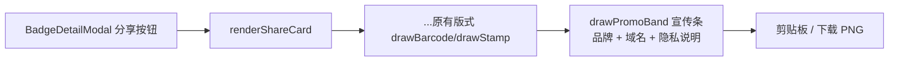

## Product Overview
在「分享工牌」生成的 Canvas 工卡图片底部新增一条深色宣传条，印上品牌 + 域名「牛马 NIOMA · bangying.top」，让玩家分享到社交平台的工牌图自带网站导流信息。

## Core Features
- 工卡图片（480×720 拍立得式工牌）最底部新增深色墨条宣传带，居中展示「牛马 NIOMA · bangying.top」
- 原底部 8px 隐私说明「零服务器持久化 · 数据仅存于本机浏览器 · 仅供自嘲」并入宣传带作为次行小字，不丢失原有信息
- 品牌名与域名以写死常量维护在 share-card.ts，零配置，与 docs/promo.md 对外口径一致
- 不改动复制/下载分享交互、弹窗 UI 及其余版式（头部、人像、明细、金句、条码、印章均保持原样）


## Tech Stack
- 完全复用现有实现：`apps/web/lib/game/share-card.ts` 的纯原生 Canvas 2D 离屏绘制，零第三方图形依赖，无新增依赖、无新文件
- 仅改动 1 个文件：`apps/web/lib/game/share-card.ts`（`BadgeDetailModal.tsx` 的调用方无需变化）

## Implementation Approach
1. **新增常量**（导出，便于后续文案统一维护）：
```ts
/** 分享工牌底部宣传条：品牌 + 域名，与 docs/promo.md 对外口径一致 */
export const SHARE_CARD_SITE_BRAND = '牛马 NIOMA';
export const SHARE_CARD_SITE_DOMAIN = 'bangying.top';
```
2. **新增 `drawPromoBand(ctx)` 绘制函数**（放在 drawBarcode / drawStamp 附近的版式区）：
   - 墨条：`ctx.fillStyle = '#2b241d'`（与头部文字同色墨，禁纯黑），`fillRect(10, 688, 460, 24)`——内框（底边 y=713）之内留 1px 纸边
   - 主行：`700 13px FONT_MONO`、米白 `#f6f1e4`，`textAlign center` 在 x=240，基线 y≈700，文案 `${SHARE_CARD_SITE_BRAND} · ${SHARE_CARD_SITE_DOMAIN}`
   - 次行：`7px FONT_SANS`、`rgba(246, 241, 228, 0.62)`，基线 y≈708，文案沿用原隐私说明
3. **接入 `renderShareCard`**：将原 707-711 行的 footer 文案块替换为 `drawPromoBand(ctx)`，绘制顺序仍在 drawBarcode、drawStamp 之后

## Implementation Notes (Execution Details)
- **避让关系**：条码工号文本基线 y=686（9px），墨条顶边 y=688 不遮挡；印章中心 (382, 662) 旋转 15° 后下角约至 y≈700，会被墨条盖住部分空边框——视觉上如同「印章压着底边」，可接受；若目测发现盖住「NIOMA HR · VERIFIED」小字不自然，将印章 centerY 微调至 ~654
- **像素纪律**：遵守文件头三条纪律——逻辑尺寸固定 480×720、绘制全部在逻辑坐标、2x 采样自动保证墨条与文字清晰度；不引入新的缩放或 smoothing 行为
- **性能**：纯同步矩形/文字绘制，单次调用增加约 3 次 fill 操作，无可测量开销；不触碰图集加载与染色缓存路径
- **爆炸半径控制**：不改 `ShareCardData` 接口、不改分享通路（shareOrDownload/downloadShareCard）、不改弹窗组件，调用方零感知

## Architecture Design
改动落在渲染纯函数层（share-card.ts 内部版式函数），遵循该文件既有模式：每个版式块一个独立 draw 函数（drawHeader / drawQuote / drawBarcode / drawStamp …），renderShareCard 按序组装。数据流不变：BadgeDetailModal → renderShareCard(data) → canvas → 剪贴板/下载。




## Agent Extensions
### Skill
- **impeccable**
  - Purpose: 对新增宣传条做排版与配色自检（字体层级、#2b241d/#f6f1e4 对比度、无纯黑纯灰、间距节奏），确保与工卡既有复古纸质风格一致
  - Expected outcome: 宣传条文案层级清晰（主行品牌域名醒目、次行隐私说明弱化），无 impeccable 反模式命中（primary findings 为空）
