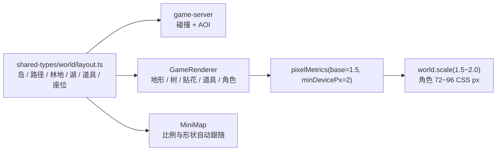

## 用户需求

大厅地图目前"人物显得大、地图太空旷、物品太散"，需要一次性把世界观感收紧。

## 核心改动

- **人物再缩小一半**：大厅世界倍率从 3 CSS px/纹素降到 1.5，角色站立高度从约 144 CSS px 降到 DPR2 下约 72 CSS px（用户明确接受"像素块只剩 1–2 设备像素"的代价）。只改大厅地图，角色创建预览台的倍率保持不变。
- **地图紧凑**：先收掉外圈无内容的草带与沙滩，把三片林地、湖、河道端点向内收，岛的整体轮廓贴合内容；再把几条尽头没有目标的支路缩短。
- **空地填满**：目前有五块完全空着的草地（北中、东中、南中、西南、西中），用户认为这是"空旷"的根因。在空地上补小林地、水塘、花海、休息角，让玩家的行进路线两侧始终有东西。
- **物品更小更密**：花箱、告示牌、售货机、长椅、公告板等相对角色明显偏大的道具按纹素重画得更小；广场、沿路、庭院里把同类道具成组摆密，长路两侧布灯与座椅，把"空走廊"变成有内容的街道。
- **视觉结果**：玩家在大厅里看到的画面应是——角色约占屏高 1/10，视野内同时出现树、花、水、长椅与路灯，走一圈不会出现大片纯草地；地图边界始终贴着内容，不会走到空无一物的海角。


## 技术栈

沿用现有栈，不引入任何新依赖：

- 渲染：Pixi.js（`apps/web/lib/game/*`，全部贴图由 `bake()` 在运行期用 Graphics 生成，无 PNG 图集）
- 共享布局：`packages/shared-types`（服务端碰撞 / 客户端渲染 / 小地图三方共同消费）
- 测试：`bun:test`；构建：pnpm workspace + turbo

## 实现策略

三段式，按风险从低到高：**先调缩放 → 再缩道具 → 最后动世界坐标**。缩放是纯客户端单点改动，可以立刻看到效果；世界坐标是服务端权威碰撞与客户端预测共用，改动必须与布局收紧一起同版本发布。

### 1. 缩放（客户端，单点）

- `renderer.ts` 的 `BASE_CSS_PER_TEXEL: 3 → 1.5`。
- `pixel-scale.ts` 的 `pixelMetrics` 增加第三个可选参数 `minDevicePx`（默认仍为 `MIN_DEVICE_PX = 3`），renderer 传 `2`。**不能直接把 `MIN_DEVICE_PX` 改成 2**：`fitMetrics` 也读这个下限，会让预览台在窄容器下多降一档，违背"不动预览台"的决定。
- 结果（必须写进注释，不能假装处处 72px）：

| DPR | 设备像素/纹素 | 角色高度 |
|---|---|---|
| 1 | 2 | 96px |
| 1.25 | 2 | 76.8px |
| 1.5 | 2 | 64px |
| 2 | 3 | 72px |
| 3 | 5 | 80px |

  非整数设备像素会让 1px 描边在相邻纹素间轮流占 1/2 像素（ADR-0005），所以整数栅格不能放弃——这是 1.5 倍的固有限制。
- 增加 `?zoom=3` 灰度开关（与现有 `?flat=1` / `?light=0` 同一写法），线上观感回归时一键退回旧倍率，不用回滚发布。
- `syncMetrics()` 里的第二次 `pixelMetrics` 调用必须传同一个下限。

### 2. 道具缩小（纯贴图重画，禁用 sprite.scale）

像素纪律（ADR-0005）禁止用 `sprite.scale` 缩道具——非整数纹素会让描边糊掉。所有缩小都改 `PROP_SIZE` 与 `drawProp` 里的手写坐标：

| 道具 | 现状 | 目标 |
|---|---|---|
| 花箱 | 34×44 | 26×34 |
| 告示牌 sign | 32×42 | 24×32 |
| 公告板 board | 46×30 | 34×24 |
| 售货机 vending | 42×60 | 34×48 |
| 长椅 bench | 46×22 | 40×18 |
| 单车 bike | 46×24 | 38×20 |
| 桌 table | 48×40 | 40×34 |
| 路灯 lamp | 16×46 | 14×40 |
| 垃圾桶 / 绿植 / 水槽 | 16×20 / 18×26 / 22×24 | 14×18 / 16×22 / 20×22 |

**不缩**：树（108 = 角色 2.25 倍，ADR-0010 的基准）、工位桌 `DESK_W/H = 88×40`（座位锚点与碰撞依赖它）。

连带必须同改的三处，漏一处就会出现"人穿模"或"看着能过走不过"：
- `PROP_SHADOW.planter` 30×12 → 22×10，`PLANTER_RADIUS` 16 → 12（layout.ts，双端）
- 售货机 `PLAZA_SOLIDS` 40×28 → 32×24，`props.ts` 的 `VENDING_W/H`
- 新加的可碰撞道具（休息角的花箱、野餐桌）同步进 `solids`

### 3. 地图收紧（服务端权威，需双端同版本发布）

内容包围盒几乎等于岛包围盒（林地本身顶到海岸），所以**只收海岸线收不动**。顺序：

1. 三片林地矩形各向内平移约 300（北西片 +300/+300，东北片 −300/+300，南东片 −300/−300），湖整体左移 350。
2. 按新的内容包围盒外扩 60–80 重画 `ISLAND_POINTS`，保留四个海湾开口，岛从 6900×7780 收到约 6300×7180（面积 −16%）。
3. `RIVER_STATIONS` 南北端点跟着新海岸走（河口仍要探进海里）；桥段 `y 3920–4300 / x=2488` 不动。
4. 缩短三条尽头无目标的支路（北 540→360、东 640→480、西不缩，它连着桥）。**南向 1200 长路保留**（它连接研发园），改为沿路布灯与座椅。

聚簇**内部**尺寸一律不改：门洞 120、广场 1120×936、研发园 2100×800、工位 88×40、房间 440×280。压这些会压坏通行宽度与工位排布。

### 4. 空地加密（主力手段）

视口面积 ×4 后，同屏内容密度必须补回来，否则会比现在更空。

- 新增林地 3 片（北中 2 片、东中 1 片），用现成的 `FOREST_RECTS` 机制，落入水面/路径/广场的树会被 `isPlantable` 自动过滤，不需要额外判空。
- 新增水塘 2 个：复用 `lakes: LakeShape[]`，`addLake` 已按数组逐块处理，碰撞（`isWaterAt`）、撒树留白（`distanceSqToWater`）、小地图全部自动跟随。
- 新增花海 2 片，补满北中与南中。
- 新增"休息角"节点：南向长路中点 `(4096, 5250)` 一组 2 长椅 + 1 路灯 + 1 花箱 + 1 告示牌；广场四角花箱 4 → 8；研发园庭院补 2 张野餐桌 + 4 盆绿植。
- 密度参数：`DECAL_CELL 64→56` 且 `DECAL_CHANCE 0.12→0.18`（约 ×2.4）、`WILD_TREE_CELL 240→190` 且 `WILD_TREE_CHANCE 0.42→0.5`（约 ×1.9）、`TREE_CHANCE 0.6→0.7`。

### 性能

- 同屏精灵从约 400 增至约 900–1200（树 + 贴花 + 道具），仍全部走 `renderable` 裁剪，单帧成本 O(可见数)；树冠遮挡走网格分桶，无新增遍历。
- 常驻对象：贴花约 2000 → 约 4300，孤树约 89 → 约 170，一次性构造开销增加约 0.1–0.2s（初始化期烘焙，不在帧循环）。
- 帧率验证点：1280×800 与 1920×1080 各跑一次，确认 60fps；若贴花层批处理耗时上升，按 ADR-0015 的复核信号先降 `WILDFLOWER_CHANCE`，不要动 `DECAL_CELL`。

### 兼容与回滚

- `?zoom=3` 退回旧倍率；布局改动无运行时开关，回滚 = 恢复 `layout.ts` 常量（与 ADR-0010 一致，必须双端同时回退）。
- 不碰 `PreviewStage.tsx`（工作区已有未提交改动，与本任务无关）。

### 架构与数据流



改布局只改 `layout.ts` / `campus.ts`，三个消费方自动跟随——这是本项目既有的"唯一真相"设计，不需要在渲染层写映射。

## 目录结构

```
packages/shared-types/src/
├── constants.ts                    # [MODIFY] 可选：VIEW_RADIUS 900 → 1000（超宽屏 2560@1.5 时视野半径约 906 已越过 AOI）
├── world/
│   ├── layout.ts                   # [MODIFY] 重画 ISLAND_POINTS（收岛）；三片 FOREST_RECTS 向内平移；LAKE_POINTS 左移 350；新增 3 片林地、2 个水塘、2 片花海写入 forests/lakes/flowerFields；缩短北/东支路；沿路与休息角道具进 props；PLANTER_RADIUS 16→12；上调 TREE_CHANCE/WILD_TREE_* 密度常量；花箱组扩到 8 个
│   ├── campus.ts                   # [MODIFY] CAMPUS_PROPS 补野餐桌与绿植；PLAZA_SOLIDS 售货机碰撞盒 40×28→32×24；新增沿路休息角道具常量（若放在 layout 则此处不动）
│   └── river.ts                    # [MODIFY] 仅当 RIVER_STATIONS 端点需要改变时核对 miter 逻辑，不改算法
└── __tests__/
    └── collision.test.ts           # [MODIFY] 更新两个硬编码点：regionAt(2075,1850)==='加班林' 改为新林地内的点；regionAt(1200,3000)/isWaterAt(result.x,3000) 按新海岸重算

apps/web/
├── lib/game/
│   ├── renderer.ts                 # [MODIFY] BASE_CSS_PER_TEXEL 3→1.5；pixelMetrics 传 minDevicePx=2（两处：init 与 syncMetrics）；新增 ?zoom= 灰度开关；按新倍率实机核对昵称/气泡字号与 NAME_STROKE_WIDTH，必要时 4→3
│   ├── pixel-scale.ts              # [MODIFY] pixelMetrics 增加 minDevicePx 可选参数（默认 MIN_DEVICE_PX），保持 fitMetrics 与预览台零漂移
│   ├── props.ts                    # [MODIFY] PROP_SIZE 表整体下调；drawProp 每个 case 的手写坐标按新尺寸重画；VENDING_W/H 同步
│   ├── terrain-textures.ts         # [MODIFY] makePlanterTexture 34×44→26×34；PROP_SHADOW.planter 30×12→22×10；树的尺寸与画法不动
│   ├── terrain.ts                  # [MODIFY] 花箱裁剪余量 padX/padY 按新尺寸收回（24/46 → 20/36）；若提升芦苇石头密度则改 addDecor
│   ├── decals.ts                   # [MODIFY] DECAL_CELL 64→56、DECAL_CHANCE 0.12→0.18，注释同步说明新的采样格与草缘整数倍关系
│   └── __tests__/
│       └── pixel-scale.test.ts     # [NEW] 断言 pixelMetrics(1.5, 1, 2)=2、pixelMetrics(1.5, 2, 2)=1.5、fitMetrics 在 min 默认值下结果不变（守住预览台）
├── components/game/
│   └── MiniMap.tsx                 # [MODIFY] 仅核对 VIEW_RADIUS/SCALE 常数；若 constants 的 VIEW_RADIUS 改动，这里保持独立的 900 不跟随
└── ...

docs/adr/
└── 0022-compact-world-and-zoom-out.md  # [NEW] 记录：倍率 3→1.5 的 DPR 取舍表、放弃非整数设备像素的理由、布局内移的坐标迁移代价与双端发版纪律、加密参数、?zoom=3 回滚路径、复核信号
```

## 关键校验点

- `pixelMetrics` 下限不能污染预览台：跑 `preview-layout.test.ts`，`desktop.metrics.cssScale === BASE(5)` 必须仍成立。
- 布局改动后跑 `collision.test.ts`：出生点不阻挡、树不进水/进路/进广场、桥两端在陆上、花箱在陆上——这些断言都是从常量派生的，只要新点写得对，会自动验证收岛没把内容切出陆地。
- 昵称在 1.5 倍率下是 13.5 CSS px（现在是 27），与角色等比缩小、不会被拉糊（`Text.resolution = devicePxPerTexel` 已跟随），但需要肉眼确认 4px 描边在新字号下是否过粗。


## Agent Extensions

### SubAgent
- **code-explorer**
  - Purpose: 在动手改 `layout.ts` 前做一次"世界坐标消费方"影响面盘点，确认除 game-server / GameRenderer / MiniMap 之外没有第四处硬编码坐标或比例常数（含 `session.ts` 的出生点、`collision.ts` 的网格索引、`quantize.ts` 的定点范围）。
  - Expected outcome: 输出一份消费方清单与每处的适配结论，避免收岛后出现某处仍按 8192 假设工作的隐性回归。

### Skill
- **verification-before-completion**
  - Purpose: 在宣布完成前强制跑通 `pnpm test`、`pnpm --filter web build`、`pnpm lint`，并附上实际输出，而不是凭观感声称"改好了"。
  - Expected outcome: 测试与构建全绿的真实日志，以及 1280×800 / 1920×1080 两种视口下的帧率与截图证据。
