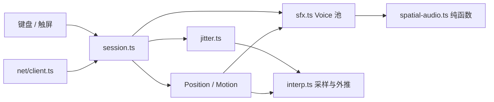

## 用户需求
在《牛马 NIOMA》现有纯合成音效与 20Hz 远端回放的基础上做平滑优化：

1. 空间音效：每个发声源携带世界坐标，以本地玩家坐标为听者原点；按相对 X 偏移计算 -1.0 到 1.0 的左右声像，按欧氏距离做 800px 内非线性衰减，边界外音量为 0。E 叫唤、G 咀嚼、F 设施互动全部接入，远端玩家叫唤也能听出方位。
2. 性能约束：播放期间不新建音频上下文或节点，不产生对象分配，不引入任何音频文件；用固定数量的节点池承载并发声音。
3. 自适应回放：移除固定 80ms，按 RTT p95 与传输抖动计算 `clamp(RTT_p95 × 0.5 + 2.0 × Jitter, 35ms, 120ms)`；好网收敛到 35~40ms，抖动时平滑拉长，避免丢步瞬移。
4. 35ms 段的连续性：越过最新快照时允许最多 25ms 的速度微外推，控制过冲在约 4px 内；抖动大时自动回到纯插值。
5. G 咀嚼需要同步给其他玩家：其他玩家按发声者方位听到咀嚼声，旧服务端与旧客户端可安全降级。

## 产品概述
园区声音从“单声道贴脸”变为有方位、有距离感的声场；附近玩家叫唤、设施互动、咀嚼都能听出左右与远近。远端角色在好网下明显更跟手，弱网下保持连续行走而不瞬移。

## 核心功能
- 空间声像：声源在听者左侧为负、右侧为正，400px 偏移达到硬声像，20ms 平滑过渡避免爆音。
- 距离衰减：40px 内不衰减，40~800px 按平方曲线衰减，800px 外直接不发声。
- 固定声音池：牛哞、马嘶、咀嚼、售货机、饮水机、咖啡机共用固定 Voice 池，忙时抢占最早结束的声道。
- 远端叫唤：在远端叫唤标志 0→1 的上升沿按其实时位置发声，不重复、不常驻。
- 咀嚼事件：本地按键发声并广播，其他玩家在观察范围内按方位听到；服务端限频防刷。
- 自适应延迟：RTT 百分位与传输抖动共同决定缓冲，上升快、回落慢，避免来回抖动。
- 微外推：仅在低延迟段、速度合理、外推不超过 25ms 时启用，超出即钳位。
- 降级与静音：无立体声声像能力时退化为纯音量衰减；静音偏好与本地存储保持不变。


## 技术栈
- 前端：Next.js 15、React 19、TypeScript、Pixi ticker、Web Audio API（仅振荡器合成，无音频资源）。
- 共享协议：`packages/shared-types`（TypeScript，vitest）。
- 服务端：Bun + `setInterval(TICK_MS=50)` 的 20Hz Tick（bun test）。
- 客户端测试：bun test（`apps/web/lib`）。

## 实现策略

### 1. 空间音效
- 新增纯函数模块 `spatial-audio.ts`：`AUDIBLE_RADIUS_PX=800`、`PAN_FULL_OFFSET_PX=400`、`panelFor(dx)=clamp(dx/400,-1,1)`、`attenuationFor(dx,dy)` 在 40px 内为 1，超出 800px 为 0，中间用 `(1-d/800)^2`。
- 重写 `sfx.ts`：首次用户手势创建一次 AudioContext、master 与固定 6 声道 Voice 池。每个 Voice 预建 2 个音源振荡器加 1 个颤音振荡器、2 个幅度 Gain、1 个 BiquadFilter、1 个包络 Gain、1 个 StereoPanner；振荡器只 start(0) 一次，之后靠包络门控，播放路径不再创建节点。
- 每次触发只做：取空闲或最早结束的 Voice，cancelScheduledValues，写入滤波类型/频率/Q、两路音源频率与幅度、颤音深度、包络峰值（乘距离衰减）、声像（20ms 线性过渡），全程标量写入。
- API：`setListener(x,y)`、`emit(species,sx,sy)`（本地 90ms 节流）、`emitRemote(species,sx,sy)`（远端不限流）、`interact(kind,sx,sy)`、`chew(sx,sy)`、`chewRemote(sx,sy)`。无 `createStereoPanner` 时降级为无声像。
- 音色：保留现有牛哞/马嘶参数；新增咀嚼三连脉冲、售货机低频 thunk 加高频咔哒、饮水机三连上升气泡、咖啡机高通嘶声加低频泵。
- 接入点：本地 E 用 `Position`；远端 E 在 `stepRemote` 检测 `Motion.emote` 上升沿并用 `sample.x/y`；F 用设施坐标；tick 每帧写一次听者坐标。

### 2. G 咀嚼事件通道
- 不新增 state 位：state 字节已被朝向 2 位、姿态 2 位、wave/moving/emote/jump 各 1 位占满；紧凑同步条目正好 48 bit，加位必须升同步格式并让每个实体多占字节。
- 采用一次性事件：`ACTION.Graze=3` 复用现有 `C2S_ACTION`；新增 `OpCode.S2C_GRAZE=0x20`，包体 `[op][id u16]`；新增 `encodeGraze/decodeGraze` 与 `readSyncTick`（校验 opcode 与包头长度）。
- 服务端在 `C2S_ACTION` 分支识别 Graze，按 `GRAZE_COOLDOWN_MS=500` 节流，通过 `player.known`（看得见我的人）定向广播，不回发自己；`Player` 增加 `lastGrazeAt` 并在 `reset()` 清零。
- 客户端：`NetHandlers.onGraze(id)`、`NetClient.handle` 分支、session 按实体当前位置 `chewRemote`；本地按键做 500ms 节流，同时发声、发包、冒气泡。
- 兼容：旧服务端忽略未知 action，退化为本地发声；旧客户端对 0x20 走 default 忽略。
- UI：桌面动作条与触屏动作盘各加一个「吃草 / G」入口（Wheat 图标），沿用现有 token、尺寸与命中区。

### 3. 自适应抖动缓冲
- 新增 `jitter.ts`：`onSync(serverTick, arrivalMs)` 用 `offset = arrival - tick × TICK_MS` 的一阶差分绝对值做 EWMA（alpha 1/8，单样本夹取 200ms）；这比“到达间隔”可靠，因为 ADR-0043 下静止人群整 Tick 不发包，间隔会被误判成抖动。
- `onRtt(rtt)` 写入 4ms 桶直方图加 24 样本环，淘汰旧桶后 O(128) 扫出 p95；无 RTT 样本时按 0 处理。
- 目标：`clamp(rttP95 × 0.5 + 2 × jitter, 35, 120)`；`delayMs` 每包 EMA 平滑，上升 alpha 0.35、下降 0.03，初值 55ms。
- `interp.ts`：`SNAPSHOT_DEPTH` 由 4 提到 6，覆盖 120ms 延迟加突发；`sample` 在晚于最新帧时，仅当已有至少 2 帧、外推不超过 `TICK_MS/2=25ms`、上段速度不超过 320px/s 时线性外推，否则保持钳位。
- session：`handleSync` 读 tick 后 `onSync`；`onPing` 后 `onRtt`；tick 用 `now - jitter.delayMs`；WELCOME 时 `reset()` 清偏移与抖动，保留 RTT 样本。
- `net/client.ts`：ping 从 2s 改为 1s，并在连接建立时立即发一次，让 p95 尽快收敛。

## 性能与复杂度
- 音频播放 O(池大小=6) 扫描，无节点创建、无对象/数组分配；空闲时 6 路振荡器常驻，用极小 CPU 换取严格零分配，可在 ADR 中记录为已知代价。
- 抖动估计每包 O(1) 更新，p95 仅在 1Hz 的 ping 上 O(128) 扫描；帧循环只多一次听者坐标赋值与一次 `delayMs` 读取。
- 网络新增仅咀嚼事件（3 字节，500ms 限频），不改同步条目大小，不影响 ADR-0043 的带宽优化。

## 关键取舍
- 固定 80ms 改为自适应：收益是跟手与抗抖动兼顾；代价是延迟随时间变化，需 EMA 限制变化速率。
- 微外推而非全面外推：收益是 35ms 下仍连续；代价是方向突变时最多约 4px 回弹，因此设 25ms 与速度上限。
- 事件通道而非 state 位：收益是不动 48 bit 热路径与同步格式；代价是远端咀嚼只闻其声、无姿态位。
- 不提高服务端 Tick：避免带宽增加约 50%，与 ADR-0043 的省流量方向冲突。

## 执行注意
- 所有 AudioParam 自动化先 `cancelScheduledValues`，指数斜坡目标值不得为 0，用 0.0001 收尾再置 0。
- 模块顶层不碰 window；muted 时不建音频图；静音只改 master，不销毁池。
- `sfx` 单例继续由 `Hud.tsx` 的开关驱动，`niuma:sfx:muted` 键不变。
- 咀嚼包只在服务端限频后广播；客户端也做同样节流，防止本地音效叠发。
- 不修改与本次无关的寻路、座位、渲染排序逻辑；新增注释解释“为什么”，并引用 ADR-0048。
- `nearestInteractiveProp` 增加写入复用槽位的变体，避免 F 键路径每次按键分配对象。

## 架构设计


## 目录结构
```
apps/web/lib/game/
├── spatial-audio.ts        # [NEW] 声像与距离衰减纯函数：800px 半径、400px 硬声像、40px 近场保护，零分配、可单测
├── jitter.ts               # [NEW] 零分配抖动估计器：tick 偏移 EWMA、RTT 直方图 p95、目标延迟与 EMA 平滑、reset
├── sfx.ts                  # [MODIFY] 重写为固定 Voice 池；预建振荡器/滤波/包络/声像；新增 chew/interact/emitRemote 与 setListener
├── session.ts              # [MODIFY] 每帧写听者坐标；E/F/G 坐标化发声；远端 emote 上升沿发声；同步 tick 与 RTT 喂给 jitter；renderTime 改用动态延迟；WELCOME 重置
├── interp.ts               # [MODIFY] 深度 4→6；新增 25ms 有上限微外推；延迟常量改为最小/最大/初值语义
├── input.ts                # [MODIFY] ActionKey 增加 graze；KeyG 派发
├── actions.ts              # [MODIFY] resolveInteraction/actionPresentation 增加 graze 分支
├── interactions.ts         # [MODIFY] 增加咀嚼台词与 nearestInteractiveProp 复用槽位变体
├── __tests__/spatial-audio.test.ts  # [NEW] 声像边界、800px 归零、近场不衰减、单调性
├── __tests__/jitter.test.ts         # [NEW] 好网收敛 35、坏网封顶 120、p95 抗离群、reset、EMA 方向
├── __tests__/interp.test.ts         # [MODIFY] 移除固定 80ms 断言；测微外推上限、超速不外推、深度 6 的窗口
└── __tests__/actions.test.ts        # [MODIFY] 增加 graze 裁决与按钮表现用例

apps/web/lib/net/client.ts   # [MODIFY] onGraze 回调、S2C_GRAZE 分支、ping 1s 且连接后立即发
apps/web/components/game/ActionBar.tsx     # [MODIFY] 增加「吃草 G」入口，保持既有 token 与布局
apps/web/components/game/TouchControls.tsx # [MODIFY] 增加触屏「吃草」按钮，兼容 3 列与 2 列布局

packages/shared-types/src/types.ts          # [MODIFY] OpCode.S2C_GRAZE=0x20；ACTION.Graze=3
packages/shared-types/src/constants.ts      # [MODIFY] GRAZE_COOLDOWN_MS=500
packages/shared-types/src/protocol.ts       # [MODIFY] encodeGraze/decodeGraze、readSyncTick
packages/shared-types/src/__tests__/protocol.test.ts # [MODIFY] 咀嚼包编解码、错误 opcode、readSyncTick

apps/game-server/src/server.ts              # [MODIFY] C2S_ACTION 的 Graze 分支：限频、写 lastGrazeAt、向 player.known 广播
apps/game-server/src/sim/world.ts           # [MODIFY] Player.lastGrazeAt 与 reset 清零

docs/adr/0048-spatial-audio-and-adaptive-jitter.md # [NEW] 决策记录：空间声场、Voice 池、事件通道、自适应缓冲与微外推；含备选方案、后果与回滚
```

## 验证
- `pnpm --filter @niuma/web test`：spatial-audio、jitter、interp、actions。
- `pnpm --filter @niuma/shared-types test`：协议编解码与 readSyncTick。
- `pnpm --filter @niuma/game-server test`：既有 Tick/座位用例不回归。
- `pnpm typecheck`：web、game-server、shared-types 全量类型检查。


## Agent Extensions
### Skill
- **principal-software-architect**
  - Purpose: 复核“state 位已满改用一次性事件通道”的协议决策，按仓库 ADR 结构写 ADR-0048，给出备选方案、不可逆性与 30 天回滚路径。
  - Expected outcome: 一份可长期追溯的 ADR，明确修订 ADR-0025 与 ADR-0023 的边界，并列出复核信号。
### Skill
- **impeccable**
  - Purpose: 为桌面动作条与触屏动作盘新增「吃草」入口做 shape/polish，保证新增按钮不破坏现有像素风 token、命中区与 3 列/2 列布局。
  - Expected outcome: 两处入口视觉与既有动作按钮一致，触屏无溢出，键盘提示与无障碍标签齐备。
