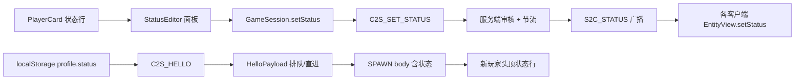

## 用户需求
在园区里增加「状态」功能：玩家可以输入一段固定长度的文字和 emoji，设置后常驻显示在自己头顶名字周围；入口位置由方案自行判断。

## 产品概述
状态是一张挂在工牌上的可编辑名片：设置一次即长期跟随角色，进入园区、被新玩家看见、切换设备前的每一次会话都保持一致（随浏览器存档恢复）。状态只在视野内传播，服务端不落库。

## 核心功能
- **工牌状态行**：左上角工牌卡在名字下方新增一行状态；未设置显示占位文案，已设置显示 emoji 与文字，点击展开编辑面板。
- **编辑面板**：自由输入文字，配一排常用 emoji 快捷插入；实时显示显示宽度计数，超限转警示色；提供保存与清除。
- **长度约束**：16 显示宽（8 个汉字或 8 个 emoji），超出按显示宽截断并加省略号。
- **常驻展示**：状态以独立一行显示在头顶昵称上方，字号更小、颜色次要、保留描边；聊天气泡整体再向上让位，三者永不重叠。
- **即时同步**：保存后立刻对本机与视野内玩家生效，动作/表情/移动不受影响；新进入视野的玩家一次拿到完整状态。
- **存档**：状态写入浏览器本地档案，重新进入园区自动恢复；清理浏览器数据即清空。
- **收起体验**：保存或按 Esc 立即关闭面板并失焦，WASD 立刻可用；点击游戏画面空白处也收起。
- **输入法友好**：中文输入法组合态下按 C / Z / X / 空格不触发游戏动作；NumpadEnter 与 Enter 同效。
- **内容安全**：状态与昵称走同一套审核，违规内容不上屏。


## 技术栈
沿用现有 monorepo，不引入新依赖：

- 契约层：TypeScript strict，手写二进制协议（`packages/shared-types`）
- 服务端：Bun WebSocket，20Hz Tick（`apps/game-server`）
- 客户端：Next.js 15 App Router / React 19 / Zustand 5 / Tailwind CSS v4
- 渲染：PixiJS 8 的 `Text`（`apps/web/lib/game/renderer.ts`）
- 存档：浏览器 `localStorage`，继续使用 `niuma:profile:v2`
- 测试：vitest（协议纯模块）+ bun:test（头顶几何纯模块）

## 实现方案

### 总体策略
状态是「玩家自报的展示型字段」，生命周期与昵称、外观一致：只存在进程内存与浏览器 localStorage。按三条路径同步，避免任何轮询与额外往返：

1. `C2S_HELLO` 携带初始状态：状态随 `HelloPayload` 一起排队，被放行时与玩家一起落地，不会出现「排队者状态丢失」。
2. `S2C_ENTITY_SPAWN` 携带状态：新进入视野的人一包拿全，不依赖后续增量包。
3. `C2S_SET_STATUS` / `S2C_STATUS` 处理游戏内修改：广播范围与现有换装完全一致（自己 + `player.known`）。

### 方案取舍
- **A（采用）HELLO + SPAWN + 独立广播**：入场即完整，零额外往返；代价是两条已有包各追加一段可选字段。
- **B 入场后单独补发**：协议零改动，但排队放行时 `SET_STATUS` 会早于建号被丢弃，首帧状态缺失，还得加重试握手，复杂度更高，否决。
- **C 复用聊天广播**：省一个 opcode，但状态会落进聊天记录、受聊天限速影响，且新入场者拿不到，否决。

### 向后兼容
- HELLO 末尾追加扩展段：`0xff` 魔数 + `statusLen u8` + 状态字节。`0xff` 与现有 `RESUME_VERSION=1` 不同，旧解码器按「版本不认识」整段忽略；新解码器先按现有逻辑读 8 字节 resume，再读扩展段，旧客户端无扩展段时解析为空状态。
- SPAWN body 在 appearance 之后追加 `statusLen u8` + 状态字节。现有 `decodeSpawn` 读完外观不校验尾部长度，旧客户端天然忽略；新客户端在剩余字节不足时回退空状态。
- 不新增存档版本：`Profile.status` 是可选字段，`sanitizeProfile` 对缺失或非法值回退空串，旧存档不会被清空。

### 审核与边界
- 客户端表单先 `inspectText` 预检：政治类拦下，脏话按打码结果展示；服务端 `moderation.inspect` 权威兜底，命中政治类落空串并打 warn 日志。
- 长度三重钳制：16 显示宽、16 码点、48 字节；空串即「无状态」，渲染层用 `visible=false` 隐藏。
- 服务端对 `SET_STATUS` 做 200ms 节流，防止伪造包刷广播；只有状态真变化才 `markSpawnDirty()`。

### 性能
- `Player.spawnBody` 继续是一份缓存，状态变更（低频）才失效；稳态入场包仍是 O(1)，不会每 Tick 重编码。
- 渲染只为「有状态」的实体惰性创建第二个 `Text`：未设置状态的人零额外纹理与 draw call；状态变更频率极低，重建可接受。
- 头顶纵向几何继续收敛在 `nameplate.ts`，气泡堆叠改为「名字 + 状态 + 间隙」一次算完，不引入逐帧测量。

### 回滚路径（30 天）
- 协议是纯追加：回滚时同时撤掉双端的新 opcode 分支与 SPAWN 尾部字段即可，不动既有字段偏移。
- localStorage 多出的 `status` 会被旧版 `sanitizeProfile` 丢弃，无需迁移脚本。
- 决策与回滚条件写入 ADR，保留 30 天观察窗口。

## 架构设计


## 目录结构
```text
packages/shared-types/src/
├── constants.ts                  # [MODIFY] 状态长度常量：显示宽 16 / 码点 16 / 字节 48
├── types.ts                      # [MODIFY] OpCode 追加 C2S_SET_STATUS=0x1b、S2C_STATUS=0x1c；SpawnPacket 增可选 status
├── protocol.ts                   # [MODIFY] truncateStatus；HELLO 扩展段、SPAWN 尾部字段、SET_STATUS/STATUS 编解码
└── __tests__/protocol.test.ts    # [MODIFY] 新旧包互通、状态钳制、扩展段与畸形长度用例

apps/game-server/src/
├── sim/world.ts                  # [MODIFY] Player.status 字段、reset 清空、spawnBody 带上状态
├── admission/controller.ts       # [MODIFY] HelloPayload 增可选 status，排队期间一并暂存
└── server.ts                     # [MODIFY] HELLO 审核状态；admit 传入 status；SET_STATUS 分支（节流 + 广播 + markSpawnDirty）

apps/web/
├── lib/profile.ts                # [MODIFY] Profile.status；resolveProfileStatus / checkProfileStatus；sanitize 与 save 写入
├── lib/game-ui.ts                # [MODIFY] statusOpen / setStatusOpen，纳入 reset
├── lib/net/client.ts             # [MODIFY] sendStatus、onStatus、S2C_STATUS 分派
├── lib/game/session.ts           # [MODIFY] start 的 HELLO 带 status；setStatus 发送并本地更新
├── lib/game/renderer.ts          # [MODIFY] EntityView 惰性状态 Text、布局、setStatus、分辨率与换装联动
├── lib/game/nameplate.ts         # [MODIFY] 状态行几何函数、bubbleTopY 增加状态堆叠高度
├── lib/game/__tests__/nameplate.test.ts  # [MODIFY] 状态与气泡堆叠几何断言
├── lib/game/input.ts             # [MODIFY] NumpadEnter 同效、isComposing/229 提前返回、contentEditable 计入输入域
├── components/game/StatusEditor.tsx      # [NEW] 输入、显示宽计数、emoji 快捷条、保存/清除、Esc 与 IME 处理
├── components/game/Hud.tsx       # [MODIFY] PlayerCard 增状态行并组合 StatusEditor
└── components/game/GameViewport.tsx      # [MODIFY] 状态持久化回调、画布空白处收起聊天与状态面板

docs/adr/0035-player-status.md    # [NEW] 状态字段的协议扩展、显示位置、审核与回滚决策
README.md                         # [MODIFY] 玩法说明补状态入口与长度规则
```

## 关键结构
- `OpCode`：`C2S_SET_STATUS: 0x1b`（`[op][len u16][utf8]`）、`S2C_STATUS: 0x1c`（`[op][entityId u16][len u16][utf8]`）。
- `truncateStatus(raw: string): string`：去控制字符、压缩空白、按显示宽/码点/字节三重截断，空串表示无状态。
- `nameplate.ts`：`statusLabelText`、`statusBottomY(nameBottom, nameHeight)`、`bubbleTopY(nameBottom, nameHeight, bubbleHeight, stackHeight)`；后者的新参数默认 0，既有调用与测试不受影响。

## 执行注意
- 每次改 `EntityView` 的 `nameBottom`（换装）必须同时重排状态行与气泡，否则状态会压在帽子上。
- `setTextResolution` 要同步状态 `Text`，否则 DPR 变化后小字发虚。
- 状态 `Text` 的字体栈必须是「等宽 + 中文 + 系统彩色 emoji」，emoji 不能被描边染成单色。
- emoji 按码点追加；插入前先跑一次显示宽校验，避免把 16 宽额度打爆。
- 新增日志沿用 `[moderation]` 前缀，只记 verdict 与 wsId，不打印原文。


## 设计风格
延续园区既有的「暖褐底 + 像素终端 + 工牌」语言：低饱和暖褐背景、2px 硬边、等宽小字标注、唯一薄荷绿强调色。不引入圆角卡、玻璃拟态或新色板。编辑器像一张从工牌下方抽出的表单，而不是弹窗。

## 页面与区块
单屏（游戏内 HUD）加一个下拉面板：

1. **工牌卡**：header（工牌 / species）→ 名字 → 状态行（新增）→ FPS / PING / POS 指标。状态行是整行按钮，左对齐显示 emoji + 文字，右侧一支铅笔图标；未设置时显示「设置状态…」，颜色降一档。
2. **状态编辑面板**：贴在工牌卡下方，同宽（桌面 268px、触屏 190px），2px 硬边、`ink-900/94` 底、外投影。自上而下：输入框 + 显示宽计数、emoji 快捷条（8 枚，触屏换行两排）、清除与保存按钮。
3. **头顶状态行**：昵称上方独立一行，字号 7、薄荷绿、同款暖褐描边，不占用昵称的 16 宽预算；聊天气泡整体再上移，三者永不重叠。
4. **收起态**：面板关闭即卸载，输入框失焦，WASD 立即生效；Esc、点击画布空白处同样收起，焦点回到状态行。

## 交互与动效
- 展开 140ms 淡入并上移 2px，缓动 `cubic-bezier(0.2,0.8,0.2,1)`，不使用 bounce。
- 保存按钮 120ms 按下反馈；保存成功瞬间卡片状态行替换为新值，面板收起。
- 计数超过 16 宽时数字转 amber，不阻塞输入；保存时按显示宽截断并补省略号。
- emoji 按钮 32px 见方，hover 时描边转 mint、底色透出 8% mint；按下有 1px 下沉。
- 触屏输入框 `enterKeyHint="done"`，提交后主动 blur 收起软键盘。
- 无障碍：状态行带 `aria-expanded` / `aria-controls`，面板 `role="dialog"` 且带 `aria-label`，计数用 `role="status"` 播报；错误提示不依赖颜色单独表达。

## Agent Extensions

### Skill
- **principal-software-architect**
  - Purpose: 复核协议扩展的兼容窗口、字段偏移与回滚路径，按 ADR 结构记录「为什么是 HELLO + SPAWN + 独立广播」而不是入场后补发。
  - Expected outcome: 一份含备选方案、反向成本、30 天回滚条件的 `docs/adr/0035-player-status.md`，并确认 `0xff` 扩展段与 `RESUME_VERSION=1` 不冲突。

- **impeccable**
  - Purpose: 按项目既有像素终端语言设计状态行与编辑面板，落实焦点管理、IME 组合态、触屏紧凑布局与超长提示。
  - Expected outcome: 通过 `/impeccable shape` 产出面板结构，实现后用 `/impeccable polish` 收尾，确认无烂大街字体、无紫蓝渐变、无 bounce 缓动等反模式。
