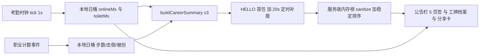

## 产品概述
园区工牌与公告栏的统计口径统一为「只看今天」。所有时长和计数都改为当日数据，服务器部署、进程重启、页面刷新、断线重连后数字都不再归零；数据存在玩家本机浏览器里，重连后自动补报。

## 核心功能
- **公告栏五榜（全部当日）**：今日工时、今日如厕、今日击倒、今日被创、今日步数。移除「本次在岗 / 本周工时 / 摸鱼次数 / 人气」四个页签；人气榜删除，但工牌点赞功能本身保留。
- **今日如厕计时**：角色坐在地铁/马桶座（`seatKind === 'toilet'`）的时长累计计入「今日如厕」，并明确它是今日工时的子集，任何展示都满足「如厕 ≤ 工时」。
- **今日工时口径**：等于本机当日累计在线时长（分钟），由考勤时钟产出，不再由服务端会话秒数或 `joinedAt` 推算。
- **部署/重启不归零**：当日工时、如厕、步数、击倒、被创数据落在本机浏览器；刷新、断线、服务端重启后重新连接时自动带上本地当日档案，榜单自动恢复，在线玩家不会长时间显示「未上报」。
- **工牌档案只描述今天**：左上角时钟由「在岗（会话秒）」改为「今日工时」；档案面板移除本次在岗、本周工时、日均在线、连续在岗、累计工龄、累计总在岗、累计行为，改为今日工时、今日如厕占比与今日计数明细。
- **职级、印章、同屏劳模榜、分享卡统一改今日口径**：职级按今日工时，印章按今日工时与今日计数，去掉工龄与连续维度；分享卡小票文案改为今日工时/今日如厕/今日排名。
- **入职日期保留**：仅作为身份信息展示，不再派生任何时长统计。
- **可接受的代价**：换浏览器或清空站点数据会重新开始，需在公告栏页脚以一句玩家可读的话说明。

## 视觉与文案效果
沿用现有纸张、印章、等宽数字的工牌视觉语言，不新增组件库。公告栏页签由 6 个收为 5 个，单行排布不再拥挤；数值统一为「今日」前缀，时间类显示为小时+分钟，计数类显示为次数/步数；未上报玩家显示占位文案而非 0 值造假。今日如厕以占比条（如厕/工时）呈现，和现有工时进度条同一视觉体系。


## 技术栈
沿用现有仓库栈，不引入新依赖：

- 类型与协议：TypeScript + `packages/shared-types`（`board.ts`、`career.ts`），复用现有 varint/定长编码与 `sanitizeCareer` 校验
- 客户端：React + Next.js（`apps/web`），现有 `localStorage` 存档与 zustand 状态
- 服务端：Bun + `apps/game-server`，**零持久化**（仅进程内存）
- 测试：`bun:test`，沿用 `apps/web/lib/game/__tests__` 与 shared-types 既有测试结构

## 实现方案

### 核心策略
把「今日数据」的唯一事实源从服务端会话搬到浏览器本地存档：考勤模块负责时间（今日工时、今日如厕），职业模块负责计数（步数/击倒/被创/加班/摸鱼），两者按 `localDateKey` 分桶；上报摘要瘦身为「只含今日字段」的新协议版本；服务端只做内存聚合与钳制，排序完全基于客户端上报的今日值。这样部署、重启、刷新、重连都不会影响数值，且不违反零持久化约束。

### 关键决策与取舍
1. **工时来源改为本地考勤**
   服务端 `joinedAt` 与会话增量在新进程里必然归零，无法作为当日口径。本地 `AttendanceTracker` 已有跨零点拆分、多标签页 merge-max、30s 批量落盘能力，直接复用最省成本且语义正确。取舍：换设备不继承，已确认接受。

2. **如厕时间放在考勤而非职业计数**
   它是有跨零点切分与 merge-max 需求的「时间区间」，和在线时长同构，放一起可复用同一套区间结算代码；职业模块只保留整数计数。取舍：`AttendanceStorage` 的日记录从单值扩为结构体，需要一次性结构迁移（带版本号，仅执行一次）。

3. **协议升到 v3，字段只减不误导**
   `CareerSummary` 只保留可当日化的字段：`firstJoinDate`、`province`、`todayMinutes`、`todayToiletMinutes`、`todaySteps`、`todayKnockdown`、`todayVented`、`todayOvertime`。移除 `weekMinutes / streakDays / activeDays / totalOnlineMinutes / reportedOnlineSec`。v1/v2 解码时只映射语义确定可复用的今日字段（v2 自带 `todayMinutes`），其余置 0，绝不把历史累计当今日值；旧解码器丢弃 v3 包时，服务端表现为「该玩家今日未上报」，不会出现脏排名。

4. **计数按日分桶但不把历史累计灌入今日**
   旧存档里的历史计数只用于内部保留，不迁移进今日桶（否则老玩家开局即榜首，破坏当日榜公平）。迁移带 `schemaVersion` 与一次性标记，仅执行一次，今日桶初始为 0，次日由日期键自然换日。

5. **榜单去掉会话增量与时间推进**
   `careerSessionDeltaMinutes`、`withCareerDelta`、`advanceBoardValue` 全部删除，避免「本地推进 + 服务端快照」双重计数导致工时翻倍。榜单数值只来自服务端快照；为了让刚部署后打开公告栏的玩家不看到自己的 0 值，对话框用本地当日值对自己那一行做 `max(server, local)` 兜底。

6. **服务端排序稳定化**
   `BoardEntry` 去掉 `joinedAt`，排序改为 value 降序 + 玩家 id 升序，避免 20s 刷新时同值玩家名次跳动。

7. **职级/印章阈值重标定**
   `getJobTitle(todayMinutes)`、`getStampTitle(todayMinutes, todayStats)` 改为今日口径，阈值按「单日可达区间」重新取值，移除 `seniorityDays / streakDays / avgDailyHours` 入参。

### 性能与可靠性
- 考勤 tick 为 O(1) 内存累加，1s 一次；落盘 30s 一次并叠加 `pagehide` / `visibilitychange(hidden)` 立即 flush，最坏丢失 < 1s。
- 左上角时钟只在分钟变化时触发一次状态更新（内部秒级累加、对外分钟粒度），避免每秒 re-render。
- 榜单服务端排序 O(n log n)，20s 一次，n 为在线人数，无额外全表扫描。
- 多标签页写入使用 merge-max，禁止后写覆盖；跨零点按 tick 时间点切分区间后再落盘。
- 服务端 `sanitizeCareer` 钳制：`todayMinutes ≤ 1440`、`todayToiletMinutes ≤ todayMinutes`、计数 ≤ 上限、`province` 长度截断，防脏数据破坏排序（客户端不可信输入）。
- 滚动发布：服务端对未知/旧指标 id 返回空榜而非报错，客户端空榜显示「今日还没有人上报」。

## 架构设计



分层：本地计量层（attendance、career 存档）→ 摘要层（`buildCareerSummary`）→ 传输层（HELLO + 周期上报）→ 服务端聚合层（`sim/board.ts`）→ 展示层（dialog、panel、share-card）。展示层只读今日字段，不感知历史累计；历史字段在协议与 UI 中彻底消失，保证不会被误用。

## 目录结构

```
niuma/
├── packages/shared-types/src/
│   ├── board.ts                          # [MODIFY] 指标枚举改为 today_minutes/today_toilet/today_knockdown/today_vented/today_steps；boardValueOf 仅读今日字段；删除 likes/on_duty/week_minutes；导出 5 项顺序常量供 UI 直接消费
│   ├── career.ts                         # [MODIFY] CAREER_VERSION 升为 3；CareerSummary 瘦身为今日字段 + firstJoinDate/province；encode/decode 增加 v3 分支，v1/v2 只映射可确定今日字段；sanitizeCareer 增加 todayToilet ≤ todayMinutes 与计数上限钳制；hasCareerReport 改以今日字段判定
│   └── __tests__/career-v3.test.ts       # [NEW] v3 round-trip、省份截断、上限钳制、v1/v2 兼容解码、旧解码器丢弃 v3 的降级用例
├── apps/game-server/src/
│   ├── sim/board.ts                      # [MODIFY] BoardEntry 移除 joinedAt；排序改 value 降序 + 玩家 id 升序；删除 careerSessionDeltaMinutes 使用；按 5 个今日指标取值
│   └── server.ts                         # [MODIFY] 移除会话续算与会话增量补齐；HELLO 收到 career 即写入内存并触发视野刷新；未知指标返回空榜；日志只记指标名与条数，不打印 career 全量
├── apps/web/lib/game/
│   ├── attendance.ts                     # [MODIFY] 日记录扩为 { onlineMs, toiletMs }；新增 setToilet(boolean)；跨零点同时切分两种时长；merge-max 合并；30s 落盘 + pagehide/visibilitychange 立即落盘；删除周/日均/连续/工龄/本次会话辅助函数，新增 getTodayMinutes/getTodayToiletMinutes；启动接口返回 setToilet 门面
│   ├── career.ts                         # [MODIFY] 存档升级为按 localDateKey 分桶的今日计数；recordDistance/recordSlack/recordVented/recordKnockdown/recordOvertime 写入今日桶；旧存档一次性迁移且今日桶从 0 起；buildCareerSummary 输出 v3 今日摘要
│   ├── leaderboard.ts                    # [MODIFY] BOARD_METRICS 收为 5 项今日指标；formatBoardValue 时间类按小时+分钟、计数类按次/步；删除 advanceBoardValue 与会话推进逻辑
│   ├── badge.ts                          # [MODIFY] 删除 withCareerDelta 与会话增量补丁；BoardEntry 字段改 todayMinutes；工牌展示模型只保留今日字段
│   ├── archive.ts                        # [MODIFY] BadgeArchive 只留今日字段与今日计数；Self/Remote 两个构建函数改今日值；toShareCardData 输出今日数据；职级/印章改今日口径
│   ├── session.ts                        # [MODIFY] 删除 checkOnDuty 会话档位与 welcomeAt 会话续算；ensureBoard 按 todayMinutes 排序并取本地值兜底；handleWelcome 不再改写 career
│   ├── share-card.ts                     # [MODIFY] ShareCardData 删除 dailyAverageHours/weekHours/streakDays，新增 todayToiletMinutes；小票与详情卡文案改今日工时/今日如厕/今日排名
│   └── __tests__/
│       ├── attendance-daily.test.ts      # [NEW] 如厕计时、坐/离切换、跨零点、后台恢复、多标签 merge-max、缺字段降级
│       ├── career-daily.test.ts          # [NEW] 计数按日分桶、午夜换日、一次性迁移、摘要 v3 字段映射
│       └── leaderboard-daily.test.ts     # [NEW] 5 指标格式化、排序稳定、未上报占位、本地值兜底
├── apps/web/components/
│   ├── BadgeCard.tsx                     # [MODIFY] 左上角「在岗」改「今日工时」，数据源改 useAttendance 当日分钟，离线不再显示 --:--
│   ├── game/LeaderboardDialog.tsx        # [MODIFY] 页签 grid 由 6 改 5；移除「摸鱼」头部计数；页脚写明「数据存本浏览器，换设备重新开始」
│   ├── badge/AttendancePanel.tsx         # [MODIFY] 删除 WeekMeter 与本次/周/日均/连续/累计行；改为今日工时 + 今日如厕占比条 + 当前姿态/入座
│   ├── badge/ActivityPanel.tsx           # [MODIFY] 「累计口径」改「今日口径」；计数全部今日值；名次改今日工时名次；同屏劳模榜按今日工时
│   ├── badge/SelfArchiveDialog.tsx       # [MODIFY] 移除 onlineSec/连接状态入参，改用本地今日考勤与今日计数
│   └── badge/RemoteArchiveDialog.tsx     # [MODIFY] 改用新 archive 构建函数，不再需要会话增量
├── apps/web/components/game/GameViewport.tsx  # [MODIFY] onLocalState 同步 setToilet(seated 且 seatKind 为 toilet)；buildCareerReport 去掉 onlineSec 参数；保持 20s 上报并复用本地 Tracker 内存值
├── docs/adr/0067-daily-only-stats.md      # [NEW] 新 ADR：记录「只保留今日、客户端本地分桶、v3 协议、放弃会话续算」的决策与代价，不改历史 ADR
└── apps/web/data/release-notes.json       # [MODIFY] 追加一条面向玩家的版本工报（最多 6 条改动，不写实现细节）
```

## Key Code Structures

```ts
// packages/shared-types/src/career.ts
export interface CareerSummary {
  firstJoinDate: string;      // 身份信息，不派生统计
  province: string;
  todayMinutes: number;       // 今日工时（分钟，向下取整）
  todayToiletMinutes: number; // 今日如厕，必须 ≤ todayMinutes
  todaySteps: number;
  todayKnockdown: number;     // 今日击倒他人
  todayVented: number;        // 今日被创
  todayOvertime: number;      // 今日加班次数
}
```

```ts
// apps/web/lib/game/attendance.ts
export interface AttendanceDayRecord {
  onlineMs: number; // 今日在线（工时）
  toiletMs: number; // 今日坐在马桶座位上的时长，≤ onlineMs
}
export interface AttendanceClock {
  setToilet(active: boolean, now?: number): void; // 坐/离切换，切换前先结算上一段
  flush(): void;
  snapshot(): { firstJoinDate: string; days: Record<string, AttendanceDayRecord> };
  dispose(): void;
}
```

## 实施注意事项
- **双计数风险**：删除 `withCareerDelta`、`careerSessionDeltaMinutes` 时必须同步清掉所有调用点（`archive.ts`、`session.ts`、`server.ts`、`BadgeCard`），否则今日工时会翻倍。
- **日期口径**：一律使用 `localDateKey`，禁止 `toISOString()`；跨零点在 tick 内按区间切开，不能整段记到当天。
- **落盘纪律**：不得每秒写 `localStorage`；`AttendanceTracker` 的 `tick` 只写内存，落盘走 30s 批处理，并在 `pagehide` / `visibilitychange(hidden)` / 坐离切换时 flush。
- **如厕子集约束**：`setToilet(false)` 前先结算上一段；服务端 `sanitizeCareer` 再钳一次 `todayToiletMinutes ≤ todayMinutes`，防止脏存档或旧包。
- **重连恢复链路**：`NetClient` 已缓存最近一次 career 并在 HELLO 中携带；客户端 20s 定时上报应允许离线时继续写入缓存（`sendCareer` 在离线时也更新本地 career），确保服务端重启后首个 HELLO 就能重建榜单。
- **滚动发布**：新指标 id 与旧 id 不混用语义；服务端遇到旧 id 直接返回空榜，客户端显示「今日还没有人上报」，绝不把旧标签读成今日值。
- **日志**：沿用服务端现有日志通道，只记录指标名、条数与拒绝原因；不打印昵称、省份以外的 career 字段，避免刷屏与隐私泄漏。
- **视觉收尾**：删除 WeekMeter 后避免面板留白过大，用今日如厕占比条和计数网格补位；沿用既有 `FieldRow` / `StatCell`，不引入新组件库。
- **提交纪律**：提交前更新 `apps/web/data/release-notes.json` 并运行 `pnpm changelog:check`；新增 ADR 放 `docs/adr/`，不改历史 ADR。


## Agent Extensions
### Skill
- **test-driven-development**
  - Purpose: 先为协议 v3、今日如厕、跨零点、部署重连写失败测试，再实现逻辑
  - Expected outcome: 新增的 `attendance-daily` / `career-daily` / `career-v3` 测试先红后绿，覆盖边界条件
- **impeccable**
  - Purpose: 对改版后的公告栏五页签与工牌档案做视觉与信息层级收尾检查
  - Expected outcome: 删除周/累计面板后无突兀留白，纸张印章语言统一，空态与未上报文案一致
- **verification-before-completion**
  - Purpose: 在完成声明前实际运行类型检查、测试与版本工报校验并核对输出
  - Expected outcome: `pnpm typecheck`、相关 `test`、`pnpm changelog:check` 全部通过并有证据
