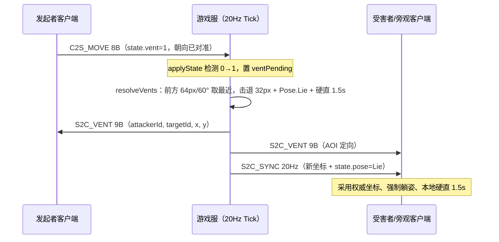

## 产品概述
在《牛马 NIOMA》中彻底移除「叫唤」这一纯情绪动作，替换为带社交后果的互动「发泄」：玩家对其他玩家发起一记牛马式冲撞，被命中者被创飞、摔在地上，1.5 秒内起不来。园区内所有玩家都能同步看到整个过程，并听到、看到配套的声音与吐槽。

## 核心功能
- **解除叫唤**：牛哞、马嘶两套鸣叫音色、叫唤动作切片与叫唤入口全部移除，原按键位置由发泄接管。
- **发泄演出**：三段式动作——后撤蓄力（双耳竖起）→ 全力前冲、头与前蹄砸向地面并带一道 1px 速度线 → 后坐力回弹；站、坐、躺三种姿态各有一套同构演出。
- **出招方式**：按 E 出招；也可用鼠标左键直接点击身边相邻的玩家出招。行走途中按 E 会立刻停下出招，不出现「边滑边撞」。
- **命中判定**：系统在出招者身前 64 像素、60 度扇形内取最近的一名玩家判定命中。
- **击退与倒地**：命中后沿出招方向把对方推后 32 像素（撞墙贴墙停下，不穿墙），并强制改为躺地姿态。
- **倒地硬直**：被创飞者 1.5 秒内无法起身、无法移动；时间到后自动恢复可动，按方向键自然爬起。
- **全员同步**：出招者、受害者、旁观者看到同一套动作、同一个落点、同一句台词；无位置抖动、无被拉回。
- **声音反馈**：空放是一声短促的破空「呼哧」；命中是一记低频下潜叠加噪音冲击的「砰」。
- **头顶吐槽**：出招者头顶出现三句固定吐槽之一；被创飞者头顶出现另外三句之一，并在头顶转两颗小星星，随硬直结束消失。
- **点击分流**：点到身边能打到的玩家直接出招（不弹其工牌）；点到远处玩家仍查看工牌。
- **验收**：全量类型检查通过，源码与产物不留任何叫唤相关实现；移动包仍严格 8 字节。


## 技术栈
沿用现有栈，不新增运行时依赖：TypeScript strict + pnpm workspace + turbo；协议层为 `@niuma/shared-types` 手写二进制编解码（`ByteWriter`/`ByteReader`）；服务端 Bun WebSocket + 20Hz `setInterval` Tick + 进程内 `World`/`SpatialGrid`；客户端 Next.js + PixiJS（ECS 为 bitecs SoA）+ 纯 Web Audio 实时合成（零音频资源）；图集由 bun 脚本生成 64×64 像素帧（34 列 × 4 行）；测试统一 `bun:test`。

## 实现策略
把「叫唤」这个纯表现位升级为**服务端裁决的互动事件**：同一个 bit6 原地换语义（包长零变化），命中结果走一次性事件包，位移与姿态仍走既有 20Hz Tick。

1. **bit6 原地改名**（`emote` → `vent`）：移动包 8/14 字节、紧凑条目 48bit、同步包长全部不变；回滚只需把语义换回。
2. **命中由服务端在 Tick 内裁决**：客户端只上报「我在出招」这一位；服务端做 4 向轴对齐扇形判定 + 距离最近优先，杜绝客户端自证命中。
3. **边缘触发 + 限频**：`Player.applyState` 检测 `vent` 0→1 置 `ventPending`，`resolveVents` 消费一次，配合 `VENT_COOLDOWN_MS` 防止 440ms 持有窗口内重复结算与连点刷屏。
4. **新增 9 字节 `S2C_VENT`**（用户已确认）：受害者本人的姿态是客户端预测的，Tick 里的 state 对本人不生效，必须显式事件；空放也发（`targetId = 0`），用于统一全场音效与台词。
5. **受害者本地硬直 + 权威坐标**：事件包携带服务端最终 x/y，客户端直接采用——32px 偏差小于既有 128px 漂移阈值，只靠 Tick 不会回正，必然拉回抖动。
6. **客户端出招锁**：`ventLockUntil` 在出招窗口内屏蔽位移，并把 `Walk` 落回 `Idle` 再播叠加轨（`overlayTrackFor` 对 Walk 返回 null），实现「打断移动直接出招」且无滑步。
7. **台词确定性**：按 netId 哈希取句，全部客户端算出同一句，满足「两边窗口完全一致」。

**权衡**：不复用 `S2C_GRAZE` 加参数——咀嚼与发泄是两类事件，混包会迫使客户端按长度猜语义（协议注释明确反对）；不广播受害者完整 state——Tick 已是权威 state 通道，事件包只补 Tick 无法表达的「归因」。击退走 `resolveMotionInto` 而非直接加坐标，与移动共用同一碰撞求解器，贴墙自然衰减。

**性能**：移动包体积 0 变化；`resolveVents` 稳态每人一次布尔判断，仅对 `ventPending` 的玩家进入 `known` 内层循环，最坏 O(N + V·k)，V 受 700ms 限频约束；事件包约 1 条/秒/人；客户端不新增每帧分配（气泡复用 `showBubble` 的 300ms 节流与同屏上限 10，星星为 2 个常驻 Sprite 只改 position/visible）。

**架构**



## 执行细节（防回归）
- `packState` 是位置参数：改名后所有调用点（含测试）必须逐一核对，布尔顺序一致编译器不会报错。
- `resolveVents` 必须在同一 Tick 的 dirty 广播**之前**执行（在 `server.ts` 的 `runTick` 之前调用），否则受害者倒地晚 50ms。
- `S2C_VENT` 必须发给发起者自己（`player.known` 不含自己），否则拿不到命中反馈。
- 服务端硬直闸门放在「防重复序号」之后、「座位分支」之前；期间 `accepted = false`，`server.ts` 不更新 grid（符合预期）；每包重打包同一 state 不会置 dirty，无广播风暴。
- 残留扫描必须用词边界：`moo` 会命中 `smooth`、`neigh` 会命中 `neighbor`、`emote` 会命中 `remote`。
- 生成物不可手改；改完 `layout.ts`/`quadruped.ts` 必须 `pnpm assets`，`atlas.ts` 会校验 `manifest.version`。
- 像素：速度线必须在 `px.outline()` 之后落笔（否则被描边包成一团）；vent 三帧不参与呼吸（`breatheOffset` 保持 0）。
- 音频：破空与钝击用两个独立节流时间戳，否则命中音会被破空的 90ms 窗口吞掉。
- 动作条与触屏动作盘共用 `ActionKey`，两侧必须同改，否则 `Record<ActionKey, …>` 缺键。

## 目录结构
```
packages/shared-types/src/
├── constants.ts                 # [MODIFY] POSE/ACTION 注释改写；新增 VENT_RANGE_PX=64、VENT_HALF_ANGLE_DEG=30、VENT_KNOCKBACK_PX=32、VENT_STUN_MS=1500、VENT_COOLDOWN_MS=700
├── quantize.ts                  # [MODIFY] packState 第 4 参 emote→vent；STATE_BITS.emote→vent；unpackState 字段改名；位布局与 8 字节包不变
├── types.ts                     # [MODIFY] OpCode 增 S2C_VENT=0x21；新增 VentEventPacket{attackerId,targetId,x,y}，targetId=0 表示为空放
├── protocol.ts                  # [MODIFY] encodeVent/decodeVent=[op][attackerId u16][targetId u16][x u16][y u16] 共 9 字节，坐标走 quantizeCoord；更新 packState 调用点
├── world/vent.ts                # [NEW] 纯几何：VENT_FACING（4 向单位向量）、withinVentCone(ax,ay,dir,bx,by,range?)，点积平方比较、零分配无开方
├── index.ts                     # [MODIFY] 追加 export * from './world/vent'
├── __tests__/protocol.test.ts   # [MODIFY] state 往返字段改名；断言 vent 占 bit6=0b01000000；encodeMove 仍 8 字节；encodeVent 往返 9 字节
└── __tests__/vent.test.ts       # [NEW] 正前命中/背后不中/超距不中/边界角/最近优先

apps/game-server/src/
├── sim/world.ts                 # [MODIFY] Player.emote→vent，新增 ventPending/lastVentAt/stunUntil；reset 清理；applyState 形参改名并检测 0→1 置 ventPending
├── sim/movement.ts              # [MODIFY] 硬直闸门（强制 Pose.Lie、位置不动、提前返回）；座位分支与常规分支 state.vent 透传（不再按 stationary 丢弃），wave 仍要求站定
├── sim/vent.ts                  # [NEW] resolveVents(world, seats, transport, now)：消费 ventPending→限频→known 内扇形最近目标→seats.stand→resolveMotionInto 推 32px→Pose.Lie+stunUntil→dirty/needsViewRefresh→广播 S2C_VENT（含发起者与空放）；返回 SeatStateEntry[] scratch 供广播
├── server.ts                    # [MODIFY] Tick 回调内 runTick 之前调用 resolveVents，随后广播座位移除条目
├── sim/vent.test.ts             # [NEW] 命中结算/靠墙不穿墙/限频不二次结算/硬直期 applyMove 不改姿态与位置/硬直过期恢复
├── sim/movement.test.ts         # [MODIFY] 核对并改名 emote 断言
├── sim/seats.test.ts            # [MODIFY] 同上
└── sim/tick.test.ts             # [MODIFY] 同上

apps/web/
├── lib/game/input.ts                    # [MODIFY] ActionKey 'emote'→'vent'；ACTION_CODE.vent=3 / ACTION_BY_CODE[3]='vent'（数字不变，跨线程环无迁移）
├── lib/game/input-keyboard.ts           # [MODIFY] KeyE → 'vent'，注释同步
├── lib/game/actions.ts                  # [MODIFY] InteractionIntent {kind:'vent'}（去掉 animated）；resolveInteraction 恒返回 vent；actionPresentation 恒可用
├── lib/game/ecs.ts                      # [MODIFY] Motion.emote/emoteSince→vent/ventSince；spawn 初始化；删除死代码 POSE.Emote
├── lib/game/clip.ts                     # [MODIFY] OverlayTracks.emoteByPose/emoteMs→ventByPose/ventMs；buildOverlayTracks 读 vent/sitVent/lieVent；overlayTrackFor 参数 venting
├── lib/game/session.ts                   # [MODIFY] 出招分支（冷却/落回 Idle/ventLockUntil/本地破空音/台词）、startOverlay、expireLocalOverlays、stepRemote 上升沿、sendMove、handleVent（采用权威坐标+强制躺姿+硬直+气泡+星星）、perform 硬直拦截、pickAt 点击相邻玩家直接出招
├── lib/game/sfx.ts                      # [MODIFY] 删除 KIND.moo/neigh、emit/emitRemote、moo()、neigh()；新增常驻噪声链与 playVentImpactSound(x,y,hit,local)
├── lib/game/interactions.ts             # [MODIFY] 新增 VENT_LINES / VENT_VICTIM_LINES 与 pickVentLine/pickVentVictimLine（按 netId 取模，确定性）
├── lib/game/renderer.ts                 # [MODIFY] EntityView 增 2 颗星星 Sprite 与 setStun(phaseMs)，绕头顶整数纹素椭圆轨迹旋转，phase<0 隐藏
├── lib/game/pony-motion.ts              # [MODIFY] PonyPoseName/PONY_POSES 的 'emote'→'vent'
├── lib/game/snapshot.ts                 # [MODIFY] 注释中的 Emote 改写
├── lib/game/runtime/engine-env.ts       # [MODIFY] AudioEvent 删 emote 项，新增 {kind:'vent'; x; y; hit; local}
├── lib/game/runtime/audio-sink.ts       # [MODIFY] case 'vent' → sfx.playVentImpactSound
├── lib/game/__tests__/clip.test.ts      # [MODIFY] vent 按姿态三轨 + ventMs 断言
├── lib/game/__tests__/actions.test.ts   # [MODIFY] vent 永不 unavailable、不进 active
├── lib/game/__tests__/move-send.test.ts # [MODIFY] vent 位变化必须立即发包
├── components/game/ActionBar.tsx        # [MODIFY] 叫唤/Music4 → 发泄 + 冲击类图标，hint 仍 E
├── components/game/TouchControls.tsx    # [MODIFY] 同步文案与图标
└── components/game/Hud.tsx              # [MODIFY] 注释中的叫唤字样更新

packages/pixel-assets/
├── src/layout.ts                        # [MODIFY] PoseName emote/sitEmote/lieEmote→vent/sitVent/lieVent；CLIPS 三条重命名（列 16-24、440ms 不变）；COLUMN_POSES 与列预算注释同步
├── src/quadruped.ts                     # [MODIFY] SideOptions.openMouth→vent 参数（后撤/前冲/头下压/耳竖起/前蹄前探/速度线）；sideOptions 三相位参数化；drawSideBody 尾部新增速度线（outline 之后落笔）；facingOptions/openMouth 同步改 vent 姿态并移除 backBarkLift
├── scripts/generate.ts                  # [MODIFY] 图集 version 7→8（生成物与 manifest 两处），注释「v8：16-24 列改为冲撞/头槌」
├── __tests__/overlay-frames.test.ts     # [MODIFY] BARK 段改写为 vent：三帧两两不同、相位 1 差异量显著大于旧嘴部变化、包围盒跨头与前蹄、四向顶行仍为空
└── __tests__/layout.test.ts             # [MODIFY] 一次性动作时长键改名，保持 440ms 断言

生成物（由 pnpm assets 重写，禁止手改）：
apps/web/lib/game/sprite-layout.generated.ts   # [REGENERATE] clips 键 vent/sitVent/lieVent
apps/web/public/sprites/**                     # [REGENERATE] 图集 PNG 与 manifest.json

docs/adr/
├── 0051-vent-knockdown-and-state-bit6.md      # [NEW] bit6 改名、S2C_VENT 契约、Tick 结算顺序、64/60°/32/1500 参数、回滚策略
└── 0018-emote-and-jump-overlay.md             # [MODIFY] 标注已被 0051 取代（保留历史原文）
```

## 关键代码结构
```ts
// packages/shared-types/src/types.ts
export interface VentEventPacket {
  /** 出招者实体 id */
  attackerId: number;
  /** 受击者实体 id；0 表示空放，此时 x/y 无意义 */
  targetId: number;
  /** 服务端结算后的受击者权威坐标（1/8px 定点），受害者客户端直接采用 */
  x: number;
  y: number;
}

// packages/shared-types/src/world/vent.ts
/** 4 向轴对齐朝向向量下标与 DIRECTION 一致 */
export const VENT_FACING: ReadonlyArray<{ readonly x: number; readonly y: number }>;
/** 目标是否落在出招者前方 range 像素、±halfAngle 度的扇形内；零分配、无开方 */
export function withinVentCone(
  ax: number,
  ay: number,
  direction: Direction,
  bx: number,
  by: number,
  range?: number,
): boolean;
```


## Agent Extensions
### Skill
- **layer-pixel-art**
  - Purpose: 指导 64×64 帧内「后撤蓄力 → 前冲头槌/前蹄下砸 → 后坐力」三帧的像素构图、剪影可读性与 1px 速度线落笔位置
  - Expected outcome: 16-24 列不再有任何张嘴帧，三帧剪影一眼可分、无抗锯齿、顶行不被裁切
- **impeccable**
  - Purpose: 收敛动作条与触屏动作盘的文案/图标改动（叫唤→发泄），确保不与既有视觉语言冲突
  - Expected outcome: 桌面与移动两处按钮文案一致、图标语义准确，不引入新布局
- **domain-modeling**
  - Purpose: 按仓库既有 ADR 体例撰写 `docs/adr/0051-vent-knockdown-and-state-bit6.md` 并标注 0018 已被取代
  - Expected outcome: 决策记录含契约、参数、结算顺序与回滚路径，可直接评审
- **verification-before-completion**
  - Purpose: 在收尾阶段以真实命令输出验证 typecheck、单测、图集生成与残留扫描
  - Expected outcome: 每条验收标准都有可复现的命令证据，不以「应该通过」代替结果
### SubAgent
- **code-explorer**
  - Purpose: 改造完成后全仓库复扫 `moo/neigh/emote`（词边界）与 `packState` 调用点，确认无遗漏
  - Expected outcome: 输出剩余命中清单并逐条判定「历史文档」或「待修」
