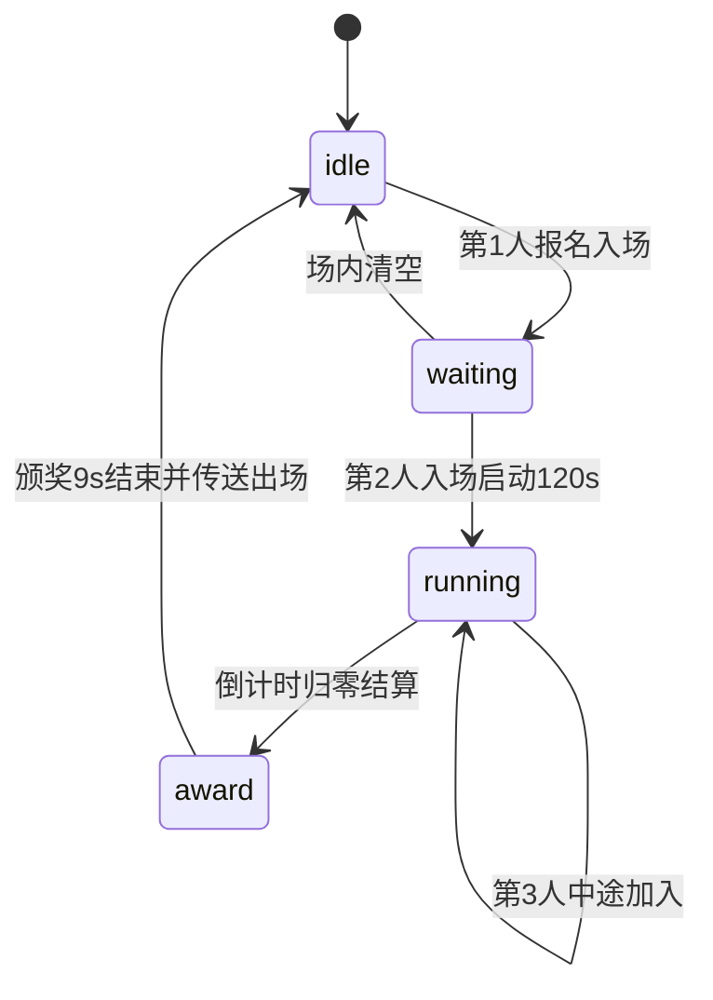

## 用户需求
在发泄区新增一个可同时容纳最多 3 名角色进入的擂台玩法，围绕进入限制、血量、区域限定、2 分钟计时、结算排名与颁奖动画五个模块形成闭环，并说明各模块的组织方式。

## 产品概述
发泄区西侧新增一块独立擂台垫（现有橡胶垫西侧，老板场地完全不动，仅移走落在垫内的垃圾桶）。玩家在擂台旁按 F 报名并被传送到场内起点，场内以现有 E 发泄命中互相攻击；每局严格 2 分钟，结束时按剩余血量排出前三名，在场内领奖台上升台领奖，配彩带与奖杯动画，同时把冠亚季军写入本地考勤档案并在工牌展示。

## 核心功能
- 进入限制：擂台容量 3 人；第 1 人进场后在场内等待，第 2 人进场才启动倒计时；第 3 人可在倒计时内中途加入；满员拒绝报名，颁奖阶段拒绝报名。
- 血量机制：每人初始 10 点生命；命中扣 1 点，保留击退与 1.5s 倒地硬直；血量归零即倒地淘汰，留在擂台边等待结算，不再参与攻击。
- 区域限定：非参赛者无法踏入擂台矩形（只能通过 F 传送进入）；参赛者在等待、进行、颁奖三阶段均被夹在擂台内，不得离开；颁奖阶段冻结移动与攻击。
- 计时逻辑：以第 2 人入场为起点严格 120 秒倒计时，服务端权威计时，HUD 显示剩余时间与最后 10 秒警示；到点即结算，不提前 KO 结束。
- 结算排名：按剩余血量降序，同分依次比较存活优先、淘汰更晚者优先、入场序号小者优先，结果确定性可复现。
- 结算与颁奖动画：领奖台从擂台内升起呈现金/银/铜三阶，前三名角色被传送到对应台阶并面向镜头；冠军头顶奖杯，彩带粒子自上落下并旋转淡出，HUD 同步展示名次与血量。
- 后续收尾：颁奖约 9 秒后全员被传送回擂台东侧出口，比赛状态清空回到空闲；冠亚季军写入本地考勤并显示在工牌活动区。
- 外围观战：未参赛玩家可在外围绕观，靠近时可见倒计时与排名面板；本地战绩按对局去重，避免重复累加。


## 技术栈
- 语言与工程：TypeScript + pnpm monorepo（`packages/shared-types`、`apps/game-server`、`apps/web`），沿用现有定长二进制 WebSocket 协议与进程内存零持久化模型。
- 服务端：Node.js 权威模拟循环（`server.ts` tick 循环 + `sim/` 模块），擂台状态只活进程内存。
- 客户端：React + Pixi 渲染层 + Zustand UI store + Web Worker 网络桥，保持现有渲染管线（地面烘焙层、角色层、labels 层、fx 层）。
- 测试与质量：vitest（根 `pnpm test`）、`pnpm typecheck`、`pnpm changelog:check`。

## 实现策略与关键决策
1. 分层落地：共享规则层（`world/ring.ts` + 常量）→ 服务端比赛层（`sim/ring.ts` 状态机）→ 边界/战斗适配（`movement.ts`、`vent.ts`）→ 协议层 → 客户端状态层（`session.ts`）→ 表现层（`RingView` + `RingHud`）→ 长期档案层（`career`/`archive`/工牌）。
2. 服务端权威 + 客户端插值：`S2C_RING` 只在阶段变化、血量变化与 1Hz 心跳时广播；倒计时由客户端用 `receivedAt + remainingSec` 本地递减，避免每帧发包含大量数据的消息。
3. 擂台是“带进入限制的矩形”：非参赛者在服务端碰撞中不可跨越边界，参赛者被夹取（向内收缩角色半径），唯一入场路径是 `C2S_RING_ENTER` 的传送，避免靠移动直接进入。
4. 战斗复用现有 E 命中：`resolveVents` 内按“双方均为参赛者且在擂台内”路由为擂台伤害；跨边界命中忽略；击退结果再夹回擂台；擂台伤害不计入普通“击倒/被喷”考勤与老板血量。
5. 协议向前兼容：普通命中保持 9 字节，擂台命中追加可选第 10 字节 flags（bit0 擂台命中、bit1 淘汰）；`decodeVent` 接受 9 或 10 字节。
6. 考勤向后兼容：`CareerSummary` 升 v4，在 v3 字段之后、province 长度之前插入 3 个 u16（金/银/铜），固定 24 字节；`CAREER_MIN_BYTES` 仍为 18 以解旧包，`CAREER_MAX_BYTES` 由 66 调整为 72；v3 包解码时三个新字段补零。
7. 确定性排名与幂等战绩：名次全部由服务端计算并随包下发，客户端只渲染；本地按 `matchId` 去重，避免重发包重复累加奖牌。

## 模块组织与数据流
- 进入限制：`sim/ring.ts` 的 `enter/leave` 负责容量、阶段准入、传送与拒绝原因；`server.ts` 只做协议路由与广播。
- 血量机制：`ring.applyHit(playerId, victimId, now)` 唯一扣血入口（扣 1、置淘汰、记录 elimination 时刻），`vent.ts` 命中后调用。
- 区域限定：`movement.ts` 在 `applyMove` 前置门槛（非参赛者拒绝入内）、后置夹取（参赛者约束在矩形内）、award 阶段直接忽略移动。
- 计时逻辑：`ring.tick(now)` 由 tick 循环驱动，`waiting→running`、`running→award`、`award→idle` 三段时间戳判定，O(参赛者 ≤3)。
- 结算与拍卖：award 开始时计算名次、下发 `S2C_RING`、把前三名传送到领奖台坐标并冻结；award 结束统一传送回出口并广播 idle。
- 数据流：客户端输入 → `session` 预测与本地夹取 → `C2S_RING_ENTER/LEAVE` → 服务端裁决 → `S2C_RING`（含参与者名字，供 HUD 使用）→ Worker 桥 → `game-ui` store → `RingHud` / `RingView`。



## 协议与共享结构设计
- `constants.ts`：新增 `RING_CAPACITY=3`、`RING_MAX_HP=10`、`RING_ROUND_MS=120000`、`RING_AWARD_MS=9000`、`RING_DAMAGE=1`；新增 OpCode `C2S_RING_ENTER=0x2d`、`C2S_RING_LEAVE=0x2e`、`S2C_RING=0x2f`（避开已用 0x2c）。
- `world/ring.ts`：`RING_RECT`（约 3440..3740, 5300..5560）、`RING_ENTRY`/`RING_EXIT`/`RING_PODIUM`（金/银/铜三坐标）、`RING_NEAR_PX`、`clampToRing`、`isInsideRing`、`rankByHp`、`canEnter`。
- `types.ts`：`RingPhase = 'idle' | 'waiting' | 'running' | 'award'`；`RingSlot { id, hp, eliminated, rank, name }`；`RingPacket { matchId, phase, remainingSec, slots }`。
- `protocol.ts` 字节布局：header `opcode(1) + phase(1) + matchId(u16) + remainingSec(u16)`；随后固定 3 槽，每槽 `id(u16，0 为空) + hp(u8) + flags(u8) + rank(u8) + nameLen(u8) + name(≤24B)`；`encodeRing/decodeRing` 做长度与字段校验。
- 地图：`campus.ts` 将 `SOUTH_YARD_PROPS` 的 `bin` 从 (3540,5400) 移到 (3416,5480)，其余道具与导航点不动。

## 目录结构（项目根 `d:/other/project/niuma`）
```
packages/shared-types/src/
├── constants.ts                     # [MODIFY] 新增擂台常量、OpCode、Vent flags 位定义
├── types.ts                         # [MODIFY] RingPhase/RingSlot/RingPacket 及 Vent flags 类型
├── protocol.ts                      # [MODIFY] encodeRing/decodeRing、decodeVent 兼容 9/10 字节、考勤 v4 编解码与 v3 兼容
├── career.ts                        # [MODIFY] CareerSummary 新增 ringGold/Silver/Bronze 与清洗逻辑
├── world/
│   ├── ring.ts                      # [NEW] 擂台矩形、出入口、领奖台坐标、容量/血量/时长、夹取与排名规则
│   └── campus.ts                    # [MODIFY] 垃圾桶位移，为擂台垫让位
└── __tests__/                       # [MODIFY] 考勤 v4/v3 兼容、Ring 包往返、Vent flags 用例

apps/game-server/src/
├── sim/
│   ├── ring.ts                      # [NEW] idle/waiting/running/award 状态机：enter/leave/applyHit/tick/snapshot/removePlayer，名次计算、领奖台传送、出口传送、断线清理
│   ├── ring.test.ts                 # [NEW] 容量、2 人开赛、第三人中途加入、扣血淘汰、同分排名、120s 结算、断线清理
│   ├── world.ts                     # [MODIFY] 挂载 ring 运行时，暴露玩家查询
│   ├── movement.ts                  # [MODIFY] 非参赛者禁入、参赛者夹取、award 冻结
│   ├── vent.ts                      # [MODIFY] 擂台内互相命中路由、跨边界忽略、击退夹取、S2C_VENT flags
│   └── tick.ts                      # [MODIFY] tick 中驱动 ring.tick(now)
├── server.ts                        # [MODIFY] 处理 C2S_RING_ENTER/LEAVE、broadcastRing、开赛与结算广播、断线移除

apps/web/
├── lib/net/client.ts                # [MODIFY] 编解码 ring 消息、onRing 回调
├── lib/game/
│   ├── session.ts                   # [MODIFY] ring 快照、selfId 参赛判定、F 交互分流、本地夹取、取消导航、onRing 回调
│   ├── interactions.ts              # [MODIFY] 擂台提示优先级高于老板
│   ├── hint-copy.ts                 # [MODIFY] 报名/取消/已满/颁奖中/等待第 2 人文案
│   ├── renderer.ts                  # [MODIFY] 挂载 RingView，彩带容器置于角色之后、labels 之前
│   ├── ring.ts                      # [NEW] RingView：倒计时牌、状态牌、领奖台升降、奖杯、彩带粒子、-1 飘字
│   ├── ring-art.ts                  # [NEW] 擂台垫/围绳/角柱/三阶领奖台的像素贴图烘焙
│   ├── career.ts                    # [MODIFY] recordRingMedal(rank) 与 buildCareerSummary 输出擂台奖牌
│   ├── archive.ts                   # [MODIFY] BadgeArchive.activity 新增擂台金/银/铜
│   └── runtime/
│       ├── worker-protocol.ts       # [MODIFY] 新增 ring 消息类型
│       ├── worker-host.ts           # [MODIFY] 转发 ring 快照（含名字与 receivedAt）
│       └── worker-client.ts         # [MODIFY] 派发 ring 事件到主线程
├── lib/game-ui.ts                   # [MODIFY] 新增 ring 状态与 setRing，reset 时清空
├── components/game/
│   ├── RingHud.tsx                  # [NEW] 倒计时、三席位名字、10 格血量、淘汰/名次、排名板
│   ├── GameViewport.tsx             # [MODIFY] 组装 ring 回调、HUD 与颁奖表现
│   └── Hud.tsx                      # [MODIFY] 引入 RingHud 显示条件
├── components/badge/ActivityPanel.tsx # [MOD
