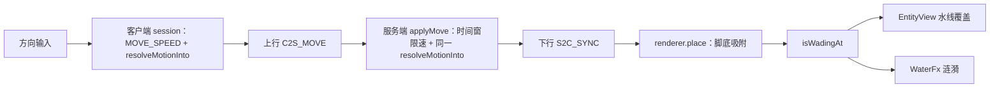

## 产品概述
园区里的湖面、河道和小水塘从“不可进入的障碍”变成可涉水区域。角色可以直接从岸边走进水里，岛外围的海仍是不可跨越的世界边界。

## 核心功能
- 湖面、主河、晨会溪、小水塘全部可进入，岸边不再有隐形墙。
- 水中移动速度与陆地一致，不新增游泳姿态或额外操作。
- 半身入水表现：角色下半身被半透明水色覆盖，水线固定在膝腹之间，脚下阴影减淡。
- 涟漪：入水瞬间有水花，水中行走的落脚点持续出现扩散水波。
- 桥面、码头不触发涉水表现，仍是正常通行面。
- 出生点与脱困点不落在水里。
- 海水仍不可进入；走到河口会被海岸线挡住。
- 座位、道具、树木、小地图、区域名等既有行为不变。

## 视觉与体验
角色走进水里时，腿部逐渐被水色吞没，水线随脚底固定在水面高度；行走时脚下荡开浅色水波，入水第一下有更大的水花。整体保持现有暖色低饱和像素风，不出现整块蓝色矩形或半透明渐变。

## 验收标准
- 从四个方向走进摸鱼湖、主河、晨会溪和小水塘，均能到达水心并自由走出。
- 桥面中心、码头木板上行走时不显示涉水覆盖与涟漪。
- 角色走向岛外海岸时仍被挡住，无法进入海水。
- 本地角色与远端角色表现一致；200 人同屏时帧率无明显下降。


## 技术栈
- Monorepo：pnpm workspace + Turborepo，TypeScript。
- 世界契约：`packages/shared-types`，纯函数、无框架依赖，服务端与客户端共用同一份地形几何与移动求解。
- 服务端：Bun + WebSocket 权威移动，20Hz tick，移动包限速后调用 `resolveMotionInto`。
- 客户端：Next.js + PixiJS v8，运行时生成像素纹理，`nearest` 采样，整数纹素。
- 测试：vitest（shared-types）+ bun:test（web/server）。

## 方案选择

### 方案 A（采纳）：水域不再是碰撞体
- 从 `collision.ts` 的 blocker 列表中移除湖面与河道多边形，删除 `water` 字段与 `isBlocked` 中的 `onBridge` 分支。
- 新增纯函数 `isWadingAt(x, y)`：在桥面/码头上返回 false，否则返回 `isWaterAt(x, y)`。
- 海水继续由 `isOnLand` 兜底，因此“岛内水域全可进、海仍是边界”不需要新增判定分支。
- 收益：改动最小、双端天然一致；不扩协议、不改限速、不加持久化。
- 代价：水域不再有通行代价；桥与码头从“唯一渡口”退化为装饰性通行面。
- 回滚：恢复两段水多边形注册与 `water` 分支，删除涉水表现相关文件即可，回滚成本低。

### 方案 B（否决）：保留水 blocker，增加 `passable` 标记
当前只有一种水域语义，`passable` 是为“深水不可进/浅水可进”预留的投机抽象；字段与分支仍在热路径上。

### 方案 C（否决）：水域通行策略配置
没有第二个消费方，配置无人读取，属于过度设计。

## 架构判定与基线

```text
BASELINE | shared-types/world/collision.ts | expected: 纯几何与移动求解，双端同源，无框架依赖 | observed: 湖/河以 water 多边形注册，isBlocked 用 onBridge 放行桥面 | fit: align | patterns: [P-Strategy] | violations: [] | suggestion: 移除水 blocker，保留 isOnLand 作为海边界
BASELINE | shared-types/world/layout.ts | expected: 世界内容与几何查询的唯一来源 | observed: isWaterAt 对每个湖/河做全量 pointInPolygon，isOnBridge 含桥与码头 | fit: align | patterns: [] | violations: [] | suggestion: 新增 isWadingAt，并给 isWaterAt 加包围盒粗筛
BASELINE | apps/web/lib/game/renderer.ts | expected: 渲染适配层，只消费世界契约，不复制地形规则 | observed: EntityView 只有阴影与本体，place 每帧按脚底 y 排序 | fit: align | patterns: [G-Composite] | violations: [] | suggestion: 在 place 中接入 isWadingAt，覆盖层与涟漪拆到独立 WaterFx
```

## 实现路径

### 1. 放开湖河碰撞
`packages/shared-types/src/world/collision.ts`
- 删除 `WORLD_LAYOUT.lakes` 与 `WORLD_LAYOUT.rivers` 的 blocker 注册。
- 从 `Blocker` 联合类型中删除 `water` 字段，删除 `isBlocked` 里的 `onBridge` 与 `water` 分支；保留 `isOnLand(x, y, radius)` 作为海边界的第一道判断。
- 更新文件头注释：湖河可涉水，海仍是边界，桥/码头只是正常通行面。
- `findFreePoint` 增加第四个参数 `avoidWater = true`：出生与脱困默认避开水面；`resolveMotionInto` 的卡死恢复传 `false`，允许把角色放到水里，避免在狭小岸边兜底传送到广场。

`packages/shared-types/src/world/layout.ts`
- 新增：
  `isWadingAt(x: number, y: number): boolean`
  先判 `isOnBridge` 短路返回 false，再返回 `isWaterAt`。
- `isWaterAt` 改为先做 `rectContains(lake.rect / river.rect)` 粗筛，再调用 `pointInPolygon`；`distanceSqToWater` 保持原样，避免改变撒树、贴花、花海等确定性世界内容。

### 2. 服务端出生点
`apps/game-server/src/server.ts`
- `spawnPoint` 的采样拒绝条件补上 `isWaterAt(x, y)`，确保 16 次重抽期间不会把出生点放进湖心或河心。
- `findFreePoint` 使用默认 `avoidWater = true`，作为第二道保险。
- `applyMove`、`MOVE_SPEED`、协议、AOI、座位逻辑全部不动。

### 3. 客户端涉水表现
`apps/web/lib/game/water-fx.ts`（新增）
- `makeWadingTexture(renderer)`：生成 30×16 纹素的水线覆盖纹理，`nearest`、无抗锯齿。主体用 `waterMid` 半透明，底部压一层 `waterDeep`，顶部 1–2 行用 `waterFoam` 画断续水线；颜色全部取自 `terrain-palette`。
- `WaterFx`：固定 24 个精灵的对象池，预生成 3 帧环形涟漪纹理。`spawn(x, y, big)` 只改 position / texture / alpha / visible；`update(dtMs)` 按寿命切帧并淡出，不做浮点缩放；`destroy` 先销毁精灵再销毁纹理。
- 容器放在 `fx` 之后、`sortLayer` 之前，涟漪压在水面上、角色脚下。

`apps/web/lib/game/renderer.ts`
- `EntityView` 新增 `wadingSprite`（锚点 0.5,1，固定在脚底 y=0），`init` 时按“阴影 → 本体 → 水线覆盖”顺序挂到 `root`。
- `EntityView.setWadingAt(x, y): boolean`：缓存上次吸附后的脚底坐标，位置未变直接返回；变化时才调用 `isWadingAt`。状态翻转时切换覆盖层可见性、把阴影 alpha 降到 0.35；进入水中返回 true，用于触发入水水花。
- `EntityView.setPose` 的落脚回调改为 `(x, y, wading)`，由 renderer 分流：陆地走 `GroundFx.spawn`，水中走 `WaterFx.spawn`。
- `GameRenderer.place` 每帧在 `setPosition` 后调用 `setWadingAt`；返回 true 时触发一次大水花。`addEntity` 初始化时也调用一次，避免远端角色入场首帧没有水线。
- `buildLayers` 创建 `wadingTexture` 与 `WaterFx`；`tickBubbles` 增加 `waterFx.update`；`destroy` 先销毁视图与粒子，再销毁共享纹理。
- 覆盖层固定在世界脚底位置，不跟随 `setBob` 与 `applyJump`，跳跃时水线仍贴着水面。

### 4. 性能与可靠性
- `isWaterAt` 的包围盒粗筛把“陆地角色每帧遍历 48 顶点河多边形”降为几次矩形判断。
- `setWadingAt` 的位置缓存让站立不动的角色零几何查询；200 人同屏只有移动中的实体重新采样。
- 涟漪固定池 24 个，水线纹理所有角色共享，不新增每个角色的 TilingSprite，不破坏合批。
- 非有限坐标在 `isWadingAt` 与 `isWaterAt` 中直接返回 false；海水、桥面、码头三类边界都有明确分支。
- 不新增协议字段、姿态位、服务端 tick 工作与网络字节。

### 5. 测试与文档
- `packages/shared-types/src/__tests__/collision.test.ts`
  - 将“湖面不可进入”“桥面以外的河段挡人”改写为“可涉水进入”，断言终点进入水面。
  - 新增“海仍是边界”“桥面与码头不算涉水”“湖心算涉水”“出生点不落在水里”。
  - 保留座位、道具、树木“不在水里”的既有断言。
- 新增 `docs/adr/0030-wadeable-water.md`：记录湖河可涉水、海仍边界、桥/码头不再唯一渡口、半身入水与涟漪表现、速度不变、回滚路径与复核信号；标注取代 ADR-0008 与 ADR-0015 中“水域一律不可涉”的旧结论。历史 ADR 原文不改。
- 清理 `collision.ts` 头注释与 `layout.ts` 中“水域放行区”的过时描述。

## 架构与数据流



单一事实来源：`shared-types/world` 的水面/桥面几何。服务端只负责权威位置，客户端只消费 `isWadingAt` 做表现；`water-fx.ts` 是渲染适配器，不复制任何地形规则。

## 目录结构

```text
niuma/
├── packages/shared-types/src/
│   ├── world/
│   │   ├── collision.ts        # [MODIFY] 移除湖河 blocker 与 water 分支；findFreePoint 增加 avoidWater；更新头注释
│   │   └── layout.ts           # [MODIFY] 新增 isWadingAt；isWaterAt 增加包围盒粗筛；更新涉水注释
│   └── __tests__/
│       └── collision.test.ts   # [MODIFY] 湖河可进、海仍边界、桥码头不涉水、出生避水的断言
├── apps/game-server/src/
│   └── server.ts               # [MODIFY] spawnPoint 拒绝水面，出生与脱困避水
├── apps/web/lib/game/
│   ├── renderer.ts             # [MODIFY] EntityView 水线覆盖、setWadingAt、place 接入、WaterFx 生命周期
│   └── water-fx.ts             # [NEW] 水线覆盖纹理、3 帧涟漪纹理、固定粒子池
└── docs/adr/
    └── 0030-wadeable-water.md  # [NEW] 湖河可涉水的架构决策、后果、回滚与复核信号
```

## 关键接口

```ts
export function isWadingAt(x: number, y: number): boolean;

export function findFreePoint(
  x: number,
  y: number,
  radius?: number,
  avoidWater?: boolean,
): { x: number; y: number };

class WaterFx {
  readonly container: Container;
  spawn(x: number, y: number, big?: boolean): void;
  update(dtMs: number): void;
  destroy(): void;
}
```

## 明确不做
- 不改移动速度、不新增游泳姿态与协议位。
- 不放行海水，不重定义世界边界。
- 不改小地图、区域名、座位、AOI、聊天与道具交互。
- 不为“未来深水/浅水”预留配置或抽象。


## Agent Extensions
### Skill
- **principal-software-architect**
  - Purpose: 将“水域从碰撞体变为可通行区域”的契约变更固化为 ADR，明确双端一致性、海边界、回滚路径与复核信号。
  - Expected outcome: 产出 `docs/adr/0030-wadeable-water.md`，并在计划执行时用同一套权衡结论约束实现，不引入协议或配置层的额外抽象。
