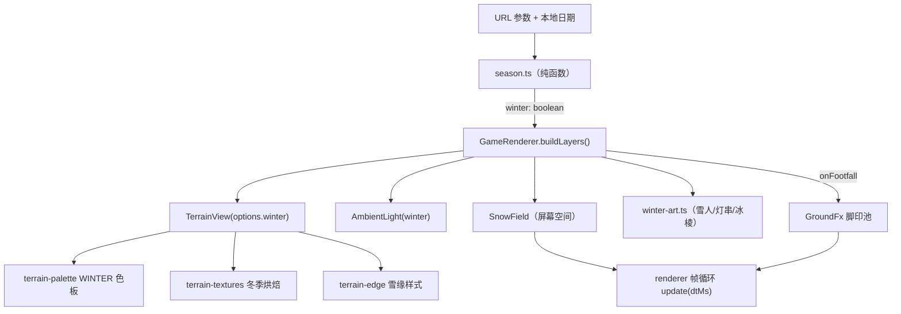

## 用户需求

园区进入冬季，加入雪与相关冬季元素。核心是在**不改变玩法、碰撞与协议**的前提下，让整座园区在视觉上“下过一场雪”。

## 产品总览

打开园区时，若本地日期落在 12 月至次年 2 月，世界自动入冬：天空持续飘落细雪，草地、林地、花海与广场铺上一层薄雪，树冠顶出积雪，水色转冷、岸边浮起薄冰，角色走过雪地留下渐隐脚印。休息庭院与院落中庭摆着雪人与雪堆，部分树挂上暖色灯串，四角院落屋檐垂着冰棱。土路、沙滩、水面与所有室内区域保持原样，看起来是“雪被踩化、被浪打湿、被屋檐挡住”。

## 核心功能

1. **入冬判定**
   - 默认按访问者本地日期判断：12、1、2 月为冬季。
   - 可通过 URL 参数强制开启或关闭，行为与现有 `?light=0`、`?flat=1` 的灰度开关一致。

2. **飘雪**
   - 整屏细雪缓慢下落，带轻微左右飘移，雪粒为 1 至 2 像素的硬边白点，落在角色前方。
   - 密度跟随视口面积，窗口缩放后自动重排，不出现“贴着镜头不动”的雪块。

3. **地面覆雪**
   - 草地、林地、花海、广场统一变为积雪面：主体为略带蓝调的白，叠大小不一的雪堆色簇与零星露出的草尖。
   - 沙滩、土路、木桥、码头、水面不被雪覆盖。
   - 草地与土路的交界不再长绿草尖，改为从雪面探出的雪缘。

4. **树冠与水面**
   - 树冠顶部与外围积一层雪，轮廓比夏季更圆润，树冠整体仍可被遮挡淡出。
   - 湖水、河水、海水转为更冷更淡的色调，岸边浮一圈薄冰。

5. **脚印**
   - 角色每走一段距离在雪地上留下一个 3 像素宽的深色脚印，约数秒内淡出，多人同屏各自独立。
   - 走上土路、木桥、沙滩或涉水时不产生脚印。

6. **冬季道具**
   - 雪人：胡萝卜鼻、围巾与帽子，摆在休息庭院与中庭等开阔处。
   - 雪堆：成组的小雪丘，散布在花海边缘与路角。
   - 灯串：部分树冠上挂一串暖色小灯，白天几乎不显，夜间柔光下成为暖点。
   - 冰棱：四角院落外墙檐口垂下一排 3 至 6 像素的冰棱。
   - 以上全部为纯装饰，不参与碰撞，不阻挡通行。

7. **室内豁免**

   会议室、宿舍区、卫生间、工作区的地板与墙体保持原样，室内看不到积雪与冰棱。

8. **开关**
   - 默认自动；可手动强制冬季或关闭冬季。
   - 可单独关闭飘雪而保留全部雪景，便于定位观感问题。

## 视觉目标

整体维持项目既有的暖色低饱和像素风，冬季版本把“暖”压低一档而不变冷硬：雪不是纯白，而是带一点米蓝的暖白；阴影不是纯黑，而是雪面特有的蓝灰；夜间不压成黑场，而是让灯串的暖橙在冷蓝里浮出来。画面第一眼应当是“安静、干净、有呼吸感的一场雪”，而不是贴了一张白色蒙版。


## 技术选型

| 层 | 选型 | 说明 |
|---|---|---|
| 渲染 | PixiJS 8（既有） | 不引入任何新运行时依赖 |
| 语言 | TypeScript 5 strict | 与仓库 tsconfig 一致 |
| 外壳 | Next.js 15 App Router | 改动全部落在 `'use client'` 的渲染层 |
| 美术 | 程序化 Graphics 烘焙 | 沿用 `bake()` + `organicBlob()`，无外部素材 |
| 测试 | vitest | 沿用 `apps/web/lib/game/__tests__` |

## 实现策略

把“冬季”收敛成**一个客户端布尔量**：由唯一入口 `season.ts` 从本地日期与 URL 参数读出，再单向注入四类消费方——地形纹理、边缘样式、屏幕空间粒子、环境光。消费方一律接收 `winter: boolean`，不自己读日期，保证同一帧里所有图层的季节判断一致，也方便单测。

所有冬季纹理在构造期一次性烘焙（`TerrainView` 构造函数内），帧循环只改 `position`、`alpha`、`tilePosition`，不 `generateTexture`、不 `new` 对象。

## 关键决策与权衡

| 决策 | 选择 | 理由 | 代价 |
|---|---|---|---|
| 季节归属 | 纯客户端，零服务端改动 | 服务端权威碰撞 + 静态共享地形不允许季节性障碍；冬夏可行走区域必须完全相同 | 无法实现“雪地打滑/减速”，故明确不做 |
| 覆雪实现 | 一层平铺覆盖，而非重画每种地面的冬季纹理 | 一处改动覆盖草地/林地/花海/广场，纹理预算只加一张 512 平铺 | 雪面细节全部由这一张承担 |
| 雪的层序 | 插在 `addPlaza()` 之后、`addPaths()` 之前 | 土路与沙岸自然不被雪盖，读作“路被踩化、岸被浪打湿” | 需为覆雪层单独做内缩遮罩 |
| 覆雪遮罩 | `offsetContour(ISLAND.points, -ISLAND_SAND)` 生成陆地内缩多边形 | 复用 `addShoreSand` 已用过并被验证的偏移方法，避开沙滩带 | 急弯处需沿用既有的 bevel 处理 |
| 水色转冷 | 烘焙冬季水面/海面纹理，不用 `tint` | `multiply` 只能压亮部，调不出“更冷更淡”的水 | 多两张 96×96 纹理 |
| 树冠积雪 | 在 `makeTreeParts` 内参数化，不额外叠精灵 | 雪帽与树冠共用同一套行宽算法，天然对齐，不引入第二套锚点 | 树冠纹理数量翻倍（4 棵树 × 1 张树冠） |
| 草缘换色 | `edgeGlyphs` 增加可选样式覆盖，默认行为不变 | 否则雪地上会长出绿草尖，且既有 `terrain-edge.test.ts` 不受影响 | `TerrainView` 需在冬季传入覆盖表 |
| 冬季贴花 | 整层不生成 | 花与草叶本就被雪埋，同时省掉 900–1200 个精灵 | 冬季失去贴花层的草地细节（由雪面色簇承担） |
| 脚印 | 复用 `EntityView` 的 `onFootfall` 回调 | 与尘土/涟漪同一条触地通路，不新建移动检测，不新增每帧状态 | 脚印精度受接触帧驱动，不跟随亚像素位移 |
| 飘雪坐标 | 屏幕空间，挂在 `stage` 上、`AmbientLight` 之下 | 与相机解耦，缩放与相机夹取不会让雪跟着世界抖 | 雪不参与世界深度排序（视觉上可接受） |

## 架构设计



数据流是单向的：`season` 只被 `GameRenderer.buildLayers()` 读一次，其余模块只消费 `winter` 布尔量与已烘焙好的纹理，没有反向依赖，也没有运行期重新判定季节的分支。

## 目录结构

```
apps/web/lib/game/
├── season.ts                     # [NEW] 季节判定唯一入口。导出 isWinterMonth(month)、readSeason(params, now)。readSeason 返回 { winter, snow, source }：source 区分 date / url-on / url-off，snow 表示飘雪粒子是否开启（?snow=0 只关粒子，?season=off 关闭整层）。纯函数，不碰 window，参数由调用方注入，便于单测。
├── snow-fx.ts                    # [NEW] 屏幕空间飘雪。构造期烘焙 1 张 2×2 白点纹理；按视口面积算出 60–180 个精灵的对象池（上限硬编码），每个精灵持有 vx/vy/phase/alpha，update(dtMs, w, h) 只改 position 与 alpha，resize 时把越界精灵重新投放。禁止在帧循环里分配对象或读随机数生成器实例。
├── winter-art.ts                 # [NEW] 冬季静态道具。烘焙雪人（约 18×30）、雪堆（三档 24×12）、灯串（约 40×20 的暖色串灯）与冰棱（三档 3–6px 竖条）四套纹理；按确定性锚点表摆放雪人与雪堆（休息庭院、院落中庭、路角），按位置哈希给部分树挂灯串，按 WORLD_LAYOUT.solids 里 kind === 'wall' 且宽度大于高度的墙体外檐每 14px 挂一根冰棱（合并进一个 Graphics，不逐根建 Sprite）。导出一个 attach(depth, propsBase, renderer) 与 updateLight(alpha)。
├── season.test.ts                # [NEW] 见 __tests__/season.test.ts
├── terrain-palette.ts            # [MODIFY] 追加 WINTER 色块：snowBase 0xE9F0F7 / snowLight 0xF4F8FC / snowShade 0xD3DFEC / snowDeep 0xB4C6D9 / iceBase 0xCBE6F0 / iceEdge 0x8FB6C8 / iceDeep 0x6F97AC / bulbWarm 0xFFD08A / footprint 0xA9BCCF。注释里写明“不出现纯白与纯黑，暗部取雪色相压暗”，与 EDGE_TINT 的纪律一致。
├── terrain-textures.ts           # [MODIFY] 新增 makeSnowTexture(renderer)（512 平铺：snowBase 底 + 24 个 organicBlob 雪堆色簇 + 少量露出的草尖点 + 1px 噪点，全部走 wrappedRect 保证无缝）；makeWaterTexture / makeSeaTexture / makeTreeTextures 增加可选 { winter } 参数，冬季水色转冷、树冠顶部按行宽追加雪帽（雪帽颜色取 snowLight/snowShade，仍保留 canopyEdge 作为外沿暗边，不换描边体系）。
├── terrain-edge.ts               # [MODIFY] 导出 WINTER_GRASS_FRINGE 与 WINTER_EDGE_STYLE（至少覆盖 grass 与 dirt 两档）；edgeGlyphs 的 options 增加可选 style 与 fringe 覆盖，缺省仍用现有 EDGE_STYLE / GRASS_FRINGE，既有测试与调用方零改动。
├── terrain.ts                    # [MODIFY] TerrainOptions 增加 winter；构造期按 winter 选纹理；build() 在 addPlaza() 之后插入 addSnowCover()（TilingSprite + offsetContour 内缩多边形遮罩，tilePosition 按世界坐标对齐，pivot 与 grass 一致）；addDecals() 在 winter 时直接返回；addLake/addRivers 在冬季补一圈 iceBase 细边（沿用 contour，宽 2–3px）；addTrees 的树冠在冬季让树冠 alpha 上限略高于夏季（雪面反光），遮挡逻辑仍是同一套 trackCanopy。
├── fx.ts                         # [MODIFY] GroundFx 增加脚印池：1 张 3×2 硬边纹理、96 个精灵、spawnFootprint(x, y, flip)、在 update(dtMs) 里与尘土同一循环淡出（寿命约 9s，分三档 alpha，不做渐变贴图）。尘土逻辑与纹理完全不动。
├── ambient-light.ts              # [MODIFY] lightToneAt(hour, winter) 增加可选第二参数与 WINTER_ANCHORS：日出推后到 7:30、日落提前到 17:00、夜间冷蓝 alpha 抬到 0.16；AmbientLight 构造时接收 winter，30s 采样的节流逻辑不变。
├── renderer.ts                   # [MODIFY] buildLayers() 顶部用 readSeason 读一次季节；把 winter 传给 TerrainView / AmbientLight / winter-art；构造 SnowField 并挂在 world 之上、light 之下；onFootfall 回调里在 !wading 且落在雪面时调用 spawnFootprint；帧循环 update(dtMs) 里追加 snow 与 winter-art 的更新；init() 里 light 与 snow 的 resize 同步。新增 ?season / ?snow 两个开关的读取。
└── __tests__/
    └── season.test.ts            # [NEW] 覆盖：12/1/2 月为冬季、3/6/11 月为非冬季；?season=winter 在 7 月强制开；?season=off 在 1 月强制关；?snow=0 保留 winter 但关闭粒子；非法值回落默认。

docs/adr/
└── 0046-winter-season-layer.md   # [NEW] 记录“季节不进服务端”的边界决策、覆雪层序、草缘换色与回退开关；不改写既有 ADR（仓库存在重号的 0043，不触碰）。

README.md                         # [MODIFY] 在「地图与地形」之后补一节「冬季」，写清自动入冬区间、三档开关、以及“冬季不改碰撞”的边界。
```

## 视觉与调色要点

- 雪面三档明度：`snowLight` 只用于雪堆受光面与脚印边缘，`snowBase` 是地面主体，`snowShade` 是堆与堆之间的接触暗部。第四档 `snowDeep` 仅用于雪缘齿尖与冰棱根部，不铺大面积。
- 冰不是玻璃：`iceBase` 只以 2–3px 细边出现在水岸内侧，绝不整片覆盖水面，否则会读成“水面换了个颜色”。
- 灯串的暖光只在夜间柔光下才显：白天 alpha 约 0.25，夜间 1.0；亮度切换挂在既有 30s 光照采样上，不新增每帧计算。
- 脚印颜色取雪面的蓝灰而不是泥色，否则会读成“地上有脏点”。

## 性能与可靠性

- **纹理预算**：新增 1 张 512 雪面 + 2 张 96 水面 + 4 张树冠（冬季变体）+ 约 8 张小道具纹理，全部在构造期烘焙一次。
- **精灵预算**：覆雪层 1 个 TilingSprite + 1 个遮罩；飘雪不超过 180 个；脚印 96 个；灯串约 24 个；冰棱合并为 1 个 Graphics。冬季同时**净减少**约 900–1200 个贴花精灵。
- **帧循环纪律**：飘雪与脚印的更新只做数值累加与 `position.set` / `alpha` 赋值；`resize` 之外不重新计算布局；不新建数组、Set 或临时向量。
- **合批**：飘雪共用 1 张纹理，仅靠 `tint` 与 `alpha` 制造层次，避免逐粒纹理切换打断批次。
- **失败兜底**：若某台机器上 `multiply` 柔光未生效（WebGPU 扩展路径），冬季只表现为光色略亮一档，雪层本身仍正确；灰度开关可一键退回。
- **回退**：全部改动在 Web 侧，服务端与 `packages/shared-types` 零改动，**不需要双端发版**；`?season=off` 等价于线上关闭冬季，回滚只需回滚 Web。

## 验证

1. `pnpm typecheck` 与 `pnpm test` 全绿（新增 season 单测不改变既有用例）。
2. 把系统时间改到 1 月与 7 月各进一次园区，确认默认值符合预期；`?season=winter` 在 7 月能看到完整冬景；`?season=off` 在 1 月与改动前完全一致。
3. 走到河边、桥上、沙滩、土路、会议室、宿舍、卫生间逐一确认：不覆雪、不出冰棱、不留脚印。
4. 两人同屏互走，确认脚印与雪层都不影响移动与遮挡淡出；树后角色仍只让树冠淡到既定 alpha。
5. 压测口径不变：60 人在线时对比改动前后帧时间，确认飘雪与脚印未引入可测量的帧抖动。


## Agent Extensions

### Skill
- **principal-software-architect**
  - Purpose: 复核“季节只存在于客户端、不改碰撞与协议”这一边界决策，以及新增模块的落层位置（config → 表现层 → 渲染层），产出 ADR-0046 的结构与权衡记录。
  - Expected outcome: 一份可落地的边界结论与 ADR 正文，明确非目标（不做打滑/减速、不做全站冬季）与 30 天回滚路径（`?season=off` 与 Web 单侧回滚）。

- **impeccable**
  - Purpose: 对冬季视觉层做一次 `audit` 与 `polish`：检查雪面与角色的对比度、夜间灯串的可读性、雪层在多种分辨率下的观感，以及是否存在“白蒙版感”“低对比糊成一片”等反模式。
  - Expected outcome: 一份针对雪景色板、明度阶梯与动效节奏的修正清单，并落到 `terrain-palette.ts` 与 `snow-fx.ts` 的具体数值上。
