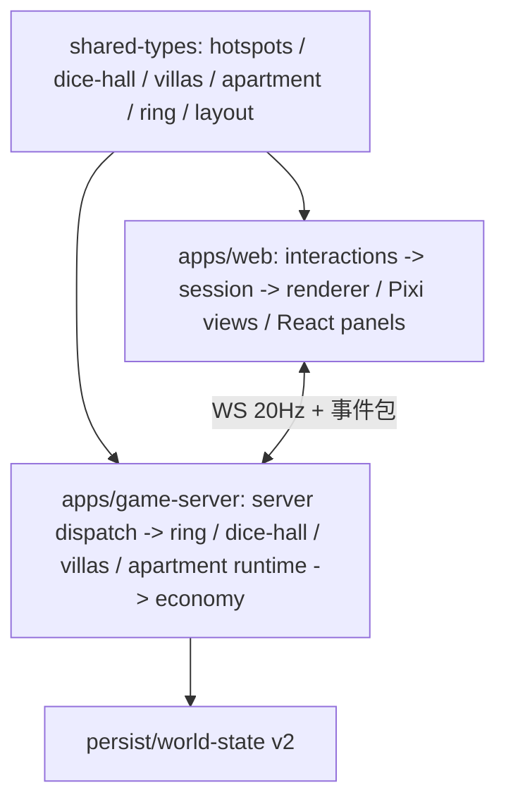

## 用户需求
在 niuma 园区内建立数据驱动的统一热区注册表，并新增四类功能建筑与高阶多人玩法，同时不破坏现有广场、院落、湖泊、研发园与冬季覆雪表现。

## 核心功能
- **统一热区**：抽离 `HotspotDef { id, kind, x, y, radius, label, seatGroupId? }` 与 `WORLD_HOTSPOTS` 表；客户端「按 F 提示条」与服务端交互校验都改为查表，新增建筑只需注册一条热区。
- **摸鱼大赌场 `DICE_HALL`**：西侧空地新建开放式豪华亭，2 张 6 人绿绒赌桌共 12 座。坐上赌桌按 F 加入公共局，每 10 秒自动开奖，押大/小/豹子，多人同赢同输，0% 抽水；每局 5% 概率触发 NPC 保安查岗抽水彩蛋。
- **绩效八角笼 `ARENA`**：把现有擂台整体改造为带围栏（南北留门洞）的八角擂台，配 4 张观战长椅。踏进报名区交 50 币当擂主，挑战者上台开启红蓝公开赛；长椅观战者可弹窗押注红蓝；擂主连胜 3 场触发全服广播。
- **赛博茶水强化站**：现有茶水站升级为霓虹小亭，商店增加装扮页签，售卖永久属性与装扮。
- **豪宅小院 `VILLA_1 / VILLA_2`**：无主时门口牌匾标价 1000 币，按 F 买下本运行周期冠名权，牌匾实时显示房主名；房主可切换锁门并每 60 秒从摇钱树收 25 币。
- **牛马公寓 `APARTMENT`**：门口按 F 进入私有户型（0 纸箱 / 1 隔断 / 2 一居室 / 3 大平层），家具可在网格内购买摆放，生成临时门牌号邀请好友串门，同屋玩家互相可见并可坐沙发。
- **同步要求**：导览牌 `NAV_TARGETS`、小地图绘制、y-band 深度排序与冬季覆雪全部同步；新增地图测试覆盖可达、不压路、不入水。

## 视觉与体验
延续方角像素与深墨 UI：赌场绿绒配黄铜与暖灯串，八角笼铁灰围栏配红蓝角台与聚光灯，豪宅砖红院墙配黑底金字牌匾与金色摇钱树粒子，公寓外立面水泥灰配霓虹门牌、室内按档位从纸箱堆过渡到冷白大平层，茶水站青紫霓虹；所有新弹层沿用现有 ink/mint 方角风格，押注走居中卡、商店走右抽屉。


## 技术栈
沿用现有技术栈，不引入新依赖：TypeScript pnpm monorepo；`packages/shared-types` 纯 TS 共享真相源；服务端 Bun WebSocket（20Hz tick）；客户端 Next.js 15 + React 19 + PixiJS 8 + zustand + Tailwind；测试 Vitest；持久化走 `apps/game-server/src/persist/`（JSON 原子写）。

## 实施思路
核心策略是「共享常量先行，服务端权威结算，客户端只做表现与预测」。四类建筑全部由 `packages/shared-types/src/world/` 下的纯常量模块描述（坐标、碰撞、座位、热区、规则数值），服务端与客户端共用同一份，从根上避免坐标漂移。

1. **热区注册表**：`hotspots.ts` 导出有序 `WORLD_HOTSPOTS` 数组（数组下标即线上 u8 标识），并派生 `HOTSPOT_INDEX`、`hotspotById`、`isWithinHotspot`、`nearestHotspot`。客户端 `selectContextHint` 改为「按 kind 优先级取最近命中」，把公告板朝向、老板矩形等特例保留在原有谓词里；服务端新增 `C2S_HOTSPOT_INTERACT`，先查表再校验距离（radius + 240px 延迟余量）与阶段/余额，取代散落的距离判断。
2. **押注结算用彩池（pari-mutuel）而非固定赔率**：每局所有注额合池，命中档位按注额比例分走全池，0 抽水且不增发货币；命中档位无人下注则全额退款。赌桌「大/小/豹子」与八角笼「红/蓝」共用同一套池结算，天然支持多人同赢同输。整数除法余数按注额降序、玩家 id 兜底分配，保证确定性。
3. **擂台改造保持接口稳定**：保留 `RingRuntime` 与 `enter/leave` 签名（单测大量直接调用），把 `RING_CAPACITY` 改为 2、新增红蓝名额与擂主连胜字段；50 币报名费在 `server.ts` 调用 `enter` 之前用 `trySpendCoins` 扣除，结算时把 100 币彩池发给胜者。`clampToRing` 继续只约束参赛者，非参赛者可经南北门洞走进报名区。
4. **公寓用「地图远端的实体房间槽位」实现局部同步**：每个房间是 8192 地图内未被使用的坐标矩形（y ≥ 6100 网格排布），因此移动、AOI、深度排序、相机跟随全部复用，无需第二套坐标系。给 `Player` 增加 `roomId`，`refreshView` 按 `roomId` 过滤 known 集合，进出房间走 teleport + despawn，达到「屋内互见、屋外不可见」。家具由客户端存储，进房时上送布局（u8 家具 id × 网格），服务端按 houseTier 校验件数与合法性后广播 `S2C_ROOM_STATE`。
5. **豪宅门锁的动态碰撞**：静态 `WORLD_LAYOUT.solids` 不可变，锁门用共享纯函数 `villaDoorSolid(villa, locked)` 生成一条门栅，服务端移动裁决与客户端预测共用同一判定；锁状态经 `S2C_VILLA_STATE` 广播，worker 内缓存后参与预测，避免预测与权威不一致。
6. **持久化**：`world-state` 升到 v2，新增 `villas`（房主 deviceId/名字/锁状态/上次收币时间）与 `rooms`（deviceId→门牌号/家具），`normalizeWorldState` 接受 v1 并按空值迁移，坏档仍隔离不覆盖。金币与属性继续遵守 ADR-0082：会话内服务端权威，长期存档在浏览器 localStorage，只通过 `S2C_WALLET_SYNC` 回写。

## 性能与可靠性
- 热区查询按 kind 分桶 + 线性扫描（表规模 < 40），O(k) 且只在提示计算/交互时调用，不进 20Hz 路径；距离判断用平方距离避免开方。
- 押注池结算 O(n log n)（仅按注额排序，n ≤ 12），每局一次；赌桌 tick 只需比较时间戳，无逐帧分配。
- 新下行包一律复用预分配 writer，广播沿用现有 `known` 集合与 `broadcastXxx` 模式；钱包快照只发本人，避免全服放大。
- 房间 AOI 过滤发生在 `refreshView` 的既有循环内，不新增遍历；家具布局上限 32 格，包体有界。

## 关键风险与规避
- `guard.ts` 的 `TABLE_SIZE` 必须抬到新最大 opcode + 1，否则新包全部被判非法。
- 新增提示文案必须同时补 `HINT`、`HINT_BUTTONS`、`TOUCH_HINTS` 三张穷尽表，否则编译失败。
- 新下行消息若漏改 `worker-host.ts` / `worker-client.ts`，Worker 模式会静默丢包，必须逐一透传。
- `CLINIC_*` 已被急救站占用，茶水站沿用 `TEA_STATION` 与新内部名 `TEA_BAR`，对外显示「赛博茶水强化站」。
- 新地块必须落在岛屿内且不压 `PATHS`、`LAKES`、`CAMPUS_RECT`、`SOUTH_YARD`、`CLINIC_RECT` 与树丛，坐标以布局测试为准做小幅微调。

## 架构设计


## 目录结构
```text
packages/shared-types/src/
├── world/
│   ├── hotspots.ts          # [NEW] HotspotDef、HotspotKind、WORLD_HOTSPOTS、HOTSPOT_INDEX、hotspotById/isWithinHotspot/nearestHotspot/nearestHotspotOfKinds；label 复用 hint key，座位组通过 seatGroupId 关联
│   ├── dice-hall.ts         # [NEW] DICE_HALL 亭体/双桌/12 座/柱与桌沿碰撞/招牌位/保安巡逻点；公共局规则常量（10s 下注、1.5s 摇骰、4s 亮牌、押注上限、豹子档、查岗概率 5%）
│   ├── villas.ts            # [NEW] VILLA_1/VILLA_2 院墙、门、牌匾位、摇钱树位、价格 1000、每分钟 25、锁门门栅纯函数 villaDoorSolid
│   ├── apartment.ts         # [NEW] APARTMENT 外立面与门口热区、ROOM_SLOTS 远端房间矩形、四档户型尺寸、家具目录与网格规格、门牌号生成、clampToRoom、房间碰撞
│   ├── ring.ts              # [MODIFY] 八角笼化：RING_CAPACITY=2、红蓝起跑位、围栏段与南北门洞、4 个观战长椅座位组、报名区、RING_FEE=50、RING_STREAK=3、押注池类型
│   ├── campus.ts            # [MODIFY] SeatInstance 增加可选 group 字段；findNearestSeat 支持组过滤
│   ├── collision.ts         # [MODIFY] 支持房间矩形视为可站区、动态门栅阻挡
│   └── layout.ts            # [MODIFY] 汇总新地块到 WORLD_LAYOUT 的 buildings/paved/solids/seats/props；NAV_TARGETS 增加 diceHall/villa1/villa2/apartment 并把擂台改名绩效八角笼；REGIONS 增加赌场、豪宅区、公寓区
├── economy.ts               # [MODIFY] 追加 WALLET_REASON（DiceBet/DiceWin/GuardRake/ArenaFee/ArenaWin/ArenaBet/ArenaBetWin/ArenaBetLoss/VillaBuy/VillaIncome/Cosmetic）、赌注与彩池上限、COSMETIC_SKUS、HOUSE_TIER_PRICES、SHOP_KIND.Cosmetic=2
├── types.ts                 # [MODIFY] 追加 C2S_HOTSPOT_INTERACT、C2S_DICE_BET、C2S_ARENA_BET、C2S_APARTMENT、S2C_DICE_STATE、S2C_VILLA_STATE、S2C_ROOM_STATE、S2C_ROOM_INVITE
├── protocol.ts              # [MODIFY] 对应 encode/decode，范本 encodeShopBuy；所有 u16/u32 字段有界
├── index.ts                 # [MODIFY] 追加 world/hotspots、dice-hall、villas、apartment 导出
└── __tests__/               # [NEW] hotspots.test.ts、dice-hall-layout.test.ts、villa-layout.test.ts、apartment-layout.test.ts：可达/不压路/不入水/不互相重叠/热区半径命中

apps/game-server/src/
├── net/guard.ts             # [MODIFY] TABLE_SIZE 抬到 0x50，登记 4 个新上行定长包
├── server.ts                # [MODIFY] 热区交互分发、赌桌/擂台/豪宅/公寓分支、发奖与连胜广播、房间进出与视野刷新
├── sim/world.ts             # [MODIFY] Player 增加 roomId、arenaStreak、villaId、tableId 等字段
├── sim/view.ts              # [MODIFY] 按 roomId 过滤 known，进房 despawn 旧视野
├── sim/seats.ts             # [MODIFY] 支持按 seatGroupId 找空位
├── sim/ring.ts              # [MODIFY] 红蓝 1v1、报名费彩池、擂主连胜、押注池冻结与结算、Award 后退回等待
├── sim/dice-hall.ts         # [NEW] 两张桌的公共局状态机、押注登记、彩池结算、保安查岗彩蛋、状态广播节流
├── sim/villas.ts            # [NEW] 冠名权买卖、锁门、按分钟计息与领取、状态快照与落盘
├── sim/apartment.ts         # [NEW] 房间分配、门牌号、家具布局校验、同屋座位占用、邀请票据与进出裁决
├── economy/service.ts       # [MODIFY] payoutEscrow/grantFromPool、buyCosmetic、setHouseTier，全部只经此入口
├── persist/world-state.ts   # [MODIFY] v2：villas + rooms 段，兼容 v1 迁移
└── sim/*.test.ts            # [NEW] dice-hall、villas、apartment 单测；ring.test.ts 同步 2 人赛制

apps/web/
├── lib/game/interactions.ts # [MODIFY] 改为查 WORLD_HOTSPOTS，按 kind 优先级输出提示；保留旧导出委托
├── lib/game/hint-copy.ts    # [MODIFY] 三张穷尽表补赌桌、八角笼、豪宅、公寓、茶水站装扮文案
├── lib/game/session.ts      # [MODIFY] interact 按 kind 分发；新增赌注、押注、买房、锁门、收币、进出公寓意图
├── lib/net/client.ts        # [MODIFY] sendXxx 与下行 case，含 VillaState/RoomState/RoomInvite/DiceState
├── lib/game/runtime/worker-host.ts、client/worker-client.ts、runtime/worker-protocol.ts # [MODIFY] 新下行包与房间/锁门状态透传
├── lib/game/dice-hall-view.ts 与 dice-hall-art.ts   # [NEW] 亭子、双桌、筹码、霓虹牌、冬季积雪，按 y 挂 depth
├── lib/game/villas-view.ts 与 villa-art.ts          # [NEW] 院墙院门、动态牌匾（换址重绘）、摇钱树与金币粒子
├── lib/game/apartment-view.ts 与 apartment-art.ts   # [NEW] 外立面、霓虹门牌、四档室内地板、家具贴图与网格预览
├── lib/game/ring.ts、ring-art.ts、ring-status.ts    # [MODIFY] 八角形地面、围栏门洞、四个长椅、红蓝角台、押注池文案
├── lib/game/tea-station.ts  # [MODIFY] 霓虹配色与招牌、夜间发光
├── lib/game/renderer.ts     # [MODIFY] 按顺序挂载新视图与房间层，传 winter 标记
├── lib/game/minimap-draw.ts # [MODIFY] 新建筑填色与热区图标；在房间内改画房间平面图
├── lib/game/winter-art.ts   # [MODIFY] 新地标雪堆/雪人坐标，冰棱随 wall solid 自动生成
├── components/game/DiceHallDialog.tsx   # [NEW] 赌桌面板：档位选择、注额、倒计时、公共池、开奖亮牌
├── components/game/ArenaBetDialog.tsx   # [NEW] 长椅押注：红蓝双方、注额、池占比、锁定倒计时
├── components/game/VillaDialog.tsx      # [NEW] 买房/锁门/收币三态卡片
├── components/game/ApartmentDialog.tsx  # [NEW] 户型升级、家具网格摆放、门牌号与邀请、串门列表
├── components/game/CoinShopDialog.tsx   # [MODIFY] 增加装扮页签（kind 2）
├── components/game/RingHud.tsx          # [MODIFY] 红蓝血条、连胜、彩池
├── components/game/EconomyLayer.tsx     # [MODIFY] 挂载新弹层
└── lib/game-ui.ts                      # [MODIFY] zustand slice 增加新弹层开关与房间状态

docs/adr/0087-hotspot-registry-and-four-buildings.md  # [NEW] 热区注册表与地块/玩法总决策
docs/adr/0088-dice-arena-villa-apartment.md            # [NEW] 彩池押注、冠名权、房间局部同步
apps/web/data/release-notes.json                        # [MODIFY] 追加一条面向玩家的版本工报
```

## 关键代码结构
```ts
// packages/shared-types/src/world/hotspots.ts
export type HotspotKind =
  | 'board' | 'bulletin' | 'shrine' | 'tea' | 'boss' | 'ring'
  | 'diceTable' | 'arenaSeat' | 'villaGate' | 'villaPlaque' | 'villaTree' | 'apartmentDoor';

export interface HotspotDef {
  readonly id: string;
  readonly kind: HotspotKind;
  readonly x: number;
  readonly y: number;
  readonly radius: number;
  /** 指向 hint-copy 的 key，客户端据此取提示文案 */
  readonly label: string;
  readonly seatGroupId?: string;
}

export const WORLD_HOTSPOTS: readonly HotspotDef[];
export function hotspotById(id: string): HotspotDef | undefined;
export function isWithinHotspot(def: HotspotDef, x: number, y: number, slack?: number): boolean;
export function nearestHotspotOfKinds(
  x: number,
  y: number,
  kinds: readonly HotspotKind[],
  accept?: (def: HotspotDef) => boolean,
): HotspotDef | null;
```
```ts
// apps/game-server/src/economy/service.ts（新增方法签名）
payoutFromPool(player: Player, amount: number, reason: number): boolean;
buyCosmetic(player: Player, cosmeticId: number): boolean;
setHouseTier(player: Player, tier: number): boolean;
```


## 设计风格
延续园区既有的像素方角语言：世界内是程序化像素美术，界面是深墨底 + 薄荷主色 + 金币金的高对比 HUD，无圆角、硬投影，信息密度偏高但层级清晰。

## 世界建筑表现
- **摸鱼大赌场**：抬高的木质亭台，四角红柱与深绿顶棚，檐下暖黄灯串与青绿霓虹「摸鱼大赌场」招牌；两张绿绒赌桌带黄铜包边、筹码堆与吊灯；冬季顶棚积雪、檐口挂冰棱。
- **绩效八角笼**：八边形铁灰擂台，四周围栏留南北门洞，红蓝两角台与角旗，顶上两束聚光灯锥；场外四张木质长椅成排，栏杆上有押注灯牌。
- **豪宅小院**：两栋砖红院墙小楼，铁艺院门与黑底金字牌匾（有主时显示房主名与锁形图标），院内金色摇钱树带上升金币粒子。
- **牛马公寓**：水泥灰多层外墙 + 霓虹门牌号与信箱；室内四档递进——纸箱堆与地铺、灰色隔断与折叠桌、暖木一居室、冷白大平层带落地窗。
- **赛博茶水强化站**：原茶台加青紫霓虹灯管、悬浮价签与蒸汽粒子，夜间自发光。

## 界面弹窗
- 赌桌面板：居中卡片，顶部桌号与 10 秒倒计时环，中部三档押注按钮（大/小/豹子）与注额快捷 chips，底部公共池与「本局查岗风险」提示。
- 押注弹窗：居中卡片，红蓝双栏显示名字、血量、赔率占比，中部注额输入与全押，底部锁定倒计时。
- 豪宅卡片：三态切换（可购买/已拥有/已锁门），牌匾预览实时显示当前房主。
- 公寓面板：左栏户型档位与升级价，中间网格摆放画布支持拖拽吸附，右栏门牌号、锁门开关与好友邀请列表。
- 商店：沿用右侧抽屉，新增「装扮」页签，卡片含缩略像素预览、价格与已解锁标记。

## 交互与动效
热区提示条沿用底部 62% 落位，命中不同热区时图标与文案切换；押注成功金币从钱包飞向桌面；开奖时骰子 1.5 秒滚动后逐颗定格；擂台连胜 3 场触发顶部全服横幅与聚光灯扫射；冬季新建筑统一叠加雪覆盖与冷色环境光。

## 响应式
桌面以完整面板与键盘快捷键为主；触屏把面板改为底部抽屉、按钮放大到 44px，长椅押注与赌桌下注均提供全屏可点区域。

## Agent Extensions
### Skill
- **lsp-code-analysis**
  - Purpose: 在重构 `isNearRing`、`selectContextHint`、`interact` 等符号前做引用与实现查找，确保热区改造不漏调用点
  - Expected outcome: 得到完整的引用清单与受影响的测试文件，改造后无悬空调用
### SubAgent
- **code-explorer**
  - Purpose: 在落地前复核新地块坐标与树丛/路网/湖泊的实际冲突，以及协议八处落点是否齐全
  - Expected outcome: 给出可直接写入布局常量的可行坐标与逐项勾选的接线清单
