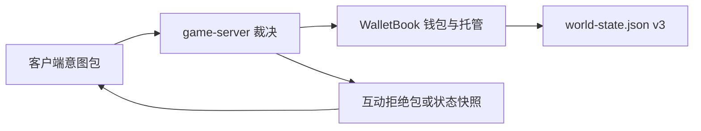

## 用户需求
地图上的互动玩法普遍存在体验与数据问题：靠近赌桌、擂台、工位等热区时按 F 没有反应或提示不出现；赌场下注、擂台报名、观战押注、买院、搬砖、悬赏领取等面板能打开，但提交后没有任何回执；余额、彩池、倒计时、擂台血量与名次会出现与界面不一致的情况。

## 产品概述
把全部互动玩法统一为“客户端只表达意图、服务端负责裁决与记账”，覆盖赌场、擂台、挑战巴士、别墅小院、工位搬砖、每日悬赏、世界事件红包、公寓探头、诊所与小黑屋等地图交互。重点补齐赌场与擂台的服务端数据校验，并让每一次被拒绝的操作都有明确、即时的中文反馈。

## 核心功能
- 服务端按匿名设备号保存钱包与战绩，重启不丢；存量玩家首次登录时一次性导入原余额。
- 赌场：服务端随机摇骰，投注期不泄露结果，下注、结算、退款全部由服务端记账。
- 擂台：报名费、观战彩池、名次奖励与奖牌由服务端按局结算，离线也生效；离场与断线不再产生退费或吞币。
- 所有互动面板：成功有结果、失败有原因；离座、超距、余额不足、阶段不对、名额已满等情况不再“点了没反应”。
- 提示条与 F 键分发使用同一套热区优先级，入座后也能正确提示茶台、供案等相邻互动。
- 别墅离线房主显示“已拥有”，不再显示可购买；赌桌只在亮牌阶段揭晓点数。


## 技术栈与约束
- 复用现有 pnpm + Turborepo + TypeScript strict、Next.js 15 + React 19 + Zustand、Bun WebSocket、PixiJS 与 `packages/shared-types`；不引入数据库、ORM 或新框架。
- 持久化继续走 `world-state.json` 原子快照（tmp 写入后 rename），版本升到 v3；无账号、无跨设备找回、每台 game-server 一座园区各自落盘。
- 时间口径统一用服务端 `clock.now()` 与客户端 `serverNow()`，新增字段不引入 `Date.now()` 判定。
- 仓库已有代码引用 ADR-0103（开放平面）但 `docs/adr/` 缺失该文件；本次不改写历史，新决策使用 ADR-0104。

## 审计结论（代码证据与修复方向）
| 问题 | 证据 | 修复 |
|---|---|---|
| 赌桌结果可预测 | `sim/dice-hall.ts` 用 `roundId` 生成确定性骰面，`snapshot` 在投注期下发 `roundId` | 注入服务端随机源，局号不再决定骰面与查岗 |
| 摇骰提前揭晓 | `snapshot` 在 Rolling 阶段就带 `dice`，`DiceHallDialog` 在非投注期即显示点数 | 仅在 Reveal 阶段下发骰面与查岗标记 |
| 赌桌静默拒绝 | 座位、阶段、注额、余额、重复下注都只返回 false | 新增统一互动拒绝包，客户端显示原因 |
| 单一托管桶 | `Player.escrowedCoins` 被赌桌、擂台、P2P 共用；`refundEscrow`、`payoutFromPool`、`settleEscrow` 清空整桶 | 托管按 `dice:桌号`、`ring`、`p2p:局号` 分账本 |
| 擂台颁奖期退费 | `C2S_RING_LEAVE` 在 Award 阶段也退 50 币，而 `arenaPot` 已清零 | 只有 Waiting 阶段退费；报名费改为托管并按局结算 |
| 擂台报名费泄漏 | 等待期断线走 `removePlayer`，不退费也不清 `arenaPot` | 费用随成员记录，断线/走空统一退款或结算 |
| 擂台离线无奖 | `RingRuntime.settle` 只给 `world.get()` 在线玩家发奖 | 结算条目带设备号，钱包账本支持离线入账 |
| 观战离座仍可提交 | `ArenaBetDialog` 不校验座位，离座后按钮仍可点 | 客户端按座位门禁禁用/关闭，服务端再拒绝兜底 |
| 别墅离线显示待售 | `ownerId` 离线归零，`VillaDialog` 以 `ownerId` 判定归属 | 别墅包增加 `owned` 与 `mine` 标志，按设备号判定 |
| 搬砖/悬赏静默失败 | `resolveWorkClaim` 返回 null、`quests.claim` 返回 false 时无回包 | 返回原因码，经拒绝包回给本人 |
| 入座提示与 F 不一致 | `updateSeatHint` 在入座时绕过 `selectContextHint` | 入座也先走热区/场所/陈设判定，座位文案只做兜底 |
| 钱包可伪造 | HELLO 经济段只做上下限钳制，客户端可上报 999,999,999 | 服务端账本唯一权威，首次导入后不再采信 HELLO |
| 钱包不跨重启 | 服务端内存只认本次进园，重启后回浏览器读取 | `wallets` 段随 `world-state.json` v3 落盘 |
| 饰品不同步 | `S2C_WALLET_SYNC` 不含 `unlockedCosmetics` | 钱包包尾部追加可选装扮清单，旧客户端忽略尾段 |

## 架构决策
备选方案：
1. 只补拒绝包与资格复核，钱包仍以浏览器为永久层。否决：用户明确要求服务端落盘钱包与战绩。
2. 把钱包字段塞进现有 `ProfileBook`。否决：`ProfileBook` 有 90 天 TTL 与 512 容量，且语义是匿名口碑，不是资产账本。
3. 推荐：新增独立 `WalletBook`，仍在同一个 `world-state.json` 的 `wallets` 段中原子落盘；按设备号聚合，容量独立、无 TTL、LRU 淘汰。该方案复用现有快照写盘与坏档隔离，不引入第二套存储。

代价与边界：
- `world-state.json` 体积增加，按 1024 个钱包估算约数百 KB；写盘仍走 1 秒防抖，禁止在 20Hz Tick 内同步写。
- 每个园区独立账本，同一浏览器进入不同园区余额不互通，符合 ADR-0043。
- 首次导入存在一次性作弊窗口：设备号由客户端生成，清空站点数据可重新导入一次。用导入上限与迁移开关限制，并在 ADR 中写明这是无账号架构的已知边界。

数据流：



## 数据与落盘
`WalletRecord` 字段：设备号、最近昵称、余额、四维等级、背包、已解锁装扮、托管条目数组、导入时刻、最近进园时刻。托管条目形如 `key` 加 `amount`。

- 服务端启动恢复 `wallets` 后，先把所有残留托管原路退回余额并清空托管：崩服时不丢冻结中的赌注与报名费。
- `WalletBook` 默认容量 1024，由 `GAME_STATE_MAX_WALLETS` 配置；只淘汰托管为零且不在线的最久未进园记录，淘汰前写告警日志。
- 写盘增加上一份 `.bak` 轮转：读取主档失败时先尝试备份，再走坏档隔离，降低钱包数据整体丢失概率。
- 兼容读取 v1 与 v2：缺失 `wallets` 段按空账本接管，不把老档判成坏档。
- 一次性导入：`GAME_WALLET_PERSIST=1` 时，首次见到某设备号才从 HELLO 经济段导入，上限由 `GAME_WALLET_IMPORT_MAX` 控制，默认 100000；导入后写 `importedAt`，后续 HELLO 经济段一律忽略。`GAME_WALLET_PERSIST=0` 回到浏览器永久层的旧行为。
- 无有效设备号的会话使用临时钱包，不落盘、不导入，保留当前匿名体验。

## 托管与结算
- 托管键：`dice:0`、`dice:1`、`ring`、`p2p:局号`。`freezeEscrow`、`refundEscrow`、`settleEscrow`、`clearEscrow` 全部带 key，禁止清空整桶。
- 赌桌：下注冻结 `dice:桌号`；赢家按彩池派彩并清自己的 key；输家清 key；无人命中全额退该 key。
- 擂台：报名费改为冻结 `ring`，不再用 `trySpendCoins` 直接扣走；结算时冠军队拿走所有成员的 `ring` 托管，其余成员清 key；等待期离场与等待期断线退该 key；颁奖期离场不退。`arenaPot` 闭包变量删除，费用从成员记录推导。
- 挑战巴士：冻结与结算使用 `p2p:局号`；取消、超时、平局只退该 key，不影响赌桌与擂台。
- 离线入账：擂台结算条目带设备号，冠军奖金、名次奖励与奖牌通过 `WalletBook` 与 `ProfileBook` 按设备号入账；玩家下次登录看到新余额与奖牌。

## 协议变更
- 新增下行 `S2C_INTERACT_REJECT = 0x5a`，定长 `[op][action u8][reason u8]`，3 字节。
- `INTERACT_ACTION` 覆盖：擂台报名、擂台离场、赌桌下注、观战押注、买院、锁门、收币、搬砖结算、悬赏领取、红包领取。
- `INTERACT_REASON` 覆盖：未入座、距离过远、阶段不对、名额已满、已参与、余额不足、注额非法、忙碌、冷却中、目标无效、库存不足、仅房主、已售出、暂无可收、未知。
- `S2C_WALLET_SYNC` 尾部追加可选段：装扮数量 u8 加逐件 id u8；解码器读到剩余字节才解析，旧客户端忽略尾段。钱包包同时用于进园初始化与每次变动。
- `VillaPacket` 增加 `owned` 与 `mine` 两个布尔字段；`ownerId` 继续表示在线实体 id，不再承担归属判定。
- `S2C_DICE_STATE` 在 Betting 与 Rolling 阶段下发零骰面，Reveal 阶段才带真实点数与查岗标记。
- 允许硬切：同步更新 `README.md` 的协议与玩法说明，Web 与 game-server 同版本发布。

## 服务端改造
- `apps/game-server/src/economy/wallet.ts`：新增 `Wallet` 聚合，持有余额、四维、背包、装扮与托管表，提供导入、快照、托管增减与上限钳制。
- `apps/game-server/src/persist/wallets.ts`：新增 `WalletBook`，按设备号 O(1) 查找，支持 `acquire`、`credit`、`toJSON`、`restore`、启动退款、容量淘汰。
- `apps/game-server/src/sim/world.ts`：`Player` 持有 `wallet` 引用；用访问器保留 `coins`、`stats`、`inventory`、`unlockedCosmetics` 的既有调用点；`reset()` 必须先换成新的临时钱包，绝不能把共享钱包清零；`applyEconomy` 改为绑定钱包。
- `apps/game-server/src/economy/service.ts`：全部方法改为操作 `player.wallet`；托管方法增加 key；`push` 时回调 `onChange` 标记落盘脏位；新增按设备号离线入账。
- `apps/game-server/src/persist/world-state.ts`：版本升 v3，新增 `wallets` 段，兼容 v1/v2，增加 `.bak` 轮转与恢复。
- `apps/game-server/src/sim/dice-hall.ts`：构造注入随机源，默认使用 `crypto.randomInt`；`rollDice` 只留给单测；快照在 Rolling 阶段隐藏骰面与查岗；所有失败分支返回明确原因。
- `apps/game-server/src/sim/ring.ts`：成员记录设备号与报名费；`leave` 返回是否退费；`removePlayer` 处理等待期退费与走空退款；`settle` 条目带费用与设备号；删除外部 `arenaPot`。
- `apps/game-server/src/sim/villas.ts`：快照写入 `owned` 与 `mine`，离线房主仍算已拥有。
- `apps/game-server/src/sim/work.ts` 与 `sim/quests.ts`：把布尔或 null 改为带原因码的结果，供分发层发拒绝包。
- `apps/game-server/src/challenge/bus.ts`：冻结、退款、结算全部带 `p2p:局号`。
- `apps/game-server/src/config.ts`：新增钱包持久化、导入上限、最大钱包数三个配置；复用现有整数读取工具。
- `apps/game-server/src/server.ts`：admit 时绑定或导入钱包；所有互动失败分支发拒绝包；擂台费用与离线结算接线；断线时退款与落盘；`stop()` 的同步落盘覆盖钱包。

## 客户端改造
- `apps/web/lib/net/client.ts`：解码新拒绝包并回调；钱包包读取可选装扮尾段。
- `apps/web/lib/game/runtime/worker-protocol.ts`、`worker-host.ts`、`worker-client.ts`、`main-thread-client.ts`：把拒绝包与刷新后的钱包/别墅/赌桌状态完整透传到主线程，避免 Worker 模式丢反馈。
- `apps/web/lib/game/session.ts`：新增互动拒绝回调；擂台报名与取消改为“报名中/取消中”，等快照确认；`updateSeatHint` 入座时也先走热区优先级，相邻空椅提示不得顶掉当前座位文案。
- `apps/web/components/game/GameViewport.tsx`：拒绝包映射为中文提示；观战长椅离座时自动关闭押注面板；钱包同步时合并服务端装扮清单。
- `apps/web/components/game/DiceHallDialog.tsx`：只在 Reveal 阶段显示点数；提交期间禁用按钮并显示等待态。
- `apps/web/components/game/ArenaBetDialog.tsx`：增加座位门禁属性，离座或未入座时禁用并提示“先坐上观战长椅”。
- `apps/web/components/game/VillaDialog.tsx`：改用 `owned` 与 `mine` 判定；离线房主显示已拥有、不可购买。
- `apps/web/lib/economy.ts`：保留本地镜像用于进园前首帧展示，注释明确服务端账本才是权威。
- UI 收尾使用 [skill:impeccable]：统一错误提示、等待态、按钮禁用态与焦点行为，避免“点了没反应”的视觉歧义。

## 性能、可靠性与安全
- 钱包读写 O(1)；每次变动只标脏，1 秒防抖后整档写入；Tick 内不做同步 IO。
- 拒绝包 3 字节，仅在明确失败时发送，不进入高频移动路径。
- 钱包记录容量有上限；不淘汰在线或托管中的记录；淘汰与导入截断写告警日志。
- 日志不输出完整设备号与昵称，只输出设备号短哈希与原因码，避免 PII 与日志洪水。
- 首次导入是唯一采信客户端钱包的入口，导入后服务端账本不可被 HELLO 覆盖；导入上限与关闭开关是主要防线。
- 保留 `GAME_WALLET_PERSIST=0` 与 `GAME_STATE_PATH=''` 两条回滚路径，不改地图、碰撞、座位表与美术。

## 目录结构
```text
apps/game-server/src/
├── economy/
│   ├── service.ts                  # [MODIFY] 钱包操作、分 key 托管、离线入账、落盘回调
│   └── wallet.ts                   # [NEW] Wallet 聚合与导入/快照/托管不变量
├── persist/
│   ├── wallets.ts                  # [NEW] WalletBook：设备号索引、容量、启动退款
│   ├── world-state.ts              # [MODIFY] v3、wallets 段、v1/v2 兼容、.bak 轮转
│   └── profiles.ts                 # [MODIFY] 仅补充与钱包的边界注释
├── sim/
│   ├── world.ts                    # [MODIFY] Player 绑定钱包、访问器、reset 安全
│   ├── dice-hall.ts                # [MODIFY] 随机源、亮牌门禁、失败原因
│   ├── ring.ts                     # [MODIFY] 报名费、断线、离线结算、删除 arenaPot
│   ├── villas.ts                   # [MODIFY] owned/mine 快照
│   ├── work.ts                     # [MODIFY] 失败原因码
│   └── quests.ts                   # [MODIFY] 失败原因码
├── challenge/bus.ts                # [MODIFY] p2p:局号 托管
├── config.ts                       # [MODIFY] 钱包持久化/导入/容量配置
├── server.ts                       # [MODIFY] admit 钱包、拒绝包、擂台费用、断线落盘
├── economy/wallet.test.ts          # [NEW] 导入、托管、上限
├── persist/wallets.test.ts         # [NEW] 恢复、淘汰、启动退款
├── sim/dice-hall.test.ts           # [MODIFY] 随机源、Rolling 不揭晓、分 key 托管
├── sim/ring.test.ts                # [MODIFY] Waiting 退费、Award 不退、断线、离线冠军
└── persist/world-state.test.ts     # [MODIFY] v2 升 v3、坏钱包条目、备份恢复

packages/shared-types/src/
├── types.ts                        # [MODIFY] OpCode 0x5a、互动动作/原因、别墅字段
├── protocol.ts                     # [MODIFY] 拒绝包编解码、钱包装扮尾段、别墅编解码
└── __tests__/interact-reject.test.ts # [NEW] 拒绝包与钱包尾段往返

apps/web/
├── lib/net/client.ts               # [MODIFY] 解码拒绝包与装扮尾段
├── lib/game/session.ts             # [MODIFY] 拒绝回调、报名中态、提示对齐
├── lib/game/runtime/worker-protocol.ts # [MODIFY] 新下行消息
├── lib/game/runtime/worker-host.ts # [MODIFY] 透传拒绝与钱包
├── lib/game/runtime/worker-client.ts # [MODIFY] 透传新消息
├── lib/game/client/main-thread-client.ts # [MODIFY] 回调转发
├── components/game/GameViewport.tsx # [MODIFY] 拒绝提示、离座关闭、装扮同步
├── components/game/DiceHallDialog.tsx # [MODIFY] 亮牌门禁与等待态
├── components/game/ArenaBetDialog.tsx # [MODIFY] 座位门禁
├── components/game/VillaDialog.tsx  # [MODIFY] owned/mine
├── lib/game/__tests__/context-hint.test.ts # [MODIFY] 入座提示一致性
└── lib/game/__tests__/villa-dialog.test.tsx # [NEW] 离线房主归属

docs/adr/0104-server-authoritative-wallet.md # [NEW] 钱包账本、托管分账、协议与回滚
apps/web/data/release-notes.json             # [MODIFY] 提交前追加玩家可感知版本工报
README.md                                    # [MODIFY] 钱包、赌场、擂台、别墅口径
```

## 关键数据结构
- `WalletRecord`：设备号、昵称、余额、四维等级、背包键值表、装扮键数组、托管条目数组、导入时刻、最近进园时刻。
- `RingSettleEntry` 扩展：设备号、名次、报名费、是否在线；结算回调按设备号入账。
- 拒绝包常量：动作编号与原因编号放共享契约，客户端只做文案映射，服务端只发编号。

## 验收与回滚
- 服务端单测：首次导入只发生一次、二次 HELLO 不覆盖；分 key 托管互不影响；擂台 Waiting 退费与 Award 不退费；等待期断线与走空退款；离线冠军入账；赌桌 Rolling 阶段无点数。
- 共享契约单测：拒绝包往返、钱包包装扮尾段往返、旧客户端忽略尾段、别墅 owned/mine 往返。
- Web 单测：入座时提示与 F 分发一致；观战面板离座禁用；别墅离线房主显示已拥有。
- 全量 `pnpm typecheck`、`pnpm test`、`pnpm changelog:check`。
- 手工回归：赌场下注到亮牌、擂台报名到颁奖离场、观战押注离座、别墅买院锁门收币、工位搬砖、悬赏领取、红包雨。
- 回滚：`GAME_WALLET_PERSIST=0` 回到浏览器永久层；`GAME_STATE_PATH=''` 关闭全部持久化；新 OpCode 与包尾段可随版本一起回退。


## Agent Extensions
### Skill
- **principal-software-architect**
  - Purpose: 产出 ADR-0104，完成钱包账本、托管分账与落盘边界的方案对比、代价说明与回滚路径。
  - Expected outcome: 一份可执行的架构决策记录，明确取代 ADR-0081 的落盘范围与 ADR-0082 的浏览器永久层，并给出 30 天回滚条件。
- **impeccable**
  - Purpose: 统一互动面板的错误态、等待态、禁用态与提示文案，消除“点了没反应”的视觉歧义。
  - Expected outcome: 赌场、擂台、别墅、搬砖等面板在失败时都有明确原因与可恢复操作，交互反馈符合现有像素 UI 风格。

### SubAgent
- **code-explorer**
  - Purpose: 复核地图上全部热区、F 键分发、Worker 透传与断线清理链路，确认没有遗漏的互动入口。
  - Expected outcome: 一份“热区到服务端处理器”的完整对照清单，并验证新增拒绝包在 Worker 与主线程两种模式下都能到达 UI。
