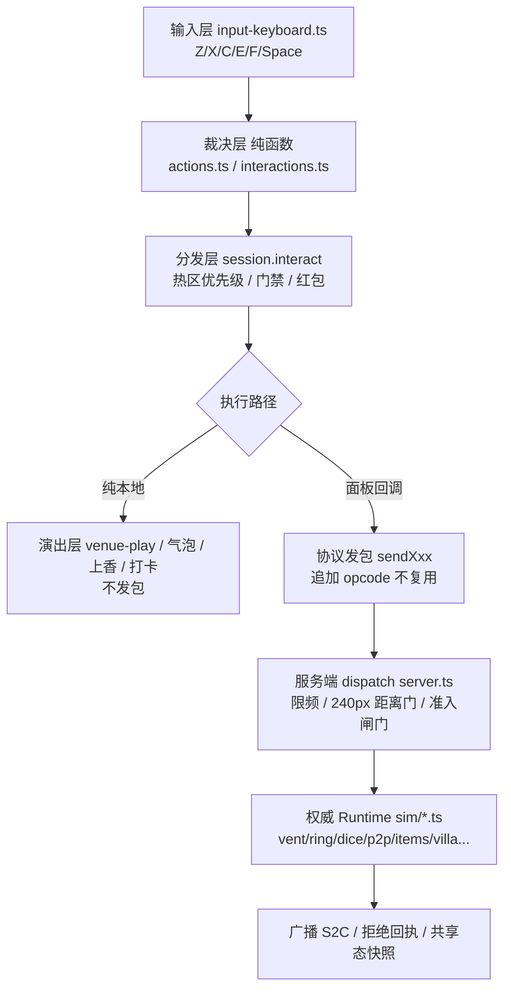

## 产品概述
对「牛马园区」的互动系统做一次全面体检，并在体检结论之上完善玩法。核心不是凭空加功能，而是先把四类互动逻辑逐一查清楚——哪里提示与实际动作对不上、哪里判定有漏洞、哪里反馈不清或手感生硬——再按对玩家的价值排序，把高价值优化落地。整个过程保持园区一贯的"加班园区"幽默气质与像素风互动反馈。

## 核心需求
- **四类互动全量审查**：F键热区与提示（优先级、距离、文案一致性、先坐下门禁）、玩家间互动（发泄、P2P挑战、点赞、打赏、道具）、场所弱互动（售货机气泡、会议室投屏、影厅换台、打卡、上香/木鱼/告示板）、姿态与移动（坐躺、吸附、起身、打呼、移动衔接）。
- **产出带证据的问题清单**：每条问题说明期望行为与实际行为的差异、影响范围与复现条件，不做空泛结论。
- **设计并落地优化**：按"玩家可感知价值 × 改动风险 × 回滚成本"排序，优先低风险高收益项；提示与实际按键严格一致，失败操作有明确回执，互动反馈更及时清晰。
- **在现有玩法框架内增强深度**：发泄/P2P/道具/场所演出的细节打磨，不推翻既有手感与数值口径。
- **补齐质量缺口**：为缺少测试的服务端玩法补测试，更新首页版本工报，确保全量校验通过。


## 技术栈选型（沿用现有，不引入新技术）
- **客户端**：Next.js 15 App Router · React 19 · TypeScript 5 strict · Zustand 5 · PixiJS 8（位图渲染）。
- **服务端**：Bun `Bun.serve` WebSocket · 20Hz 固定 Tick · 进程内存为唯一真相。
- **共享契约**：`packages/shared-types`，手写二进制协议（编号最高 0x5f，78 个在用）；`WORLD_HOTSPOTS` / `seatMatchesHotspot` 为热区与门禁唯一真相源。
- **测试**：vitest（渲染纯模块/协议）+ bun:test（服务端 AOI/玩法）+ `@niuma/game-server` 既有测试布局。

## 实现思路（两阶段：先审查，后优化）

**阶段 A — 证据化审查（先于任何编码）**
用户明确要"检查有什么问题"，因此不预设结论，先以证据定位。用 `principal-software-architect` 的证据格式逐单元记录：
`BASELINE | <unit> | expected: … | observed: … | fit: align|partial|drift | evidence: <path:line> | impact: …`
审查沿"提示 → 按键 → 服务端判定"这条契约链逐层核对，因为该项目所有注释都强调"提示什么、按 F 就是什么"，一致性是最可能出漂移的地方。四类审查重点：
1. **F键热区与提示**：`selectContextHint` 与 `session.interact` 是否走同一张 `WORLD_HOTSPOTS` 与同一优先级；近距热区（茶台48 vs 饮水机56，仅差34px）的抢占；各半径边界与非有限数/NaN 输入；`seatMatchesHotspot` 门禁失败时提示是否清晰。
2. **玩家间互动**：发泄 state bit6 上行与 `sim/vent.ts` 裁决（扇形、硬直、入座免伤、打老板、攻速冷却钳制）；P2P 邀请 TTL、托管 key、超时兜底与平局退款；点赞幂等、打赏、道具叠加钳制/保护期/失败退款。核对客户端展示与服务端权威是否同一口径。
3. **场所弱互动**：气泡台词轮转、投屏/换台/打卡演出；核对"帧循环零分配、构造期烘焙"纪律是否被破坏；本地演出与 `S2C_ACTIVITY` 共享反馈可见性的一致性（ADR-0105）。
4. **姿态与移动**：`resolveInteraction` 的开关键序（床只能躺、坐躺互斥、边走边坐吸附、发泄打断移动）；起身与 `SIT_RANGE=90` 吸附；打呼触发条件与移动清理。

**阶段 B — 优先级优化落地**
用 `brainstorming` 发散、`principal-software-architect` 收敛，按三维评分排序：**玩家可感知价值 × 改动风险 × 回滚成本**。
关键决策（含权衡）：
- **决策1：审查先于编码**。理由：避免凭猜测改代码产生回归；代价是多一轮文档产出，但这是用户诉求本身。
- **决策2：收敛到单一真相表**。凡发现"提示与按键各写一套"，一律合并到 `WORLD_HOTSPOTS` / `seatMatchesHotspot` / `HINT`，而非新增分支。降低长期漂移风险。
- **决策3：最低可行层优先**。纯客户端能修的不动协议；确需权威改动才双端同步。理由：双端发版成本高、留空 opcode 不可复用。必要新 opcode 只能**追加**（当前最高 0x5f），`0x20`/`0x2a`/`0x2b`/`0x3d`/`0x4d`–`0x50` 永久留空不复用。
- **决策4：对抗审查**。涉及不可逆或跨模块改动走 `ARCH-PRIMARY → ARCH-ADVERSARY → ARCH-SYNTH`，主动找反例与失效场景；重要结论落新增 ADR（不改历史 ADR）。

**性能与可靠性**：互动判定位于帧循环与约 150ms 一次提示采样的热路径，必须保持纯函数、零分配、复用输出槽（`nearestInteractivePropInto` / `HINT_SPOT` 现状）；服务端 dispatch 在 20Hz Tick 内，改动不得新增逐 Tick 遍历或短命对象，沿用限频闸门（L1253-1279）与 240px 距离门。协议改动保持编号只追加、旧客户端读到未知魔数即停的兼容策略。

**避免技术债**：复用现有纯函数与 Runtime 模式；不为假想复用方造抽象；每项高风险改动保留现有灰度开关风格（如 `?venue=0` / `GAME_xxx=0`），确保可回滚。

## 实现要点（防回归）
- **时间口径**：一律服务端 `clock.now()` / 客户端 `serverNow()` / `serverDateKey()`，禁止用 `Date.now()` / `new Date()` 判定玩法时间。
- **落盘边界**：仅园区共享运行态可写快照；会话/聊天/考勤/外观保持在内存与 localStorage。
- **爆炸半径**：每项优化单独提交、可独立回滚；不触碰无关系统（渲染管线、地形、图集）；保持向后兼容（旧包、旧存档可读）。
- **日志与提示**：复用现有 `sendInteractReject` / `showHint` 通道，失败回执沿用既有原因码，不引入新的日志噪音。
- **UI 附带改动**：若优化触及 `InteractionHint` / `ActionBar` / 面板反馈，动手前加载 `impeccable`（polish/audit），遵守反模式自检，不改既有设计方向。

## 架构设计



审计聚焦三条**契约边界**：①裁决层↔分发层的"提示即按键"一致性；②分发层↔服务端的门禁与距离口径一致；③本地演出↔权威广播的反馈可见性一致。改动默认落在最低可行层：能修在裁决/分发层就不动协议层，能修在演出层就不动权威层。

## 目录结构

本次为"审查+按结论优化"，故区分**审查对象（读取核对，按需修改）**、**确定新增/修改的产物**三类。

```
project-root/
├── docs/adr/
│   └── <新序号>-interaction-audit-optimizations.md   # [NEW] 记录审查结论与关键优化决策（权衡、推荐项、回滚路径）；不改写历史 ADR
├── apps/web/lib/game/
│   ├── interactions.ts            # [审查对象/可能修改] F键热区判定、半径、facesBulletin/hotspotAtForSeat/selectContextHint/pickLine/snoreDue，核对提示与按键同源及边界输入
│   ├── actions.ts                 # [审查对象/可能修改] resolveInteraction/actionPresentation 开关键序与 blocked 提示
│   ├── session.ts                 # [审查对象/可能修改] interact(eid) L1975-2122 分发链、门禁不过只提示、发包集中区、纯本地动作
│   ├── hint-copy.ts               # [审查对象/可能修改] HINT 文案；失败回执与提示清晰度统一
│   ├── venue-play.ts              # [审查对象/可能修改] 场所演出零分配纪律、待机遮罩、换台/闪光池
│   ├── venue-spots.ts             # [审查对象] 场所座位点与频道
│   ├── interior-spots.ts          # [审查对象] 室内陈设点查询
│   ├── input.ts / input-keyboard.ts # [审查对象] 动作语义映射与掩码，输入法选词防误触
│   └── __tests__/
│       ├── interactions.test.ts / actions.test.ts / context-hint.test.ts  # [修改] 覆盖修复的一致性/门禁/边界回归
│       └── venue-motion.test.ts / venue-spots.test.ts / interaction-hint.test.tsx  # [修改] 演出与提示回归
├── apps/web/components/game/
│   ├── InteractionHint.tsx / ActionBar.tsx / TouchControls.tsx  # [审查对象/按需修改] 提示与动作反馈呈现；改动前加载 impeccable
│   └── InteractionMenu.tsx / EconomyLayer.tsx / DiceHallDialog.tsx 等  # [审查对象] 面板回调发包入口与失败回执展示
├── apps/game-server/src/
│   ├── server.ts                  # [审查对象/可能修改] dispatch 单入口；限频闸门、距离门、sendInteractReject 一致性
│   ├── sim/
│   │   ├── vent.ts / movement.ts / seats.ts   # [审查对象/可能修改] 发泄/移动/座位权威裁决
│   │   ├── ring.ts / dice-hall.ts / dice-ledger.ts  # [审查对象/可能修改] 擂台与骰桌权威
│   │   ├── like.ts / items.ts / work.ts / quests.ts / villas.ts / apartment.ts / board.ts / activity.ts  # [审查对象/可能修改] 各玩法 Runtime
│   │   ├── villas.test.ts / work.test.ts / quests.test.ts / items.test.ts  # [NEW] 补齐无测试缺口（按审查结论落地）
│   │   └── vent.test.ts / ring.test.ts / dice-hall.test.ts / board.test.ts / seats.test.ts / like.test.ts / apartment.test.ts / movement.test.ts  # [修改] 权威逻辑回归
│   ├── challenge/bus.test.ts      # [修改] P2P 邀请/应战/行动/超时兜底回归
│   └── net/guard.ts               # [审查对象] 包合法性闸门，协议改动时同步
├── packages/shared-types/src/
│   ├── types.ts                   # [审查对象/必要时修改] OpCode；新编号只追加，留空编号不复用
│   ├── world/hotspots.ts          # [审查对象/可能修改] WORLD_HOTSPOTS / HOTSPOT_PRIORITY 单一真相表
│   ├── world/seat-gate.ts         # [审查对象/可能修改] seatMatchesHotspot / hotspotRequiresSeat 门禁口径
│   ├── world/layout.ts            # [审查对象] SIT_RANGE / findNearestSeat
│   └── __tests__/seat-gate.test.ts / vent.test.ts / board.test.ts / interact-reject.test.ts / protocol.test.ts  # [修改] 契约一致性回归
└── apps/web/data/release-notes.json  # [MODIFY] 按 AGENTS.md 追加版本工报（玩家可感知结果，落代码同一次提交）
```

## 关键代码结构
审查发现记录采用统一字段，便于汇总与追踪（来源于架构技能强制的证据格式）：

```
interface AuditFinding {
  unit: string;              // 被审查单元（文件/函数/玩法）
  expected: string;          // 期望行为
  observed: string;          // 实际行为
  fit: 'align' | 'partial' | 'drift';
  evidence: string;          // path:line 定位
  impact: string;            // 玩家可感知影响
  fixLayer: 'config' | 'product-api' | 'tool' | 'effect' | 'core';
  value: number; risk: number; rollbackCost: number;  // 优先级评分
}
```


## Agent Extensions

### Skill
- **principal-software-architect**
  - Purpose: 界定审查约束/非目标/反向成本，输出 BASELINE 证据行，对重要优化做 ARCH-PRIMARY → ARCH-ADVERSARY → ARCH-SYNTH 对抗审查并落 ADR。
  - Expected outcome: 每类互动有可核对的证据清单；每个重要决策有≥2方案权衡、推荐项与 30 天回滚路径，并记录改动落层。
- **brainstorming**
  - Purpose: 在"由你设计优化"的方案设计阶段探索意图与多种优化方向，再交给架构技能收敛。
  - Expected outcome: 产出成组的玩法优化候选（发泄/P2P/道具/场所演出/反馈），标明取舍。
- **improve-codebase-architecture**
  - Purpose: 单次改动跨 3+ 文件或重排互动调用链时，按深模块/seam 原则审查，避免新抽象与技术债。
  - Expected outcome: 优化收敛到既有纯函数与 Runtime 模式，接口简单、调用方无需了解内部。
- **impeccable**
  - Purpose: 优化触及互动提示/动作条/面板反馈等 UI 时，按 polish/audit 执行并做反模式自检。
  - Expected outcome: UI 改动符合既有设计方向，无反模式，a11y/响应式/动效检查通过。
- **test-driven-development**
  - Purpose: 服务端权威逻辑与协议改动先写测试（含 villa/work/quests/items 缺口）再实现。
  - Expected outcome: 每项修复有红→绿测试覆盖，契约一致性由测试锁定。
- **verification-before-completion**
  - Purpose: 声称完成前实际运行 typecheck / test / changelog:check 并确认输出。
  - Expected outcome: 全量校验通过的证据，而非口头断言。

### SubAgent
- **code-explorer**
  - Purpose: 对四类互动做跨文件深度审查探索，定位提示-按键-服务端判定的具体差异点行号。
  - Expected outcome: 带 `path:line` 的审查证据清单，覆盖客户端判定链与服务端 Runtime。
