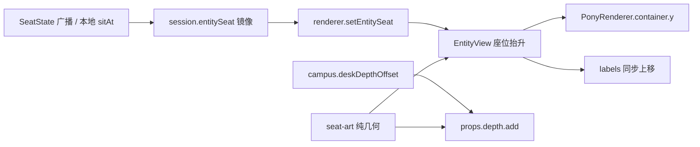

## 用户需求
修复游戏里「侧坐工位」仍然不对的问题，并顺带检查同类问题；优化手机端操作。

## 产品概述
这是一座 2D 像素多人在线办公园区。本次改动要让四个方向的工位都读得通：人坐在椅面上、正对桌面，桌子不遮人；同时让手机横屏下的摇杆、动作盘与聊天输入互不打架。

## 核心功能
- **侧坐工位三处修复**
  - 东西两列的桌子不再压在坐着的人与椅子之上，避免桌沿切掉角色的吻部。
  - 坐姿不再「陷进椅子」：角色臀部落在椅面，侧视能看见坐垫、立柱与五星脚，而不是「坐在一根杆子上」。
  - 侧放桌的显示器改为立在远侧桌沿上，配合桌面、挡板、桌腿的立面关系，读得出「这是一张工位」。
- **四向统一**
  - 南北两排与东西两列使用同一套座位接触契约；四向椅面高度一致，转身与换排不再出现贴合差异。
- **同类问题复核**
  - 对全图工位与座位加回归线：桌子深度不高于入座者、椅子靠背在朝向反侧、屏幕朝向人、座面顶与臀底对齐。
  - 其他座位（马桶、沙发、床、凳子）保持现状，但契约预留扩展位，不产生回归。
- **手机端操作手感**
  - 左下浮动摇杆：左半屏热区按下即在落点生成，松手回零；不再要求精准按进固定圆。
  - 右下动作盘重排为两排按钮 + 独立大号打字键，去掉空洞，扩大命中面积，按下有缩放、描边与轻震动反馈。
- **手机端聊天与键盘**
  - 聊天面板改为浮层，不再把底部操作区顶出屏幕。
  - 发送后自动收起键盘与面板；输入框可长按选词。
  - 输入法弹起时舞台与操作区跟随可视视口收缩，摇杆不被键盘盖住。
  - 退出全屏、收起聊天等入口不再被自动全屏抢走手势。


## 技术栈
沿用现有栈，不引入新依赖：
- 客户端：Next.js App Router + React + TypeScript + Tailwind CSS v4 + Pixi.js
- 共享层：`@niuma/shared-types`（世界布局与纯几何）
- 测试：Vitest / Bun test（`apps/web/lib/game/__tests__`、`packages/*/src/__tests__`）
- 构建：pnpm + turbo；`pnpm assets` 仅生成角色图集，桌椅为客户端运行时烘焙，本次无需重跑

## 实现思路

### 1. 桌子深度键按朝向派生（修「桌面切人」）
现状：`props.ts` 用 `desk.y + footprint.h / 2` 作为深度键。东西向 `footprint.h = 88`，桌子键为 `desk.y + 44`；而坐着的人键为 `desk.y`、椅子为 `desk.y - 1`，桌子恒压在人与椅子之上。
- 在 `campus.ts` 新增纯函数 `deskDepthOffset(facing)`：南北向返回 `DESK_H / 2`（占地南边，现状不变）；东西向返回 `-2`（让到椅子 `-1` 与人 `0` 之后，避免同键依赖插入顺序）。
- `props.ts` 的精灵锚点仍取占地南边（`bottom` 不变，桌子不陷地、不浮空），只把 `depth.add` 的键换成 `desk.y + deskDepthOffset(desk.facing)`。
- 不变量：对每个工位，`desk.y + deskDepthOffset(facing)` 严格小于 `seat.y`；东西向同时小于椅子键 `seat.y - 1`。写进 `seats.test.ts`，对全部工位遍历。

### 2. 座位接触契约（修「人陷进椅子」）
新增 `apps/web/lib/game/seat-art.ts`，作为座位几何唯一来源（纯函数、不 import pixi）：
- `seatArtFor(kind, facing)` 返回精灵帧尺寸、`sink`、座面接触高度 `contactY`（相对座位锚点，负值向上）。
- `seatLift(kind, facing)` 返回角色坐上该座位时应抬升的正整数纹素；地面坐姿返回 0。
- `chair-art.ts` 把四向座面顶统一到局部 `seat.y = 13`（世界 `seat.y - 11`），同步调整 Up 的靠背与 Left/Right 的立柱，保持 26×30 帧与锚点不变；四向椅面高度因此一致。
- 坐姿臀底为 `seat.y - 1`，故椅子统一抬升 `10` 纹素；`pony.ts` 的 `PonyRenderer` 合并 `bob` 与抬升：`container.y = bob - lift`（阴影在 container 外，留在地面），标签与气泡同步上移 `lift`。
- 远端角色没有座位 id：`session.ts` 维护 `entitySeat: Map<netId, seatId>`，在 `handleSeatState`、本地 `sitAt` / `standUp`、出生与退场时调用 `renderer.setEntitySeat(netId, seat | null)`；`EntityView.setSeat` 只在座位变化时重算并应用抬升，稳态零开销。

### 3. 侧放桌显示器立面化（修「桌子像平板」）
现状：竖桌帧 48×92，显示器 `y 34..56` 完全落在桌面 `y 6..78` 内部，读成桌面上的平板。
- 竖桌帧改为 48×110：桌面 `y 24..96`、前挡板 `96..110`、显示器 `y 2..24`（底部贴桌面北缘、向上凸出 22），与横桌「显示器立在桌沿之上」的投影约定一致。
- 桌心与占地不动，精灵锚点仍是占地南边 `desk.y + 44`；帧变高只向上扩展，`PropsView.cullables` 的 `padY` 自动跟随 `frame.h`。
- 陈设（绿植、马克杯、便签）整体下移 18，避免被抬高的桌面压住；`desk-art.test.ts` 增加「显示器顶边高于桌面北缘」与「显示器不压桌面陈设」两条断言。

### 4. 手机端操作层
- 抽出 `apps/web/lib/game/joystick.ts`：`stickVector(dx, dy, radius, deadZone, rotated)` 纯函数，负责旋转映射、死区重标定与半径钳制，单独单测。
- `Joystick` 改为左半屏热区 + 落点生成：`pointerdown` 缓存 `getBoundingClientRect()`，`pointermove` 只做数学并直接写 `ref.style.transform`，去掉每帧 `setState`；`active` 只在按下/抬起各触发一次渲染。
- `TouchActions` 改为 3 列 × 2 行、56px 按钮，独立 64px 打字键放在右侧主拇指位；总高约 120px（原 190px）。保留 `aria-pressed`、不可用原因 `title`、按下缩放与 `navigator.vibrate(8)`（有则调用）。
- `ChatDock`：`compact` 下发送后 `blur()` 并收起面板；输入框补 `enterKeyHint="send"`、`autoComplete/autoCapitalize="off"`、`select-text` 与 `-webkit-touch-callout: default`，覆盖根节点的 `select-none`。
- `GameViewport`：把手机端聊天面板移出 HUD 的纵向 flex，改为绝对定位浮层（贴底操作区上方、`max-h` 限制、`z-30`）；热区 `z-10`、动作盘 `z-20`，避免抢指针。提示条改到动作盘上方，不再用固定 `bottom-36`。
- 新增 `useVisualViewportStage`：监听 `visualViewport` 的 `resize/scroll`，返回舞台宽高（旋转时交换宽高）；`layout.tsx` 增加 `interactiveWidget: 'resizes-content'`；`globals.css` 补 `100vh` 回退、`overscroll-behavior: none` 与 `html, body { height: 100% }`。
- 全屏白名单补 `data-no-immersive`：打卡下班 Link、聊天面板折叠头；`useIsTouch` 放宽为 `pointer: coarse` 或 `any-pointer: coarse`，触屏二合一设备不再失去摇杆。

## 关键决策与权衡
- **深度键放在共享层而非渲染层**：桌子与座位的相对关系是布局事实，任何客户端都应一致；放 `campus.ts` 可被共享单测遍历全部工位。
- **抬升放渲染层而非重画坐姿**：坐姿贴图的「贴地」剪影是 ADR-0031 的可读性成果，重画会牵动图集与所有姿势；渲染层抬升 10 纹素成本更低，且能自然扩展到手其他座位。
- **不用 `seat.y - 1` 做桌子键**：与椅子同键会依赖 Pixi 同 zIndex 的插入顺序，改用 `-2` 形成显式全序。
- **不改协议与服务端**：座位朝向、占地、碰撞全部不动，只补视觉契约。

## 性能与可靠性
- 桌椅纹理仍是四向 × 两态一次性烘焙；竖桌帧 48×110 仅多约 1.7k 像素/张，可忽略。
- 座位抬升只在座位变化时计算一次，不进入每帧循环；不新增每帧 Map 查询。
- 摇杆去掉每次 pointermove 的同步布局与 React 渲染，120Hz 采样下不再 layout thrash。
- 所有偏移为整数纹素，遵守 ADR-0005（禁负缩放、不旋转精灵）；阴影、标签、气泡各自独立补偿，不产生半像素描边。

## 架构设计


## 目录结构
```
niuma/
├── packages/shared-types/src/
│   ├── world/campus.ts                         # [MODIFY] 新增 deskDepthOffset(facing)：南北 +20、东西 -2，附同 y 并排的说明
│   └── __tests__/seats.test.ts                  # [MODIFY] 遍历全部工位，断言桌子深度键严格低于入座者与椅子
├── apps/web/lib/game/
│   ├── seat-art.ts                              # [NEW] 座位几何契约：seatArtFor / contactY / seatLift，纯函数不依赖 pixi
│   ├── joystick.ts                              # [NEW] 摇杆数学：旋转映射、死区重标定、半径钳制，供组件与单测共用
│   ├── chair-art.ts                             # [MODIFY] 四向座面顶统一到局部 y=13，调整 Up 靠背与侧向立柱，帧尺寸不变
│   ├── desk-art.ts                              # [MODIFY] 竖桌帧 48×110，桌面/挡板/桌腿整体下移，显示器立在北侧桌沿
│   ├── props.ts                                 # [MODIFY] 改用 seat-art 的 SEAT_ART；桌深改用 deskDepthOffset；座位键保持 seat.y-1
│   ├── pony.ts                                  # [MODIFY] setBob 与 setLift 合并为 container.y = bob - lift，阴影不随体
│   ├── renderer.ts                              # [MODIFY] EntityView.setSeat 应用抬升；setEntitySeat 对外接口；标签同步上移
│   ├── session.ts                               # [MODIFY] entitySeat 镜像；handleSeatState / sitAt / standUp / 出生退场时同步
│   └── __tests__/
│       ├── seat-art.test.ts                     # [NEW] 四向椅面顶一致；抬升后臀底等于座面顶；非椅子座位抬升为 0
│       ├── joystick.test.ts                     # [NEW] 死区、钳制、旋转后方向
│       ├── chair-art.test.ts                    # [MODIFY] 补「四向座面顶同高」与「靠背不越界」
│       └── desk-art.test.ts                     # [MODIFY] 更新竖桌帧尺寸；补显示器立于桌面北缘、陈设不压显示器
├── apps/web/components/game/
│   ├── TouchControls.tsx                        # [MODIFY] 浮动摇杆热区与 ref 驱动摇杆头；3×2 动作盘 + 独立打字键；按压反馈
│   ├── ChatDock.tsx                             # [MODIFY] 发送后 blur/收面板；输入属性与可选中；折叠头标 data-no-immersive
│   └── GameViewport.tsx                         # [MODIFY] 手机端聊天浮层化；可视视口舞台；提示条位置；全屏白名单
├── apps/web/lib/use-touch-stage.ts              # [MODIFY] 放宽触屏判定；新增 useVisualViewportStage
├── apps/web/app/
│   ├── globals.css                              # [MODIFY] 舞台 vh 回退、overscroll、输入框恢复可选中
│   └── layout.tsx                               # [MODIFY] viewport 增加 interactiveWidget: resizes-content
└── docs/adr/
    └── 0032-seat-contact-and-desk-depth.md      # [NEW] 决策记录：深度键、座位接触契约、竖桌立面化、回滚与复核信号
```

## 关键代码结构
```ts
// packages/shared-types/src/world/campus.ts
/** 桌子精灵的深度键相对桌心的偏移：南北取占地南边；东西与椅子同 y，必须让到人后 */
export function deskDepthOffset(facing: Direction): number;

// apps/web/lib/game/seat-art.ts
export interface SeatArt {
  frame: { w: number; h: number };
  sink: number;
  /** 座面接触高度（相对座位锚点，负值向上）；非坐面返回 null */
  contactY: number | null;
}
export function seatArtFor(kind: SeatKind, facing: Direction): SeatArt;
/** 角色坐上该座位时的抬升纹素；地面坐姿与未审计座位返回 0 */
export function seatLift(kind: SeatKind, facing: Direction): number;
```

## 实施注意事项
- `SEAT_ART` 只搬位置不改数值；椅子 `sink = 6` 不变，抬升是角色侧补偿，不要拿 `sink` 当座位高度用。
- 桌子精灵锚点仍是 `desk.y + footprint.h / 2`；只改深度键，不要改定位，否则桌子会陷地。
- 东西向桌子键用 `-2` 而非 `-1`，与椅子 `-1`、人 `0` 形成显式顺序；同键排序不可依赖。
- 抬升只对 `chair` 生效；马桶、沙发、床、凳子保持 0，避免超出本轮范围。孩子 `contactY` 为 null 时明确按 0 处理。
- 椅面几何与坐姿臀底一旦分叉，`seat-art.test.ts` 必须直接失败；不要靠肉眼调数。
- 桌椅是运行时 `bake`，不需要 `pnpm assets`；只有改 `quadruped.ts` 才需要。
- 摇杆热区与聊天浮层的层级要显式指定，避免面板打开时拖到摇杆导致角色继续移动。
- 全屏自动抢占只允许一次，白名单必须覆盖所有「退出/收起」入口，避免点退出反被拉进全屏。
- 不改服务端、不改协议、不改座位坐标；所有改动保持向后兼容。
- 交付前跑 `pnpm typecheck`、`pnpm test`、`pnpm build`，并对手机横屏做一次手动验收（摇杆、动作盘、聊天、键盘、安全区、旋转兜底）。


## 设计方向
延续现有「暖墨底 + 薄荷冷光」的像素办公终端气质，不换肤，只重排手机端操作层。目标是让拇指盲按可用、让聊天不再挤掉摇杆，保持与桌面 HUD 同一套描边、等宽字与硬边阴影。

## 单屏：手机横屏游戏 HUD
### 顶部信息带
左侧工牌与频道入口，右侧在线数、音效、全屏、打卡下班。控件 36px 高，描边 2px，半透明墨底，避免压住游戏画面。

### 左下浮动摇杆
默认只留一枚淡描边基座作提示；在左半屏任意落点按下即生成摇杆，半径 56px，摇杆头 44px。松手回零并淡出，触点不被固定圆限制。

### 右下动作盘
3 列 × 2 行、56px 圆形动作键，右侧独立 64px 打字键。总高约 120px，占横屏高度约三分之一。按键为墨底 + 薄描边，按下 75ms 缩放到 0.96 并亮起薄荷描边。

### 聊天浮层
收起时只是一条 38px 的频道标题条；展开后浮在动作盘上方，最大高度约屏高 42%，消息区独立滚动。发送即收键盘并回到收起态，不再顶掉底部操作区。

### 提示与反馈
动作被拦下时，提示条贴在动作盘上沿，右对齐、单行省略；可点击的动作给出 8ms 轻震动。所有可点区域不小于 44px。

## 交互与响应式
- 舞台被旋转 90° 时，摇杆的屏幕坐标换算到舞台本地坐标，方向不反。
- 安全区在旋转后按右/下/左/上映射，刘海与 Home 条不压控件。
- 输入法弹起时舞台跟随可视视口收缩，操作区整体上移；键盘收起后恢复。
- 触点释放、页面隐藏、横竖屏切换时摇杆立即归零，角色不会持续滑步。
- 保留键盘与鼠标的桌面布局，触屏判定放宽后二合一设备也能操作。

## 可访问性
动作键保留 `aria-pressed`、`aria-label` 与不可用原因；焦点环用薄荷色 2px；正文对比度不低于 4.5:1；聊天输入框恢复文本选择与系统放大镜。

## Skill
- **principal-software-architect**
  - Purpose: 为「桌子深度键、座位接触契约、竖桌立面化」做方案对比与不可逆性评估，并按项目 `docs/adr/` 规范产出 ADR-0032。
  - Expected outcome: 一份含备选方案、取舍、回滚路径与复核信号的决策记录，且结论落到最低可行层（共享纯几何 + 渲染补偿）。
- **impeccable**
  - Purpose: 对手机端 HUD 执行 `/impeccable shape` 与 `/impeccable polish`，重排摇杆热区、动作盘与聊天浮层，并做命中面积、对比度、焦点与响应式自检。
  - Expected outcome: 手机横屏下拇指可盲按、聊天不遮操作区、无 3×3 空洞的 HUD，且通过可访问性与视觉一致性检查。

## SubAgent
- **code-explorer**
  - Purpose: 修复完成后对全图工位、座位与主要道具做一次只读复核，寻找同类的深度键、遮挡、贴边与占地问题。
  - Expected outcome: 一份按可疑度排序的残留问题清单；能补回归线的直接补测试，超范围的列入后续待办。
