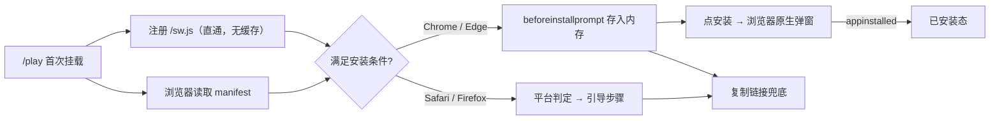

## Product Overview
在园区游戏页右上角的图标栏新增「存到桌面」入口，把站点变成桌面 / 手机主屏上的独立应用；浏览器不支持一键安装时，就地给出当前系统的添加步骤，并可一键复制园区链接作为书签。

## Core Features
- 入口位于游戏页右上角，与公告、静音、全屏、切换园区、打卡下班同一排；触摸端收成图标格
- 支持一键安装的浏览器（Chrome / Edge）点击后弹出原生安装确认，装完桌面、任务栏或主屏出现牛马图标，打开为独立窗口并直接进园区
- 已安装或从桌面图标打开时，面板显示「已经在桌面上了」，不再重复引导
- 不支持一键安装的浏览器自动切换为分系统图解：iOS「分享 → 添加到主屏幕」、macOS Safari「添加到程序坞」、Android 浏览器菜单「添加到主屏幕」、Firefox「固定到任务栏」，并统一提示书签快捷键
- 面板内提供「复制链接」，复制后就地显示「已复制」；当前园区的地址会被完整保留
- 面板点外部或按 Esc 关闭，焦点回到入口按钮；与园区公告面板互斥，不会同时叠在右上角
- 竖屏 390px 宽度下图标格由 2 行变 3 行，面板不越出屏幕


## Tech Stack
沿用现有栈，零新增依赖：Next.js 15 App Router + React 19 + TypeScript strict + Tailwind CSS v4 + lucide-react，测试走 `bun test`（`apps/web` 的 `test` 脚本即 `bun test lib`）。服务端仍零持久化，本功能全部是静态资源与浏览器 API。

## Implementation Approach

### 1. 可安装外壳（静态资源，零运行时）
- `apps/web/app/manifest.ts` 新增 `MetadataRoute.Manifest`，输出 `/manifest.webmanifest`：
  - `name` 用现有站点名，`short_name: '牛马'`，`id: '/'`，`scope: '/'`，`display: 'standalone'`，`lang: 'zh-CN'`，`theme_color`/`background_color: '#14100c'`。
  - **`start_url` 取 `/`，不用 `/play`**：首页的 `homeAutoEnterScript()`（`apps/web/lib/auto-enter.ts`，ADR-0038）会在解析阶段按 `niuma:park:v1` 跳到玩家上次的园区；写死 `/play` 会让多园区部署里的桌面图标永远落在第一座园区。
  - icons：`logo-192.png`（`purpose: 'any'`）、`logo-512.png`（`any` 与 `maskable` 各一条）。
- `apps/web/app/layout.tsx` 补 `metadata.manifest = '/manifest.webmanifest'` 与 `appleWebApp: { capable: true, title: '牛马', statusBarStyle: 'black-translucent' }`，保留现有 16/32/48/180 图标配置。
- `packages/pixel-assets/scripts/brand.ts` 把 `appleIcon()` 参数化为 `paddedIcon(size)`：`scale = floor(size / LOGO_SIZE)`、四周用 `LOGO_TILE_HEX` 补齐。`LOGO_SIZE = 16`，所以 192 恰好 12 倍、512 恰好 32 倍，180 仍走 11 倍 + 2px 边（现有三张图标字节不变）。产物由 `pnpm assets` 生成，不手放 PNG。

### 2. 零缓存直通 Service Worker
- 新增 `apps/web/public/sw.js`（纯 JS，不进类型检查）：
  - `install` → `skipWaiting()`；`activate` → `clients.claim()`。
  - 只注册一个空的 `fetch` 监听，**不调用 `respondWith`、不写任何缓存**。这既满足 Chromium 对「带 fetch 处理器的 SW」的安装判据，又保证与 `BuildWatcher` 的 `?__v=` 强刷、`/api/version` 轮询、图集 `no-cache` 策略零冲突。
- 注册入口放在 `PlayShell`（`apps/web/components/game/PlayShell.tsx`）挂载时执行一次，爆炸半径只覆盖 `/play`；模块内 `initialized` 幂等。注册失败静默吞掉，不阻断进入园区。
- 退场开关：`/play?sw=0` 时反注册所有 SW 并跳过注册，和项目已有的 `?flat=1`、`?render=main` 调试开关同一思路。
- 部署侧无需改 nginx：`/sw.js` 与 `/manifest.webmanifest` 都落在 `location /` 反代 Next，命中 `$niuma_cache_control = "no-cache, must-revalidate"`，不会被长期缓存；`jenkins-deploy.sh` 已把 `apps/web/public` 整体拷进 standalone（第 264–267 行），两个文件都能取到。`next.config.ts` 的 `/:path*` COOP/COEP 响应头同样覆盖 `/sw.js`，满足 Worker 脚本的跨源隔离要求。

### 3. 状态机与平台判定
- `apps/web/lib/install-prompt.ts`（模块级单例，无 React）：
  - 模块求值时即挂 `beforeinstallprompt` 监听（`preventDefault()` 后存住事件，Chrome 只允许 `prompt()` 一次），并监听 `appinstalled` 清空事件、置 installed。
  - 初值判定：`matchMedia('(display-mode: standalone)').matches || navigator.standalone === true`。
  - `initInstallPrompt()`：先挂监听、再 `navigator.serviceWorker.register('/sw.js')`，保证事件不会早于监听丢失。
  - `promptInstall()` 返回 `'accepted' | 'dismissed' | 'unavailable'`；事件消费后立即清空，避免二次调用抛错。
  - `copyPageLink()`：`navigator.clipboard.writeText(location.href.replace(/#.*$/, ''))`，非安全上下文或权限被拒时退到隐藏 textarea + `execCommand('copy')`，仍失败返回 false。
- `apps/web/lib/use-install-prompt.ts`：`useState` + `useEffect` 订阅上述单例（与 `use-touch-stage.ts` 的写法一致，不引第三种状态库）。
- `apps/web/lib/install-guide.ts` 纯函数，便于单测：
  - `detectInstallPlatform(ua, { maxTouchPoints, platform })` → `'ios-safari' | 'ios-other' | 'android' | 'mac-safari' | 'firefox' | 'desktop-chromium' | 'desktop-other'`。
  - 必须处理两个坑：iPadOS 13+ 伪装成 macOS（`Macintosh` + `maxTouchPoints > 1` 判为 iOS）；iOS 上所有浏览器都是 WebKit，引导统一走系统分享面板。
  - `installGuide(platform)` 返回 `{ heading, steps[], shortcut }`，文案集中一处，UI 只负责渲染。
- 补充单测 `apps/web/lib/__tests__/install-guide.test.ts`，覆盖 iPhone/iPad、Android Chrome、桌面 Chromium、macOS Safari、Firefox、未知 UA。

### 4. UI 接入
- 新增 `apps/web/components/game/InstallAppButton.tsx`，props `{ compact?: boolean }`，完全复用 `NoticeBoard.tsx` 的下拉范式：`pointer-events-auto relative` 容器 + 触发按钮 + `section.panel.panel-scan.animate-notice-in absolute right-0 top-full z-30 mt-1.5 w-[260px]` + `role="dialog"` + `aria-expanded` / `aria-controls` + 外部 `pointerdown` 关闭 + Esc 关闭并回焦（`data-install-trigger`）。
  - 面板四态：已安装 / 可一键安装 / 分系统引导 / 复制结果反馈。
- `apps/web/lib/game-ui.ts` 新增 `installOpen: boolean` 与 `setInstallOpen`，写进 `INITIAL` 与 `reset`；`setInstallOpen(true)` 关闭 `noticeOpen`，`setNoticeOpen(true)` 关闭 `installOpen`，`setStatusOpen(true)` 同时关掉两者（右上角同一位置不能并存）。
- `apps/web/components/game/GameViewport.tsx`：第 46 行导入新组件；在 577 行 `NoticeBoard` 与 `SfxToggle` 之间插入 `<InstallAppButton compact={isTouch} />`；`closePanels`（约 485 行）补 `ui.setInstallOpen(false)`，点画布即收起。
- `apps/web/components/game/NavCard.tsx` 第 77 行的竖屏让位条件扩成 `chatOpen || noticeOpen || installOpen`，避免 196px 导览卡与 260px 面板重叠。
- 竖屏 6 个控件正好 3 行 × 2 列，桌面端横排会多约 80px；以 1024px 宽视口复核，若与左上工牌挤压则给图标行加 `flex-wrap justify-end`（只改类名，不动结构）。

## Implementation Notes
- 图标脚本改完必须 `pnpm assets` 并核对：`logo-192.png` 为 192×192、`logo-512.png` 为 512×512，且 `logo-16/32/48/48-blink/180.png` 的 git diff 为空（参数化不能改到既有产物）。
- maskable 只声明 512：图形是满幅深底 + 居中牛头，系统按 80% 安全区裁切只会切掉底色，不会切到主体。
- 失败一律静默：SW 注册失败、剪贴板被拒、安装弹窗被拒都只回退到下一步引导，不弹错误、不加 `console` 噪音（与 `useImmersiveStage`、`shareOrDownload` 的处理一致）。
- 不新增依赖、不改协议、不碰服务端与 nginx 配置；不为本功能抽公共 dismiss hook（会牵动 `NoticeBoard`，收益不抵风险）。
- 性能影响可忽略：`/sw.js` 小于 1KB 且每个页面加载只取一次，SW 不缓存任何响应，不增加内存与网络常驻开销；两个图标仅在安装时由浏览器读取。
- 安装后的独立窗口与浏览器共用同一份 `localStorage`，昵称、外观与上次园区自动延续，面板文案里点明这一点。

## Architecture Design


## Directory Structure
```
apps/web/
├── app/
│   ├── manifest.ts                      # [NEW] MetadataRoute.Manifest：name/short_name/start_url '/'/scope '/'/standalone/主题色/192+512 图标（含 maskable）
│   └── layout.tsx                       # [MODIFY] 补 metadata.manifest 与 appleWebApp（capable/title/statusBarStyle）
├── public/
│   ├── sw.js                            # [NEW] 直通 SW：skipWaiting + clients.claim + 空 fetch 监听，零缓存
│   └── brand/
│       ├── logo-192.png                 # [NEW][生成] 12 倍整数放大，不透明底
│       └── logo-512.png                 # [NEW][生成] 32 倍，兼作 maskable
├── lib/
│   ├── install-prompt.ts                # [NEW] 模块级单例：捕获 beforeinstallprompt / appinstalled、注册 SW、promptInstall、copyPageLink
│   ├── use-install-prompt.ts            # [NEW] 订阅单例的 React hook，返回 canPrompt/installed 与动作
│   ├── install-guide.ts                 # [NEW] 纯函数：UA + maxTouchPoints 判平台，返回 heading/steps/shortcut
│   ├── game-ui.ts                       # [MODIFY] 新增 installOpen 与 setInstallOpen，与 noticeOpen/statusOpen 互斥
│   └── __tests__/
│       └── install-guide.test.ts        # [NEW] bun 单测：iPhone/iPad 伪装 Mac/Android/桌面 Chromium/Safari/Firefox/未知
├── components/game/
│   ├── InstallAppButton.tsx             # [NEW] 右上角按钮 + 四态下拉面板（已安装/可安装/引导/复制反馈），点外部与 Esc 关闭并回焦
│   ├── GameViewport.tsx                 # [MODIFY] 导入并插入按钮；closePanels 同时收起 installOpen
│   ├── PlayShell.tsx                    # [MODIFY] 挂载时调用 initInstallPrompt()，仅 /play 注册，支持 ?sw=0
│   └── NavCard.tsx                      # [MODIFY] 竖屏让位条件加 installOpen
└── data/
    └── release-notes.json               # [MODIFY] 新增 2026-11-12-9：面向玩家的“存到桌面”说明
packages/pixel-assets/scripts/
└── brand.ts                             # [MODIFY] appleIcon() 参数化为 paddedIcon(size)，追加 PWA_ICON_SIZES = [192, 512]
```

## Key Code Structures
```ts
// apps/web/lib/install-prompt.ts
export interface InstallState {
  canPrompt: boolean;
  installed: boolean;
  platform: InstallPlatform;
}
export function initInstallPrompt(): void;
export function subscribeInstall(listener: () => void): () => void;
export function getInstallState(): InstallState;
export function promptInstall(): Promise<'accepted' | 'dismissed' | 'unavailable'>;
export function copyPageLink(): Promise<boolean>;

// apps/web/lib/install-guide.ts
export type InstallPlatform =
  | 'ios-safari' | 'ios-other' | 'android'
  | 'mac-safari' | 'firefox' | 'desktop-chromium' | 'desktop-other';
export function detectInstallPlatform(
  ua: string,
  hints: { maxTouchPoints: number; platform?: string },
): InstallPlatform;
export function installGuide(platform: InstallPlatform): {
  heading: string; steps: string[]; shortcut: string;
};
```


## 设计方向
沿用园区 HUD 的像素工业语汇，不引入新的视觉语言：2px 硬边框、`panel` / `panel-scan` 的暖褐渐变底、冷光薄荷只做单点强调。

## 入口按钮
与公告、静音同排：桌面端为「图标 + 存到桌面」的矮按钮，触摸端收成 36×36 图标格；默认 `border-ink-600` + `bg-ink-900/92`，hover / focus 转 `border-mint-400` 与薄荷字色，与既有控件逐像素对齐。

## 下拉面板
宽 260px，贴按钮右缘向下展开，`right-0 top-full mt-1.5`，用 `animate-notice-in` 220ms `--ease-out-expo` 落定，不做弹跳。结构为：头部 `// 桌面入口` 与关闭键 → 状态区（已安装的确认行 / 一键安装的主行动 / 分系统编号步骤）→ 底部「复制链接」与 `install` 标记。步骤序号用等宽字体的 01/02/03，正文 11px 行高放松，读起来像工位贴的操作卡。

## 状态与反馈
主行动是薄荷实心块，次行动是 2px 描边幽灵块；复制成功就地变「已复制」并在 1.6s 后还原，不使用全屏 toast。已安装态不再显示安装按钮，改为一行薄荷确认字，语气克制。

## 布局与可达性
390px 竖屏时 6 个控件排成 3 行 × 2 列右对齐，面板右缘与按钮对齐不越界；命中区不小于 36px。支持 Esc 关闭并把焦点还给入口，`role="dialog"` + `aria-expanded` / `aria-controls`，复制反馈用 `role="status"` 播报。

## Agent Extensions
### Skill
- **impeccable**
  - Purpose: 按 `/impeccable shape` → 实现 → `/impeccable polish` 的流程产出右上角按钮与四态下拉面板，沿用项目像素工业语汇并做反模式自检。
  - Expected outcome: 与现有 HUD 控件同构的面板，无 Inter/紫蓝渐变/纯黑纯灰/bounce 缓动等命中项。
- **web-design-guidelines**
  - Purpose: 复核面板的键盘路径（Esc 回焦、Tab 顺序）、`aria` 契约、36px 命中区与 390px 竖屏布局。
  - Expected outcome: 输出问题清单并逐条修掉，面板在触摸端不溢出、键盘可完整操作。
