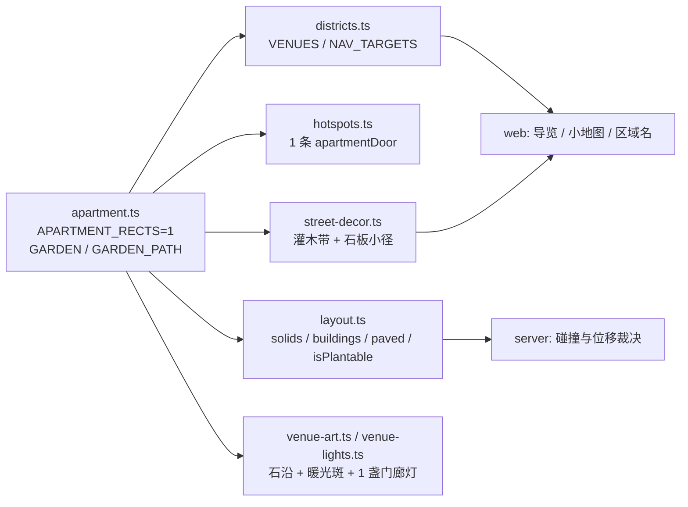

## 用户需求

园区生活区现在有 301–306 六栋「牛马公寓」，用户希望**只保留一栋**；楼群撤掉后腾出的西侧空地**留成草地/小花园**（补灌木、石板小径等纯装饰，不挡路、不改碰撞）。

## 产品概述

公寓从「六栋楼群」收敛为「一栋公寓 + 门前口袋花园」：玩家仍在 301 栋门口按 F，从外立面的空闲窗口探头、再按 F 出门；原来另外五栋楼的位置变成一片可自由穿行的绿地，公寓门口多出一条石板小径通向生活大街，两侧是灌木与花圃，白天有层次、夜里门口仍有暖光。

## 核心功能

- **只剩一栋公寓**：门牌只保留 301，楼体尺寸（300×240）、实心碰撞、4 层 × 5 列共 20 个探头窗口全部不变，一窗一人、占满拒客、出门回门口台阶的逻辑完全照旧。
- **入口只剩一处**：门口热区、导览「牛马公寓」目标、小地图公寓图标、区域名都只指向这一栋，站在原 302–306 的位置不再提示「进公寓」。
- **门前口袋花园**：公寓南侧空地铺一条石板小径，从门口台阶一直通到生活大街；小径两侧散布灌木（两档高度）、一小片花圃与一圈低矮石沿，另有花箱点缀；整片花园可自由踩踏，不产生任何碰撞。
- **其余空地回归草地林荫**：原第二排楼位置自然长出散树与草地，不再有楼体轮廓和巷道。
- **视觉一致性**：花园沿用公寓的暖灰石与薄荷点缀色，冬天地面与灌木同样覆雪；夜里公寓门廊暖光加花园中段的烘焙暖色光斑，不额外堆灯。
- **一键灰度**：花园装饰与现有过渡带装饰共用同一个关闭开关，关掉后回到纯草地，地图与碰撞不受影响。


## 技术栈

沿用现有仓库，不新增依赖：

- monorepo：pnpm 10 + turbo，四包（`apps/web`、`apps/game-server`、`packages/shared-types`、`packages/pixel-assets`）
- 共享层：TypeScript 纯数据/常量 + `vitest`（`packages/shared-types/src/__tests__`）
- 服务端：Bun + `bun:test`（`apps/game-server`）
- 客户端：Next.js + PixiJS（程序化像素绘制，无贴图资源）+ `bun:test`（`apps/web/lib/game/__tests__`）

## 实施方案

**核心策略：单点真相 + 派生收敛，而不是逐个改调用点。**

1. **布局收敛在一处**：`packages/shared-types/src/world/apartment.ts` 的 `APARTMENT_RECTS` 只留 301 一条，`APARTMENT_ROOM_COUNT` 改为 `APARTMENT_RECTS.length` 派生（=1），删除已无意义的 `APARTMENT_ALLEY` / `ALLEY_COLUMN_X`。`APARTMENT_SPECS` / `APARTMENT_WINDOWS` / `APARTMENT_WALL_SOLIDS` 保持原有派生结构——将来要加第二栋仍是一行坐标的事。
2. **零改动收敛**：`districts.ts`、`hotspots.ts`、`layout.ts`、客户端 `apartment-view.ts` / `venue-art.ts` / `venue-lights.ts` / `window-peek.ts` / `minimap-draw.ts` 全都已按 `APARTMENT_SPECS` 展开，删楼后自动只剩一处；只改注释、文案与计数断言，**不改协议**（`slot` 字段保留、恒为 0，`Player.roomId` 语义 1 = 窗内不变，`0x4d`–`0x50` 继续留空）。
3. **花园走既有装饰管线**：在 `apps/web/lib/game/street-decor.ts` 增加花园灌木带（复用 `scatterShrubs` / `propsAllowed`）与一条新的纯函数 `apartmentGardenPath()`（沿 `APARTMENT_GARDEN_PATH` 密铺 9×7 石板），仍由 `streetDecorPlan()` 汇总，`street-decor-art.buildStreetDecor()` 构造期一次烘焙、零逐帧成本；不写 `PropKind`、不加 `solids`、不改 `props`。
4. **树留白**：在 `layout.ts` 的 `isPlantable()` 增加 `APARTMENT_GARDEN` ±12 排除，避免随机散树把石板小径和灌木位吃掉。`looseTrees()` 的随机数列按格推进（先取 roll 再判 `isPlantable`），因此撤楼只会「新增」空地上的树，**不会重排全岛其余树位**，视觉爆炸半径最小。
5. **光比原方案更省**：公寓门廊光 6 → 1（`venue-lights.ts` 的循环自动收敛），花园夜景用 `venue-art` 的烘焙暖色 `pool()` 表现（符合 skill「其余靠地面提亮与烘焙暖色块」），不新增 `LightSpec`，`venueLights()` 总数 30 → 25。
6. **文档**：README 公寓段落/生活区描述/场所总表/热区条数同步；按仓库约定**不修改历史 ADR**，新增 `docs/adr/0101-*.md` 记录「六栋→一栋 + 口袋花园」的决策与后果。

**性能与可靠性**：楼体 solids 6 → 1、热区 29 → 24、常驻光源 −5，20Hz 移动裁决与 `nearestHotspotOfKinds` 都只会更轻；新增约 30 个灌木与约 150 块石板全部在构造期烘焙进 `props.base` 的一张 `Graphics`，帧循环零新增分配。花园只做视觉、不参与 `isBlocked`，因此不影响服务端权威位移与自动寻路可达性。

## 实施要点（执行细节）

- **`APARTMENT_ROOM_COUNT` 定义顺序**：先 `APARTMENT_RECTS`，再 `APARTMENT_ROOM_COUNT`，再 `APARTMENT_SPECS`——`doorNoOf` / `apartmentBySlot` / `apartmentByDoorNo` 的夹取都靠它，删栋后 `apartmentByDoorNo(302)` 自然返回 `undefined`。
- **花园坐标只写一份**：`APARTMENT_GARDEN` 与 `APARTMENT_GARDEN_PATH` 放 `apartment.ts`（在生活区矩形 3140,4640,1680×1120 内，南缘 5292 距 `LIVING_AVENUE` 5300 留 8px，东缘 4020 距南主路 `halfWidth 56` 的路缘 4040 留 20px，不压 301 楼体、不压区门 ±56 几何）。
- **花园石沿/光斑**：`venue-art.build()` 里在 `paintApartmentDoors(flat)` 之后加 `paintApartmentGarden(flat)`；石沿取 `TOWN_MATERIALS.stone/stoneDark`，北缘在小径处留 40px 缺口；暖光斑走既有 `pool()`（写进 `glow`，`?light=0` 一起退场）。描边一律同色相压暗，禁止纯黑。
- **装饰可关**：花园灌木与石板随 `?decor=0` 一起消失（同一条管线），不要另起开关。
- **测试随之调整**：`apartment-layout.test.ts` 重写为单栋口径 + 花园几何/树留白断言；`street-decor.test.ts` 的地面件预算加入石板小径上限；`lighting.test.ts` 的区间由 [26,32] 改为 [21,27] 并改注释（25 = 单栋公寓 1 + 两院 2 + 擂台 2 + 赌场 2 + 赌桌 2 + 诊所 2 + 广场 4 + 中心 1 + 茶台 1 + 卫生间 1 + 五区门 5 + 企业走廊 1 + 发泄室 1）；`game-server/src/sim/apartment.test.ts` 里 `slot 2/3/5` 的用例改成 slot 0 与夹取断言。
- **日志与错误处理**：本次不新增网络/IO 路径，无需新增日志；沿用的 `console.error('[game] 窗口探头贴图加载失败')` 不动。
- **提交前**：更新 `apps/web/data/release-notes.json`（`2026-11-15-25`）并跑 `pnpm changelog:check`；`pnpm typecheck` 与 `pnpm test` 全绿。

## 架构设计

依赖方向保持不变（`apartment.ts` → `districts.ts` → `layout.ts`；客户端只读共享常量）：



## 目录结构

```
packages/shared-types/src/
├── world/
│   ├── apartment.ts          # [MODIFY] 唯一真源：APARTMENT_RECTS 只留 301、ROOM_COUNT 派生、删除 APARTMENT_ALLEY/ALLEY_COLUMN_X、
│   │                         #   新增 APARTMENT_GARDEN（3200,4936,820×356）与 APARTMENT_GARDEN_PATH（3334,4952,32×340）；
│   │                         #   保持 SPECS/WINDOWS/WALL_SOLIDS/doorNoOf/apartmentBySlot/apartmentByDoorNo/apartmentWindowAt 结构不变
│   ├── districts.ts          # [MODIFY] VENUES 里六条 apartment-N 合成一条 venue('apartment', 300×240 矩形)；
│   │                         #   NAV_TARGETS 的 arrive 仍取 301 outside；更新「六栋」注释
│   ├── hotspots.ts           # [MODIFY] 只有 1 条 apartmentDoor（id 仍为 apartment-door-0），注释与优先级说明同步
│   └── layout.ts             # [MODIFY] isPlantable 增加 APARTMENT_GARDEN ±12 留白；buildings/paved/solids 注释由「六栋」改「一栋」；
│                             #   FLOWER_FIELDS 增一处花园花圃（3520,5000,180×140）；LIVING_AVENUE 注释同步
└── __tests__/
    └── apartment-layout.test.ts  # [MODIFY] 重写：单栋 301（门牌 301，302 起 undefined）、单条门热区、20 窗口不重叠、
                                  #   花园与楼体/生活大街/南主路不重叠、花园内无树、路径落在花园内且过门口台阶

apps/game-server/src/sim/
├── apartment.ts              # [MODIFY] 逻辑不变，仅把 JSDoc 从「每栋 20 格」改为「唯一一栋 20 格」，说明 slot 恒为 0
├── apartment.test.ts         # [MODIFY] slot 0 顺序占窗、roomId=1、20 窗满拒客、出门释放复用、断线释放、非法 slot 夹到 0
└── world.ts                  # [MODIFY] roomId 注释「1..6」→「1 = 唯一一栋的窗口」

apps/web/lib/game/
├── street-decor.ts           # [MODIFY] 新增 APARTMENT_GARDEN_BAND（复用 scatterShrubs 撒灌木）与 apartmentGardenPath()
│                             #   （沿 GARDEN_PATH 每 7px 一行、三列 9px 石板，整数纹素、确定性）；
│                             #   由 streetDecorPlan() 并入 props/ground，仍按 y,x 排序
├── venue-art.ts              # [MODIFY] 新增 paintApartmentGarden(flat)：花园三边石沿（北缘留 40px 步道口）+ 小径中段暖色 pool()
├── venue-lights.ts           # [MODIFY] 公寓门廊循环自动降为 1 盏；注释「六栋」→「一栋」，说明花园靠烘焙光斑
├── apartment-view.ts         # [MODIFY] 仅注释（「六栋单户公寓楼」→「唯一一栋」，门窗/水箱/遮阳棚画法不动）
├── session.ts                # [MODIFY] 仅注释：roomSlot 由「0..5」改为「0」
├── interactions.ts           # [MODIFY] 仅注释：roomId/roomSlot 语义改为唯一一栋
└── __tests__/
    ├── street-decor.test.ts  # [MODIFY] 新增：石板全部落在 GARDEN_PATH 内、数量符合行×列派生、花园小物不压楼体；
    │                         #   地面件预算加入小径上限
    └── lighting.test.ts      # [MODIFY] venueLights 区间 [21,27]，注释按 25 盏重算

README.md                     # [MODIFY] 公寓章节（一栋 + 花园）、生活区描述、场所总表「牛马公寓」一行、热区 29→24 条
docs/adr/
└── 0101-single-apartment-and-pocket-garden.md  # [NEW] 背景/决策/后果/备选：为何只留 301、花园如何零碰撞、协议与光预算影响
apps/web/data/release-notes.json              # [MODIFY] 追加 2026-11-15-25（≤6 条，只写玩家可感知变化）
```

## 关键结构

```ts
// packages/shared-types/src/world/apartment.ts（示意：只列受影响的常量与新增项）
const APARTMENT_RECTS: ReadonlyArray<WorldRect> = [
  { x: 3200, y: 4680, w: APARTMENT_W, h: APARTMENT_H }, // 301：唯一一栋
];
export const APARTMENT_ROOM_COUNT = APARTMENT_RECTS.length;      // 1，slot 恒为 0
export const APARTMENT_DOOR_BASE = 301;                          // 门牌只剩 301

/** 撤掉五栋后留下的门前口袋花园（纯装饰、零碰撞） */
export const APARTMENT_GARDEN: WorldRect = { x: 3200, y: 4936, w: 820, h: 356 };
/** 石板小径：门口台阶 → 生活大街，32px 宽、整数纹素 */
export const APARTMENT_GARDEN_PATH: WorldRect = { x: 3334, y: 4952, w: 32, h: 340 };
```


## Agent Extensions

### Skill
- **pixel-venue-polish**
  - Purpose: 按全站像素画风与光照预算落地门前口袋花园（石沿、灌木、石板小径、夜里门口暖光与烘焙光斑），并校验没有纯黑描边、没有超 `LightSpec` 预算、装饰可在 `?decor=0` / `?light=0` 下整体退场。
  - Expected outcome: 花园在白天读得出「公寓门前的小院」、夜里门口一段有暖光；`venueLights()` 稳定为 25 盏且 `lighting.test.ts` 预算断言通过；所有新装饰零碰撞、构造期一次烘焙。
