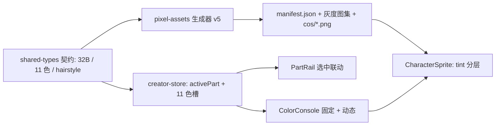

## 用户需求
- 左栏「背上」配件槽（电脑包 / 公文包）整体改为「发型」，提供 6 个选项：不剪、寸头、齐刘海、马尾、爆炸头、大背头；四个朝向都要有可辨认造型，帽子压在头发之上。
- 每个属性都能单独改色：在现有 主体 / 斑纹 / 蹄铁 / 眼睛 / 角鬃 5 色之外，新增 口鼻 / 尾巴 / 头饰 / 眼镜 / 颈饰 / 发型 6 色，共 11 个色槽。配件与发型整件按所选色相染色，保留明暗层次，不再保留原有点缀色。
- 右侧颜色面板重新设计为两段式：上半部分「整体」固定展示 5 个整体色，始终可见；下半部分「当前属性」紧随左栏最近一次点选的属性动态切换（口鼻 / 尾巴 / 头饰 / 眼镜 / 颈饰 / 发型）。
- 未点选属性时给出明确引导与快捷入口；当前属性未佩戴时给出空状态提示，但仍允许预设配色。
- 颜色改动即时反映在中间实时预览与游戏内角色上，拖动滑块不重建纹理。
- 外观线协议同步扩展（20 → 32 字节），旧草稿自动回落到默认外观。

## 视觉
沿用现有工位终端风：深墨绿底、薄荷绿高亮、2px 硬边框、等宽小字标签。新面板要有清晰的两段式层级，当前属性卡片明显重于固定行；切换属性时有短促的位移与描边过渡，无弹跳、无渐变滥用。

## 核心功能
- 发型槽位替换与四向像素造型
- 11 个独立色槽与整件染色
- 右侧面板「整体固定 + 当前属性动态」
- 左栏与右侧面板的选中联动
- 协议、资产图集、客户端渲染与文档同步升级


## 技术栈
沿用现有 pnpm + turbo 单仓：Next.js App Router + React + TypeScript + Tailwind（`apps/web`）、zustand、PixiJS v8、Bun 测试、手写像素资产生成器（`packages/pixel-assets`）、`packages/shared-types` 作为前后端唯一契约。不引入新依赖、不引入组件库。

## 实现策略
按「协议层 → 资产生成 → 客户端渲染 → UI → 文档」推进，每层都可独立验证。

**关键决策**

1. **外观契约扩到 32 字节**（一次性破协议，前端与 game-server 同仓同发）：

| 偏移 | 长度 | 字段 |
|---|---|---|
| 0 | 1 | species |
| 1–22 | 22 | 11 × u16 RGB565：body / pattern / hoof / eyes / extra / snout / tail / headwear / eyewear / neckwear / hairstyle |
| 23–26 | 4 | patternId / snoutId / extraId（角或鬃）/ tailId |
| 27–30 | 4 | headwear / eyewear / neckwear / hairstyle 目录索引 |
| 31 | 1 | reserved |

   `APPEARANCE_BYTES` 改为 32；hello / spawn / set-appearance / broadcast 包自动加长，服务端只透传无需改逻辑；单包 +12 字节，200 人同屏最坏下行仍远低于预算。备选「复用 [19] 保留位」只能多 1 字节，无法承载 6 色 × u16，否决。

2. **尾巴独立图层**：新增 `tail` 层与 `Tail / TailShade / TailOutline` 槽位。`drawTail` 直接写 tail 槽；整帧 `px.outline()` 之后做一次「描边归属改写」——若某描边像素四邻接 tail 槽，则改写为 `TailOutline`。避免用子画布 blit 造成尾巴与躯干之间多一条内描边。`LAYERS` 中 `tail` 排在 `body` 之前（尾巴在身后）。

3. **配件灰度化**：`cosmetics.ts` 的 `Icon` 由写 RGB 改为写 luma 槽（本体 255 / 阴影 ~205 / 深部 ~160 / 描边 ~54），`silhouette()` 用最深 luma 而非 INK；仍输出 20×20 RGBA 灰度图，PNG 管线不变。客户端 `Sprite.tint` 染色，换色零纹理重建。

4. **发型取代背包**：`BACK_IDS` → `HAIR_IDS = ['none','buzz','bangs','ponytail','afro','slick']`，`cosmetics.backItem` → `hairstyle`，`COSMETIC_CATALOG.back` → `hair`，补齐 `drawHair(id, dir)` 四向构图；层序 body → bodyLight → **hair** → headwear（帽子压住头发），背面正常显示。发型锚点复用 `landmarksOf().headTop` 并加 2px 下移（仅生成器一处推导），使 20×20 图标能覆盖后脑与颈背。

5. **默认色沿用现状观感**：口鼻 / 尾巴默认取本体色（此前口鼻就是用 body 染色）；头饰 `#2C4A7C`、眼镜 `#66756A`、颈饰牛 `#C94F3A` / 马 `#2C4A7C`、发型牛 `#2A2622` / 马 `#3B2A1D`。默认发型牛 `buzz`、马 `none`。

6. **UI 两段式**：store 增加 `activePart`（8 个属性键，默认 `null`）与 11 个 `ColorSlot`；`PartRail` 点击 chip 时同时 setActivePart；`ColorConsole` 上半「整体」为 5 行紧凑手风琴（色块 + 名称 + hex，展开才出 HSV），下半「当前属性」为主操作卡片（大色块 + 属性名 + 当前佩戴项 + 常驻 H/S/V + hex + wire565）。预设色板作用于当前聚焦槽，无聚焦回落到 body。未选中时展示 6 个快捷聚焦按钮，属性为 `none` 时展示提示但仍可调色。

## 架构与数据流



## 实施注意
- **性能**：颜色拖动只改 `Sprite.tint`；`variantKey` 仍只含变体字段，颜色不进重建判定。React 侧每个颜色行只订阅自身槽位，`ColorConsole` 只订阅 `activePart`，避免整面板在拖动时重渲染。
- **热路径**：`sanitizeAppearance` 在每次 `setColor` 调用，保持 O(1) 小对象重建；不要在其中做字符串比较或数组分配。
- **资产生成成本**：tail 图层可复用已有的 tail=0/1 两次渲染，不额外增加渲染轮次；新增 5 款发型 × 3 朝向 + 镜像约 20 张 20×20 PNG，体积可忽略。
- **爆炸半径**：破协议必须前后端一起发；`sessionStorage` key 保持 `niuma:profile:v1`，`sanitizeAppearance` 会丢弃旧 `backItem` 并回落默认发型与默认新色，属于免费迁移。
- **回归校验**：`pnpm assets` 后看 `packages/pixel-assets/.proof/cosmetics.png` 确认发型四向与帽子叠压；`pnpm test`（appearance/sync/spawn/cosmetics 断言）+ `pnpm typecheck`。
- **日志**：不新增日志；沿用现有 `console.error` 风格，不打印外观对象。

## 目录结构
```
packages/shared-types/src/
├── types.ts                     # [MODIFY] colors 扩到 11 键、cosmetics.hairstyle、两物种 DEFAULT_APPEARANCE
├── constants.ts                 # [MODIFY] APPEARANCE_BYTES 20 → 32，补布局注释
├── catalog.ts                   # [MODIFY] BACK_IDS → HAIR_IDS（6 项）、BackId → HairId、更新目录注释
├── appearance-codec.ts          # [MODIFY] sanitize/encode/decode/appearanceKey 按新 32 字节布局
└── __tests__/protocol.test.ts   # [MODIFY] 20→32 断言、新偏移、新色往返、旧字节回落

packages/pixel-assets/src/
├── palette.ts                   # [MODIFY] LayerName 增 tail、Tail/TailShade/TailOutline 槽、LAYERS 顺序
├── quadruped.ts                 # [MODIFY] drawTail 改写 tail 槽、描边归属改写（TailOutline）
├── cosmetics.ts                 # [MODIFY] Icon 改 luma 写入、silhouette 用深 luma、hair 目录 + drawHair 四向、移除 drawBack
├── __tests__/cosmetics.test.ts  # [MODIFY] catalog back→hair、灰度像素断言、发型数量与四向覆盖
└── scripts/generate.ts          # [MODIFY] 输出 tail-0/1.png、灰度配件、hair 锚点、manifest/布局 v5、proof 行

apps/web/
├── lib/game/atlas.ts                 # [MODIFY] SpeciesLayers.tail、manifest v5 说明
├── lib/game/character.ts             # [MODIFY] TintKey 扩 6 键、CosmeticKind back→hair、配件 tint、层序与锚点
├── lib/game/sprite-layout.generated.ts # [REGENERATED] 由 pnpm assets 重写，version 5
├── public/sprites/**                 # [REGENERATED] 图集、cos/*.png、manifest.json
├── lib/creator-store.ts              # [MODIFY] ColorSlot 11 键、PartKey、activePart/setActivePart、GLOBAL_COLOR_ROWS + PART_COLOR
├── components/creator/ColorConsole.tsx # [MODIFY] 两段式重建：整体手风琴 + 当前属性卡片 + 预设跟随聚焦
├── components/creator/PartRail.tsx   # [MODIFY] 「背上」→「发型」、chip 点击联动 activePart、分组高亮
├── components/creator/CreatorShell.tsx # [MODIFY] 介绍文案同步 11 色与发型
├── components/site/Sections.tsx      # [MODIFY] 落地页外观描述补发型
└── app/create/page.tsx               # [MODIFY] metadata 描述同步

docs/adr/0011-hairstyle-and-per-part-colors.md  # [NEW] 记录槽位迁移、32 字节协议、灰度配件、尾巴分层与回滚路径
README.md                                        # [MODIFY] 外观字节表与能力描述
```

## 关键结构
```ts
export type ColorSlot =
  | 'body' | 'pattern' | 'hoof' | 'eyes' | 'extra'
  | 'snout' | 'tail' | 'headwear' | 'eyewear' | 'neckwear' | 'hairstyle';

export type PartKey =
  | 'pattern' | 'snout' | 'extra' | 'tail'
  | 'headwear' | 'eyewear' | 'neckwear' | 'hairstyle';

/** 动态区映射：pattern / extra 仍落在固定区，但可被聚焦高亮 */
export const PART_COLOR: Record<PartKey, { slot: ColorSlot; label: string; hint: string }>;
```


## 设计方向
沿用已有「工位 404」工业终端语言：深墨绿底、薄荷绿信号色、2px 硬边框、无圆角、等宽小字标签、细扫描线。改造只重构右侧面板的信息层级，不换风格、不引入组件库，全部使用项目自研 Tailwind 组件。

## 版式与区块
- 面板顶栏：标题「调色控制台」+ `rgb565` 标签 + 一句吞吐说明，保持不变。
- 整体区（固定）：标题「整体 / GLOBAL」，5 行紧凑行：28px 色块、名称、等宽大写 hint、当前 hex、右侧展开箭头。默认收起，仅一行展开 HSV 三轨，避免 5 × 3 滑块堆满。
- 当前属性区（动态）：标题「当前属性 / FOCUS」右侧显示属性代码；卡片含 44px 大色块、属性名 + 当前佩戴项名、常驻 H/S/V 三轨、hex 输入与 wire565 回显。切换属性时整卡以 140ms 位移淡入（`ease-out-expo`），并 `aria-live="polite"` 播报新属性名。
- 空状态：虚线 2px 边框 + 一行引导「在左侧点选 口鼻 / 尾巴 / 头饰 / 眼镜 / 颈饰 / 发型」+ 6 个等宽快捷 chip，点击即聚焦。
- 预设色板：12 个 32px 方块，标题随聚焦变化为「应用到 头饰」；无聚焦时显示「应用到 主体」。
- 左栏联动：被选中的分组左侧加 2px 薄荷竖条，chip 保持 `aria-pressed` 语义。

## 交互与响应式
所有可点元素有 `focus-visible` 薄荷描边；滑块保留原生 range 键盘行为并补 `aria-valuetext`。xl 及以上三栏布局，面板 `sticky` 顶部对齐并内部滚动；小于 xl 时按 左栏 → 预览 → 调色 顺序堆叠，动态卡片不做悬浮遮挡。尊重 `prefers-reduced-motion`，关闭位移动画只保留描边变化。禁止弹跳缓动、紫蓝渐变、纯黑纯白与 Inter 字体。

## Agent Extensions
### Skill
- **principal-software-architect**
  - Purpose: 为 32 字节破协议、尾巴独立图层、配件灰度化三项不可逆决策做约束/非目标/反向成本对比，并产出 ADR-0011。
  - Expected outcome: 一份落在 `docs/adr/0011-*.md` 的决策记录，含至少两个备选方案、推荐项与回滚路径。
- **impeccable**
  - Purpose: 按 shape → 实现 → polish 流程重构右侧调色面板，并做 a11y / 响应式 / 反模式自检。
  - Expected outcome: 两段式面板成形并通过 `npx impeccable detect` 无 primary findings。
### SubAgent
- **code-explorer**
  - Purpose: 在改协议前枚举 `colors`、`cosmetics`、`appearance` 的全部调用点，确认没有遗漏的读写方。
  - Expected outcome: 一份带文件路径与行号的调用点清单，作为改动范围核对表。
