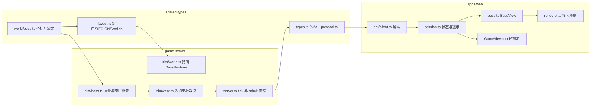

## Product Overview
在中心广场正下方（南侧主路以东、导览牌以南、影音室与摸鱼湖之间）的空地新增「发泄区」：地面由深色防滑垫、粉笔圈、警示条纹与「发泄区」字样围出边界，区域中央立一个体型巨大的胖老板像素形象，头顶常驻名牌与血条。全园区共享同一条每日生命值。

## Core Features
- 每天本地零点重置为 10000 点（进程重启也从 10000 开始，遵守服务端零持久化）。
- 靠近老板按 E「发泄」踢打，每次真实命中扣 1 点；移动端复用现有动作栏「发泄」按钮，不新增按键。
- 命中反馈：钝击音、老板受击抖动、出招者头顶「-1」飘字、血条与数值即时变化。
- 归零时老板整体变灰，血条显示 0/10000，头顶常驻「老板倒下」牌子，并弹一次全屏轻提示；之后继续踢不再扣血。
- 次日零点自动恢复彩色与满血，可再战。
- 提示：靠近存活老板显示「[E] 踢老板出气」；靠近已倒下老板显示「老板已经倒下，明天再来」。
- 边界：出招扇形内优先命中玩家；入座玩家挡刀时按空放处理，老板不隔空掉血；老板脚底有碰撞挡人，区域其余装饰不阻挡移动。


## Tech Stack Selection
沿用现有栈，不引入新依赖：TypeScript 5（strict）、Bun（游戏服务端）、Next 15 + React 19（Web）、PixiJS 8（游戏 Canvas）、Vitest + bun:test、`@niuma/shared-types` 作为客户端与服务端共享的世界数据源。服务端零持久化。

## Implementation Approach
采用「静态世界地标 + 服务端内存血量 + 纯追加下行协议」。

1. **老板不是实体**：不进入 `World.players`、AOI、同步快照和实体 id 空间，避免改动现有同步链路。只在 `WORLD_LAYOUT.solids` 登记 160×44 脚底碰撞（可从正面贴近踢打但走不过去）。
2. **单一坐标真相**：新建 `packages/shared-types/src/world/boss.ts`，导出 `BOSS_ARENA`（x 4280 / y 4480 / w 420 / h 450）、`BOSS`（中心 x 4450、脚底 y 4780、可视 200×256）、`BOSS_SOLID`、`BOSS_HIT_RECT`（脚底上方 150×110 受击区）、`BOSS_MAX_HP = 10000`、`isInBossArena()`、`bossHitPoint()`（受击矩形最近点）。渲染、碰撞、感应半径、测试全部从这里派生。
3. **布局接入**：`layout.ts` 把 `BOSS_ARENA` 加入 `isPlantable()` 留白（否则 `LOOSE_TREES` 会在区内静默长树）；`REGIONS` 插入「发泄区」并排在「中央迎宾广场」之前，保证状态栏区域名正确；`solids` 追加 `BOSS_SOLID`。
4. **服务端血量**：新建 `apps/game-server/src/sim/boss.ts`。`BossRuntime` 只持有 `hp` 和「下一个本地零点时间戳」，`syncDay(now)` 做一次 O(1) 比较即可完成跨日重置（用本地年月日构造次日零点，确定性、不依赖额外时区库）。`hit()` 扣 1 点、下限 0，仅 1→0 那次返回 `justDied`。`World` 持有实例，重启自然回到 10000。
5. **协议纯追加**：只用空闲的 `S2C_BOSS = 0x2c`（0x2a/0x2b 按 ADR-0067 继续永久留空），负载 `[op u8][hp u16][attackerId u16][flags u8]` 共 6 字节；`flags bit0` 本次归零，`bit1` 跨日重置。E 的出招意图已由现有 vent 位承载，不需要新增 C2S。
6. **命中裁决顺序**：`sim/vent.ts` 在原有玩家裁决之后追加老板裁决——只有「扇形内没有可命中玩家（含被入座者挡下的空放）」时，才用 `bossHitPoint(attacker)` 的最近点做 `withinVentCone` 判定，命中后调用 `boss.hit()` 并广播给全部真人连接（`wsId` 非 0）。保留 ADR-0065 的挡刀语义，老板不会隔空掉血。
7. **客户端表现**：新建 `apps/web/lib/game/boss.ts` 的 `BossView`，构造期烘焙地面贴图（垫子/粉笔圈/警示条纹/发泄区字样）、彩色本体、灰色本体、名牌底板、血条底槽与填充条。归零直接换灰色 texture，不用运行时滤镜；血条填充用 `scale.x = hp / 10000` 表达，不重建纹理。
8. **跨线程只加一条低频事件**：`SessionCallbacks.onBossDown` → `worker-protocol.ts` → `worker-host.ts` → `worker-client.ts` → `GameViewport.tsx` 顶部轻提示 4.5 秒。血条与抖动都在渲染线程内处理，不经过主线程，避免每脚一次 postMessage。

**关键取舍**
- 不做实体：省掉 AOI、快照字段、id 分配与每 tick 广播；代价是老板完全静态，正符合需求。
- 血量放服务端：全园区唯一真相，防篡改防不同步；代价是入场需补一条快照包，在 `admit` 时补发 `S2C_BOSS`。
- 复用 E「发泄」：零新增输入、移动端自动复用；代价是「踢」复用扇形挥击语义，用钝击音、抖动与「-1」飘字补偿打击感。

**性能与可靠性**
- 广播：每命中 1 包 × 在线人数，极端 120 命中/秒 × 60 人约 7.2k 个 6 字节小包/秒，可接受；不做合并批量，因为归零瞬间时序准确性更重要。
- 渲染：帧循环零分配、零纹理重建；HP 数字文本最多 8Hz 刷新，避免每脚重排字宽造成抖动与分配；血条只改 `scale.x`。
- 并发：同一 Tick 多人出手时，`hit()` 在 hp 已为 0 后返回 null，`justDied` 只发一次；tick 内严格「先 syncDay 再 resolveVents」，避免重置前误判归零。
- 叠加现有未提交改动（0067/0068 相关），不格式化、不回退无关代码，本轮不提交。

## Architecture Design

数据流：E 出招（现有 vent 位）→ 服务端裁决玩家 → 未命中玩家则判定老板 → `hit()` → 广播 `S2C_BOSS` → 客户端更新血条/换色，本地攻击者飘字与音效 → 归零经 worker 回调触发轻提示。

## Directory Structure
```
packages/shared-types/src/
├── world/boss.ts                       # [NEW] 发泄区唯一坐标真相：ARENA/BOSS/SOLID/HIT_RECT/MAX_HP，isInBossArena 与 bossHitPoint
├── world/layout.ts                     # [MODIFY] isPlantable 加发泄区留白；REGIONS 插入「发泄区」；solids 追加 BOSS_SOLID
├── types.ts                            # [MODIFY] OpCode 追加 S2C_BOSS = 0x2c，定义 BossPacket 与 flag 位
├── protocol.ts                         # [MODIFY] encodeBoss/decodeBoss，id 宽度对齐现有 encodeVent
└── __tests__/
    ├── boss-layout.test.ts             # [NEW] 区不压地标/树/湖，isPlantable 为假，可站立点存在，solids 已登记
    └── protocol.test.ts                # [MODIFY] S2C_BOSS 往返：hp 0/10000/越界、attackerId、flags

apps/game-server/src/
├── sim/boss.ts                         # [NEW] BossRuntime：hp、syncDay 跨日 O(1) 重置、hit 扣点与 justDied 单次
├── sim/boss.test.ts                    # [NEW] 逐点扣血、下限 0、归零只报一次、同 Tick 多命中、跨日重置
├── sim/vent.ts                         # [MODIFY] 玩家裁决后追加老板裁决与全园区广播，不改原有空放/挡刀
├── sim/vent.test.ts                    # [MODIFY] 补「玩家优先于老板」「入座挡刀不掉血」「范围外不掉血」
├── sim/world.ts                        # [MODIFY] World 持有 BossRuntime
└── server.ts                           # [MODIFY] tick 先 syncDay 再 resolveVents；admit 补发 S2C_BOSS

apps/web/
├── lib/net/client.ts                   # [MODIFY] 注册 0x2c handler，转发 hp/attackerId/flags
├── lib/game/boss.ts                    # [NEW] BossView：烘焙地面贴图/双色本体/名牌/血条，updateHp、playHit、setDead
├── lib/game/renderer.ts                # [MODIFY] 构造 BossView；地面贴图入地面装饰层，本体入 sortLayer 按脚底 y 排序，名牌与血条入 labels
├── lib/game/session.ts                 # [MODIFY] 保存 BossState，更新视图与提示，归零触发回调，本地攻击者播钝击音与飘字
├── lib/game/hint-copy.ts               # [MODIFY] HintCopy 新增 bossAlive/bossDead，同步 HINT/HINT_BUTTONS/TOUCH_HINTS
├── lib/game/interactions.ts            # [MODIFY] 新增 isNearBoss 感应函数与半径
├── lib/game/runtime/worker-protocol.ts # [MODIFY] 新增 bossDown 事件类型
├── lib/game/runtime/worker-host.ts     # [MODIFY] 转发 session 的 onBossDown
├── lib/game/client/worker-client.ts    # [MODIFY] switch 增加 bossDown 分支
├── lib/game/__tests__/hint-copy.test.ts        # [MODIFY] 覆盖新提示穷举
├── lib/game/__tests__/interactions.test.ts     # [MODIFY] isNearBoss 边界
├── lib/game/__tests__/interaction-hint.test.tsx # [MODIFY] 老板提示的按钮与点击走 vent
└── components/game/GameViewport.tsx    # [MODIFY] 接收 onBossDown 并渲染 4.5s 顶部轻提示

docs/adr/0069-vent-zone-boss-hp.md      # [NEW] 静态地标、共享血量、0x2c、零持久化与重启语义
README.md                               # [MODIFY] 动作与互动、地图与地形、二进制协议章节
apps/web/data/release-notes.json        # [MODIFY] 追加本轮版本条目
```

## Key Code Structures
```ts
// packages/shared-types/src/world/boss.ts
export const BOSS_ARENA: { x: number; y: number; w: number; h: number };
export const BOSS: { x: number; y: number; w: number; h: number };      // x,y 为脚底锚点
export const BOSS_SOLID: { x: number; y: number; w: number; h: number };
export const BOSS_HIT_RECT: { x: number; y: number; w: number; h: number };
export const BOSS_MAX_HP = 10000;
export function isInBossArena(x: number, y: number): boolean;
export function bossHitPoint(px: number, py: number): { x: number; y: number };
```
```ts
// apps/game-server/src/sim/boss.ts
export interface BossHitResult { hp: number; attackerId: number; justDied: boolean; }

export class BossRuntime {
  get hp(): number;
  syncDay(nowMs: number): boolean;                       // 跨日重置返回 true，需广播
  hit(attackerId: number, nowMs: number): BossHitResult | null; // 已倒下返回 null
}
```


## 设计风格
复古街机像素 + 工业警示牌：发泄区整体像工地上被圈出来的一块「合法出气地」，用高对比警示色和手绘告示牌语言，与园区的暖色草地形成反差，一眼能看出「这里可以打人」。

## 视觉描述
- **区域地面**：深灰橡胶垫（#1B1D22）铺底，四周黄黑斜条纹包边（#F2C14E / #15171B），中心一圈白色粉笔圆环（#EDE6D6，带手绘毛边），北侧地面印「发泄区」粗体字样与一枚「禁止内卷」小印章。
- **老板形象**：200×256 texel、1:1 烘焙、nearest 放大，胖到呈梨形，短腿、双手背在身后、肚子把衬衫撑开，西装外套、松垮领带、金表链。3 色分层 + 1px 硬描边，脚下一片椭圆软阴影。
- **头顶 UI**：木质名牌写「老板」，下方 120×8 双色血条（墨色底槽 + 朱红填充），右侧小字「10000 / 10000」。血条随血量减少变短，低于 30% 填充转为橙红。
- **倒下状态**：整套精灵替换为去饱和灰版（#6E7278 / #4A4D52 / #33363A），血条变空，头顶换成插在脚边的纸板牌「老板倒下」，牌面留手写体与胶带痕迹。
- **全屏轻提示**：屏幕上方居中一块半透明墨色面板，朱红描边，主文案「老板倒下了」，副文案「今日怨气已清零，明天再来」，淡入 200ms、停留 4s、淡出 300ms，不拦截点击。
- **动效**：老板待机时每 3.4s 一次 1px 呼吸浮动；受击时 120ms 水平抖动 + 轻微压扁；归零瞬间整体灰化并伴随一次下坠 2px 回弹。全部为已有帧循环内的 transform 变化，不新增粒子系统。

## Agent Extensions
### Skill
- **layer-pixel-art**
  - Purpose: 指导老板形象与地面贴图的像素网格、调色板分层、硬描边与 nearest 放大规范，确保与园区现有 1:1 texel 美术风格一致。
  - Expected outcome: 一套可直接烘焙的 200×256 彩色与灰色双版本精灵设计，以及发泄区地面贴图的配色与网格规格。
- **test-driven-development**
  - Purpose: 先写 `sim/boss.ts` 的扣血、归零单次、跨日重置与同 Tick 并发测试，再实现运行时逻辑。
  - Expected outcome: 服务端血量语义被测试锁定，归零与重置边界无回归。
- **verification-before-completion**
  - Purpose: 在收尾阶段实际执行 typecheck、全量测试与 `pnpm changelog:check`，以命令输出确认完成。
  - Expected outcome: 所有校验命令通过并附实际输出证据。
