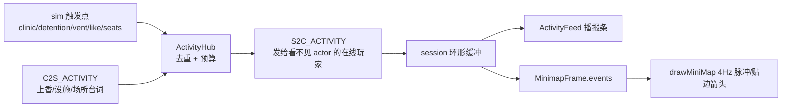

## 产品概述
园区里任何一名玩家做出的交互，其他人即使不在同一片区域，也能立刻知道「谁、在哪、做了什么」。近处玩家继续看原有完整动画；远处玩家通过全园区播报条与小地图事件标记获得同一条信息，镜头始终留在自己身上。

## 核心功能
- 全园区事件通报：救护车出警/装人/送达/上病床/治愈、保安派单与押送、被人创飞、发泄区老板受击、工牌被点赞、上香与续杯、售货机/饮水机/咖啡机互动、会议室/影音室/游乐园/摸鱼亭的场所台词、坐下/躺下/起身/挥手/跳跃/入座赌桌与擂台，都会生成一条面向全园区的通报。
- 通报内容：主语名字 + 发生了什么 + 所在区域/方位，远端玩家即使看不到实体也能读懂。
- 播报条：屏幕上方一窄条动态栏，最多同时显示三条，逐条淡入淡出，不遮挡画面中心，不抢焦点、不打断输入。
- 小地图事件标记：视野内的事件点显示脉冲标记，视野外的事件贴边显示方向箭头，点击/悬停可看到最近一条事件文字。
- 分级与降噪：强演出事件（昏迷、押送、被创飞）优先且必达；生活类事件合并同类；常规动作只通知「看不见的人」，避免同屏重复播报与刷屏。
- 开关与可访问性：播报条可在小地图页脚一键开关并记住偏好；重要事件走礼貌播报（aria-live），动效遵循系统「减少动态」设置。

## 边界
- 不做镜头跳转、不做远程实体渲染、不新增持久化状态。
- 近处已有的完整演出与音效保持原样，通报条只承担「远处也没错过」的职责。
- 旧客户端不认识新消息会静默忽略，不影响正常同步。


## 技术栈
- 现有栈不变：Next.js + React + TypeScript 前端（Pixi 渲染 + Worker）、Bun + TypeScript 游戏服、`@niuma/shared-types` 共享协议。
- 复用既有模式：`S2C_SYSTEM_NOTICE` 的「服务端套模板、客户端只显示」；`S2C_AMBULANCE`/`S2C_PATIENT` 的定长小包 + 旧客户端 default 静默忽略；`notice.ts` 的模板集中表；Worker 内 4Hz 的 `drawMiniMap`。

## 实现思路
一条新的全园区广播通道 + 一套客户端降噪管道。服务端维护 `ActivityHub`，所有交互触发点只调用一次 `emit(kind, actor)`；Hub 做「分级去重 + 预算限流 + 按接收者过滤」，把 `S2C_ACTIVITY`（含 kind、actorId、坐标、成品文案）推给**看不见这个人的在线玩家**（以及本人视情况），因此同屏玩家不会出现「动画 + 播报」双份信息。客户端把包分成两条呈现：顶部播报条（React 状态）与小地图事件标记（Worker 画布），两条共用一个带过期时间的环形缓冲。

关键决策与理由：

1. **不复用 `S2C_SYSTEM_NOTICE`**：它没有坐标，做不了小地图定位，且它的口径是「进园/离园/公告」这类系统消息。新开 `0x33 S2C_ACTIVITY`，8 字节头 + 截断文案，向后兼容（旧端 default 忽略），与 ADR-0084/0072 先例一致。
2. **生活类反馈需要一个上行口**：上香、设施气泡、场所台词、拍照全靠客户端本地随机，服务端无从派生。新增 `0x34 C2S_ACTIVITY`（`[op][kind u8][sub u8]`），服务端只做白名单 + 每玩家 1 条/秒限流，坐标一律取服务端权威位置，**不接受客户端坐标**。文案属于纯观感，即使被伪造也不影响判定，因此不引入领地校验表，代价写进 ADR。
3. **常规动作不做全服刷屏**：坐下/挥手/跳跃在 200 人时可达每秒数十次。接收者过滤用 `actor.known`（OA 集合）做差集，复杂度 O(接收者)，不额外算距离；再加每个 actor 每类 4 秒去重与全局令牌桶（约 40 条/秒，桶空时优先丢常规动作），保证最坏情况下每客户端约 1KB/s。
4. **急救/押送已有权威状态**，新通道只补「可读的一句话 + 定位」，不新增第二份真相；`S2C_AMBULANCE`/`S2C_PATIENT`/`S2C_JAIL` 保持原样。
5. **小地图不改成全图**：168px 画布仍映射本人 1000px 视野，视野外事件贴边画 4px 箭头 + 方向，既保住现有可读性，又满足「远处也知道在哪」。移动端无小地图时，播报条内置区域名与方位。

## 协议与数据结构
- `S2C_ACTIVITY = 0x33`：`[op][kind u8][actorId u16][x u16][y u16][len u8][utf8]`，坐标沿用 1/8 像素量化。
- `C2S_ACTIVITY = 0x34`：`[op][kind u8][sub u8]`，在 `net/guard.ts` 用定长校验（2 字节），多一字节即判伪造。
- `ACTIVITY_TIER`：`Dramatic`（必达，不去重）/ `Life`（同类 2 秒合并）/ `Routine`（同类 4 秒合并，且只发非 AOI 接收者）。
- 文案统一走 `formatActivity(kind, { name, region })`，未知 kind 返回 `null`，调用方跳过，绝不显示半句话。



## 性能与可靠性
- 服务端：每条事件 O(接收者 + 去重常量)，无 N+1、无逐帧遍历；令牌桶把最坏情况收敛到固定上限。
- 客户端：播报条只在事件到达时触发一次 React 更新，4Hz 小地图把事件与地形一起重绘，不额外起定时器；事件列表只保留 8 条、过期即丢，避免数组无限增长。
- 错误处理：`formatActivity` 返回空即跳过；解码长度越界按空文案处理（沿用 `decodeSystemNotice` 的收口方式）；坐标越界钳到世界边界。
- 兼容与回滚：新 opcode 旧端忽略；回滚只需删掉 `ActivityHub` 的实例化与两个协议分支，播报条与小地图标记自动退化为无事件，既有演出不受影响。

## 落地纪律
- 触发点全部在 sim 层，不改动已有广播包的字段与语义；`broadcastSystemNotice` 的调用方保持不变（本需求不走系统公告频道，避免把玩法动态混进入/离园通知）。
- 不新增落盘状态，急救与押送仍只活在进程内存。
- 时间口径统一用服务端 `clock.now()`；客户端排队与过期用会话时钟(`this.elapsed`)，不用 `Date.now()`。
- 复用现有像素 HUD 视觉与 `font-mono` 数字排版，不引入新的组件库。
- 提交前补 `apps/web/data/release-notes.json` 并跑 `pnpm changelog:check`。

## 目录结构
```
niuma/
├── packages/shared-types/src/
│   ├── activity.ts                    # [NEW] ACTIVITY_KIND 枚举、分级、去重窗口与 formatActivity 模板表
│   ├── types.ts                       # [MODIFY] OpCode 追加 C2S_ACTIVITY 0x34 / S2C_ACTIVITY 0x33，定义 ActivityPacket 与上报包类型
│   ├── protocol.ts                    # [MODIFY] encodeActivity/decodeActivity、encodeActivityReport/decodeActivityReport，文本收口走 truncateChat
│   ├── index.ts                       # [MODIFY] 导出新模块
│   └── __tests__/activity.test.ts     # [NEW] 模板空参返回 null、kind 全覆盖、编解码往返与越界
├── apps/game-server/src/
│   ├── sim/activity.ts                # [NEW] ActivityHub：分级去重、令牌桶、按 known 差集发送、注入到各 manager
│   ├── sim/activity.test.ts           # [NEW] 去重窗口、桶空时降级、AOI 内收不到、actor 离线跳过
│   ├── server.ts                      # [MODIFY] 构造 ActivityHub 并注入；新增 C2S_ACTIVITY 分支（白名单 + 每秒 1 条限流）；老板受击处补 emit
│   ├── sim/clinic.ts                  # [MODIFY] 昏迷/装车/治疗/治愈四个跃迁点 emit
│   ├── sim/detention.ts               # [MODIFY] 派单/押送/入屋三个相位 emit
│   ├── sim/vent.ts                    # [MODIFY] 命中回调里 emit（复用已有 attackerId/targetId 归因）
│   ├── sim/like.ts                    # [MODIFY] 点赞成功 emit
│   ├── sim/seats.ts                   # [MODIFY] 入座/起身 emit（含床位与赌桌/擂台座位）
│   ├── sim/ring.ts / sim/dice.ts      # [MODIFY] 开局、结算是非
 
├── apps/web/
│   ├── lib/net/client.ts              # [MODIFY] 注册 onActivity 与 sendActivity，新增 opcode 分发
│   ├── lib/game/session.ts            # [MODIFY] handleActivity 写入缓冲；本地生活类事件上报并补一条本人回执；worldSnapshot 带 events
│   ├── lib/game/activity-feed.ts      # [NEW] 纯函数队列：上限 3 条、1.2 秒一条、5 秒淡出、Dramatic 立即插队
│   ├── lib/game/game-ui.ts            # [MODIFY] activities 状态、pushActivity、播报开关与 localStorage 记忆
│   ├── components/game/ActivityFeed.tsx  # [NEW] 顶部播报条：分级配色、区域小标签、进出动效、减少动态适配
│   ├── components/game/GameViewport.tsx  # [MODIFY] 挂载播报条，接 game-ui
│   ├── lib/game/minimap-draw.ts      # [MODIFY] MinimapFrame.events，视野内脉冲环、视野外贴边箭头与方向
│   ├── components/game/MiniMap.tsx    # [MODIFY] 页脚动态计数与「播报」开关
│   ├── lib/game/__tests__/activity-feed.test.ts   # [NEW] 节流、插队、过期、上限
│   └── lib/game/__tests__/minimap-events.test.ts  # [NEW] 贴边钳制与方向角
├── docs/adr/0107-park-wide-activity-feed.md        # [NEW] 承接 ADR-0105，记录分级/限流/伪造风险/回滚
└── apps/web/data/release-notes.json                # [MODIFY] 一条面向玩家的版本工报
```

## 关键结构
```ts
// packages/shared-types/src/activity.ts
export const ACTIVITY_KIND: Readonly<Record<string, number>>;
export const ACTIVITY_TIER: ReadonlyMap<number, 'dramatic' | 'life' | 'routine'>;
export function formatActivity(kind: number, params: { name?: string; region?: string }): string | null;

// apps/game-server/src/sim/activity.ts
export class ActivityHub {
  emit(kind: number, actor: Player, now: number): void;          // 服务端已知事件
  report(actor: Player, kind: number, sub: number, now: number): void; // 客户端上报，含限流
}
```


## 设计定位
延续园区既有像素 HUD：深墨底、2px 硬边、等宽数字、薄荷色描边。新增元素必须是「可瞟一眼、不抢视线」的信息层，而不是新的浮窗系统。

## 页面与区块
**顶部播报条（ActivityFeed）**
- 位置：屏幕顶部居中，落在现有顶部状态条下方 8px，宽度自适应 320–520px，移动端贴满左右 12px 安全边。
- 结构：每条为一行「分级色块 + 区域小标签 + 一句话」，左侧 3px 竖条按分级取色（强演出=朱红、生活=暖金、常规=薄荷）。
- 动效：从上方 8px 滑入 + 透明度 0→1（180ms cubic-bezier(0.22,1,0.36,1)）；停留 5 秒后 240ms 淡出，绝不使用回弹缓动。强演出事件插队并加一次 1px 边框呼吸，最多 900ms。
- 容量：同屏最多 3 条，超出进入队列，1.2 秒放行一条；连续同类事件合并为「另有 N 人」尾注。

**小地图事件层（MiniMap）**
- 视野内：3px 菱形标记 + 每 500ms 扩散一圈的 1px 脉冲环，颜色同分级。
- 视野外：标记钳到画布边缘内缩 6px，画 4px 方向楔形，并按真实方位旋转；标记透明度 0.75，不遮挡地形与场所图标。
- 页脚：现有「SCAN 4Hz / AOI 1000px」右侧改为「动态 N」计数与一个 14px 开关方块，开启时薄荷实心，关闭时描边空心。
- 悬停/点击：在页脚临时替换为最近一条事件文案，2 秒后回到计数，避免再加一层浮层。

**空态与降级**
- 无事件时播报条完全收起（不占高度），小地图页脚显示「动态 0」。
- 移动端无小地图：播报条文案自带区域与方位（如「急救站 · 东南」），保持同一套分级配色。
- 关闭播报后仍保留小地图标记，两者互不牵连。

## 交互与响应式
- 播报条 `pointer-events: none`，只有开关与悬停文本可点，不阻断移动与技能输入。
- 断点：≥1024px 居中显示 3 条；<1024px 单条 + 「+N」折叠，点击展开为最多 3 条。
- 可访问性：强演出事件所在容器 `aria-live="polite"`，生活类与常规类不进播报（避免读屏刷屏）；开关带 `aria-pressed`；`prefers-reduced-motion` 下所有位移动效改为纯淡入淡出。

## 文案语气
短句、玩家视角、不写实现细节：如「阿牛在急救站被救护车接走了」「值班护士把阿花扶上病床」「有人在上香，香火正旺」「隔壁工位有人摸鱼喝咖啡」。


## Agent Extensions
### Skill
- **principal-software-architect**
  - Purpose: 为本需求给出至少两个方案（全服广播 vs 观战镜头 vs 纯通知）的权衡矩阵，并把分级、限流、伪造风险与回滚路径写成 ADR-0107。
  - Expected outcome: 新增 `docs/adr/0107-park-wide-activity-feed.md`，含约束、非目标、反向成本与 30 天回滚步骤
