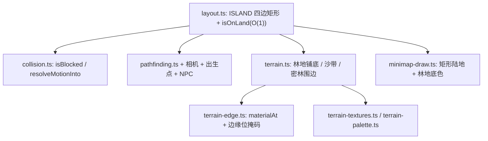

## 用户需求
删除园区地图四边原有的海水与不可行走区域，改成明确的四条矩形边界，地图整体尺寸保持不变。

## 产品概述
改造后园区是一整块矩形陆地：可活动范围沿用当前岛界包围盒（x 2146–5951 / y 1956–6168，约 3805×4212）。原来伸进地图的北湾、东湾、南中湾全部填成陆地，玩家可以直接走进去；四边由一圈不可通行的密林封住，贴边看到的是林墙而不是海面或黑边。

## 核心功能
- 矩形边界：四边统一为同一条边界契约，玩家走到沙带外沿即被挡住，四个角不再有锯齿状海岸线
- 地形：删除深海与浅滩，草地铺满整个矩形；四边内侧保留一圈约 26px 的沙滩装饰带，沙草交界继续保留像素化的有机过渡
- 边界景观：矩形外侧用一圈深色密林包裹，分近远两层，向外延伸足够远，贴边行走不露黑边
- 湖泊：地图内三座湖（摸鱼湖 / 沉思浅塘 / 涟漪湖）原样保留，仍可涉水通行
- 系统同步：小地图、寻路网格、出生点、相机夹紧、NPC 行走范围全部跟随新矩形边界，不会走出边界或卡在旧海岸线上

## 视觉要求
- 站在任意一边向外看：沙带 → 草地边缘 → 一层近树影 → 一层压暗的远林墙，层次清楚，没有海水、浅滩与硬黑边
- 边缘保持 1:1 像素颗粒与整数像素对齐，不使用模糊或抗锯齿
- 冬季模式下林地与沙带同步换色，雪层止于沙带内侧


## 技术栈
- 语言与构建：TypeScript + pnpm workspace + turbo（沿用，无新增依赖）
- 共享布局：`@niuma/shared-types` 的纯函数几何层（`world/layout.ts`、`world/collision.ts`），服务端与客户端共用同一份边界
- 渲染：Next.js + PixiJS v8，`TerrainView` 的 base / edge / decals 三层
- 测试：vitest（shared-types）、bun test（web）

## 实现策略
1. **单一几何真相**：把 `ISLAND` 的多边形海岸线换成 4 点矩形（沿用原包围盒四点），`ISLAND.bounds` 数值完全不变，因此 `WORLD_BOUNDS`、协议坐标、AOI、服务端 `clampWorldX/Y`、相机夹紧、A* 网格全部自动保持不变。`isOnLand` 从「点内判定 + 到多边形距离」改为 O(1) 的内缩矩形比较，`radius` 仍是净空语义，`isBlocked` 的边界短路、`findFreePoint` 的夹回逻辑无需改动。
2. **视觉分层替换**：`addSea` 改为深色林地铺底（保留 2048px 外扩量防止边缘露黑），删除 `addShoreShelf` 浅滩；草地不再用多边形遮罩，直接把 TilingSprite 定位到矩形；沙带从「以岸线为中线的描边」改为「边界内侧 26px 的矩形环」；新增密林围边层，只画不碰（不注册 blocker、不进深度排序，角色到不了）。
3. **边界景深**：矩形外 0–240px 放两排确定性树影（近排略亮、远排压暗并下移），再往外是林地底色平铺，形成「林墙」而非海面；所有树影进 `cullables`，出屏即 `renderable = false`，预计新增精灵 < 600。
4. **材质/边缘系统收敛**：`MaterialId` 删除 `shallow`，`sea` 改为语义更准确的 `outside`（矩形以外），`materialAt` 用矩形距离判定；沙/草交界、沙/外界的暗边继续走既有 32px 材质网格 + 8 邻位掩码 + 47 态归一化 + 整数 rect 图元，不引入新渲染模式。

## 实现要点（执行细节）
- `isOnLand`：`x > bx + radius && x < bx + w - radius && y > by + radius && y < by + h - radius`；`radius = 0` 时与旧行为一致（严格内部点），`radius > 0` 时先判断 `w/h > 2 * radius` 再比较，避免负数矩形。
- 沙带宽度沿用 `ISLAND_SAND = 26`：该宽度仍能跨过 32px 材质格（格心距边界 16px 落在沙内、48px 落在草上），位掩码采样不会错位。
- `isPlantable` 的留白从 `isOnLand(x, y, 30)` 提到沙带之外（≥ 沙带宽 + 树冠半径），避免树长到沙滩上；`looseTrees` 的 180px 内缩保留，原海湾区域会按既有确定性种子自动补树，不需要手写新布局。
- 相机仍夹在 `ISLAND.bounds`，最大外露约半个视口（< 1300px），林地铺底外扩 2048px 足够；同时把渲染器底色改成林地深色作为最后兜底。
- 冬季雪层遮罩由 `offsetContour(ISLAND.points, -ISLAND_SAND)` 改为「矩形内缩 ISLAND_SAND」，用现成的 `roundedRectContour(rect, 0)` 生成直角轮廓，避免再写一套几何。
- 三湖不动：`isWaterAt` 只覆盖湖面，边界不再与水域概念耦合；`collision.ts:81` 的「三湖不注册碰撞体」注释保持有效。
- 旧语义清理：`layout.ts` 中「北门入园口：从海滩到院落北缘」的注释与北向主路「→ 北湾南岸」注释同步改写为矩形陆地描述，区域矩形本身不动。
- 日志：无新增运行期日志；不要让每帧代码打印边界信息。
- 影响面控制：不改协议、不改服务端逻辑、不改存档结构；除 `isOnLand` 语义外，其余边界消费方只做类型与注释级适配。

## 架构关系


## 目录结构
```
packages/shared-types/src/
├── world/layout.ts                  # [MODIFY] ISLAND 改 4 点矩形；isOnLand 改内缩矩形判定；删除 ISLAND_SHALLOW；ISLAND_SAND 语义改为边界内侧沙带宽；isPlantable 留白提到沙带外；更新北门/北湾相关注释
├── world/collision.ts               # [MODIFY] 仅更新「海即边界」注释为「矩形边界」，逻辑不动
└── __tests__/
    ├── collision.test.ts            # [MODIFY] 「海岛边界」整组重写：四边阻挡、原三个海湾转为可进入、净空断言改为距矩形边界
    ├── layout-hub.test.ts           # [MODIFY] ISLAND 点数 16 → 4、四角坐标断言、海湾断言反转
    └── layout-density.test.ts       # [MODIFY] 因新增约 13% 陆地重新标定纯草比例阈值，保留「无空 512 窗口」底线

apps/web/lib/game/
├── terrain.ts                       # [MODIFY] addSea→addWild 林地铺底；删除 addShoreShelf；addGrass 直接铺矩形；addShoreSand 改矩形内环；addSnowCover 遮罩改内缩矩形；新增 addBorderForest 调用；删 SEA_TILE / sea 水面滚动项；更新 build 顺序
├── border-forest.ts                 # [NEW] 确定性密林围边：四边两排树位生成、近远两层明暗、数量上限、纯函数无 Pixi 依赖
├── terrain-edge.ts                  # [MODIFY] MATERIAL 删除 shallow、sea 改名 outside；materialAt 改矩形距离判定；EDGE_STYLE / WINTER_EDGE_STYLE / EDGE_DRAW_ORDER 同步；MaterialId 收窄
├── terrain-textures.ts              # [MODIFY] makeSeaTexture → makeWildTexture（深色林地平铺），删除冬季海面配色分支
├── terrain-palette.ts               # [MODIFY] 新增林地/远林色阶，删除 sea* / shoreShallow；更新小地图 wild 色
├── minimap-draw.ts                  # [MODIFY] 背景改林地深色，岛形多边形改矩形填充 + 沙色描边
├── ground.ts                        # [MODIFY] isOutdoorGround 的 pointInPolygon(ISLAND.points) 改为 rectContains，省一次多边形扫描
└── __tests__/
    ├── terrain-edge.test.ts         # [MODIFY] 「海岸三段」改为「矩形沙带 + 边界外」，NaN 兜底断言改为 outside
    └── border-forest.test.ts        # [NEW] 树位确定性、全部落在矩形外、数量上限、四边覆盖无缺口

docs/adr/0064-rectangular-map-boundary.md   # [NEW] 记录「海边界 → 矩形密林边界」的决策与代价
apps/web/data/release-notes.json            # [MODIFY] 追加 2026-11-13-3 版本工报
```

## 关键代码结构
```ts
// layout.ts：矩形边界契约（radius 即净空，radius = 0 时与旧版一致）
const ISLAND_POINTS: Point[] = [
  [2146, 1956], [5951, 1956], [5951, 6168], [2146, 6168],
];
export function isOnLand(x: number, y: number, radius = 0): boolean;

// border-forest.ts：纯函数输出树位，渲染层只负责贴图
export interface ForestTree { x: number; y: number; variant: number; depth: 0 | 1 }
export function buildBorderForest(bounds: WorldRect): ForestTree[];
```

