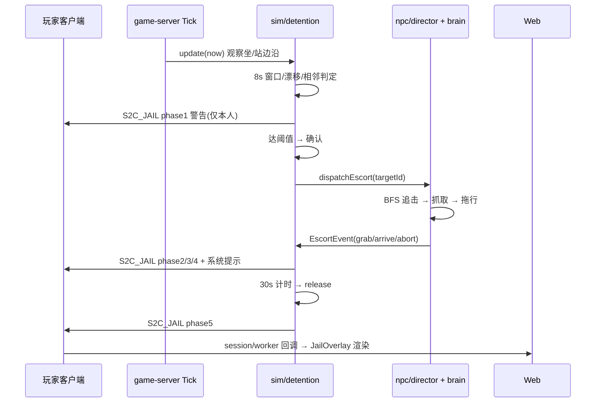

## Product Overview
在园区地图新增一间独立「小黑屋」，并让园区保安对「在他人身旁高频坐下—站起」的行为进行巡逻抓捕、押送与限时禁足，形成一次可完整感知、可回滚的园区执法小事件。

## Core Features
- **新增场景**：小黑屋建筑、西侧门与支路、水泥地面、吊灯/反省凳/红叉桃心海报；小地图与 HUD 区域名自动生效。
- **服务端判定**：只认真人玩家的 `坐→站` 完整循环；坐姿 150–1200ms、相邻 56px、循环间隔 ≥150ms、8 秒窗口、位置漂移 ≤32px。
- **分级响应**：第 3 次循环仅本人黄色警告 3.5 秒；第 6 次循环或 3 秒内第 4 次循环确认不当行为。
- **保安押送**：最近空闲保安出动，1.3 倍速追击，26px 抓取、0.6 秒按肩、躺姿拖行，经门外进入反省点；追击 12 秒失败则放人。
- **惩罚与释放**：反省 30 秒，坐姿、禁移动/动作/发泄、可聊天；服务端到点释放，断线即出狱，无持久化。
- **提示文字**：确认时广播「{name} 被保安请进了小黑屋：园区内不许色色。」；本人依次看到警告、出动、拖走、全屏暗角常驻倒计时卡片、释放提示；旁人看到被拖者头顶「不许色色！」气泡。
- **回滚**：`GAME_JAIL_ENABLED=false` 时关闭检测、押送与惩罚，小黑屋保留为普通空房。


## Tech Stack
沿用现有 TypeScript monorepo（pnpm + Turbo），不引入新依赖：
- 共享协议/地图：`packages/shared-types`（Vitest）
- 游戏服务端：WebSocket + 20Hz Tick（Bun test）
- 前端：Next.js/React + PixiJS 渲染 + 现有 Tailwind HUD
- 权威边界：判定/押送/释放全部在服务端；客户端只消费事件与渲染

## Implementation Approach
采用**服务端权威规则模块 + NPC 押送任务 + 仅押送用 BFS + 增量协议**：
1. 新增深模块 `sim/detention.ts`，对外只暴露 `observe/update/handleEscortEvent/dispose`，内部封装阈值、滑动窗口、免疫与计时器；对 `World.players` 做姿态边沿检测，只在「入座/起身」时做一次 56px 邻域查询，避免每 Tick 全量空间查询。
2. 保安押送落在 `npc/brain.ts` 的任务分支，`director.ts` 实现 `EscortPort` 并派发最近空闲保安；`sim` 通过端口接口反向依赖 NPC，不直接触碰 `NpcAgent`。
3. 新增 `S2C_JAIL (0x2d)` 定长 9 字节包；不占用现有 state 位，旧客户端走 default 静默忽略。押送位置继续复用 20Hz Tick 的 dirty 同步，不额外加高频包。
4. 小黑屋只作为地图数据新增，复用 `roomWalls`、`PATHS`、`REGIONS`、`isBlocked`；BFS 仅在派发/追击重算时运行（24px 网格、8 邻接、禁止切角、视线简化），约 28k 格、毫秒级、每名保安最多 2.5 次/秒。

**规则常量（单一事实源，写在 `detention.ts`）**：
`WITNESS_RANGE_PX=56`、`CYCLE_WINDOW_MS=8000`、`CYCLE_MIN_MS=150`、`CYCLE_MAX_MS=1200`、`WARN_CYCLES=3`、`CONFIRM_CYCLES=6`、`RATE_WINDOW_MS=3000`、`RATE_CYCLES=4`、`ANCHOR_DRIFT_PX=32`、`IMMUNITY_MS=60000`、`JAIL_MS=30000`、`CHASE_TIMEOUT_MS=12000`、`DRAG_TIMEOUT_MS=15000`、`GRAB_RANGE_PX=26`、`GRAB_HOLD_MS=600`、`TOW_OFFSET_PX=22`、`CHASE_SPEED=1.3`、`DRAG_SPEED=0.85`。

**状态机**：`Idle → Watching → Warned → Confirmed → Chasing → Grabbed(按肩) → Dragging → Jailed → Released`；任一异常（目标断线、保安卡死、超时）走 `Aborted`，清本地锁并恢复 Idle，绝不传送。

**关键决策与代价**：
- 否决「保安瞬移到现场」：违背 ADR-0061「NPC 绝不传送」，且玩家会看到凭空出现。
- 否决「客户端判定」：可伪造、跨端不一致；服务端判定保证同一事实源。
- BFS 只服务押送，不扩散为全图寻路；在 ADR-0072 明确与既有「NPC 不做全图寻路」的边界。
- 代价是新增约 100 行寻路模块与一个协议字段，换取零传送、可回滚与低 Tick 开销。

**性能与可靠性**：
- 检测 O(在线人数) 每 Tick + 每次姿态跃迁 O(k) 邻域；循环数组按 8s 裁剪，内存恒定。
- BFS 单次 O(格子数)，仅派发/重算触发；追击重算节流 400ms 且目标位移 >48px。
- 每个事件仅 5 次以内 `S2C_JAIL`，旁听范围 1000px 只查询一次并去重；不增加常驻广播。
- 全部状态为进程内存，玩家移除即清理；`GAME_JAIL_ENABLED=false` 时不创建检测、不发包，协议仍保留但无人使用。

## Architecture Design


## Implementation Notes
- **地图**：`JAIL={x:4320,y:4790,w:460,h:320}`、西墙门 `{side:'west',from:4920,to:4980}`、反省点 `(4590,4980)`、多人左右 ±48px 最多 3 人；北缘距四角院落 74px、南缘距南侧庭院 30px，需在布局测试中写死校验。
- **姿态锁**：新增 `Player.jailUntil`；`applyMove` 在 stun 判断之前增加 jail 分支，强制 `POSE.Sit`、`seat=0` 并拒绝位移，避免用 `stunUntil` 导致躺姿。抓取时 `seats.stand()` 释放座位，`stunUntil` 作为拖行硬直（上限 45s）；入狱时清 stun、写 jailUntil；释放/中止两者清零。
- **免疫**：`vent.ts` 的出招者与目标都增加 `now < player.jailUntil` 跳过；`C2S_ACTION` 对 `stunUntil/jailUntil` 直接拒绝。聊天不受影响。
- **押送事件**：`director` 每名保安最多一个任务，选最近空闲；围观/排队不阻塞 Tick。保安被发泄踹倒时 `updateAgent` 因 stun 提前返回，任务保留，起身继续；拖行卡死 15s 中止并原地释放。
- **协议**：`[op][entityId u16][phase u8][flags u8][seconds u16][guardId u16]`，`flags bit0=本人`；phase 1 只发本人，2/3/4/5 发本人 + 1000px 内其他玩家；phase 3 的 seconds 填预计押送上限 25，phase 4 填服务端剩余秒。
- **客户端锁**：收到 self 的 phase 3/4 时 `localLockUntil=now+min(seconds,45)*1000`，phase 5 清零；每帧与现有 `stunUntil` 一起阻断移动/动作预测。倒计时仅显示，以服务端 phase 5 为准；本地归零显示「等待开门…」。
- **日志**：复用服务端现有日志，事件级单条记录（player id、phase、原因），不写玩家名/聊天内容；不逐 Tick 打日志。
- **零持久化**：断线、重连、重启即清理押送与惩罚；无 schema/数据库改动。
- **回滚**：新增 `config.jail.enabled`，读 `GAME_JAIL_ENABLED`（默认 true）；关闭后小黑屋仍是可进入的普通空房，检测与押送代码早退。
- **文档**：新增 `docs/adr/0072-*.md`；提交前更新 `apps/web/data/release-notes.json` 并跑 `pnpm changelog:check`。

## Directory Structure
```
packages/shared-types/src/
├── world/campus.ts                 # [MODIFY] 新增 JAIL 建筑/门/铺装/反省锚点、concrete 地板类型、CAMPUS_BUILDINGS 与 CAMPUS_SOLIDS 条目
├── world/layout.ts                 # [MODIFY] 新增西侧支路、小黑屋 REGION、jail 导航目标；导出新常量
├── types.ts                        # [MODIFY] 新增 S2C_JAIL=0x2d、JAIL_PHASE 常量与类型
├── protocol.ts                     # [MODIFY] JailPacket 接口 + encodeJail/decodeJail（9 字节定长）
├── notice.ts                       # [MODIFY] SYSTEM_NOTICE_KIND.Detained=5 与「{name} 被保安请进了小黑屋：园区内不许色色。」模板
└── __tests__/
    ├── nav-arrival.test.ts         # [MODIFY] 导航目标 12→13，补小黑屋到达点
    └── jail-layout.test.ts         # [NEW] 校验建筑边界/门/支路/南北间距/不与 solids 重叠

apps/game-server/src/
├── config.ts                       # [MODIFY] ServerConfig 增加 jail.enabled，loadConfig 读取 GAME_JAIL_ENABLED
├── server.ts                       # [MODIFY] 创建 detention 并接线；Tick 顺序 update→vents→npcs→runTick；C2S_ACTION 拒绝禁足；开关早退
├── sim/
│   ├── detention.ts                # [NEW] 深模块：阈值窗口、警告/确认、免疫、派发、抓取/入狱/释放事件、超时与清理
│   ├── detention.test.ts           # [NEW] 覆盖 3/6 次、3s 内 4 次、窗口裁剪、漂移、无效坐姿、无目击者、免疫、释放、开关关闭
│   ├── world.ts                    # [MODIFY] Player 增加 jailUntil 字段并在 reset 清理
│   ├── movement.ts                 # [MODIFY] applyMove 增加 jailUntil 分支（Sit、seat=0、拒绝位移）
│   └── vent.ts                     # [MODIFY] 出招者/目标跳过 jailUntil 状态
└── npc/
    ├── escort-path.ts              # [NEW] 24px BFS、8 邻接禁切角、isBlocked 可站立判定、视线简化与不可达返回 null
    ├── escort-path.test.ts         # [NEW] 绕墙、门洞、不可达、起终点同格、路径不穿墙
    ├── brain.ts                    # [MODIFY] NpcAgent 增加 escort 任务；追击/重算节流/抓取停顿/拖行/卡死中止
    └── director.ts                 # [MODIFY] 实现 EscortPort：最近空闲保安、每名 1 任务、事件回调、目标断线中止

apps/web/
├── lib/game/props.ts               # [MODIFY] 新增 concrete 地板绘制（灰、裂缝、排水口）并接入 fillBuildingFloor
├── lib/game/interior-art.ts        # [MODIFY] 注册小黑屋内饰：吊灯、反省凳、红叉桃心海报、铁窗
├── lib/net/client.ts               # [MODIFY] S2C_JAIL 解码分支 + onJail 回调
├── lib/game/session.ts             # [MODIFY] JailNotice 类型、onJail、本人本地锁/倒计时、旁人气泡、本地提示、reset 清理
├── lib/game/client/
│   ├── game-client.ts              # [MODIFY] SessionCallbacks 增加 onJail
│   ├── main-thread-client.ts       # [MODIFY] 转发 onJail
│   └── worker-client.ts            # [MODIFY] 转发 worker 的 jail 消息
├── lib/game/runtime/
│   ├── worker-protocol.ts          # [MODIFY] 增加 {t:'jail'} 消息类型
│   └── worker-host.ts              # [MODIFY] 收到 jail 后 post 给主线程
└── components/game/
    ├── GameViewport.tsx            # [MODIFY] jail 状态、onJail 回调、自动消退、渲染 JailOverlay
    └── JailOverlay.tsx             # [NEW] 顶部黄/红条、全屏暗角、常驻倒计时卡片、释放 toast；无新依赖

docs/adr/0072-jail-detention-and-escort.md  # [NEW] 判定阈值、押送状态机、BFS 边界、协议、回滚与 ADR-0061 关系
.env.example                                # [MODIFY] 增加 GAME_JAIL_ENABLED=1 与说明
apps/web/data/release-notes.json            # [MODIFY] 追加一条面向玩家的版本记录
```

## Key Code Structures
```ts
// packages/shared-types/src/types.ts
export const JAIL_PHASE = { Warn: 1, Dispatch: 2, Escort: 3, Jailed: 4, Released: 5 } as const;
export interface JailPacket {
  entityId: number; // 被处置的玩家
  phase: number;
  self: boolean;    // flags bit0
  seconds: number;  // 3/25/剩余反省秒/0
  guardId: number;  // 0 表示无保安
}

// apps/game-server/src/npc/director.ts
export interface EscortPort {
  /** 派发最近空闲保安；无空闲返回 false，detention 下 Tick 重试 */
  dispatch(targetId: number, now: number): boolean;
}
export type EscortEvent =
  | { kind: 'grab'; guardId: number; targetId: number; now: number }
  | { kind: 'arrive'; guardId: number; targetId: number; now: number }
  | { kind: 'abort'; guardId: number; targetId: number; reason: 'timeout' | 'missing' | 'stuck' };
```


## Design Style
沿用园区既有的像素风 + 深色 HUD，不引入新字体或组件库。小黑屋是「冷、硬、窘」的一间水泥房：灰底裂缝、单颗晃动的吊灯、铁窗、红叉桃心海报和一只反省凳；HUD 则用现有 ink 面板与 mono 小字，形成“园区广播”的严肃感与反差幽默。

## 场景与 HUD
- **室内**：水泥地板用 2–3 档灰 + 1px 裂缝/排水口，墙沿用现有描边；吊灯做 3 帧轻微摆动，光锥用低透明度暖黄；海报为像素红叉压在桃心上，不写文字，文字交给 UI。
- **警告**：顶部居中黄条，左侧三角警示图标，3.5s 后下滑淡出；不遮挡聊天和动作栏。
- **出动/拖走**：红条，左侧保安帽剪影，文案分两行：粗体主句 + mono 小字「园区内不许色色」；拖走阶段常驻至 phase 4。
- **入狱**：全屏 `radial-gradient` 暗角 + 顶部常驻卡片；卡片含「小黑屋反省中」、大号倒计时、两行副文案「不许色色，好好做人」「移动已限制」。倒计时每秒跳一次但不做 aria-live 刷屏。
- **释放**：2.5s 薄荷绿 toast「反省结束，可以走了」，向上淡出。
- **旁人**：被拖者头顶像素气泡「不许色色！」，2s 后消失；不额外加屏幕效果。

## 交互与响应式
- 全部 `pointer-events-none`，不拦截聊天/面板；桌面顶部 24px，移动端 12px 且卡片宽度 `min(92vw, 420px)`。
- 动画只做 120–200ms 的透明度/位移，不使用弹跳；尊重 `prefers-reduced-motion`，关闭吊灯摆动与滑入，只保留淡入。
- 无障碍：横幅 `role="status" aria-live="polite"`；倒计时用 `role="progressbar"` 与 `aria-valuenow`，每秒视觉更新但不进入 live region；暗角不改变可读对比度。

## Agent Extensions
### Skill
- **tdd**
  - Purpose: 先写 `detention` 阈值/押送超时与 `escort-path` 用例，再实现规则，确保 3/6 次、3s 内 4 次、窗口与漂移等边界可验证。
  - Expected outcome: 服务端规则与寻路测试先红后绿，覆盖所有阈值与异常分支。
- **impeccable**
  - Purpose: 实现并打磨 `JailOverlay.tsx` 与小黑屋 HUD，避免模板化样式，保持与现有像素风一致。
  - Expected outcome: 黄/红条、暗角卡片、倒计时与释放 toast 完成，无新字体/依赖，移动端与减少动效可用。
- **principal-software-architect**
  - Purpose: 固化 `sim/detention` 与 `npc` 的端口边界、BFS 适用范围与回滚策略，产出 ADR-0072。
  - Expected outcome: ADR 记录判定阈值、状态机、协议、性能与 ADR-0061 的边界，方案可评审。
