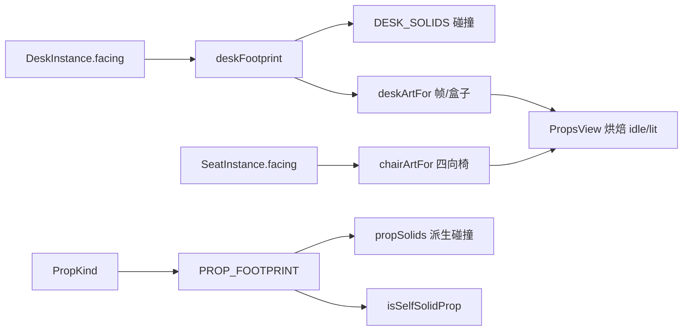

## 用户需求
当工位位于侧面（东、西两列）时，桌子本身也要侧过来摆放：桌子的长边顺着人坐的方向，人坐在长边外侧，显示器落在对面远侧长边。当前只有显示器转了 90°，桌子仍是 88 宽 × 40 高的横桌，人坐在 40 宽的短边端头，显示器压在近侧，读起来像「人趴在桌子端头看屏幕」。同时按「符合现实物理规律」审计全图物品并一并修正。

## 产品概述
这是一款像素风多人在线办公园区游戏（Pixi 渲染，双端共用一份布局数据）。本次不改玩法、协议与入座规则，只修「地图家具的朝向、贴墙与碰撞要和现实一致」。

## 核心功能
- 侧向工位桌随朝向整体转 90°：占地碰撞、椅位、贴图、显示器、桌面陈设（绿植/马克杯/便签）同步转置；显示器永远在背对椅子的远侧长边
- 椅子四向化：靠背永远在入座朝向的反侧，空椅不再出现「背对桌子」的错觉
- 马桶改为背靠水箱、面朝房间（当前正对水箱）
- 会议室白板移回北墙内侧，不再一半穿出墙外
- 洗手台整体贴到南墙，龙头朝墙、台盆朝房间，人从北侧使用
- 售货机 / 饮水机 / 咖啡机碰撞盒底边与精灵底座对齐，正面不再有 14px 隐形墙
- 长椅、野餐桌、单车补碰撞（变实体）；绿植、垃圾桶、标识、灯仍可穿过
- 会议室门移到东端，不再一进门正对一把椅子
- 上述朝向与占地由单测固化，并新增 ADR 记录

## 视觉结果
站在广场四角看，四面工位都是「人正对桌子长边的显示器」：南北两排是横桌，东西两列是竖桌，桌子与椅子、显示器朝向一致；家具不再悬空、穿墙或背对使用者，大件家具也真的挡人。


## 技术栈
沿用现有：TypeScript monorepo（pnpm + turbo）、PixiJS 8、Next.js、共享布局包 `@niuma/shared-types`；测试 shared-types 用 vitest、web 用 `bun test lib/game/__tests__`。

## 实现方案
核心策略：**朝向即几何**。桌子、椅子、道具占地的「朝向 → 尺寸/盒子」全部变成纯数据，布局层（碰撞、椅位）与渲染层（贴图盒子）读同一份函数，避免两处各写一份。延续 ADR-0027 已建立的「几何与绘制分离」模式：几何留在不 import pixi 的 `desk-art.ts` / 新增 `chair-art.ts`，绘制留在 `props.ts`。

关键决策与理由：
- **桌子旋转用「按朝向重画几何」，不用精灵旋转**：ADR-0005 禁止负缩放/任意角度变换，90° 旋转虽数学精确，但会让 1px 描边与像素网格错位，且侧视为竖窄机身，必须重画。
- **东西两列的桌脚占地从 88×40 变 40×88，椅子从 ±64 收到 ±40**：椅子永远坐在长边外侧，`chairOffset` 统一为「短边一半 + CHAIR_GAP」= 40。南北两排与工作区六工位坐标零变化。
- **侧放桌贴图整体覆盖 40×88 占地**（桌面 40×76 + 南端 12 高前挡板），碰撞与可见桌面一致，不在桌下留隐形墙；帧约 48×92，比横桌 96×66 更省纹理。
- **实体道具由 props 数组派生碰撞**（单一来源表），底边 = 精灵底座；`kind: 'prop'` 已被 `fillSolidFlat` 跳过，不会在地面层重复画矩形；`isSelfSolidProp` 改为「有占地」判定，测试不再两处维护名单。
- **深度排序不动**：工位底边改为 `desk.y + footprint.h/2`；椅子仍 `seat.y - 1`——角色帧脚底原点 (32,59)，身体永远画在锚点以北 59px，椅背在任何朝向下都被身体遮住，所以不需要为椅背改排序。
- **洗手台/白板/门是纯数据位移**，不动碰撞逻辑；洗手台贴图按垂直翻转重画（龙头从北侧移到南侧）。

性能与可靠性：烘焙数量 8 张工位（不变）+ 椅子由 1 张变 4 张（26×30 级小图），一次性成本可忽略；帧循环仍是视口裁剪 + idle/lit 切换，无新增每帧计算；碰撞体新增约 10 条（长椅×6、野餐桌×3、单车×1），128px 网格索引吸收，无可测影响。风险控制：南北两排、工作区、会议桌、床/沙发/凳子坐标一律不动，blast radius 限于东西两列与 4 台洗手台、1 块白板、1 个门洞。

## 系统结构



## 执行要点
- `packages/shared-types/src/world/campus.ts`
  - 新增 `deskFootprint(facing)`：`FACING_VECTOR[facing].x !== 0 ? {w: DESK_H, h: DESK_W} : {w: DESK_W, h: DESK_H}`；`chairOffset(facing)` 改为 `Math.min(w,h)/2 + CHAIR_GAP`（即恒为 40），`workstation` 签名不变。
  - 新增 `PROP_FOOTPRINT: Partial<Record<PropKind,{w,d}>>`：vending 32×24、cooler 20×20、coffee 22×20、bench 38×10、table 38×18、bike 36×12；`propSolid(prop)` 返回 `{kind:'prop', x: x-w/2, y: y-d, w, h: d}`；`isSelfSolidProp` 改为查表。
  - 删除手写的 `PLAZA_SOLIDS` / `WORK_SOLIDS`（改由 props 派生），`CAMPUS_SOLIDS` 去掉 `...WORK_SOLIDS`。
  - `TOILET_SEATS.facing` 改 `DIRECTION.Down`（注释同步：背靠北侧水箱、面朝房间）。
  - `MEETING_DOOR` 改 `{side:'south', from:3510, to:3570}`（避开 x=3400 的南排中椅）。
  - `CAMPUS_PROPS`：`board` 移到 `(3400, 6014)`；4 台 `sink` 的 y 由 6220 改 6250。
- `packages/shared-types/src/world/layout.ts`
  - `DESK_SOLIDS = DESKS.map(deskSolid)`（用 `deskFootprint`）；`officeWorkstations()` 的门洞区间判定改用各朝向的 `w/h`（东西列用转置后的 88 高，排除项仍为 4010/4160，椅子数不变）。
  - `WORLD_LAYOUT.solids = [...DESK_SOLIDS, ...PLAZA_SOLIDS 删除, ...CAMPUS_SOLIDS, ...propSolids(ALL_PROPS)]`；`props` 复用同一个 `ALL_PROPS` 常量，保证「props 与派生碰撞」同源。
  - 重新导出 `deskFootprint`、`propSolid`、`propSolids`。
- `apps/web/lib/game/desk-art.ts`（重写接口）
  - `DeskArt` 增加 `frame`、`top`、`front`、`handle`、`legs`、`shadow`、`details{mug{x,y}, note{x,y}, plant{cx,bottom}}`；保留 `monitor`、`screen`。
  - 横桌帧 96×66（沿用现状坐标）；侧放帧 48×92：占地 x 4–44 / y 4–92，`top {4,4,40,76}`、`front {4,80,40,12}`、`handle {20,84,8,2}`、腿 `{6,86,5,6}/{33,86,5,6}`。
  - 显示器落点：Left → 西端 `{8,40,12,22}`、screen `east`；Right → 东端 `{28,40,12,22}`、screen `west`（原实现把侧视显示器画在近侧 74–86，本次纠正）；陈设在桌面内并与显示器分开（Left：plant cx32/bottom24、mug{26,56}、note{33,68}；Right 镜像）。
- `apps/web/lib/game/props.ts`
  - `drawDesk` 改为纯按盒子绘制（桌面 → 高光 → 前挡板 → 拉手 → 腿 → 显示器 → 陈设），不再写四向分支；`drawMonitor` 侧视分支复用现有逻辑（亮边、桌面反光）。
  - `build()`：每个 facing 用自己的帧烘焙；`bottom = desk.y + deskFootprint(desk.facing).h/2`；裁剪 `padX = art.frame.w/2 + 4`、`padY = art.frame.h`。
  - `drawChair` 改为读 `chairArtFor(facing)` 的盒子；`SEAT_ART` 的椅子尺寸按朝向区分；椅子贴图按 facing 烘焙 4 张，`build()` 按 `seat.facing` 取图。
  - `drawProp('sink')` 垂直翻转重画：柜体/台面在 art 上半、台盆居中、龙头落在 art 底部（贴南墙）。
- `apps/web/lib/game/chair-art.ts`（新增，纯几何）
  - `ChairArt { frame, back, seat, base[], shadow }`；`chairArtFor(facing)`：Down 为现状（背靠在北/远侧），Up 为背面视（背靠落在南/近侧、可见座沿），Left/Right 为侧视（背靠分别在东/西侧）。
- 测试
  - `apps/web/lib/game/__tests__/desk-art.test.ts`（重写）：四向帧尺寸；桌面+前挡板覆盖 40×88/88×40 占地且帧底与占地南边对齐；显示器中心落在背对椅子的远半区（Left 在西、Right 在东、Up 在北、Down 在南）；陈设不压显示器、不越出桌面；所有盒子在帧内。
  - `apps/web/lib/game/__tests__/chair-art.test.ts`（新增）：靠背在朝向反侧（按 facing 计算方位）、座面在朝向侧、盒子不越帧。
  - `packages/shared-types/src/__tests__/seats.test.ts`：马桶改断言 `DIRECTION.Down`；补「工位桌长边垂直于朝向」「椅子在长边外侧且 gap = CHAIR_GAP」「每个有占地的道具都有一条底边与精灵底座对齐的 solid」「bench/table/bike 有碰撞、plant/bin/lamp/sign/board/sink/sideTable 没有」；保留既有「座位不压墙与桌、两两不重叠、门洞通道不被挡、四角在陆地」。
- 文档：新增 `docs/adr/0028-desk-rotation-and-prop-physics.md`，记录「桌随朝向转置 / 家具朝向与贴墙 / 占地单一来源」，关联 0020、0027，写明负面（侧放帧更高、椅子多 3 张贴图、东西列椅位内收 24px）与回滚（回滚该提交即可；数据改动互不依赖）。

## 目录结构
```
packages/shared-types/src/
├── world/campus.ts                         # [MODIFY] deskFootprint / chairOffset / PROP_FOOTPRINT / propSolid /
│                                           #   isSelfSolidProp；马桶朝向、会议室门、白板与洗手台坐标；删 PLAZA_SOLIDS、WORK_SOLIDS
├── world/layout.ts                         # [MODIFY] deskSolid 派生 DESK_SOLIDS；门洞判定用朝向占地；
│                                           #   props 与派生碰撞同源；重导出新函数
└── __tests__/seats.test.ts                 # [MODIFY] 马桶朝向、长边/椅距、占地底边对齐、大件/小件碰撞名单

apps/web/lib/game/
├── desk-art.ts                             # [MODIFY] 每朝向 frame + 桌面/挡板/腿/显示器/陈设盒子；侧放帧 48×92
├── chair-art.ts                            # [NEW] 四向椅子几何（背面视/正面视/左右侧视），不 import pixi
├── props.ts                                # [MODIFY] drawDesk 数据化；按朝向烘焙椅子；工位 bottom/pad 用占地；
│                                           #   洗手台贴图翻转
└── __tests__/
    ├── desk-art.test.ts                    # [MODIFY] 四向帧/远侧长边/陈设不重叠/占地覆盖
    └── chair-art.test.ts                   # [NEW] 靠背反侧、座面朝向侧、不越帧

docs/adr/0028-desk-rotation-and-prop-physics.md  # [NEW] 本轮决策、代价、回滚
```

## 关键接口
```ts
// packages/shared-types/src/world/campus.ts
export function deskFootprint(facing: Direction): { w: number; h: number };
export function chairOffset(facing: Direction): number; // 短边一半 + CHAIR_GAP
export function isSelfSolidProp(kind: PropKind): boolean;
export function propSolid(prop: PropInstance): SolidRect | undefined; // 底边 = prop.y

// apps/web/lib/game/desk-art.ts
export function deskArtFor(facing: Direction): DeskArt; // frame/top/front/legs/monitor/details

// apps/web/lib/game/chair-art.ts
export function chairArtFor(facing: Direction): ChairArt; // frame/back/seat/base
```

## 验证
- `pnpm --filter @niuma/shared-types test`、`pnpm --filter @niuma/web test`、`pnpm --filter @niuma/game-server test`、`pnpm typecheck`。
- 人工（dev 起服）：东西两列坐下后显示器在正前方长边、桌子是竖的；南北两排与工作区六工位外观不变；空椅背靠朝向正确；马桶坐着背靠水箱；白板不出墙；洗手台贴南墙；售货机/饮水机/咖啡机贴脸不被隐形墙挡；长椅/野餐桌/单车挡人、绿植垃圾桶不挡；会议室从新门洞正常进出、不撞椅子。


## Agent Extensions
### Skill
- **tdd**
  - Purpose: 先写几何断言（desk-art / chair-art / 占地底边对齐），再改实现，避免「贴错边」这类位图里看不出、CI 能挡住的回归
  - Expected outcome: 新增/重写的几何测试先红后绿，且四个朝向的帧、显示器远侧、陈设不重叠、占地与碰撞对齐都有断言覆盖
