## 产品概述
在牛马考勤档案中增加「击倒数」，记录本人按 E 成功击倒他人的累计次数。它和步数、摸鱼、被喷、加班并列，成为工牌行为统计的一部分；自己的档案与查看他人的档案都能看到，考勤小票分享卡也会带上这一行。

## 核心功能
- 按 E 成功击倒他人时累计加一；空放、被别人击倒、旁观互殴都不增加。
- 与现有行为统计同一套本地累计与上报口径，刷新或重开浏览器后仍保留。
- 工牌档案 ACTIVITY 区新增「击倒」格子，显示累计次数；未上报时显示「未上报」。
- 考勤小票分享卡新增「击倒次数」一行，排版不挤压现有名次与金句区。
- 他人工牌显示对方截至上次上报的累计击倒数，不额外暴露实时战斗状态。


## 技术栈
沿用现有栈，不新增依赖：TypeScript、`@niuma/shared-types` 手写二进制协议、Next.js 15 + React 19、Tailwind CSS v4、zustand、Bun 服务端。协议继续遵循「尾部追加 + 魔数 + 缺段回退」。

## 实现策略

### 1. 统计口径：只认服务端结算
- 计数来源固定为 `S2C_VENT` 事件包：服务端 `resolveVents` 命中后会把包显式发给攻击者，包内已有 `attackerId` 与 `targetId`。
- 只统计 `attackerId === localId` 且 `targetId !== 0`：空放 `targetId = 0` 不计，被别人击倒只增加「被喷」，旁观互殴不计。
- 不在本地按下 E 时预加：限频、硬直、空放、判定失败都不该刷高数字。
- 新增纯函数 `ventOutcome(packet, localId)`，返回 `hit | dealt | other`，供会话层与单测共用，避免把归因逻辑散落在回调里。

### 2. 数据链路：复用考勤摘要，不新增 opcode
- `CareerStats` 增加 `knockdownCount`，与 `ventedCount` 并列；本地 `niuma:career:v1` 缺字段时按 0 读取，不做迁移脚本。
- `CareerTracker.recordKnockdown()` 只在收到本地命中事件时加一，30 秒批处理落盘，切后台/关页补写。
- `buildCareerSummary` 把击倒数带进 `CareerSummary`，随 `C2S_HELLO` 的 `0xfc` 尾部段与 `C2S_CAREER` 补报上行。
- 服务端 `Player.career` 只做内存保存与转发，`spawnPacketOf` / `S2C_CAREER` 自动带出新字段；不需要新 opcode、不需要服务端持久化。
- 观看侧 `PlayerBadge.career` 直接携带 `knockdownCount`，`BadgeArchive.activity` 消费它。

### 3. 协议版本：v2 与前向兼容
- 新字段插入在 `ventedCount` 之后，会改变 `overtimeCount`、`reportedOnlineSec` 与 `provinceLen` 的偏移，因此不能沿用 v1 版本号。
- `CAREER_VERSION` 升到 2；`CAREER_VERSION_LEGACY = 1`。
- 新解码器同时支持 v1 与 v2：v1 摘要把 `knockdownCount` 回退为 0；v2 按新布局解析。
- 旧 v1 解码器看到版本 2 会整段丢弃并显示「未上报」，不会读出错位的省份；这是可接受的降级。
- 信封层（`readCareerSegment` / `decodeCareerReport` / `decodeCareerBroadcast`）的长度下限必须用 `CAREER_MIN_BYTES = 34`，否则 v1 包会在进入 `decodeCareer` 前被拒。
- 长度常量分离：`CAREER_FIXED_BYTES = 36`（v2）、`CAREER_FIXED_BYTES_LEGACY = 34`、`CAREER_MIN_BYTES = 34`、`CAREER_MAX_BYTES = 66`、`CAREER_SEGMENT_MAX_BYTES = 68`。
- `spawnWriter` 仍为 320 字节，现有 body + onlineSec + career 段远小于上限，不需要扩容。

### 4. UI 展示
- `BadgeArchive.activity` 增加 `knockdownCount`；本人从 `CareerStats` 取，他人从 `PlayerBadge.career` 取。
- `ActivityGrid` 从 6 个格子改为 6 个统计格子 + 整行名次：步数 / 里程 / 击倒，摸鱼 / 被喷 / 加班，最后一行名次横跨三列，避免新增格子落单。
- 考勤小票在「搬砖里程」之后插入「击倒次数」，行为行从 5 行变 6 行，仍位于名次行与金句线之上。
- `hasCareer=false` 时统一显示「未上报」，不用 0 冒充；击倒数与其它行为统计使用同一套格式化与单位。

```mermaid
flowchart LR
  E[按 E 出招] --> S[服务端 resolveVents]
  S --> V[S2C_VENT 归因包]
  V --> O[ventOutcome 判定]
  O --> C[CareerTracker.recordKnockdown]
  C --> L[localStorage + useCareer]
  L --> H[CareerSummary v2]
  H --> R[HELLO / C2S_CAREER]
  R --> P[Player.career 仅内存]
  P --> B[SPAWN / S2C_CAREER]
  B --> A[BadgeArchive ACTIVITY / 小票]
```



## 架构设计

### 模块边界
- `packages/shared-types`：唯一协议契约。新增字段、v1/v2 解码分支、常量与钳制。
- `apps/game-server`：唯一权威。只保存内存摘要并转发，不落盘；本次无需改业务逻辑。
- `apps/web/lib/game`：唯一网络与工牌聚合层。负责事件归因、本地统计、摘要组装。
- `apps/web/components/badge`：唯一展示层。只消费 `BadgeArchive`，不直接解析协议。

### 数据所有权
- 击倒数由本人浏览器累计并自报，服务端只做展示转发；改包仍可伪造，与现有行为统计同一安全边界。
- 服务端只提供权威的「谁打中了谁」，客户端据此决定是否加一；服务端不保存累计值。

### 回滚路径
- 回滚只需把 `CAREER_VERSION` 调回 1 并移除新字段；v2 摘要会被 v1 解码器按版本拒绝，UI 回到「未上报」，无需数据迁移。
- 本地存档中的 `knockdownCount` 可保留，旧代码读取时忽略。

## 目录结构

```text
packages/shared-types/src/
├── career.ts                         # [MODIFY] CareerSummary 增加 knockdownCount；EMPTY_CAREER、sanitizeCareer、MAX_COUNT 复用；新增 v2/legacy 定长常量与 CAREER_MIN_BYTES。
├── protocol.ts                       # [MODIFY] encodeCareer 写 v2；decodeCareer 按版本分支解析 v1/v2；信封层长度检查改用 CAREER_MIN_BYTES；更新字段顺序注释。
└── __tests__/
    ├── career.test.ts                # [MODIFY] v2 全字段往返、v1 手工包解码、击倒数 clamp、长度预算。
    └── protocol.test.ts              # [MODIFY] CAREER fixture 补字段；v2 版本字节、v1 兼容、截断/错误版本/超长拒绝。
apps/web/
├── lib/game/
│   ├── career.ts                     # [MODIFY] CareerStats、EMPTY_CAREER_STATS、sanitize/save、CareerTracker、CareerClock、NOOP_CLOCK、buildCareerSummary 全部同步 knockdownCount 与 recordKnockdown。
│   ├── vent-outcome.ts               # [NEW] 纯函数 ventOutcome(packet, localId)，区分 hit/dealt/other；无网络、无 React 依赖。
│   ├── session.ts                    # [MODIFY] handleVent 使用 ventOutcome；SessionCallbacks 增加 onVentDealt；只在本方命中时回调。
│   ├── runtime/worker-protocol.ts    # [MODIFY] 增加 { t: 'ventDealt' } 消息。
│   ├── runtime/worker-host.ts        # [MODIFY] onVentDealt 转发到主线程。
│   ├── client/worker-client.ts       # [MODIFY] 处理 ventDealt 并调用 options.callbacks.onVentDealt。
│   ├── archive.ts                    # [MODIFY] BadgeArchive.activity 增加 knockdownCount；本人/他人构建器同步。
│   ├── share-card.ts                 # [MODIFY] ShareCardData.activity 增加 knockdownCount；考勤小票增加「击倒次数」行。
│   └── __tests__/
│       ├── career.test.ts            # [MODIFY] recordKnockdown 累加、落盘、摘要带出。
│       ├── archive.test.ts           # [MODIFY] 本人/他人 activity 包含击倒数；hasCareer=false 仍为未上报。
│       └── vent-outcome.test.ts      # [NEW] 本人命中/空放/被命中/旁观四种归因。
├── components/
│   ├── badge/ArchiveFields.tsx       # [MODIFY] ActivityGrid 增加击倒；名次改为整行，避免第七格落单。
│   └── game/GameViewport.tsx         # [MODIFY] 增加 onVentDealt 回调，调用 recordKnockdown。
docs/
├── adr/0052-badge-career-summary.md  # [MODIFY] 增加 Rev 2 记录：字段、版本门、v1 兼容、+2 字节、回滚。
README.md                             # [MODIFY] 工牌档案补击倒数；协议章节更新 v2 载荷与「约 36–66 字节」。
```

## 关键代码结构

```ts
export interface CareerSummary {
  // ...既有字段
  /** 成功击倒他人的累计次数；v1 摘要缺省为 0 */
  knockdownCount: number;
}

export const CAREER_VERSION = 2;
export const CAREER_VERSION_LEGACY = 1;
export const CAREER_FIXED_BYTES = 36;
export const CAREER_FIXED_BYTES_LEGACY = 34;
/** 信封层长度下限：v1 包也必须能进入 decodeCareer */
export const CAREER_MIN_BYTES = CAREER_FIXED_BYTES_LEGACY;
export const CAREER_MAX_BYTES = CAREER_FIXED_BYTES + MAX_PROVINCE_BYTES;

export type VentOutcome = 'hit' | 'dealt' | 'other';
export function ventOutcome(packet: VentEventPacket, localId: number): VentOutcome;
```

## 实施要点

- **版本门**：`decodeCareer` 先读版本字节；v1 按旧偏移解析并把击倒数置 0，v2 在 `ventedCount` 后多读一个 u16；其它版本返回 undefined。信封层长度检查用 34 作为下限，用 66 作为上限。
- **计数时机**：只在 `S2C_VENT` 到达时加一；`targetId = 0` 直接返回不计；服务端 `nearestInCone` 已跳过倒地/硬直目标，每次成功命中都是新的击倒。
- **存储**：继续使用 `niuma:career:v1`，缺字段按 0 处理；30 秒批处理落盘，`pagehide` / `visibilitychange` 补写；不新增存储层。
- **性能**：摘要每条最多增加 2 字节，v2 上限 66 字节；不碰 Tick、同步包与渲染热路径；工牌推送仍为 2Hz；击倒事件本身低频，计数开销可忽略。
- **兼容性**：旧 v1 客户端收到 v2 摘要显示「未上报」，不会解析出错误数值；新客户端可读旧服务端的 v1 摘要。
- **安全**：击倒数只由服务端事件驱动，客户端无法通过连点 E 刷高；服务端 `sanitizeCareer` 继续把计数钳在 0 到 65535；不新增自由文本，不需要额外审核。
- **爆炸半径**：不改服务端业务逻辑、不新增 opcode、不改同步包；UI 只动 ACTIVITY 与小票两处。
- **日志**：不新增日志；坏摘要仍按现有规则静默回退，不在日志里打印玩家统计。

## 验证

- `packages/shared-types`：v2 全字段往返；手工构造 v1 payload 仍能解出且击倒数为 0；v2 首字节为 2；截断、错误版本、超长返回 undefined；`sanitizeCareer` 对负数、NaN、超大击倒数做 clamp。
- `apps/web`：`ventOutcome` 覆盖本人命中、空放、被命中、旁观；`CareerTracker.recordKnockdown` 累加并落盘；`buildCareerSummary` 带出击倒数；本人/他人档案的 `activity.knockdownCount` 正确；`hasCareer=false` 显示「未上报」。
- 集成：两个客户端，A 按 E 击倒 B，A 的击倒数加一、B 的被喷加一；A 空放不增加。
- 回归：`pnpm typecheck`、`pnpm test`、200 bot 压测；`impeccable detect` 对改动文件无 primary findings。


### Skill
- **principal-software-architect**
  - Purpose: 复核考勤摘要 v1 到 v2 的字段偏移、信封层长度下限与旧客户端降级路径，确认不会读出乱码。
  - Expected outcome: ADR-0052 增加 Rev 2 版本化决策，附 v1/v2 解码矩阵与回滚路径。
- **impeccable**
  - Purpose: 检查 ACTIVITY 七格重排与考勤小票新增行在窄屏、长数字下的排版。
  - Expected outcome: 档案与小票无溢出、无落单格子，detect 无 primary findings。
