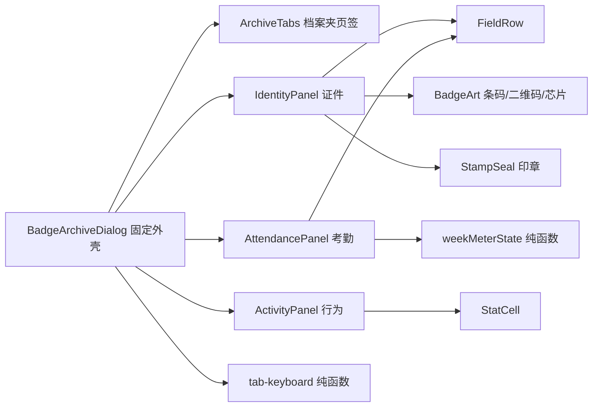

## User Requirements
- 将当前单列长滚动的「牛马考勤档案」改成固定高度的三页签档案卡：证件 / 考勤 / 行为。
- 分享按钮常驻底部，不占 tab；切换页签不改变卡片高度，只让当前页内容滚动。
- 三个页签覆盖弹窗现有全部字段与操作，不丢失信息；保留像素工牌、暖褐底、薄荷绿强调、印章与条码。
- 视觉方向为档案夹式页签加本周工时仪表，不做纸质活页大改，不改数据、协议与服务端。

## Product Overview
档案弹窗从一张越拉越长的信息清单，变成一张有明确分区、可以快速翻页的实体工牌档案。头部始终显示姓名、物种、部门班次与状态；中部用三个档案夹页签分别承载身份凭证、考勤工时与行为社交；底部分享区固定可用。用户打开后第一眼看到完整工牌，而不是一屏需要不断下滑的字段。

## Core Features
- 固定高度卡片：头部身份带、页签栏、底部分享区固定，中间内容区独立滚动。
- 三页签：证件（工号、职级、首次入职、地点、条码/二维码/芯片、印章、签发注脚）、考勤（本周工时仪表、本次/今日/本周/日均/连续/累计工龄/姿态/入座）、行为（步数/里程/击倒/摸鱼/被喷/加班/名次、同屏劳模榜、数据口径注脚）。
- 档案夹页签：激活页签与内容区连成一体，未激活页签后退；2px 硬边、mint 激活色、无圆角。
- 本周工时仪表：40 小时基线，正常 mint、超过 40h 转 amber 并显示超出时长；未上报考勤时轨道为空并显示「未上报」。
- 底部固定分享：复制、下载、考勤小票三枚按钮；本人与代打只改 aria-label 与 toast。
- 完整保留 Esc、遮罩关闭、焦点陷阱、关闭后焦点还给游戏、方向键/Home/End 切页、游戏键吞噬与 busy/toast。


## Tech Stack
- 沿用 Next.js 15 App Router、React 19、TypeScript、Tailwind CSS v4 的 `@theme` 令牌、lucide-react。
- 不新增依赖；不改 `BadgeArchive`、`PlayerBadge`、二进制协议、服务端与 localStorage。
- 复用现有 `FieldRow`、`StatCell`、`Barcode`、`FakeQr`、`Chip` 与 ink/mist/mint/amber 色板。

## Implementation Approach
核心是把「一个长滚动弹窗」拆成「固定外壳 + 三个独立面板 + 两个纯函数」：

1. **固定高度外壳**：弹窗外层改为 `h-[min(640px,92dvh)] overflow-hidden`，内部 `flex h-full flex-col`；挂绳/标题/身份带/页签栏/底部分享区全部 `shrink-0`，只有 `role="tabpanel"` 区域 `min-h-0 flex-1 overflow-y-auto`。
2. **三页签**：`证件 / 考勤 / 行为`，使用 `role="tablist"`、`role="tab"`、`aria-selected`、`aria-controls`、`role="tabpanel"`、`aria-labelledby` 与 roving tabindex。每次只挂载当前面板，切换时用 `key={tab}` 触发 120ms 淡入上移动效；全局 `prefers-reduced-motion` 已会关闭动效。
3. **档案夹视觉**：页签三等分，激活页签使用 `bg-ink-800`、`text-mint-400`、2px `ink-500` 边框与 mint 顶边，并用 `-mb-[2px]` 与内容区边框咬合；未激活页签后退为 mist 色，不用药丸和圆角。
4. **本周工时仪表**：新增纯函数 `weekMeterState(weekHours, hasCareer)`，返回 `percent`（0–100）与 `tone: empty | normal | over`，`overHours` 由组件格式化为「超出 x 小时」。`hasCareer=false` 时轨道为空并显示「未上报」，不用 0 冒充。
5. **键盘与焦点**：方向键、Home、End 的页签导航必须放进现有 window capture 处理器，因为 `GAME_KEYS` 会在 capture 阶段吞掉方向键；在 `GAME_KEYS` 分支之前识别 `[role="tab"]`，自行 focus 并 click 相邻页签，再 `preventDefault` + `stopPropagation`。不要把导航只挂在 tablist 的 React `onKeyDown` 上。空格在按钮上继续不 `preventDefault`，保留键盘触发。
6. **焦点管理**：打开时焦点落到关闭按钮；焦点陷阱查询保持 `button:not([disabled]), [href], input, select, textarea, [tabindex]:not([tabindex="-1"])`；非激活页签 `tabIndex=-1`，面板 `tabIndex=0`；关闭时焦点还给游戏 canvas。
7. **数据与更新**：弹窗继续只消费 `BadgeArchive`；本人 1Hz、他人 2Hz 的归档更新直接重渲染当前面板，不因切页丢订阅。`key={tab}` 只随页签变化，不随 archive 数据变化，避免每秒重挂载。`employeeNo + isSelf` 变化时把页签重置到「证件」。
8. **性能与可靠性**：只渲染一个面板，减少长弹窗 DOM；无新增网络与高频计算；工时仪表为纯 CSS 宽度；分享按钮的 Safari Clipboard、busy、toast 逻辑原样保留。不碰 Tick、同步包、渲染热路径。

## Architecture Design


模块边界：
- `BadgeArchiveDialog`：唯一外壳，负责固定高度、页签状态、capture 键盘、焦点陷阱、底部分享区与 toast。
- `ArchiveTabs`：唯一页签定义与页签栏，持有 `ArchiveTabId`、标签、图标与 aria 属性。
- 三个 Panel：只负责各自分区的字段排布，不解析协议、不读 store。
- `ArchiveFields`：只保留 `FieldRow` / `StatCell` 两个基础展示原语。
- `week-meter` / `tab-keyboard`：无 React、无网络依赖的纯函数，便于单测。
- 入口 `BadgeCard`、`SelfArchiveDialog`、`RemoteArchiveDialog` 与 `archive.ts` 不改契约。

## Directory Structure
```text
apps/web/
├── components/badge/
│   ├── BadgeArchiveDialog.tsx   # [MODIFY] 固定高度外壳、tab 状态、capture 键盘、焦点陷阱、底部分享区、toast
│   ├── ArchiveTabs.tsx          # [NEW] 三页签定义、档案夹页签栏、ArchiveTabId 类型
│   ├── IdentityPanel.tsx        # [NEW] 证件页：工号/部门/职级/首次入职/地点/区域 + 条码/二维码/芯片 + 印章 + 注脚
│   ├── AttendancePanel.tsx      # [NEW] 考勤页：本周工时仪表 + 本次/今日/本周/日均/连续/工龄/姿态/入座
│   ├── ActivityPanel.tsx        # [NEW] 行为页：步数/里程/击倒/摸鱼/被喷/加班/名次 + 同屏劳模榜 + 口径注脚
│   ├── ArchiveFields.tsx        # [MODIFY] 只保留 FieldRow / StatCell；旧 ArchiveFields、ActivityGrid、BoardList 迁出
│   └── StampSeal.tsx            # [NEW] 从弹窗抽出的 APPROVAL 印章块，供证件页复用
├── lib/game/
│   ├── week-meter.ts            # [NEW] weekMeterState 纯函数：percent / tone / overHours
│   ├── tab-keyboard.ts          # [NEW] nextTabIndex 纯函数：左右循环、Home/End、count 0/1 边界
│   └── __tests__/
│       ├── week-meter.test.ts   # [NEW] 0/12.5/40/50/负数/NaN/未上报
│       └── tab-keyboard.test.ts # [NEW] 左右循环、Home/End、单页签、空页签
└── app/globals.css              # [MODIFY] .animate-archive-panel-in 与 keyframes（120ms，--ease-out-expo）
```

## Key Code Structures
```ts
export type TabNavKey = 'ArrowLeft' | 'ArrowRight' | 'Home' | 'End';

export function nextTabIndex(current: number, key: TabNavKey, count: number): number;

export interface WeekMeterState {
  percent: number;
  tone: 'empty' | 'normal' | 'over';
  overHours: number;
}

export function weekMeterState(weekHours: number, hasCareer: boolean): WeekMeterState;
```

## Implementation Notes
- **键盘冲突**：`GAME_KEYS` 包含方向键，且 window capture 会 `stopPropagation`；页签方向键导航必须在同一个 capture 处理器内完成。Home/End 不在 GAME_KEYS 里，也走同一分支，避免依赖 tablist 的冒泡事件。
- **页签状态**：默认「证件」；`employeeNo + isSelf` 变化时重置。切换页签只改 state，不重新订阅 badge，不重建分享逻辑。
- **固定高度**：外层 `overflow-hidden`，内容面板 `min-h-0 flex-1 overflow-y-auto overscroll-contain`；页签栏与底栏 `shrink-0`，切页高度不跳。
- **移动端**：430px / 94vw；三个页签等宽；底部三按钮用 `grid grid-cols-3 gap-2`，短标签 + `aria-label`，长文案不换行溢出；身份带姓名、状态、部门班次使用 `min-w-0` + `truncate`。
- **未上报**：工时仪表、行为统计、地点等继续沿用 `hasCareer` 判断，显示「未上报」，不用 0 冒充；「视野内」「截至上次上报」「代打存档」口径原样保留。
- **视觉一致性**：统一走 `ink/mist/mint/amber` 令牌，减少 `neutral-*` 默认灰把暖褐底拉冷；不加圆角、玻璃拟态、彩色渐变与 bounce 缓动。
- **测试**：纯函数单测覆盖边界；组件无测试框架，靠 typecheck、`impeccable detect` 与桌面/移动端手测；手测包含长昵称、长地点、长职位、本人/代打、hasCareer=false、方向键切页、Esc/遮罩关闭与焦点归还。


## Design Style
沿用「像素工业档案夹」：暖褐底、2px 硬边、薄荷绿激活、琥珀印章、等宽小字、克制动效。弹窗不再是一列到底的长表，而是一张固定高度的实体工牌卡：上方是挂绳孔、标题与身份带，中部是三枚档案夹页签，下方是常驻分享区。所有分页共享同一张卡片骨架，切换时只有内容区变化。

## Layout
- 外层 430px / 94vw，高度 `min(640px, 92dvh)`，2px 外框，内部 `flex-col`，整体不滚动。
- 顶部挂绳装饰压缩到约 28px；标题行保留「牛马考勤档案 / NIOMA · EMPLOYEE RECORD」与关闭按钮。
- 身份带：48px 物种预览、姓名、物种/部门班次/本人或代打标签、状态；长文本截断，标签可换行。
- 页签栏三等分：证件 / 考勤 / 行为，lucide 图标 12px + 等宽标签 10px；激活页签与内容边框咬合，未激活页签后退。
- 内容区独立滚动，`overscroll-contain`；面板内边距 16px，字段行与统计格保持现有密度。
- 底部分享区固定：复制 / 下载 / 考勤小票三枚按钮一行排列，下方一行 8px 关闭提示；toast 仍固定在视口底部。

## Tabs
- 证件：工号、部门/班次、职级（含过载警示）、首次入职、出勤地点、园区区域；下方条码/二维码/芯片一列，再下方 APPROVAL 印章与签发/代打注脚。
- 考勤：本周工时仪表置顶（40h 基线、mint 填充、超过转 amber、未上报空轨），下方本次在岗、今日累计、本周工时、日均在线、连续在岗、累计工龄、当前姿态、入座。
- 行为：步数/里程/击倒/摸鱼/被喷/加班/名次统计格，同屏劳模榜，底部一行「行为统计由本人客户端自报，他人工牌截至上次上报」注脚。

## Interaction
- 页签点击、左右方向键、Home/End 切换；激活页签跟随焦点，切换后内容 120ms 淡入 + 2px 上移，`prefers-reduced-motion` 下自动关闭。
- Esc 与遮罩关闭；Tab 焦点陷阱；关闭后焦点回到游戏 canvas；弹窗期间继续吞掉 W/A/S/D、方向键、空格与动作键。
- 分享按钮保留 busy 态与 toast；本人/代打只改 aria-label 与提示文案，不改变按钮位置。

## Responsive
- 320px 宽度下三页签仍并排，图标与标签不换行；底栏三按钮用短标签，长说明放 aria-label/title。
- 长昵称、长地点、长职级在字段行内截断；行为统计格数字使用 tabular-nums，避免跳动。

## Agent Extensions
### Skill
- **impeccable**
  - Purpose: 按 shape → implement → polish 的流程设计档案夹页签、固定高度布局、工时仪表与移动端排版，并检查可访问性、对比度、溢出与动效反模式。
  - Expected outcome: 三页签档案卡在桌面与移动端均无溢出、切页不跳高度，键盘与焦点行为完整；`impeccable detect` 对改动文件无 primary findings。
