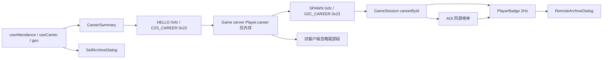

## User Requirements
- 查看他人工牌时，信息完整度要与本人档案一致：点击园区里的其他角色，直接打开完整的「牛马考勤档案」，不再只显示姓名、所在地、在线时长、姿态与入座这几行。
- 本人与他人工牌共用同一套档案字段与视觉，包含工号、职级、考勤、履历、行为统计、园区社交、印章、条码/二维码与分享入口。
- 继续丰富工牌内容，覆盖四类：考勤深化、行为统计、园区社交、视觉与分享。
- 他人工牌的出勤地点只显示到省；本人仍显示「中国 · 省 · 市」。
- 他人的考勤摘要由本人进入园区时自报，园区只做即时转发、不留存；数据缺失时显示「未上报」，不用 0 冒充真实数据。

## Product Overview
像素风牛马园区里的工牌从「几行身份信息」升级为一张可翻阅的完整考勤档案。自己的档案与查看他人的档案使用同一个弹窗、同一套字段和同一套盖章/条码/分享结构，信息不再因为「数据在别人浏览器里」而缩水；同时新增今日与本周工时、连续在岗、首次入职、步数里程、摸鱼/被喷/加班、同屏劳模榜、部门班次等内容，让工牌真正像一张能被同事围观的职场身份证。

## Core Features
- 完整档案：本人与他人工牌共用同一套字段、分区、印章、条码/二维码与分享入口。
- 考勤深化：本次在岗、今日累计、本周工时、日均、累计工龄与总工时、连续在岗、首次入职日、出勤地点、园区区域、姿态与入座。
- 行为统计：行走步数与里程、摸鱼次数、被喷次数、加班次数。
- 园区社交：部门/班次、同屏本周工时榜与个人排名，明确标注「视野内」。
- 视觉与分享：印章体系升级、条码/二维码保留、新增考勤小票分享模板；他人工牌支持「为 TA 打印」，并标注代打语义。
- 交互与隐私：被查看者离开视野自动关闭；点空白或按 Esc 关闭；焦点还给游戏；移动端不与聊天、摇杆抢空间；他人工牌地点只到省。


## Tech Stack
- 沿用现有栈：Next.js 15 App Router + React 19 + TypeScript、Tailwind CSS v4 的 `@theme` 令牌、zustand、PixiJS 8 渲染线程、`@niuma/shared-types` 手写二进制协议、Bun `Bun.serve` 权威服务端。
- 不新增依赖。分享卡继续用原生 Canvas；图标继续用 lucide-react。
- 协议继续遵循「尾部追加 + 魔数 + 缺段回退」，不使用 JSON。

## Implementation Approach

### 1. 数据流：本人自报，服务端只做内存转发
- 进园前从 `useAttendance`、`useCareer`、`readCachedGeo()` 组装 `CareerSummary`，随 `C2S_HELLO` 的 `0xfc` 尾部段上报；`geo` 异步就绪后、以及在线每 60 秒用 `C2S_CAREER (0x22)` 补报一次。
- 服务端 `handleHello` 与 `C2S_CAREER` 做结构钳制与省份审核，写入 `Player.career`，仅存在内存，`reset()` 清空；`spawnPacketOf` 把摘要放进 `S2C_ENTITY_SPAWN` 的尾部；补报同时向 `player.known` 广播 `S2C_CAREER (0x23)`，让正在围观的人立即刷新。
- `reportedOnlineSec` 由服务端在入场或收到补报时写入 `floor((now - joinedAt) / 1000)`，客户端只读。这样对方的「今日/本周/累计」增量等于服务端 `onlineSec` 减 `reportedOnlineSec`，不会因重连或两端时钟偏差重复计时。
- 观看侧 `GameSession` 维护 `careerById` 与 `appearanceById`，`badgeOf` 把 career、appearance、AOI 榜单与排名一并交给 `PlayerBadge`；`RemoteArchiveDialog` 订阅工牌推送，`despawn` 后 `badgeOf` 返回 null 即自动关闭。
- 自己的档案不走网络：`SelfArchiveDialog` 直接订阅 `useAttendance`、`useCareer`、`useGameUi`，与远端共用 `BadgeArchive` 视图模型和同一个展示组件。

### 2. 统一档案模型与组件
- 新增 `apps/web/lib/game/archive.ts`：`BadgeArchive` 是唯一展示模型，`buildSelfArchive` 与 `buildRemoteArchive` 都是纯函数；所有字段在进入 UI 前已格式化为字符串，UI 不再自行判断「0 还是未上报」。
- 新增 `BadgeArchiveDialog` 纯展示组件：只负责布局、印章、条码/二维码、分享按钮、焦点陷阱与游戏键吞键；`SelfArchiveDialog` 与 `RemoteArchiveDialog` 只负责取数并组装 `BadgeArchive`。
- 删除 `InspectCard` 小卡；`GameViewport` 只保留一个 `RemoteArchiveDialog`（portal），桌面与移动端共用，避免两套布局的字段漂移。
- `picked` 消息带上初始 `PlayerBadge`，首帧直接渲染档案，避免「先空白 250ms 再出内容」。

### 3. 考勤与行为统计
- `attendance.ts` 新增纯函数：`getWeekMinutes` 按本地周一零点起算；`getStreakDays` 从今天或昨天起算连续有工时的天数；`getActiveDays` 统计有效日期数。`getStampTitle` 增加可选的 streak、steps、slackCount、rank 维度，默认调用保持旧输出。
- 新增 `career.ts`：localStorage key `niuma:career:v1`，存 `distancePx`、`slackCount`、`ventedCount`、`overtimeCount`、`lastOvertimeDay`；30 秒批量落盘，`pagehide` 与 `visibilitychange` 补写，与 attendance 同一套资源纪律。
- 步数与里程来自 `onStats` 的 2Hz 坐标采样，忽略超过 256px 的瞬移；摸鱼来自 `onLocalState` 的「未入座到入座且不是床」边沿；被喷来自现有 `audio` 事件中 `kind === 'vent' && hit && local`；加班按「本地 21:00 后仍在岗」每天最多记一次。
- 远端行为统计直接读 `PlayerBadge.career`；它天然是「截至上次上报」的快照，UI 用「累计」而不是「实时」表述，避免误导。

### 4. 园区社交
- 零持久化下没有全服历史榜。实现为「视野内本周工时榜」：`GameSession` 用 `known` 加自己 的 career 计算 `weekMinutes + (onlineSec - reportedOnlineSec) / 60`，排序取前三，并记录每个人名次；缓存 2 秒或在 spawn、despawn、career 更新时失效，不在高频推送里排序。
- UI 明确写「同屏劳模榜 · 本周工时（视野内 N 人）」，不伪装成全服榜。
- 部门与班次由昵称哈希稳定派生，与工号同一套 djb2，双端不需要协议字段。

### 5. 分享与视觉
- `ShareCardData` 增加 weekHours、streakDays、activity、rank、department、shift、isSelf；`renderShareCard(data, variant)` 支持 `badge` 与 `timesheet` 两种 480 宽模板；他人工卡带「代打存档」标识，按钮文案改为「复制 TA 的工卡」与「下载 TA 的工卡」。
- 伪条码与伪二维码生成器抽到 `badge-art.ts`，继续由工号派生；印章区、条码、二维码、芯片、挂绳孔与金属夹保留，新增「工时仪表」与榜单条。

### 6. 备选方案与权衡
| 方案 | 结论 | 理由 |
|---|---|---|
| A 客户端自报 + 0xfc 尾部段 | 选用 | 保持零持久化、无额外往返、旧端天然忽略；代价是数据可伪造、只覆盖在线玩家 |
| B 点选时按需查询资料 | 不选 | 多一次往返与加载态；服务端仍需保存摘要；工牌详情会闪烁 |
| C 服务端身份与持久化 | 本期不选 | 需要账号、存储与隐私评估，会推翻 ADR-0004；本期不需要跨设备与全服榜 |
| D 只显示会话数据 | 不选 | 无法满足「和本人一样全」 |

ADR-0037 曾建议完整资料走独立查询接口；本次的 career 摘要是约 70 至 90 字节的紧凑身份卡数据，且每次查看都需要，因此采用尾部追加，并在 ADR-0052 中记录这一边界与后续复核信号。

## Architecture Design


模块边界：
- `packages/shared-types`：唯一协议契约。新增 `CareerSummary`、尾部段编解码、`C2S_CAREER` 与 `S2C_CAREER`、结构钳制；不依赖运行时。
- `apps/game-server`：唯一权威。只保存会话内存中的 career，做限频、审核、广播；不落盘。
- `apps/web/lib/game/session.ts`：唯一网络与工牌聚合层。维护 career、appearance、AOI 榜单；UI 不直接解析协议。
- `apps/web/lib/game/archive.ts`：唯一展示模型。本人与他人都从这里拿 `BadgeArchive`。
- `apps/web/components/badge`：唯一展示层。一个 `BadgeArchiveDialog` 加两个取数壳。

数据所有权：
- 考勤历史、行为累计、首次入职日由本人浏览器持有；服务端只做转发。
- 本次在线秒数、入场时刻由服务端持有。
- 观看侧只做增量计算与展示，不写回服务端。

## Directory Structure

```text
packages/shared-types/
├── src/
│   ├── types.ts                         # [MODIFY] 新增 CareerSummary、SpawnPacket.career、S2C_CAREER 包类型、OpCode 0x22/0x23。字段必须与编解码顺序一致，所有数字按无符号处理。
│   ├── constants.ts                     # [MODIFY] 新增 CAREER_EXTENSION_MAGIC=0xfc、版本号、省份长度上限、补报限频。魔数不得与 0xff/0xfe/0xfd 冲突。
│   ├── career.ts                        # [NEW] sanitizeCareer、emptyCareer、日期与数值钳制。纯函数、无外部依赖，服务端与客户端共用。
│   ├── protocol.ts                      # [MODIFY] career 编解码、HELLO/SPAWN 尾部段、C2S_CAREER 与 S2C_CAREER 编解码。新增段必须追加在末尾，缺段返回 undefined。
│   ├── index.ts                         # [MODIFY] 导出 career。
│   └── __tests__/
│       ├── protocol.test.ts             # [MODIFY] 覆盖 career 往返、旧包缺段、截断保护、缓存 body 与整包字节一致。
│       └── career.test.ts               # [NEW] 覆盖负数、NaN、超大值、非法日期、省份截断。
apps/game-server/src/
├── admission/controller.ts              # [MODIFY] HelloPayload 增加 career，排队期间随载荷暂存。
├── server.ts                            # [MODIFY] handleHello 审核并写入 career；C2S_CAREER 限频、审核、广播；admit 在 refreshView 前赋值。
└── sim/
    ├── world.ts                         # [MODIFY] Player.career、lastCareerAt；reset 清空，避免对象池复用串数据。
    └── view.ts                          # [MODIFY] spawnPacketOf 把 career 追加到入场包；在线秒数仍现算。
apps/web/
├── lib/
│   ├── game-ui.ts                       # [MODIFY] GameUiState 增加 board、rank；setStats 同步，初值为空数组与 null。
│   ├── game/
│   │   ├── badge.ts                     # [MODIFY] PlayerBadge 增加 career、appearance、board、rank；新增 BoardEntry、departmentOf、shiftOf。
│   │   ├── badge-art.ts                 # [NEW] 伪条码与伪二维码纯函数，由工号派生，保证同一张工牌稳定。
│   │   ├── attendance.ts                # [MODIFY] 新增 getWeekMinutes、getStreakDays、getActiveDays；getStampTitle 增加可选维度，旧调用不回归。
│   │   ├── career.ts                    # [NEW] 行为统计存储、useCareer、CareerTracker、startCareerClock；30 秒落盘与 pagehide 补写。
│   │   ├── archive.ts                   # [NEW] BadgeArchive、buildSelfArchive、buildRemoteArchive、toShareCardData；处理未上报与省份隐私。
│   │   ├── share-card.ts                # [MODIFY] ShareCardData 扩展；renderShareCard 支持 badge 与 timesheet；代打标识。
│   │   ├── session.ts                   # [MODIFY] careerById、appearanceById、localCareer、榜单缓存、badgeOf 扩展、updateCareer、SessionStats 增加 board/rank。
│   │   ├── runtime/engine-env.ts        # [MODIFY] SessionProfile 增加 career。
│   │   ├── runtime/worker-protocol.ts   # [MODIFY] MainToWorker 增加 career 消息；picked 增加初始 badge。
│   │   ├── runtime/worker-host.ts       # [MODIFY] 处理 career 消息；工牌推送降为 2Hz，小地图仍 4Hz。
│   │   ├── client/game-client.ts        # [MODIFY] 增加 updateCareer；onPick 带初始 badge；增加 onVentHit。
│   │   ├── client/worker-client.ts      # [MODIFY] 实现 updateCareer、picked 初始 badge、audio 命中回调。
│   │   ├── client/main-thread-client.ts # [MODIFY] 同上，保持两条宿主路径行为一致。
│   │   └── net/client.ts                # [MODIFY] connect 带 career；sendCareer；S2C_CAREER 分发 onCareer。
│   ├── __tests__/attendance.test.ts     # [MODIFY] 周工时、连续天数、有效天数边界。
│   └── game/__tests__/
│       ├── badge.test.ts                # [MODIFY] 部门、班次、印章新档位。
│       ├── badge-art.test.ts            # [NEW] 条码与二维码稳定性、边界。
│       ├── career.test.ts               # [NEW] 距离跳变、坐姿边沿、加班每日一次、存档往返。
│       └── archive.test.ts              # [NEW] 本人/他人、缺失 career、省份只到省、增量计算、分享数据。
├── components/
│   ├── BadgeCard.tsx                    # [MODIFY] 档案入口改用 SelfArchiveDialog，保留状态编辑与详情打开回调。
│   ├── BadgeDetailModal.tsx             # [DELETE] 内容拆分到 badge 目录，避免展示与取数继续耦合。
│   ├── badge/
│   │   ├── BadgeArchiveDialog.tsx       # [NEW] 统一档案弹窗：字段分区、工时仪表、行为统计、榜单、印章、条码/二维码、分享按钮、焦点与按键处理。
│   │   ├── SelfArchiveDialog.tsx        # [NEW] 订阅 attendance、career、game-ui，组装本人 BadgeArchive。
│   │   └── RemoteArchiveDialog.tsx      # [NEW] 订阅他人 badge，首帧用 seed，despawn 自动关闭，组装他人 BadgeArchive。
│   └── game/
│       ├── GameViewport.tsx             # [MODIFY] 启动 career 时钟、补报 career、接入行为计数与 onVentHit、渲染 RemoteArchiveDialog、移除 InspectCard。
│       └── InspectCard.tsx              # [DELETE] 完整档案弹窗替代小卡。
├── app/globals.css                      # [MODIFY] 档案入场、印章落下、榜单条增长动效；遵守 prefers-reduced-motion。
docs/
├── adr/0052-badge-career-summary.md     # [NEW] 数据归属、协议扩展、AOI 榜单边界、备选方案、回滚与基线。
└── adr/0037-badge-online-and-inspect.md # [MODIFY] 增加「由 ADR-0052 接续」的说明，不改写历史决策。
README.md                                # [MODIFY] 协议章节补充 0x22/0x23 与 0xfc 尾部段；工牌章节补充自报、隐私与同屏榜单边界。
```

## Key Code Structures

```ts
export interface CareerSummary {
  /** YYYY-MM-DD，空串表示未上报 */
  firstJoinDate: string;
  totalOnlineMinutes: number;
  /** 有工时的日期数，用于推导日均 */
  activeDays: number;
  todayMinutes: number;
  weekMinutes: number;
  streakDays: number;
  steps: number;
  distanceM: number;
  slackCount: number;
  ventedCount: number;
  overtimeCount: number;
  /** 只到省；city 与 isp 永不下发 */
  province: string;
  /** 服务端写入，客户端只读；用于计算上报后的增量 */
  reportedOnlineSec: number;
}
```

```ts
export interface BoardEntry {
  id: number;
  name: string;
  weekMinutes: number;
  self: boolean;
}

export interface BadgeArchive {
  name: string;
  employeeNo: string;
  species: Species;
  appearance: CharacterAppearance;
  isSelf: boolean;
  department: string;
  shift: string;
  jobTitle: string;
  jobWarning?: string;
  jobColor: string;
  status: string;
  region: string;
  location: string;
  pose: string;
  seat: string;
  sessionDuration: string;
  todayDuration: string;
  weekHours: number;
  dailyAverageHours: number;
  seniorityDays: number;
  totalHours: number;
  firstJoinDate: string;
  streakDays: number;
  activity: {
    steps: number;
    distanceM: number;
    slackCount: number;
    ventedCount: number;
    overtimeCount: number;
  };
  board: BoardEntry[];
  rank: number | null;
  stamp: string;
  stampRed: boolean;
  /** false 时字段显示未上报，不拿 0 冒充 */
  hasCareer: boolean;
}
```

## Implementation Notes
- **协议兼容**：HELLO 的 `0xfc` 段追加在 `0xfd` 能力段之后；SPAWN 的 `0xfc` 段追加在 `0xfe` 在线秒数之后。旧服务端与旧解码器读完已知段就停止，天然忽略；新解码器缺段返回 undefined，不阻塞入场。`spawnWriter` 现有 320 字节足够容纳约 70 至 90 字节的 career 段。
- **性能**：单条 career 约 70 至 90 字节；补报限频 60 秒，且只在 `known` 内广播，200 人最坏约 600 次每秒小包、约 40KB/s，低于现有 20Hz 同步预算。工牌档案推送从 4Hz 降到 2Hz，小地图仍 4Hz；榜单缓存失效才重算，时间复杂度 O(N log N)，N 不超过 200。
- **安全与隐私**：省份是不可信自由文本，截断到 10 字或 30 字节，走现有 moderation，拒绝则空串并显示「保密」；所有数字 clamp，日期正则校验。服务端不信任客户端，但 career 只用于展示，不参与任何权威判定。日志只在审核拒绝时输出 `[career]` 警告，附带 wsId 与原因，不打印完整载荷。
- **爆炸半径**：不改移动、碰撞、渲染热路径；行为统计只采样现有 `onStats` 与 `onLocalState`。协议纯追加，UI 改动集中在工牌档案；旧服务端、旧客户端仍可正常入场。
- **验证**：`pnpm test`、`pnpm typecheck`；双客户端互看完整档案与分享；旧服务端回退时显示未上报；200 bot 压测确认服务端广播与帧率无回归。


## Agent Extensions
### Skill
- **principal-software-architect**
  - Purpose: 评审「客户端自报 + 服务端内存转发」的数据归属、0xfc 尾部扩展与 AOI 榜单边界，输出 ADR-0052、备选方案、反向成本、基线矩阵与 30 天回滚路径。
  - Expected outcome: 一份明确不引入服务端持久化的决策记录；对不可逆的协议改动完成主方案与对抗审查，并给出复核信号。
- **impeccable**
  - Purpose: 为统一的工牌档案弹窗与考勤小票模板做 shape 与 polish，检查排版、对比度、响应式、焦点、动效与反模式。
  - Expected outcome: 桌面与移动端均无溢出、无低对比、无弹跳缓动，`npx impeccable detect` 无 primary findings。
