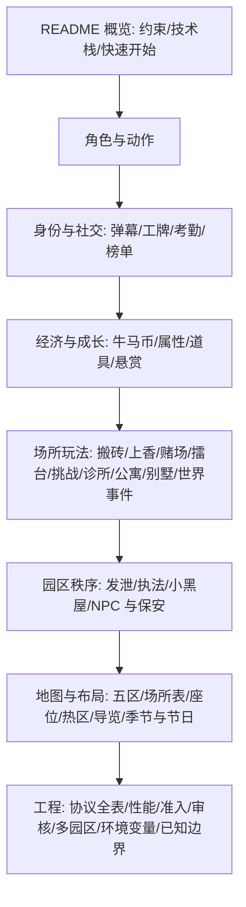

## 用户需求
把当前代码里真实存在的**玩法、场所布局与代码逻辑**同步进 `README.md`，让文档成为与代码一致的事实源，而不是停留在早期版本。

## 产品概述
`README` 是仓库唯一的对外说明：既是玩家/同事了解「园区里能玩什么」的入口，也是协作者确认「某条规则到底怎么算」的依据。用户拖入的 `README.md` 与仓库根 `README.md` 逐字节相同，因此本次以仓库根文件为唯一改动目标。

## 核心内容
- **补齐缺失玩法**：擂台 1v1（红蓝两角、10 血、报名 50 币胜者通吃、观战押注）、P2P 挑战巴士（骰子/猜拳/切磋、赌注与 5% 园区税）、摸鱼大赌场（两张桌、坐本桌才能下注、每局三轮阶段）、牛马币与属性/装扮/悬赏、7 件道具与 Buff、工作区搬砖、世界事件（红包雨/突击查岗）与老板 2.0 冲击波、诊所与救护车/工伤保护、牛马公寓六栋与家具、别墅冠名与摇钱树、供案上香/茶台强化/赛博木鱼/放假告示板。
- **重写布局章节**：五区小城与五座区门、25 处场所坐标尺寸、座位与设施表、建筑热区与座位门禁、12 个导览目标、小动物与鱼、空间音效。
- **补全工程章节**：78 个 OpCode 全表与 HELLO/SPAWN 尾段魔数、留空号、环境变量全表、调试参数与浏览器存档键。
- **纠正旧描述**：落盘由「三样」改为四段（新增豪宅冠名）、牛马榜改为 5 个今日指标、老板血量已落盘、考勤改为 20s 上报与 v4 摘要、小黑屋已迁到服务区、NPC 全岛漫游、状态宽度改为 8 个汉字、移动包 8 或 14 字节、节日彩旗按五向路网。

## 视觉与风格
不涉及界面改动。文档沿用现有中文风格：短段落、项目符号、数值表；保留 ADR 引用写法。


## 技术栈
纯文档改动，沿用仓库既有的 Markdown 写作约定，不引入新工具链、不改任何代码与依赖。

## 实现方案
以**代码为唯一取证源**，按「先纠错、再补章、最后校表」的顺序更新单一 README：

1. **取证**：每个数值、默认值、键位、坐标都必须在源码或 ADR 中找到出处，禁止凭印象补写；数值统一带单位，规则统一指向 `docs/adr/*`。
2. **纠错优先**：先修 14 处与代码冲突的旧描述（落盘范围、牛马榜指标、老板血量持久化、考勤节奏与版本、小黑屋位置、NPC 采样、状态宽度、移动包长度、彩旗路网），避免新章节建立在旧口径上。
3. **按玩家视角分章**：角色与动作 → 身份与社交 → 经济与成长 → 场所玩法 → 园区秩序 → 地图与布局 → 工程（协议/性能/准入/审核/多园区/环境变量）。新增内容插在逻辑相邻处，已有正确段落原样保留，减少 diff 噪音。
4. **表格优先**：场所、座位、道具、属性价格、OpCode、环境变量一律用表；长规则用「一行一条结论」的项目符号。
5. **可核对性**：章节内的坐标、常量写成 `名称 = 值` 形式，便于与 `packages/shared-types` 常量对照。

## 实施要点
- 取证位置：`packages/shared-types/src/{types.ts,protocol.ts,constants.ts,career.ts,board.ts,economy.ts,buffs.ts,challenge.ts,work.ts,world/*}`、`apps/game-server/src/{sim/*,challenge/*,economy/*,npc/*,persist/*,admission/*,config.ts}`、`apps/web/lib/game/*`、`docs/adr/0001-0097`。
- **不写敏感信息**：不出现真实域名/IP/端口/密钥/部署路径，环境变量表只列名称、默认值与作用。
- **不夸大可信度**：本人自报的考勤、工时、悬赏进度明确标注「仅展示、不参与权威判定」；纯客户端系统（上香、木鱼、小动物、空间音效）标注「清站点数据即重置」。
- **避免文档债务**：ADR 编号只引用真实存在且未被覆盖的条目（例如擂台按 1v1 现状描述并注明 0073 标题为旧口径），不为每句话堆 ADR。
- **性能影响**：无运行时改动；唯一成本是文档体积增长，用表格与小节避免重复叙述。

## 架构设计
单一文档、分层信息架构：



## 目录结构
```
niuma/
├── README.md          # [MODIFY] 唯一改动文件。纠 14 处过期描述；新增经济与道具、场所玩法（赌场/擂台/P2P/诊所/公寓/别墅/世界事件）、五区布局与场所座位表、座位门禁与热区、导览与小动物音效、78 个 OpCode 与尾段魔数全表、环境变量与调试/存档键全表；保留已验证正确的角色动画、弹幕、考勤、准入、性能等章节。
└── docs/adr/*.md      # [READ] 只读取证，不改历史 ADR；新增结论一律引用现有编号。
```
（用户拖入的临时副本 `572ed5b1…/README.md` 与仓库根文件内容一致，是否回写该副本在验收时向用户单独确认，默认不动工作区外文件。）


## Agent Extensions
### SubAgent
- **code-explorer**
  - Purpose: 在写作与验收阶段抽查数值出处（常量、默认值、坐标、字节结构），以及确认新增章节覆盖了全部 ADR 0073-0097 的玩家可感知玩法。
  - Expected outcome: 产出「数值—证据文件路径」对照清单与遗漏项清单，使 README 中每条数值都能被代码证实。
