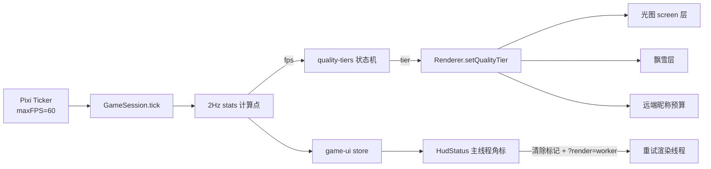

## 用户需求

用户反馈「游玩感觉卡」，需要在已完成的卡顿根因诊断基础上，把高嫌疑的性能开销实际改掉，且不牺牲像素画风与既有观感口径。

## 诊断结论（方案依据）

卡顿来源已核实为三类形态叠加，而非单一原因：

1. **整体低帧**：帧循环跟随显示器刷新率跑（`session.ts` 注册 ticker 时未设上限），120/144Hz 屏上逻辑与渲染双双跑满刷新率。
2. **人多时卡**：同屏角色越多，每帧写入深度值与触发层内重排的次数越多；高 DPR 手机视野更大（`pixelMetrics` 未封顶 DPR），同屏人数与填充率三重叠加。
3. **开面板卡**：搬砖面板以 33ms 强制整面板重渲染（含半透明磨砂层）来驱动倒计时与进度条。
4. **部分用户永久掉主线程**：渲染线程崩溃后写入标记，之后一律主线程渲染，但界面从不显示当前是主线程，玩家无法自证「我为什么比别人卡」，也没有自救入口。

## 产品概述

在不改变画面观感的前提下降低帧开销、缩小人群与面板两类峰值，并给玩家可见的渲染状态与一键自救入口；真卡时自动降一档非关键观感（夜色补光层、雪花、远端昵称预算），而不是粗暴降分辨率。

## 核心功能

- 帧节拍上限：默认按 60 帧推进，高刷屏不再双倍消耗；提供 `?fps=` 灰度开关用于线上对照。
- 静止角色免深度重排：站立/坐着的角色不再每帧写深度值、不再触发层内排序；走动角色行为完全不变。
- 渲染状态可见化：HUD 状态段在上方主线程渲染时显示「主线程」角标，点击可清除回退标记并重试渲染线程。
- 低帧自动降档：连续低帧时依次关闭夜色补光第二层、飘雪、削减远端昵称文字预算；帧率恢复后自动回升，带滞回不来回抖。
- 可选高 DPI 上限：`?dpr=1|2|3|0` 应急开关，默认不启用，只作为低端机自救手段。
- 搬砖面板零重渲染倒计时：倒计时与进度条改为直写 DOM，面板只在轮次切换与按键时重渲染，布局与数值表现完全不变。


## 技术栈

沿用既有栈，不引入新依赖：Next.js 15 + React 19 + TypeScript、Pixi v8.6（WebGL2 默认，ADR-0071）、bitecs（SoA + 分带深度层）、zustand（`lib/game-ui.ts`）、`bun:test`（`apps/web/package.json` 的 `test` 脚本为 `bun test lib`）、Turbopack 构建。

## 实施方案

核心策略是「**先削固定开销，再削峰值开销，最后给玩家自助手段**」，四项独立可验证的改动，每项都能单独上线、单独回滚：

### 1. 帧节拍上限（削固定开销，收益最大且零观感损失）

`GameSession.start()` 里 `renderer.app.ticker.add(this.tick)` 之前设置 `ticker.maxFPS`。新增纯函数 `resolveTargetFps(search)` 负责解析：默认 60；`?fps=30|60|120|0` 显式覆盖，`0` 表示不设上限（与现状等价，用于线上对照），非法值回落 60。

- **为何安全**：`tick` 里 `dtMs = Math.min(ticker.deltaMS, 50)` 已对 delta 做钳制，远端插值按毫秒推进（`RemoteTrack` 按固定延迟采样），逻辑节拍从 120Hz 降到 60Hz 不改变任何位置/动画的时间语义；网络同步是包驱动的，不受帧率影响。
- **为何不做更低**：30Hz 会让走路像素抖动明显，60 是观感与开销的平衡点。
- **预期收益**：120Hz 设备上帧回调与渲染各减半（CPU + GPU 填充均减半），这是所有设备上最确定的收益。

### 2. 静止角色免深度重排（削人多时的峰值）

`SortLayer.update(child, y)` 现在的写法是「先换 band，再无条件写 `zIndex = y`」。因为 band 是 `sortableChildren = true`，即使 y 没变，只要 zIndex setter 真的改了值，Pixi 就会把该 band 标记为脏并在渲染前 `sortChildren`。

改法：算出目标 band 后**先判同容器且同深度值，命中就直接 return**。`y` 进来前已被 `place()` 用 `snapTexel()` 取整，站立/坐着的角色 y 恒定，于是这类角色每帧 0 次 setter、0 次脏标记；走动角色 y 每帧变化，行为与现在完全一致。

- **正确性论证不变**：band 顺序仍等价于 y 顺序（ADR-0024 的语义只依赖 y 的单调性，与「是否重复写同值」无关）。
- **预期收益**：广场站满人时省掉每帧 N 次 setter 与最多 N 个 band 的 `sortChildren`（O(n log n)）；`?bands=0` 单容器回退路径收益更大。
- **复杂度**：O(1) 判等在热路径内，无新增分配。

### 3. 渲染模式可见化与一键重试（让玩家能自证与自救）

`EngineEnv` 增加只读字段 `renderMode: 'worker' | 'main'`，由两个宿主（`worker-client.ts` / `main-thread-client.ts`）各自填值——这两处已经是引擎与平台的唯一接缝，不碰 `GameSession` 内部逻辑。`SessionStats` 与 `game-ui` store 同步带上该字段（与 `backend` 同一通路，2Hz）。

`render-mode.ts` 增加 `clearRenderFallback()` 与 `retryRenderUrl(href)` 两个纯函数（前者清 `niuma:render-fallback`，后者把地址钉成 `?render=worker`），供 HUD 按钮调用后 `location.replace`。

UI 落在 `Hud.tsx` 的 `HudStatus`：主线程渲染时在「视野」前加一枚可点击的小角标（沿用 `hudButtonClassName` 的色板与尺寸口径），title 说明「当前为主线程渲染，性能受限，点击重试」。**不新增面板、不改布局**，属于内容级补充。

- **为何重要**：这是提升「还是卡」类反馈可诊断性的关键——玩家能看到自己是不是掉档了，也能一键回到渲染线程。

### 4. 低帧自动降档（真卡时才牺牲非关键观感）

新增 `quality-tiers.ts`：纯状态机 `nextQualityTier(current, fps, dtMs)`，三档 `high | balanced | low`。降档条件为连续 3 个 2Hz 窗口 fps < 45（约 6s），升档条件为连续 12s fps > 55；中间带滞回区，避免在 48fps 附近来回抖。

档位只作用于三处**非关键观感**，全部在 `Renderer` 内部：

| 档位 | 夜色补光第二层（screen 混合） | 飘雪层 | 远端昵称文字预算 |
|---|---|---|---|
| high | 开 | 开 | 全量 |
| balanced | 关 | 开 | 全量 |
| low | 关 | 关 | 减半（仅视野中心保留） |

- **刻意不动 DPR、不动光图分母、不动角色本体**：`renderer.ts:970` 的注释明确要求 backing store 与设备像素 1:1，改变 DPR 会在高 DPR 屏上引入非整数重采样、让像素块变糊，属于玩家可感知的画风损失，因此不放进自动降档。
- **实现点**：`LightmapLayer` 增加 `setScreenEnabled(on)`（置 screen 层 alpha 为 0 并 `visible = false`，仍保留 mult 主合成，夜间压暗观感基本不变，只失去暗部抬亮）；`Renderer.setQualityTier(tier)` 统一开关 `this.snow.container.visible` 与昵称预算。
- **采样位置**：复用 `session.ts` 已有的 2Hz stats 计算点（`this.fps` 刚算出来的那一处），不新增计时器，不新增每帧分配。

### 5. 可选 DPR 上限（应急开关，默认关）

`pixel-scale.ts` 增加 `resolveDprCap(search)` 与 `capDpr(dpr, cap)`，`renderer.ts` 在 `init()` 的 `normalizeDpr(options.dpr)` 之后串联一次。默认 `?dpr=0`（不封顶，与现状一字不差），`?dpr=2` 供 DPR 3 手机自救（backing store 面积减约 44%）。

- **不做默认开启**：封顶会让 canvas backing 与设备像素不再 1:1，浏览器合成阶段重采样，像素块边界变成 4/5 设备像素交替，属于观感损失，只能作为显式手段。
- 由于 `capDpr` 在 `init` 与 `resize` 两处都走同一函数，拖窗口跨屏时口径一致（`syncMetrics` 会因为 `dpr` 变化重算倍率与文字位图，逻辑已存在）。

### 6. 搬砖面板倒计时改为 DOM 直写（削开面板峰值）

`WorkGrindOverlay.tsx` 的 rAF 循环每 33ms 一次 `setTick` 来驱动 `<span>{remaining}</span>` 与进度条 `width`，等于 30Hz 让整块面板（含 `backdrop-blur-sm` 磨砂层）重渲染。改为：给倒计时文本与进度条各挂一个 ref，rAF 里直接写 `textContent` 与 `style.width`；`setTick` 只保留在轮次开始/结束/喘息结束这三处状态切换上。

- **观感逐帧等价**：`toFixed(1)` 本身只有 10Hz 有效变化，进度条原有 `duration-100` 过渡保持不变。
- **收益**：面板打开期间 React 渲染从 30Hz 降到事件驱动（按键才渲染），磨砂层不再每帧重新合成；`data-tick` 仅在该文件内使用，无测试依赖，可安全收敛。
- **边界**：`shake` 与 `borderTone` 仍由按键触发重渲染，连击反馈不变。

## 实施要点（执行细节）

- **热路径纪律**：`session.ts` 帧循环内禁止每帧新建对象/数组是既有硬约束（`tick` 复用槽位的注释明确写了）。上述改动全部是标量比较与布尔开关，不引入对象分配；`quality-tiers.ts` 用模块内可变状态 + 纯函数计算，避免每个 stats 周期建新对象。
- **性能与复杂度**：改动集中在「每帧比较」与「2Hz 采样」两类极低成本路径。真正的收益来自消除 GPU 填充（-50% 于高刷屏）与消除 band 重排（人多场景 O(n log n) → 0）。光图 screen 层关闭省掉的是一次全屏混合 quad，对傍晚/夜间时段最明显（白昼本就有 `depth < 0.01` 整层跳过）。
- **日志**：降档/升档与主线程重试各打一条 `console.info`，只输出档位名与整档后的 fps 区间，不输出设备信息、坐标、URL 参数；不按帧打印，天然无刷屏风险。
- **影响面控制**：所有新行为默认值与现状等价（`fps=60` 只影响高刷屏、降档只在真低帧触发、DPR 默认不封顶），不存在「发版后所有机器观感突变」的路径；`?fps=0` / `?dpr=0` 可在线上即时回退到今天的口径。
- **不改动的东西**：`world-state.json` 落盘范围（ADR-0081）、`serverNow()` 时间口径、历史 ADR。降档判定若需要时间只读 `performance.now()`（纯本机节拍，不参与玩法口径，符合 `local-date.ts` 的允许范围）。
- **兼容性**：`SessionStats` 新增字段为必填，`setStats` 与所有 `onStats` 调用点都在同一文件族内（session / game-ui / GameViewport），无外部消费方，改一次即可。

## 架构设计



模式仍是「引擎 + 宿主注入」，新增逻辑全部落在既有分层内：纯函数放 `lib/game/runtime/`（可单测、无 DOM 依赖），渲染侧开关收敛到 `Renderer` 一个入口，宿主差异只在两个 `client/*-client.ts` 各填一个只读字段。

## 目录结构

```
apps/web/
├── lib/
│   ├── game/
│   │   ├── runtime/
│   │   │   ├── frame-pacing.ts        # [NEW] 目标帧率解析：resolveTargetFps(search)，默认 60、`?fps=0` 不封顶、非法值回落。纯函数 + 常量，无 DOM 依赖
│   │   │   ├── quality-tiers.ts       # [NEW] 画质档状态机：QualityTier 类型 + nextQualityTier(current, fps, dtMs)，含滞回阈值常量，纯函数可单测
│   │   │   ├── engine-env.ts          # [MODIFY] 增加只读 renderMode: 'worker' | 'main'，注释说明它只用于上报，不参与渲染逻辑
│   │   │   ├── render-mode.ts         # [MODIFY] 新增 clearRenderFallback() 与 retryRenderUrl(href) 两个纯函数；保留原有 FALLBACK_KEY 与守卫逻辑不变
│   │   │   ├── renderer 相关          # 见下
│   │   ├── client/
│   │   │   ├── worker-client.ts       # [MODIFY] 构造 env 时填 renderMode: 'worker'
│   │   │   └── main-thread-client.ts  # [MODIFY] 构造 env 时填 renderMode: 'main'
│   │   ├── sort-layer.ts             # [MODIFY] update() 增加「同容器且同深度值直接返回」早退，注释写清正确性依据
│   │   ├── pixel-scale.ts            # [MODIFY] 新增 resolveDprCap(search) / capDpr(dpr, cap)；现有 normalizeDpr 与 pixelMetrics 语义不变
│   │   ├── renderer.ts               # [MODIFY] init 内串联 capDpr；新增 setQualityTier(tier) 统一开关雪层、光图 screen 层与昵称预算
│   │   ├── lighting/
│   │   │   └── lightmap.ts           # [MODIFY] 新增 setScreenEnabled(on)：关掉 screen 混合层的 alpha 与 visible，保留 mult 主合成
│   │   └── session.ts                # [MODIFY] 注册 ticker 前设 maxFPS；2Hz stats 点驱动画质档并调用 renderer.setQualityTier；SessionStats 增加 renderMode
│   ├── game-ui.ts                    # [MODIFY] 增加 renderMode 与 qualityTier 字段，setStats 内同步写入
│   └── __tests__/
│       ├── frame-pacing.test.ts      # [NEW] 覆盖缺省、0、30/60/120、非法值、多参数并存
│       ├── quality-tiers.test.ts     # [NEW] 覆盖降档阈值、升档阈值、滞回不抖、边界 fps=0
│       └── pixel-scale.test.ts       # [MODIFY/NEW] 覆盖 capDpr 与 resolveDprCap，并断言默认档位与现状等价
├── components/game/
│   ├── Hud.tsx                       # [MODIFY] HudStatus 主线程角标：可点击重试，沿用 hudButtonClassName 色板与尺寸
│   └── WorkGrindOverlay.tsx          # [MODIFY] 倒计时 span 与进度条 div 挂 ref，rAF 直写；setTick 收敛到轮次切换
├── data/
│   └── release-notes.json            # [MODIFY] 追加本次版本工报，只写玩家可感知结果
└── docs/adr/
    └── 0107-frame-pacing-and-adaptive-quality.md  # [NEW] 记录「帧上限取 60」「自动降档只降非关键观感、不降 DPR」两项决策
```

## 关键接口

```ts
/** 目标帧率：0 表示不设上限（与改造前的行为等价），用于线上对照 */
export function resolveTargetFps(search: string): number;

/** 画质档：只影响非关键观感层，不影响像素对齐与角色本体 */
export type QualityTier = 'high' | 'balanced' | 'low';

/** 带滞回的三档状态机：降档快、升档慢，避免在阈值附近来回抖 */
export function nextQualityTier(current: QualityTier, fps: number, dtMs: number): QualityTier;

/** DPR 上限：0 = 不封顶（默认）；封顶会引入非整数重采样，只作显式自救开关 */
export function resolveDprCap(search: string): number;
```


## Agent Extensions

### Skill
- **vercel-react-best-practices**
  - Purpose: 指导 `WorkGrindOverlay.tsx` 从「30Hz setState 驱动倒计时」改为「ref 直写 DOM」的实现细节，确保不引入新的重渲染路径、不破坏既有交互
  - Expected outcome: 面板打开期间 React 渲染降为事件驱动，倒计时与进度条逐帧表现与改造前一致
- **verification-before-completion**
  - Purpose: 在收尾阶段强制先跑 `pnpm --filter @niuma/web typecheck`、`bun test lib`（含新增用例）与 `pnpm changelog:check`，再声明完成
  - Expected outcome: 拿到真实命令输出作为证据，避免「以为过了实际没过」的收尾失误
