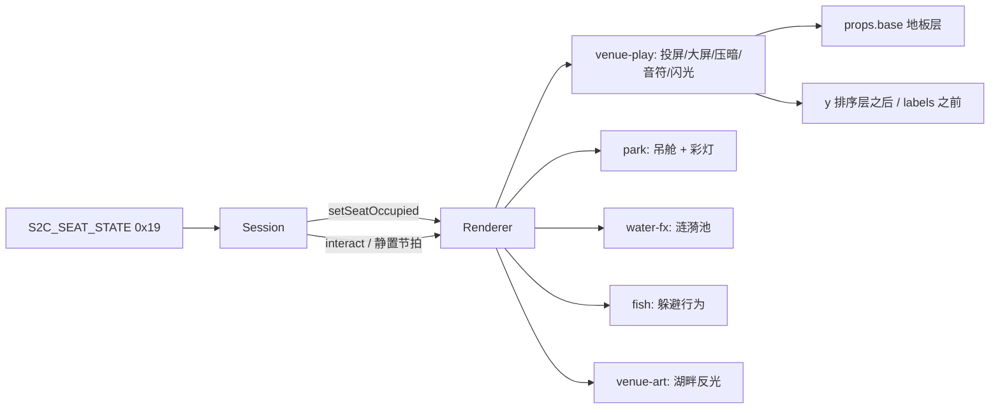

## 用户需求
在不新增玩法、不扩建房间的前提下，用「客户端演出 + 现有座位状态 + 本地气泡微交互」盘活四处已建好但玩法偏空的场所，只优化表现力与手感。

## 产品概述
园区地图、碰撞、座位、协议全部保持不变；变化全部发生在画布表现层：屏幕会播片、摩天轮会转、水里会起涟漪、坐下会有人味。玩家走进去就能感觉到「这里有生活」，但不需要学新规则。

## 核心功能
### 企业区 · 会议室
- 只要有人坐在 8 把会议椅上，北墙投屏从暗着的待机页点亮，按时间轮播三张像素幻灯片：甘特图、上升曲线、大饼图。
- 坐着按 F 或静置数秒，头顶冒出职场开会气泡（「赋能一下底层逻辑」「这个需求很简单」「先拉个对齐会」等）。
- 无人入座时投屏降回低亮待机页并轻微闪烁，暗示「会议室还开着」。

### 生活区 · 家庭影音室
- 大屏真正动起来：雪夜列车、老板鬼畜、复古屏保、星夜小舟四个固定频道，画面内的小物件持续平移，不是静帧。
- 屏幕前方浮一层柔和矩形光晕，色调跟随当前频道并轻微呼吸。
- 坐进 15 张影厅座椅任意一张，影厅座位区缓慢压暗，形成「开场」感；四只音箱边缘飘出像素小音符；起身后光线与音符一起复原。
- 坐着按 F 或在屏幕上点击即可本地换台，屏幕上方飘出一条频道名提示。

### 游乐区 · 游乐园
- 摩天轮缓慢匀速转动，六个吊舱绕圈移动且始终直立，像素边缘不发糊；夜间轮盘彩灯逐颗亮灭。
- 站在秋千、跷跷板、旋转木马、沙池、喷泉旁按 F，角色头顶闪一次相机白光并冒出「咔！童年回忆 +1」气泡。
- 坐在园内长椅上静置，偶发怀旧感叹气泡。

### 景观区 · 摸鱼亭与三湖
- 踩进浅水与水中落脚时，脚底扩散出更明显的像素水花环，入水那一下更大更亮。
- 湖里的小鱼在玩家靠近时加速摆尾、横向躲开游走，人走远后恢复悠闲往返。
- 坐进摸鱼亭四张石鼓凳静置数秒，偶发禅意气泡（「摸鱼发呆中…」「看着水面思考牛马生」）；湖面靠亭一侧的反光点更密、更明显地呼吸闪烁。

### 视觉与体验要求
- 全部保持 1:1 整数纹素与 nearest 采样，动画靠换帧与整像素位移，不做浮点缩放或旋转插值。
- 新增元素一律不参与碰撞，不遮挡可走路面，不改变任何既有坐标与座位。
- 既有灰度开关（季节、光照、节日、地形、分层）下都能正常显示；另提供一键关掉新动效的入口。


## 技术栈与发版边界
- 沿用现有栈：Pixi v8 画布渲染 + TypeScript + bun:test（`apps/web/lib/game` 纯函数单测）+ vitest（共享契约单测）。
- **不改 `packages/shared-types`**：不新增/修改碰撞体、坐标、`WORLD_HOTSPOTS`、`NAV_TARGETS`；不新增、不复用任何 opcode（`0x20`/`0x2a`/`0x2b`/`0x3d`/`0x4d`–`0x50` 保持留空）。
- 结论：**涉及双端同步发布 = 否**，仅客户端发版；服务端零改动，`S2C_SEAT_STATE`(0x19) 沿用现有广播驱动演出。
- 新几何全部从既有常量派生（`MEETING_ROOM`、`THEATER_SCREEN`、`THEATER_SPEAKERS`、`THEATER_SEATS`、`PARK_ATTRACTIONS`、`PARK_RIDES`、`PAVILION_CENTER`），会议室投屏矩形在客户端单模块导出一次，`interior-art.ts` 改从该模块取，消灭第二份手写坐标。

## 逐场所：现状 → 方案 → 文件 → 发版

### 1. 会议室（企业区）
**现状问题点**
- `interior-art.ts:818-896` 的北墙投屏（200×56，`screenX = MEETING_ROOM.x + 130`，`screenY = MEETING_ROOM.y + 2`）是一次性烘焙的静态图：永远同一张 OKR + 折线 + 柱状图，投影仪光锥也静止。
- 8 把会议椅（`MEETING_SEATS` 6 + `MEETING_END_SEATS` 2）入座后没有任何反馈，`hotspots.ts` 里也没有会议相关热区。
- `interactions.ts` 的台词表只覆盖售货机/饮水机/咖啡机。

**优化方案**
- 静态画面降级为「待机页」：叠层覆盖屏内区域，无人入座时 alpha≈0.35 + `screenFlicker` 微闪。
- 有人入座（`MEETING_SEATS` 内座位占用数 > 0）→ alpha 1，每 4s 切一张底图：甘特条 / 阶梯折线 / 饼图；屏上一枚「激光笔」小红点按时间在板面整数移动。
- 入座静置 6s 首条、之后每 11s 一条开会气泡；按 F 立即出一条（受现有 `INTERACT_COOLDOWN_MS` 节流）。
- 文案：赋能一下底层逻辑 / 这个需求很简单 / 先拉个对齐会 / 对齐一下颗粒度 / 这个排期没问题吧 / 先做个 MVP / 记笔记：点头.gif。

**涉及文件**：`interior-art.ts`、`venue-spots.ts`(新)、`venue-play.ts`(新)、`renderer.ts`、`session.ts`、`interactions.ts`、`hint-copy.ts`。**双端发版：否**。

### 2. 家庭影音室（生活区）
**现状问题点**
- `interior-art.ts:1008-1023` 大屏是静态夜空 + 月亮 + 远山 + 一叶小舟；4 只音箱（`THEATER_SPEAKERS`）与投影仪光锥全静态。
- 15 张 `kind:'cinema'` 座椅入座只有抬升（`seat-art.ts`），没有频道、没有压暗、没有音符。

**优化方案**
- 屏内叠层（由 `THEATER_SCREEN` 内缩 2px 派生）：四张频道底图 + 各自一个会动的整数像素小精灵——雪夜列车车厢平移、老板头像两帧上下台阶、复古 DVD 方块整数弹跳、小舟左右 6px 摆动。
- 光晕：预烘「三层硬边矩形」Sprite，tint 随频道主色，`alpha = 0.10 + screenFlicker × 0.06`。
- 压暗：覆盖「屏幕下沿 → 房间南墙」的半透明暗层，本地坐在 cinema 座时目标 alpha 0.22，`dtMs` 平滑（约 0.6s 到达），挂在 y 排序层之后、`labels` 之前，屏幕本身不进暗区。
- 音符：预烘 5×7 音符，固定池 8 个，围绕四只音箱按 `(seed, nowMs)` 上浮 + 2px 横摆；仅当该厅有人入座时可见。
- 换台：坐着按 F（本地 `cycleTheaterChannel()`），或在屏幕上点击（复用 `session.onStageClick` + `worldPointAt` 与新增 `isTheaterScreenHit`）；瞬时提示「频道：雪夜列车」。

**涉及文件**：`interior-art.ts`、`venue-spots.ts`、`venue-play.ts`、`renderer.ts`、`session.ts`、`hint-copy.ts`。**双端发版：否**。

### 3. 游乐园（游乐区）
**现状问题点**
- `park.ts:229-284` 把 A 字腿 + 双圈轮盘 + 8 根辐条 + 6 个吊舱烘成一张 172×182 静态纹理；`ParkView` 没有 `update()`，renderer 也不调用——摩天轮完全静止。
- 夜间无彩灯；游乐园无任何 F 互动（`park.ts:13-14` 注释「纯静态观赏区」）。

**优化方案**
- 拆分烘焙：`drawFerrisBase`（腿 / 轮圈 / 8 辐条 / 地面影 / 桅杆旗）+ `drawFerrisCabin`（16×18 吊舱）。8 根辐条在 45° 上自对称，旋转视觉由吊舱提供，**不需要多帧烘焙**。
- 构造期生成 72 步整数圆心 LUT（`Int8Array(144)`，客户端表现层允许 `Math.cos/sin`，只算一次）；`update(nowMs)` 里 `step = floor(phase × 72)`，第 i 个吊舱取 `(step + i×12) % 72`，6 个吊舱等分绕环、始终直立（真实摩天轮吊舱不翻转）→ 平滑、零每帧分配、纹理零增长。
- 彩灯：12 个 3×3 灯泡 Sprite，`alpha = nightGain × (0.35 + 0.65 × bulbPulse(seed, nowMs))`；`nightGain` 每 30s 用 `lightToneAt(serverHourFraction(serverNow(), serverTzOffsetMin()))` 采样，不占灯位预算。
- 打卡点：`venue-spots.ts` 从 `PARK_RIDES` / `PARK_ATTRACTIONS` 派生 swing / seesaw / carousel / sandpit / fountain 五处（半径 56，与两处长椅保持 ≥60，不与 90px 座位圈抢提示）；F → 4 角星闪光池 + 气泡「咔！童年回忆 +1」。
- 坐在园内长椅（`kind:'bench'` 且坐标落在 `AMUSEMENT_PARK`）静置 8s → 怀旧气泡。

**涉及文件**：`park.ts`、`venue-play.ts`（闪光池）、`venue-spots.ts`、`venue-motion.ts`、`renderer.ts`、`session.ts`、`hint-copy.ts`。**双端发版：否**。

### 4. 摸鱼亭与三湖（景观区）
**现状问题点**
- `water-fx.ts` 涟漪池只有 24 个、最大环 20×10，涉水几乎看不见；`renderer.ts:1233` 的 `onFootfall` 与 `setWadingAt()` 通路已就绪，只是幅度不足。
- `critter-motion.ts:368-392` 的小鱼完全不感知玩家；`fish.ts` 的 `update` 已拿到 `focusX/focusY` 却只用于视口剔除。
- `venue-art.ts:405-419` 每湖 8 个反光点，离亭较远；4 张石鼓凳（`PAVILION_SEATS`）入座无任何台词。

**优化方案**
- 涟漪：沿用同一池，扩到 4 帧（rx 3/6/9/13，画布 26×14）、容量 36；新增 `spawnWake(x,y)`（涉水期间每 380ms 最多一次），保留入水 `big` 大水花；仍靠换帧变大，不做浮点缩放。
- 小鱼：`Fish` 增 `alarmMs` 与 `dodgeX/dodgeY` 标量；`stepFish(fish, dtMs, playerX = Infinity, playerY = Infinity)` 保持默认参数兼容旧测试；玩家进入 56px 内则 `alarmMs = 520`、速度 ×2.1、摆尾 3→6px、并按远离玩家的方向给 ±4px 躲避，随后自然回零。
- 亭中：坐 `kind:'drum'` 静置 7s 首条、之后每 13s 一条禅意气泡；按 F 立即一句（摸鱼发呆中… / 看着水面思考牛马生 / 风把 KPI 吹走了 / 水面比需求清楚）。
- 反光：`venue-art.ts` 给摸鱼湖靠亭一侧补 4 个 glint（由 `PAVILION_CENTER` 派生），沿用现有 `waterGlint`。

**涉及文件**：`water-fx.ts`、`critter-motion.ts`、`fish.ts`、`venue-art.ts`、`venue-spots.ts`、`session.ts`、`interactions.ts`、`hint-copy.ts`、`renderer.ts`、两个单测。**双端发版：否**。

## 实现策略与关键决策
- **不做多帧烘焙**：屏幕类演出统一走「静态底图 + 1~2 个会动的精灵」，纹理数 ≈ 16 张、最大 256×60（合计 < 0.5MB），比「每频道 8 帧」省一个数量级；摩天轮更是零新增纹理（吊舱独立精灵 + LUT）。
- **状态只读共享座位广播**：`renderer.setSeatOccupied(seatId, occupied)` 已是唯一入口（现有用途是工位显示器点亮），在此处增加「房间座位占用计数」，构造期预计算每个 seatId 属于会议室/影厅，逐帧零查询。
- **提示与分发同源**：`selectContextHint` 与 `session.interact()` 共用同一张「本地场所点」表与同一顺序，避免「提示说能按、按下去没反应」；会议/影厅/亭子的 F 一律**坐姿生效**，站立时保留原有「按 Z 坐下」，不破坏 `context-hint.test.ts` 的既有断言。
- **不占灯位**：屏幕光晕、彩灯、闪光全部用烘焙贴图 + `tint/alpha`，`venueLights()` 不新增条目，`MAX_LIGHTS = 96` 的预算断言（`lighting.test.ts:155`、`ritual.test.ts:91`）保持通过。
- **零分配**：所有 sprite / 池 / LUT / 纹理在 `build` 阶段建好，帧循环只做标量运算、`texture` 赋值（变才写）、`position.set(int,int)`（变才写）、`alpha`；不 new 对象/数组、不建闭包、不 `generateTexture`、不排序。

## 架构与层序

层序增量（其余不变）：`props.base` 之后追加投屏与大屏叠层（在人之下）→ `sortLayer` 之后追加影厅压暗层 → `labels` 之前不变；`tickBubbles(dtMs)` 内顺序追加 `venuePlay.update(now) → park.update(now)`，与既有 `venueFx / critters / fish` 同一节拍，不新增 ticker。

## 目录结构
```
apps/web/lib/game/
├── venue-spots.ts                 # [NEW] 本地场所点唯一真相：派生 MEETING_SCREEN_RECT（200×56）、THEATER_CHANNEL 表（4 个频道：名称/主色）、游乐园 5 个打卡点（半径 56）、isMeetingSeat/isTheaterSeat/isPavilionSeat/isParkBenchSeat、会议/禅意/拍照/怀旧四组台词与 pickXxxLine、meetingBubbleDue/zenBubbleDue（静置节流）、isTheaterScreenHit（点击命中）。纯函数，不 import pixi，可 bun:test。
├── venue-play.ts                  # [NEW] 局域玩法表现层：MeetingScreen（3 张底图 + 激光笔 + 待机/点亮 alpha + 4s 轮播）、TheaterScreen（4 张底图 + 列车/头像/DVD/小舟动件 + 光晕 + 8 音符池）、TheaterDim（压暗层 alpha 平滑）、PhotoFlash（4 角星池）。构造期一次 bake（nearest、antialias:false），对外 expose build/update/setMeetingSeated/setTheaterSeated/setTheaterDim/cycleChannel/flashPhoto/destroy；帧内零分配；`?motion=0` 时 update 只保持首帧。
├── venue-motion.ts                # [MODIFY] 追加纯函数：slideIndex(nowMs, count, holdMs)、ferrisStep(nowMs, periodMs, steps)、bulbPulse(seed, nowMs)、noteDriftY(seed, nowMs)、dimApproach(current, target, dtMs)、photoFlashAlpha(ageMs)；沿用「只看绝对时间、相位由种子派生、不分配」纪律。
├── interior-art.ts                # [MODIFY] 会议投屏矩形改从 venue-spots 取；大屏静态画面保留为 channel 4 底图来源并让叠层覆盖；其余房间绘制不动。
├── park.ts                        # [MODIFY] drawFerrisWheel 拆为 drawFerrisBase + drawFerrisCabin；ParkView 新增 6 吊舱 Sprite、12 灯泡 Sprite、72 步 LUT 与 update(nowMs)；纹理登记进 this.textures 以便 destroy。
├── renderer.ts                    # [MODIFY] buildLayers 构造 VenuePlay（`?venue=0` 不构造）并挂 base / 压暗层；setSeatOccupied 追加房间计数转发；tickBubbles 追加 venuePlay.update / park.update / theaterDim；新增 cycleTheaterChannel / flashPhoto / isTheaterScreenHit 委托；destroy 释放新纹理。
├── water-fx.ts                    # [MODIFY] 涟漪补第 4 帧（rx 13、画布 26×14）、池 24→36、新增 spawnWake(x,y) 与涉水节流字段；spawn/update 接口保持兼容。
├── critter-motion.ts              # [MODIFY] Fish 增 alarmMs/dodgeX/dodgeY；stepFish 加可选 playerX/playerY（默认 Infinity，保证旧行为）；新增 FISH_SCARE_RADIUS / FISH_ALARM_MS 常量与加速/躲避分支。
├── fish.ts                        # [MODIFY] update 把 focusX/focusY 传给 stepFish；仍然只在位置/纹理/镜像真变时写入。
├── venue-art.ts                   # [MODIFY] 摸鱼湖靠亭一侧补 4 个 glint（PAVILION_CENTER 派生），沿用 waterGlint；不新增灯位。
├── interactions.ts                # [MODIFY] selectContextHint 增加「坐姿本地场所点」分支（顺序：hotspots → 坐姿本地点 → boss → 设施 → 座位 → 床），导出 parkPhotoSpotAt / seatedVenueHint 供 session 复用。
├── hint-copy.ts                   # [MODIFY] 新增 4 条 HINT（meeting/theater/parkPhoto/pavilion）+ HINT_BUTTONS（action:'interact'）+ TOUCH_HINTS（引号内必须是动作盘真实按钮名，否则 hint-copy.test 会炸）。
├── session.ts                     # [MODIFY] interact() 在 hotspots 之后、兜底之前分发本地场所点；updateSeatHint() 坐姿分支补三条新提示；新增 updateVenueBubbles(eid) 复用 snoreDue 范式做会议/亭/园内长椅静置气泡；onStageClick 增加影厅屏幕命中换台。
└── __tests__/
    ├── venue-spots.test.ts        # [NEW] 投屏矩形落在会议室墙内；四组场所点不与座位圈/设施圈冲突；台词非空、可复现轮转；静置阈值边界。
    ├── venue-motion.test.ts       # [MODIFY] slideIndex/ferrisStep 步进连续且回环、bulbPulse 0..1、dimApproach 单调收敛、photoFlashAlpha 首尾为 0。
    ├── context-hint.test.ts       # [MODIFY] 站立在会议椅/影厅座旁仍是 HINT.seat；坐姿给新提示；游乐园打卡点给 parkPhoto 且不遮挡长椅坐下提示。
    └── critter-motion.test.ts     # [MODIFY] 无玩家时保持既有 ±range 与 |y-homeY|<=4 断言；玩家在 56px 内触发 alarm、速度变快、离开后恢复。
docs/adr/0099-venue-local-performance-layer.md  # [NEW] 记录「弱交互场所演出只做客户端、不改协议与碰撞」的关键决策。
apps/web/data/release-notes.json                # [MODIFY] 按 AGENTS.md 追加一条面向玩家的版本工报（6 条以内，不写文件名/实现细节）。
```

## 关键代码结构
```ts
// venue-spots.ts：本地场所点唯一真相（纯函数，可单测）
export type VenueSpotKind = 'meeting' | 'theater' | 'parkPhoto' | 'pavilion';

export interface VenueSpot {
  kind: VenueSpotKind;
  x: number;
  y: number;
  radius: number;
  /** 是否需要先坐在指定种类的座位上（F 才生效） */
  seatGated: boolean;
}

/** 顺序即优先级：坐姿类在前，末尾是游乐园打卡点 */
export const VENUE_SPOTS: readonly VenueSpot[];
export function venueSpotAt(x: number, y: number, seatId: number): VenueSpot | null;
export function isTheaterScreenHit(x: number, y: number): boolean;
```

```ts
// venue-play.ts：局域玩法表现层（构造期烘焙，帧内零分配）
export class VenuePlay {
  readonly dim: Container;
  constructor(renderer: Application['renderer'], options: { animate: boolean });
  build(base: Container): void;
  update(nowMs: number): void;
  setMeetingSeated(count: number): void;
  setTheaterSeated(count: number): void;
  /** 本地是否坐在影厅座椅：驱动压暗 alpha */
  setTheaterLocal(seated: boolean): void;
  cycleChannel(): string;
  flashPhoto(x: number, y: number): void;
  destroy(): void;
}
```

## 灰度开关矩阵
| 开关 | 行为 |
|---|---|
| 默认 | 投屏/大屏/压暗/音符/闪光/吊舱/彩灯/涟漪/躲避全部开启 |
| `?motion=0` | 新增动效全部冻结在首帧（吊舱停在 0 步、屏幕停在待机/首频道、音符与闪光不生成），静态观感不变 |
| `?venue=0` | 投屏、大屏、压暗、闪光四层不构造；摩天轮吊舱与彩灯仍由 `ParkView` 独立提供，湖畔反光不追加 |
| `?light=0` | 光晕与彩灯走 Sprite alpha，不依赖光图，不报错、不黑块 |
| `?fish=0` / `?critters=0` | 不构造 `FishField`，躲避逻辑与单测独立可跑 |
| `?flat=1` / `?bands=0` | 新层只挂 `props.base` 与「排序层之后」，与地形/分桶无关 |
| `?festival=0` / `?season=winter` | 装饰与雪景互不影响；夜间增益按冬季锚点插值，彩灯更早亮 |

## 测试与验收
1. `pnpm typecheck` 四包全绿（`HINT_BUTTONS` 的 `Record<HintCopy, …>` 会强制新文案归类）。
2. `bun test apps/web/lib` 全绿：新增 `venue-spots.test.ts`，扩 `venue-motion` / `context-hint` / `critter-motion`。
3. `vitest run` 共享契约测试不受影响（未改 shared-types，可作回归证据）。
4. 浏览器核对：会议室坐人前后投屏亮度与轮播、影厅四频道切换与压暗/音符、摩天轮转动与夜间彩灯、浅水涟漪与小鱼躲避、亭中气泡与湖畔反光；再验 `?motion=0` / `?venue=0` / `?light=0` / `?fish=0` / `?season=winter` 五档。
5. 性能核对：帧内无 `new`、无 `generateTexture`；新增纹理 ≤ 16 张（< 0.5MB）、新增 Sprite ≈ 50、新增光源 0；同屏 50 人时帧率与改动前持平。
6. 提交前按 AGENTS.md 追加 `release-notes.json` 一条并跑 `pnpm changelog:check`。


## Agent Extensions
### Skill
- **pixel-venue-polish**
  - Purpose: 在实现会议室投屏、影厅大屏光晕、摩天轮彩灯与湖畔反光时，按站点规范取色板、分层（`flat` / `place()` / `DepthSink`）、控光预算与微动效纯度约束。
  - Expected outcome: 新像素画与全站画风一致（描边只用同色相压暗、明度两三档）、不新增灯位、动效为纯函数可单测。
- **lsp-code-analysis**
  - Purpose: 在改 `stepFish` 签名、`renderer.setSeatOccupied` 语义、`selectContextHint` 分支前后做调用链与引用核对。
  - Expected outcome: 所有调用点（含 `fish.ts`、`session.ts`、测试）一次性对齐，无遗漏引用导致的编译或行为回归。

### SubAgent
- **code-explorer**
  - Purpose: 实现阶段复核本次改动未覆盖的调用点（如 `ParkView` 纹理回收、`destroy()` 顺序、`props.base` 子节点顺序）。
  - Expected outcome: 给出精确文件与行号清单，确保新增纹理/精灵在析构路径上被完整释放。
