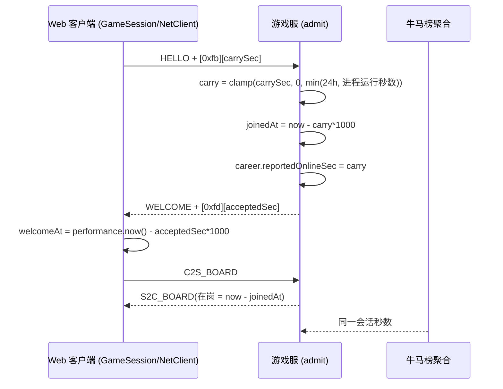

## 产品概述
修复牛马榜（中央广场公告栏）面板的两个体验问题：点「互动」打开后瞬间自动关闭，以及玩家普遍感觉「在岗 / 工时」计时不准、榜单里很多人时长完全一样。目标是在不引入账号与持久化的前提下，让三处「在岗」显示同一个数字、断线重连不再从 0 开始、榜单时长看起来在正常走秒，并让并列时长读起来像并列而不是数据异常。

## 核心功能
- 点「互动」打开牛马榜后，面板稳定停留，不会被同一次点击或紧接着的点击误关；关闭只认遮罩按下、右上角关闭按钮与 Esc。
- 左上角工牌「在岗」、工牌档案在线时长、牛马榜「在岗」三处显示同一口径的时长，断线时明确显示 `--:--` 而不是继续走秒。
- 短暂断线重连后，本次在岗时长接着算而不是归零；刷新页面重新进园视为新的一次，从 0 开始。
- 牛马榜「在岗」在面板打开期间按秒推进，不再每 20 秒整块跳一次；20 秒快照只用于校准。
- 牛马榜「工时」刷新更及时，不足 1 分钟显示 `<1m` 而不是一排 `0m`；数值相同的行显示并列名次，并在说明里写清「本浏览器累计，换设备或清缓存会重来」。
- 同一浏览器开多个标签页时，工时不因两份存档互相覆盖而忽多忽少。


## 技术栈
沿用现有栈，不新增依赖：Next.js 15 App Router + React 19 + TypeScript + Tailwind 4 + zustand（Web）；Bun `ws` 游戏服 + `@niuma/shared-types` 定长二进制协议（服务端零持久化）；Pixi 渲染在 Dedicated Worker 中运行；测试为 `bun test`（web / game-server）与 `vitest`（shared-types）。

## 实现方案

### 1. 关闭路径（修「打开即关」）
现状：`LeaderboardDialog` 只有三条关闭路径（遮罩 `onClick`、关闭按钮、Esc 的 capture 监听），面板自身没有自动关闭逻辑。因此误关只可能来自**同一手势余波或紧接着的第二次点击落到全屏遮罩**（`fixed inset-0` + `bg-black/75` 覆盖动作条位置；触屏 `pointerdown` 打开后浏览器仍可能在同一坐标合成 `click`）。

- 遮罩改监听 `onPointerDown`，且只在 `event.target === event.currentTarget && event.button === 0` 时生效（`click` 不再参与，天然屏蔽合成点击）。
- 引入「打开免疫窗」：挂载时记录 `openedAt`，`performance.now() - openedAt < BOARD_CLOSE_GUARD_MS (400)` 内忽略遮罩关闭；关闭按钮与 Esc 不设免疫窗（显式意图立即生效）。
- 判定抽成 `apps/web/lib/game/leaderboard.ts` 的纯函数 `isBackdropCloseAllowed(openedAt, now)`，可被单测覆盖（仓库没有 jsdom，只能测纯函数）。
- 打开时的 `onRequest()` 从挂载 effect 的同步链上移到 `requestAnimationFrame`（卸载时 `cancelAnimationFrame`），避免「挂载即 6 次 setState」与入场动画抢同一帧。
- 保留条件挂载（`{boardOpen && ...}`），不做常驻挂载重构，控制改动爆炸半径；入场动画本身不重播即可。

### 2. 计时口径统一
定义唯一真相：**在岗秒数 = 服务端会话秒数**（`apps/game-server/src/sim/board.ts` 的 `sessionSecOf`）。

- `apps/web/components/BadgeCard.tsx` 的 `SessionClock` 改为读 `useGameUi((s) => s.onlineSec)`，并在 `status !== 'online'` 时渲染 `--:--`（与 `game-ui.ts` 里「断线显示 --:--」的注释一致）；`attendance` 的 `sessionStartTime` 只保留给每日 / 累计工时，不再驱动工牌走秒。
- 档案弹窗已读 `useGameUi.onlineSec`，自动同源，无需改动。
- 榜单在岗来自服务端，天然同源。
- 结果：三处同源；断线时一起冻结并显示 `--:--`，回来后一起跳到正确值。

### 3. 断线累加（ADR-0059，协议纯追加）
沿用仓库既有的「尾段魔数」模式（`0xff` status / `0xfe` onlineSec / `0xfc` career）：



- `packages/shared-types/src/constants.ts` 新增 `SESSION_EXTENSION_MAGIC = 0xfb`、`WELCOME_SESSION_MAGIC = 0xfd`、`SESSION_CARRY_MAX_SEC = 86_400`（与现有 `0xfc/0xfe/0xff` 不撞车）。
- `encodeHello` 增加第 7 个可选参数 `sessionSec`，**写在 career 段之后（最末）**；`decodeHello` 的「resume 是否存在」魔数排除列表补上 `0xfb`。
- `encodeWelcome` 在可选 `syncFormat` 字节之后追加 `[0xfd][u32 acceptedSec]`；`decodeWelcome` 先判 `SYNC_FORMAT_COMPACT` 再判 `0xfd`，两者取值不同，无歧义。旧端读到 `0xfd` 只会当作「不是 COMPACT」并忽略，行为与今天逐字节一致。
- 服务端 `admit()` 用 `carry` 同时决定 `joinedAt` 与 `career.reportedOnlineSec`。**这是最关键的一处**：若 `reportedOnlineSec` 仍按今天的 0 起始，`careerSessionDeltaMinutes` 会把上一段会话再加一遍，工时直接双计。
- 客户端 `handleWelcome` 把 `welcomeAt` 与 `localCareer.reportedOnlineSec` 都按 `packet.sessionSec ?? 0` 设基线；并用 `advanceOnDuty(carrySec, 0)` 预热 `onDutyCursor`，避免重连后把「在岗 8 小时」的提醒重播一遍。
- `NetClient` 增加 `sessionSec` 字段与 `setSessionSec()`，`GameSession` 在 `onClose`（已有 `persistNow` 的那处）写入当前 `onlineSecOf(localId)`，下次 `open()` 的 HELLO 自动带上。
- 降级：旧服务端忽略尾段、WELCOME 不回显 → 客户端按 0 起算（今天的行为）；旧客户端忽略尾段 → 行为不变。混合发布安全。

### 4. 榜单可读性
- 在岗本地走秒：快照到达记录 `receivedAt`，面板内一个 1 秒 `setInterval` 渲染 `value + floor((now - receivedAt)/1000)`；20 秒快照只校准。只开一个定时器，不给每行建 timer。
- 工时上报间隔 `CAREER_REPORT_INTERVAL_MS` 60s → 20s（服务端限频 `CAREER_UPDATE_INTERVAL_MS = 10s`，安全）；**协议单位仍是分钟**，不做会打破灰度兼容的语义变更。
- `formatMinutes`：`0 < minutes < 1` → `<1m`，`<= 0` 仍为 `0m`。
- 并列名次：在 `packages/shared-types/src/board.ts` 增加纯函数 `boardRankOf(values, index)`（并列同名次、下一名跳号：1,2,2,4），服务端算 `selfRank`、客户端算每行名次，共用一份规则；并列行加一个小「并列」签，读起来是并列而不是乱序。
- 底栏与口径说明补一句「工时按本浏览器累计，换设备或清缓存会重来」。

### 5. 多标签页
`AttendanceTracker.persist()` 落盘前先读存储，`dailyRecords` 按日期键取 `max`、`totalOnlineMs` 取 `max` 再写；同时监听 `window.storage` 事件把外部写入同步进 `useAttendance`。取舍：不做 BroadcastChannel 选主（YAGNI），merge-max 保证「不会倒退、不会少记」，代价是极端并发下可能少记一小段。

## 架构与边界
- 改动集中在四层：`shared-types`（协议段 + 共享纯函数）→ `game-server/sim`（会话与聚合）→ `web/lib/game`（会话时钟、面板纯函数）→ `web/components`（展示）。不引入新模块边界，不碰 20Hz Tick、渲染线程与地图。
- 性能：HELLO +5B、WELCOME +5B（仅 `carry > 0` 时）；服务端每次入场 O(1)，榜单查询仍只在请求分支排序；面板只多一个 1Hz interval；考勤落盘每次 flush 多一次 `localStorage` 读。
- 安全：`carry` 只影响展示型榜单，服务端按 `min(24h, 进程运行秒数)` 钳制，进程重启后无法凭旧值虚增；不引入身份、不落盘、不改变「离线即离榜」。

## 关键代码结构
```ts
// packages/shared-types/src/protocol.ts
export function encodeHello(
  name: string, appearance: CharacterAppearance, resume?: ResumeState,
  status?: string, syncFormat?: SyncFormat, career?: CareerSummary,
  sessionSec?: number, // [0xfb][u32]，追加在 career 段之后
): Uint8Array;

// packages/shared-types/src/board.ts
/** 并列同名次、下一名跳号：values=[10,10,8] → 0,0,2 */
export function boardRankOf(values: readonly number[], index: number): number;

// apps/web/lib/game/leaderboard.ts
/** 打开后 400ms 内的遮罩点击不算关闭意图（挡住双击与触屏合成 click） */
export function isBackdropCloseAllowed(openedAt: number, now: number): boolean;
```

## 目录结构
```
packages/shared-types/src/
├── constants.ts                    # [MODIFY] 新增 0xfb / 0xfd 魔数、SESSION_CARRY_MAX_SEC
├── types.ts                        # [MODIFY] WelcomePacket 增加可选 sessionSec
├── protocol.ts                     # [MODIFY] encodeHello/decodeHello/encodeWelcome/decodeWelcome 追加段
├── board.ts                        # [MODIFY] 新增 boardRankOf（并列名次，双端共用）
├── career.ts                       # [MODIFY] 新增 clampSessionCarry(sec, processUptimeSec)
└── __tests__/protocol.test.ts      # [MODIFY] 会话段往返、旧包兼容、WELCOME 回显、未知版本丢弃

apps/game-server/src/
├── admission/controller.ts         # [MODIFY] HelloPayload 增加 sessionSec
├── server.ts                       # [MODIFY] HELLO 解析 carry、admit 的 joinedAt/reportedOnlineSec 基线、WELCOME 回显
└── sim/board.ts                    # [MODIFY] selfRank 改为并列名次
└── sim/board.test.ts               # [MODIFY] carry 钳制、重连续算、工时不被双计、并列名次

apps/web/
├── lib/net/client.ts               # [MODIFY] sessionSec 字段 + setSessionSec + HELLO 携带 + WELCOME 读取
├── lib/game/session.ts             # [MODIFY] welcomeAt/career 基线、断线写入 carry、onDutyCursor 预热
├── lib/game/leaderboard.ts         # [MODIFY] isBackdropCloseAllowed、advanceBoardValue、formatMinutes 的 <1m
├── lib/game/attendance.ts          # [MODIFY] persist 取 max + storage 事件同步
├── components/game/LeaderboardDialog.tsx  # [MODIFY] 遮罩 pointerdown + 免疫窗、rAF 请求、1Hz 走秒、并列签、文案
├── components/BadgeCard.tsx        # [MODIFY] SessionClock 改读 useGameUi.onlineSec，断线显示 --:--
├── lib/game/__tests__/leaderboard.test.ts         # [MODIFY] 关闭守卫、<1m、走秒、并列
├── lib/game/__tests__/leaderboard-dialog.test.tsx # [MODIFY] 静态渲染断言随文案/并列调整
└── data/release-notes.json         # [MODIFY] 追加 2026-11-12-5

docs/adr/0059-session-clock-continuity.md         # [NEW] 会话口径跨重连、三处时钟同源、选项与回滚
```


## Agent Extensions
### Skill
- **principal-software-architect**
  - Purpose: 为「断线累加会话时长」这条例外于 ADR-0054「重连归零」的决策写 ADR-0059，给出方案选项、反向成本、伪造风险与 30 天回滚路径，并输出 BASELINE 证据行。
  - Expected outcome: `docs/adr/0059-session-clock-continuity.md` 落地，含至少两个候选方案、推荐项与可执行回滚步骤。
- **impeccable**
  - Purpose: 收口牛马榜面板的关闭手势与文案细节（并列签、`<1m`、口径说明），确保改动符合现有 ink/mint 视觉语言与可访问性。
  - Expected outcome: 面板交互与文案调整后无视觉回归，关闭手势只响应显式意图。
- **verification-before-completion**
  - Purpose: 收尾阶段逐条跑类型检查、三包测试与 `pnpm changelog:check`，用真实输出而不是口头结论确认完成。
  - Expected outcome: 全部命令通过并附上命令与结果证据。

