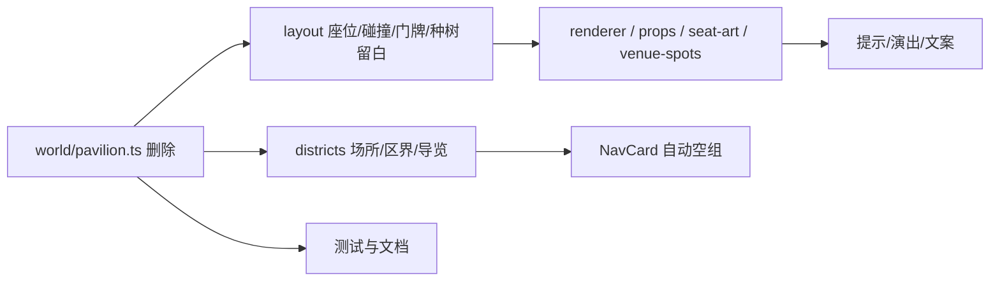

## 需求概述
把景观区摸鱼湖东北岸的摸鱼亭从园区里彻底拆除，北岸恢复成可自由穿行的草地。摸鱼大赌场亭台与工作区茶台小亭不在本次范围内。

## 核心功能
- 亭体与陈设消失：八根亭柱、双坡屋顶、台基、石桌、4 张石鼓凳、亭角 4 盏挂灯、冬季积雪与亭前湖面专属反光全部不再绘制，原地不再有悬空碰撞。
- 玩法与入口移除：石鼓凳入座、按 F 发呆、禅意静置气泡、场所名与区域名、导览目标与到达点、入口小门牌、到达横幅文案一并删除；导览目标由 15 处变 14 处。
- 地图收尾：原址并回景观区草地，树与花可自然长过去，不新增地标、长椅或灯光，避免出现「野地」夹层或小地图空洞。
- 保持不变：三处湖、游鱼、竹林、花海、赌场亭台、茶台、其余导览目标与全部通信协议不变。
- 资料同步：README 与美术规范的场所清单不再列该地标，新增一条决策记录，并在版本工报里用玩家可感知的话说明这次拆除。

## 视觉结果
玩家走到湖东北岸，看到的是连续草地与湖岸线，不再有屋顶遮挡角色；夜间湖岸少四盏暖光；HUD 导览卡只剩企业区、游乐区、生活区、服务区四个分组。


## 技术栈
- 现有 pnpm 10 monorepo：`apps/web`（PixiJS + TypeScript）、`apps/game-server`（服务端权威模拟）、`packages/shared-types`（双端共享布局）。
- 测试：shared-types 用 vitest，web 用 bun:test，服务端用 bun:test。
- 不引入新依赖、新协议字段或新分层。

## 实施方案
### 总体策略
按「单一真相 → 派生 → 表现」的顺序删：先删 `shared-types` 的摸鱼亭模块与世界装配，再删客户端渲染与弱交互，最后收尾文档与工报。共享层是多处派生的源头（座位表、碰撞表、门牌、种树留白、区域名、导览），删掉源头后大多数调用点自动收敛，只有 5 处手写清单需要显式改动：`SEAT_DRAFTS`、`WORLD_LAYOUT.solids`、`DOOR_PLAQUES`、`VENUES`、`NAV_SOURCES`。

### 关键决策
1. **彻底删除，包括 `SeatKind` 的 `drum` 与美术分支**：石鼓凳只有这一处使用者，保留会在 `seat-art`、`props`、`badge` 留下不可达分支。
2. **原址保留一块 200×180 的景观区草地**（与原亭同址：5250, 4710），替换 `SCENERY_RECTS` 里 `rectExpanded(PAVILION_RECT, 30)` 那一块。理由：直接删干净会让 `regionAt` 在该处回落到「野地」，小地图出现 200×180 的空洞，玩家从湖岸走进草地时横幅闪一下「野地」。新地块零碰撞、零灯光、零地标，只承担区界与区域名，沿用 ADR-0101「撤掉建筑的地要收尾」的既有做法。
3. **座位 id 前移不升快照版本**：删掉中间 4 个座位会让其后所有 seatId 前移 4（宿舍沙发、影厅 15 座、长椅、病床、赌桌 12 凳、八角笼 4 长椅）。升 `SNAPSHOT_VERSION` 会让全部玩家丢落点；改为在服务端 `resolveSpawn` 加护栏——座位锚点与上报坐标的直线距离超过 64px 就不认座，按上报坐标落地。坐姿快照里坐标本就等于座位坐标，正常玩家不受影响；只会拦掉「旧 id 指向了另一张远处椅子」这一种错位。
4. **不把摸鱼湖补进导览**：导览只列可互动场所（ADR-0078 的既有口径），景观区改为步行前往。`NavCard` 已按「空组不占位」过滤，组件不需要改。
5. **光源预算不动**：`MAX_LIGHTS` 保持现值，只把常驻记账减 4 盏并同步注释，回收的余量留给后续动态光源。

### 性能与可靠性
- 共享布局 solids 少 8 个、seats 少 4 个、光源少 4 盏：服务端占用数组与碰撞查询更小，光图注册与合批更轻，无新增帧循环分配。
- 树位只可能增加（原亭址的候选点变合法）；`isPlantable` 仍保留水面 95px 留白，不会把树种进湖里。树生成是构造期一次性的，无运行时开销。
- 无协议、`world-state.json` 落盘范围、服务端世界逻辑变更；`shared-types` 是双端共享常量，客户端与服务端仍需同版本发布（ADR-0077 既有约束）。
- 回滚成本中等：恢复被删模块与四张座位、还原区界与门牌、测试同步回退即可。

### 实施要点
- 先删 `packages/shared-types/src/world/pavilion.ts`，再清 `layout.ts` 的 import/re-export、`DOOR_PLAQUES` 一条、`isPlantable` 一条排除、`SEAT_DRAFTS` 四项、`solids` 八项；`districts.ts` 删 import、区界、`NavTargetId`、`VENUES`、`NAV_ARRIVALS`、`NAV_SOURCES`。
- `campus.ts` 删 `SeatKind` 的 `drum` 后，四处下游必须同改：`seat-art.ts` 的 `OTHER_SEATS`、`props.ts` 的 `drawDrumStool` 与 `seatTextures` 字面量类型、`badge.ts` 的 `seatLabel`、以及 `seat-art.test.ts` 的 `NON_CHAIR`。
- 客户端删 `pavilion.ts`、`renderer.ts` 的 import/字段/构建/`lightmap.register`/`destroy`、`venue-art.ts` 的两处地面影子与 `pavilionGlints`、`venue-palette.ts` 的 `pavilion` 键值、`venue-spots.ts` 的石鼓凳归属/本地点/`ZEN_LINES`/静置节流、`hint-copy.ts` 的 `HINT.pavilion` 及 `HINT_BUTTONS` 与 `TOUCH_HINTS` 两条映射、`interactions.ts` 的 default 分支、`session.ts` 的 import 与两处分支、`arrival-copy.ts` 的副标题。
- 测试里的固定数字要一起改：`NAV_TARGETS` 15 变 14、`DOOR_PLAQUES` 12 变 11、`VENUES` 20 变 19、光源记账减 4。`place-signs.test.ts` 的文档注释、`pathfinding` 与 `nav-route` 的标题也要改。
- `resume.test.ts` 现有「snaps back to the exact seat」传的是 0,0，加护栏后会失败：改成座位自身坐标，并新增「id 仍合法但坐标对不上」用例（用原亭址坐标，断言不占座且落在可站立草地）。
- 不要误删同名概念：`FishDrum.tsx`、`BulletinModal.tsx` 与 `badge.ts` 里的「鱼鼓」是公告栏道具；`street-decor.ts` 的「赌场亭」是赌场，全部保留。
- 文档：README 的景观区描述、区界块数、场所表、座位表、导览清单；美术规范三处引用只删条目；新增 ADR-0103，不改历史 ADR；`release-notes.json` 追加 `2026-11-16-2`（当天已有 `-1`），并跑 `pnpm changelog:check`。
- 完成后用全仓检索复查：源码里除历史 ADR、版本工报与新 ADR 的说明外，不应再有摸鱼亭或 pavilion 的引用。

## 架构设计
依赖方向不变：场所模块 → `districts` → `layout` → 渲染 / 导览 / 服务端。删除 `pavilion` 模块只是摘掉一个叶子节点，`world/` 与 `apps/web/lib/game` 的职责边界、派生链与测试口径都保持原样，不引入新抽象。



## 目录结构
```
packages/shared-types/
├── src/
│   ├── index.ts                              # [MODIFY] 移除 world/pavilion 的导出
│   ├── world/
│   │   ├── pavilion.ts                       # [DELETE] 亭子常量整体删除：占地、八柱、四凳、石桌、碰撞
│   │   ├── layout.ts                         # [MODIFY] 去 import/re-export；删门牌、种树排除、四张座位、八条碰撞
│   │   ├── districts.ts                      # [MODIFY] 删场所/导览目标/到达点；原亭区界换成 200×180 景观区草地
│   │   ├── campus.ts                         # [MODIFY] SeatKind 去掉 drum
│   │   └── apartment.ts                      # [MODIFY] 落点注释去掉摸鱼亭
│   └── __tests__/
│       ├── layout-guofeng.test.ts            # [MODIFY] 删整段亭子断言与相关 import
│       ├── nav-arrival.test.ts               # [MODIFY] 15 改 14，户外列表去掉 pavilion
│       ├── districts.test.ts                 # [MODIFY] 场所数 20 改 19，补「原址报景观区」「无 pavilion 场所」断言
│       └── place-signs.test.ts               # [MODIFY] 门牌数 12 改 11
apps/game-server/src/sim/
├── resume.ts                                 # [MODIFY] 座位锚点与上报坐标偏差超过 64px 时不认座
└── resume.test.ts                            # [MODIFY] 座位用例改真实坐标，新增错位座位用例
apps/web/
├── lib/game/
│   ├── pavilion.ts                           # [DELETE] PavilionView 整文件删除
│   ├── renderer.ts                           # [MODIFY] 删 import/字段/构建/光位注册/销毁
│   ├── venue-art.ts                          # [MODIFY] 删亭子地面影子与亭前湖面反光，清 import
│   ├── venue-palette.ts                      # [MODIFY] VenueId 与 VENUE_COLORS 去掉 pavilion
│   ├── venue-spots.ts                        # [MODIFY] 删石鼓凳归属/本地点/禅意台词/静置节流
│   ├── hint-copy.ts                          # [MODIFY] 删 HINT.pavilion 与按钮、触屏两条映射
│   ├── interactions.ts                       # [MODIFY] default 分支改通用提示，更新注释
│   ├── session.ts                            # [MODIFY] 删 isPavilionSeat 与 HINT.pavilion 分支、注释
│   ├── arrival-copy.ts                       # [MODIFY] 删摸鱼亭副标题
│   ├── badge.ts                              # [MODIFY] seatLabel 删 drum 分支
│   ├── props.ts                              # [MODIFY] 删 drawDrumStool、DRUM_SPRITE、drumStone 色与贴图映射
│   ├── seat-art.ts                           # [MODIFY] OTHER_SEATS 删 drum
│   ├── park.ts                               # [MODIFY] 注释不再引用 pavilion.ts
│   ├── lighting/light-registry.ts            # [MODIFY] 常驻光源注释减 4
│   ├── lighting/lanterns.ts                  # [MODIFY] 去掉「摸鱼亭四角」的注释
│   └── __tests__/
│       ├── nav.test.ts                       # [MODIFY] 14 处目标、景观区 0 个、分组计数与「五区都有目标」断言
│       ├── pathfinding.test.ts               # [MODIFY] 15 改 14
│       ├── road-graph.test.ts                # [MODIFY] 去掉亭子的路由例外，按全量目标断言
│       ├── nav-route.test.ts                 # [MODIFY] 标题 15 改 14
│       ├── lighting.test.ts                  # [MODIFY] 删 PAVILION_LIGHT_COUNT 与记账
│       ├── ritual.test.ts                    # [MODIFY] 预算去掉亭角 4 盏
│       ├── venue-spots.test.ts               # [MODIFY] 删亭子座位/本地点/台词/节流断言
│       ├── context-hint.test.ts              # [MODIFY] 删石鼓凳提示用例
│       └── seat-art.test.ts                  # [MODIFY] NON_CHAIR 去掉 drum
└── data/release-notes.json                   # [MODIFY] 追加 2026-11-16-2 玩家可感知改动
docs/
├── adr/0103-remove-moping-pavilion.md        # [NEW] 决策记录：范围、草地收尾、座位 id 迁移、光预算、回滚
└── art/venue-moodboard/README.md             # [MODIFY] 配色行去掉摸鱼亭
README.md                                     # [MODIFY] 景观区、区界块数、场所表、座位表、导览 14 处
.codebuddy/skills/pixel-venue-polish/SKILL.md                       # [MODIFY] 场所清单去掉摸鱼亭
.codebuddy/skills/pixel-venue-polish/references/venue-map.md        # [MODIFY] 删亭子行
.codebuddy/skills/pixel-venue-polish/references/palette.md          # [MODIFY] 删亭子色行
```


## Agent Extensions
### Skill
- **domain-modeling**
  - Purpose: 按仓库现有 ADR 格式撰写 ADR-0103，覆盖背景、决策、后果、备选方案与回滚，只新增不改历史 ADR。
  - Expected outcome: 一份与 `docs/adr/` 现有条目同构、可评审的决策记录，并把「为什么保留草地地块」「为什么加座位护栏」写清楚。
- **verification-before-completion**
  - Purpose: 收尾前逐项取证，确认类型检查、全量测试、版本工报校验通过，并对原亭址、导览卡、小地图、夜间灯光做冒烟。
  - Expected outcome: `pnpm typecheck`、`pnpm test`、`pnpm changelog:check` 全绿，冒烟清单有明确结论，不用「应该没问题」代替证据。
