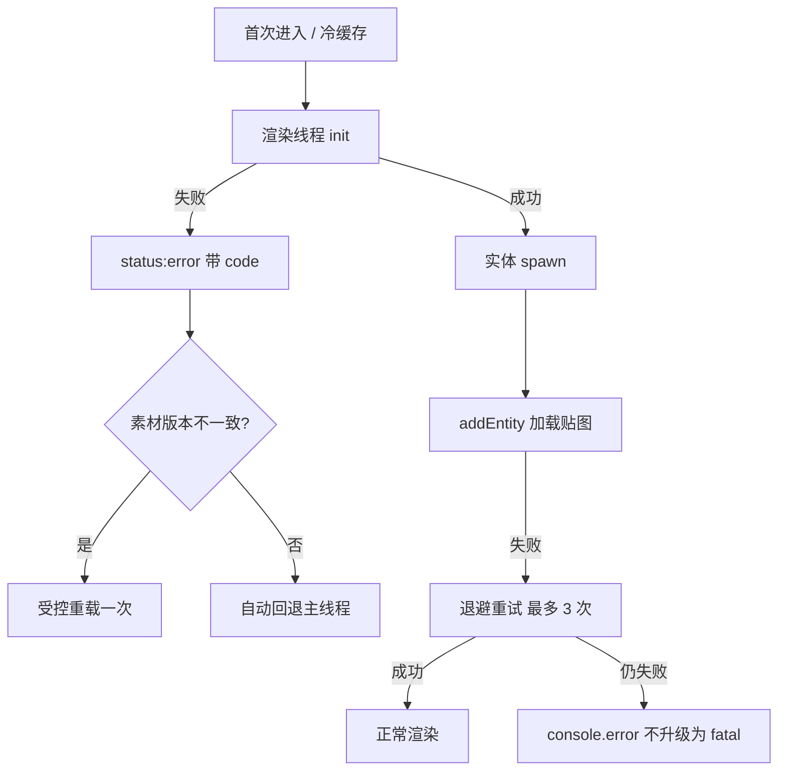

## 产品概述
定位并修复“首次进入园区偶发红色报错、刷新后才恢复”的问题，让玩家在冷启动或发版窗口内遇到瞬时加载失败时无需手动刷新即可继续游戏。

## 核心问题
- 首次进入游戏时偶发出现红色错误横幅，通常刷新一次后恢复正常。
- 红条来自游戏内连接状态横幅（`status === 'error'`），不是浏览器错误页。
- 主要诱因是首次冷加载角色贴图时，单个资源失败被升级为渲染线程致命错误；刷新后会话标记切换到主线程渲染且资源已缓存，所以看起来“刷一下就好”。
- 次要诱因是渲染线程初始化失败被启动闸门误判为启动成功，以及发版窗口内旧页面素材版本错配。

## 核心功能
- 单个角色外观贴图加载失败时自动退避重试，不再触发渲染线程致命错误和红色横幅。
- 图集清单与贴图加载失败可重试，首次失败不再被永久缓存。
- 渲染线程在就绪前失败时自动回退主线程渲染，不向玩家抛红条。
- 页面素材版本与服务端不一致时触发一次受控重载，并显示玩家可读文案，避免刷新循环。
- 红色横幅只保留给真正无法自愈的渲染故障。
- 不改变正常进入流程、渲染选路开关、服务端协议语义与零持久化约束。


## 技术栈
- 沿用现有 Next.js 15 + React 19 + Pixi 8 + Web Worker/OffscreenCanvas + TypeScript。
- 测试沿用 `bun:test`（`apps/web` 下 `bun test lib`）与 `tsc --noEmit`。
- 不新增运行时依赖，不改服务端、Opcode 与存储模型。

## 根因结论
红色横幅是 `apps/web/components/game/Hud.tsx` 中 `ConnectionBanner` 在 `status === 'error'` 时的样式。当前有两条链路会把首次进入的瞬时问题放大成红条：

1. `session.ts` 的 `handleWelcome` 与 `handleSpawn` 都用 `void this.renderer.addEntity(...)` 触发异步贴图加载，没有 catch。首次进入会冷加载本机角色与约 10 个 NPC 的多张 PNG；任意一张失败都会让 `addEntity` reject，被 `game.worker.ts` 的 `unhandledrejection` 当成 fatal，随后 `worker-client.ts` 调 `markRenderFallback()` 并显示红条。
2. `session.start()` 在 `await renderer.init()` 之前就同步发出 `status: connecting`，而 `worker-client` 的启动闸门把“第一条业务消息”当作启动成功。初始化失败因此走 `status: error` 红条，而不是已有的 `fallbackToMain()`。

刷新恢复的原因：`markRenderFallback()` 把标记写进 `sessionStorage`，刷新后 `pickRenderMode()` 直接走主线程渲染；同时失败过的贴图大多已进入 HTTP 缓存。

## 实现策略
采用“分层降级”而不是在单点吞异常：

1. **单实体视图加载可恢复**
   - 在 `session.ts` 增加按 netId 管理的视图创建助手：`addEntity(...).catch(...)` 后按 400ms、1200ms 退避重试，最多 3 次。
   - 重试前用 `ecs.get(netId)` 或 `names` 判断实体是否仍在场；despawn、`clearWorld()`、`stop()` 时清掉定时器。
   - 最终失败只 `console.error`，不让异常继续冒泡成 Worker fatal；本地角色通常会在重试后恢复。
   - `renderer.addEntity()` 在 abort 分支销毁视图后直接返回，不再 rethrow；所有路径清理 `pendingInit`，避免重复初始化与泄漏。

2. **图集加载可重试与错误分类**
   - `atlas.ts` 的 `pending` 在失败时清空，保证同一页面内后续调用还能重新尝试。
   - manifest 拉取与 `Assets.load` 各加一次短延迟重试；重试前 best-effort 清理失败缓存（`Assets.unload` 或缓存移除），清理失败不影响主流程。
   - 新增 Pixi 无关的 `atlas-errors.ts`：区分 `manifest`、`texture`、`version-mismatch`，并标注是否可重试。
   - 版本不一致不再把“请重跑 pnpm assets”的开发者文案直接抛给玩家。

3. **启动闸门语义修正**
   - 新增纯函数 `classifyBootMessage(message)`：`ready` 或初始化后的业务消息为 alive，`status: connecting` 为 progress，`status: error` 为 failed。
   - `worker-client` 只在 alive 时判定启动成功；failed 且尚未 ready 时记录原因并走既有 `fallbackToMain()`，不把错误透传给 Hud。
   - 首条消息超时保持 10s；收到 progress 后把截止时间延到 20s，给冷启动留余量，`ready` 后停止计时。

4. **过期素材受控换图**
   - `worker-protocol.ts` 的 status 消息增加可选 `code?: 'atlas-version'`，不新增 opcode。
   - `worker-host.ts` 捕获图集版本错配时发送 `code: 'atlas-version'` 与玩家可读文案，并触发 `build-check`。
   - `build-version.ts` 新增 `reloadForStaleAssets()`：固定 pseudo id 复用 `allowReloadForVersion` 的冷却与次数上限，最多重载一次，避免循环。
   - `worker-client` 与 `GameViewport` 主线程分支都识别该错误；受控重载被守卫拦住时才显示“园区已更新，请刷新页面”的红条。

### 关键取舍
- 不在 `renderer.addEntity` 内静默吞掉所有异常：真实渲染缺陷仍需暴露；只在调用方做有限重试，最终失败保留 `console.error`。
- 不做“运行时 fatal 后无刷新重建整个会话”：会话状态在 Worker 内，重建会丢位置与状态且复杂度高；先把 fatal 的触发源降级为非致命。
- 版本错配不直接无限 `location.reload()`：复用现有冷却与最大次数，固定 pseudo id 保证可测试、可观测。
- 不重写 Pixi 资源加载器：只在失败后清理并重试一次，控制改动面。

## 实施要点
- Worker 可达模块（`session.ts`、`atlas.ts`、重试工具）禁止使用 `window`/`document`，统一用 `setTimeout` 与 `globalThis`。
- 生产构建会剥离 `console.warn`，因此重试过程用 `console.warn`，最终失败用 `console.error`；日志只带 netId 与错误消息，不带昵称等个人信息。
- 定时器按 netId 建 Map，调度前先清旧定时器；`clearWorld()` 与 `stop()` 必须清空，防止幽灵重试。
- 重试只针对可重试错误；abort 与版本错配不重试；延迟加 0.8–1.2 抖动，避免网络抖动后的同时重试。
- `status.code` 为可选字段，旧消息解码不受影响；Worker 与主线程仍同版本发布，不涉及服务端协议。
- 保留 `?render=main` / `?render=worker` 灰度开关与 `niuma:render-fallback` 语义，不改正常渲染选路。
- 当前工作区有未提交的节日装饰改动；`renderer.ts` 只改 `addEntity` 的错误处理与清理，不动 `buildLayers` 与 `festival` 接线。
- 按 AGENTS.md 在提交前更新 `apps/web/data/release-notes.json` 并运行 `pnpm changelog:check`。

## 架构设计


## 目录结构
```
apps/web/
├── lib/
│   ├── build-version.ts                         # [MODIFY] 新增 reloadForStaleAssets：固定 pseudo id、复用冷却与次数上限的受控重载
│   ├── game/
│   │   ├── async-retry.ts                       # [NEW] 纯函数重试工具：次数、退避、抖动、取消判断；Worker 与主线程通用
│   │   ├── atlas.ts                             # [MODIFY] 失败清空 pending；manifest 与 Assets.load 各重试一次；抛类型化错误
│   │   ├── atlas-errors.ts                      # [NEW] Pixi 无关的 AtlasLoadError 与 isAtlasVersionMismatch，供 worker-host/client/测试共用
│   │   ├── renderer.ts                          # [MODIFY] addEntity abort 时不 rethrow，所有分支清理 pendingInit，保证重复调用安全
│   │   ├── session.ts                           # [MODIFY] 新增实体视图重试助手，替换两处 void addEntity；despawn/clearWorld/stop 清理定时器
│   │   ├── client/
│   │   │   └── worker-client.ts                 # [MODIFY] 使用启动分类纯函数；pre-ready error 走 fallbackToMain；识别素材版本错配；进度续期
│   │   ├── runtime/
│   │   │   ├── boot-gate.ts                     # [NEW] classifyBootMessage 纯函数与 BootVerdict 类型，便于单测
│   │   │   ├── worker-host.ts                   # [MODIFY] session.start 失败映射为 code 与玩家可读文案；版本错配触发 build-check
│   │   │   └── worker-protocol.ts               # [MODIFY] status 消息增加可选 code，保持向后兼容
│   │   └── __tests__/
│   │       ├── async-retry.test.ts              # [NEW] 覆盖第二次成功、重试耗尽、不可重试错误、取消
│   │       ├── boot-gate.test.ts                # [NEW] 覆盖 connecting/error/ready/业务消息四类判定
│   │       └── atlas-errors.test.ts             # [NEW] 覆盖错误分类与版本错配识别
│   └── __tests__/
│       └── build-version.test.ts                # [MODIFY] 补受控重载守卫：首次放行、冷却内拦截、超过次数拦截
├── components/game/GameViewport.tsx             # [MODIFY] 主线程启动失败时识别素材版本错配；受控重载被拦才显示友好红条
└── data/release-notes.json                      # [MODIFY] 按 AGENTS.md 追加一条玩家可感知修复记录
```

## 关键结构
```ts
// lib/game/atlas-errors.ts
export type AtlasErrorCode = 'manifest' | 'texture' | 'version-mismatch';

export class AtlasLoadError extends Error {
  readonly code: AtlasErrorCode;
  readonly retryable: boolean;
  constructor(code: AtlasErrorCode, message: string, retryable: boolean);
}

export function isAtlasVersionMismatch(error: unknown): boolean;
```

```ts
// lib/game/runtime/boot-gate.ts
export type BootVerdict = 'progress' | 'alive' | 'failed';

export function classifyBootMessage(message: WorkerToMain): BootVerdict;
```

```ts
// lib/game/runtime/worker-protocol.ts
| { t: 'status'; status: EngineStatus; detail: string; code?: 'atlas-version' }
```

## 验证方案
- DevTools 阻断单张角色贴图：进入园区不出现红条，控制台仅有 warn；解除阻断后角色自动出现；持续阻断时只打最终 error，游戏仍可操作。
- 阻断 Worker 脚本或让 `renderer.init` 失败：自动回退主线程并上线，不出现红色横幅。
- Fast 3G 加禁用缓存冷启动：在启动预算内进入，不因 10s 假超时误回退。
- 本地篡改 `manifest.version`：触发一次受控重载；再次错配显示友好文案，不循环刷新。
- `?render=main` 复验同一套素材错误路径。
- 回归节日装饰：默认与 `?festival=0` 均能正常进入与渲染。
- 运行 `pnpm --filter @niuma/web typecheck`、`bun test lib` 与 `pnpm changelog:check`。


## Agent Extensions
### SubAgent
- **code-explorer**
  - Purpose: 在改动前复核 `renderer.addEntity`、`loadAtlas`、`Assets.load` 与 `status: error` 的全部调用点，确认没有遗漏的 `void` 异步调用或错误消费方。
  - Expected outcome: 给出一份完整调用点清单与影响范围，保证重试与启动闸门改动不破坏主线程回退、节日装饰与既有测试。
