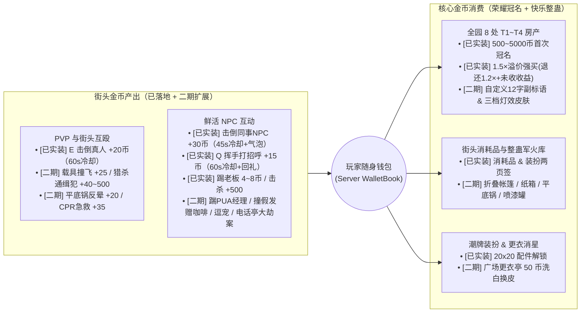
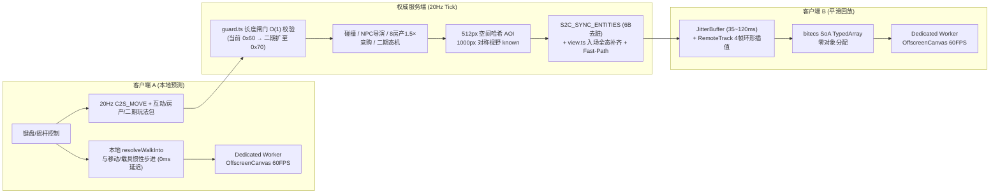

# 《牛马 NIOMA》完整执行蓝图：“像素版职场 GTA”全栈重塑、房产经济与地图布局终极规范

> **终极产品愿景**：*“砍掉赌场与数值内卷，回归纯粹街头对抗与开放世界社交！打造全球第一款以现代打工人为题材的 2D 像素版 GTA —— 打翻同事与奇葩 NPC 赚爆金币、抢飙载具狂飙突进、拿下全园地标豪宅冠名权，在最卷的赛博都市里做最自由的狂徒。”*  
> **文档性质**：已与当前代码库（`packages/shared-types`、`packages/pixel-assets`、`apps/game-server`、`apps/web`）逐行核实对齐的**零歧义工程规格说明书 + 阶段验收基线 + 可直接交付其他 AI 执行的完整提示词**。  
> **更新日期**：2026-11-19

---

## 目录
1. [文档定位、已落地基线与 AI 执行铁律](#1-文档定位已落地基线与-ai-执行铁律)
2. [已彻底清理与保留的边界（删骰桌 / 删擂台 / 删四维属性）](#2-已彻底清理与保留的边界删骰桌--删擂台--删四维属性)
3. [纯净街头金币经济闭环（PVP 对抗 + NPC 互动赚金）](#3-纯净街头金币经济闭环pvp-对抗--npc-互动赚金)
4. [全图 8 处分阶房产冠名、1.5× 溢价抢房与地图房产 UI](#4-全图-8-处分阶房产冠名15-溢价抢房与地图房产-ui)
5. [五区地图布局空间重塑与路网扩展](#5-五区地图布局空间重塑与路网扩展)
6. [二期“像素版 GTA”扩展体系（物理摔倒 / 幽灵急救 / 通缉 / 载具 / 特种 NPC / 差事涂鸦）](#6-二期像素版-gta扩展体系物理摔倒--幽灵急救--通缉--载具--特种-npc--差事涂鸦)
7. [全网实时双向同步、二进制协议与零 GC 性能规范](#7-全网实时双向同步二进制协议与零-gc-性能规范)
8. [美工细节、角色载具绘制与全链路 UI 优化（Warm NiomaOS 95）](#8-美工细节角色载具绘制与全链路-ui-优化warm-niomaos-95)
9. [跨 AI Skills 全景体系、分阶段里程碑与终极完整提示词](#9-跨-ai-skills-全景体系分阶段里程碑与终极完整提示词)

---

## 1. 文档定位、已落地基线与 AI 执行铁律

### 1.1 已落地实施的核心重构基线（Phase 0 + 8 房产/霓虹街区地基已完成）
当前代码库已完成以下首轮架构落地与全仓测试验证，后续扩展 AI **直接基于此基线叠加二期玩法，切勿重复删除已清理的模块**：
- **彻底摘除赌博与内卷数值**：全量删除 `dice-hall` / `dice-ledger` / `ring`（含服务端 `sim/` 与客户端 14 个 UI/渲染/测试文件），废除 `atkSpeedLv` / `workEffLv` / `critLv` / `armorLv` 属性升级（`STAT_SKUS = []`，服务端 `upgradeStat()` 恒返 `false` 且拒绝 `SHOP_KIND.Stat`，发泄冷却锁死 `600ms` 基础 / `420ms` 冰美式，老板固定 `15%` 暴击）；`world-state.json` 升级至 **`WORLD_STATE_VERSION = 5`**（剔除 `ring`/`dice` 字段，无缝兼容读取 v1–v4 旧档，支持最多 16 处房产）。
- **上线纯粹街头与 NPC 经济闭环**：实装 `ECONOMY_REWARD` 与 `WALLET_REASON.NpcReward (33)` / `WALLET_REASON.VillaBuyout (32)`——PVP 击倒 `+20 币`（同目标 60s 冷却）、击倒普通 NPC 同事 `+30 币`（45s 冷却 + AOI 惊呼聊天泡）、对 NPC 按 `Q` 挥手打招呼 `+15 币`（60s 冷却 + 双向挥手动作 + 问候泡，`director.reactToWave`）、踢老板 `4..8` 币（击杀 `500` 币）。
- **全图 8 处分阶房产与 1.5× 溢价竞购上线**：`VILLA_SPECS` 扩展为 `id: 0..7`（覆盖 `T1`–`T4`、含西北「霓虹娱乐街」3 处新地标与东北半岛「沉思畔茶院」），服务端 `VillaRuntime.buyResult` 支持无主原价购买与被他人占用时 **1.5× 溢价强买**（自动向在线/离线原房主退还 **1.2× 本金 + 未结算摇钱树收益**并全服大喇叭播报）；配套东/东北新支路让全部 **18 处** `NAV_TARGETS` 路网与 A* 100% 可达。
- **零 GC 渲染、小地图与 NiomaOS 95 UI**：`villas-view.ts` 采用 6 原始字段差分缓存（Zero-GC）与深靛描边 `VENUE_OUTLINE = 0x2a3142`（零 `#000000`），提供 5 套差异化建筑外观（`courtyard / club / garage / stall / lodge`）；`minimap-draw.ts` 与 `WorldSnapshot.villas` 实现小地图 3 态 5×5 像素房屋Pin（零每帧分配）；`venue-palette.ts` 与 `venue-lights.ts` 重塑西北霓虹街区并保持 **`venueLights().length === 20`**（预算严格控制在 `MAX_LIGHTS = 96` 内）；`VillaDialog.tsx`、`CoinShopDialog.tsx`（2 页签）与 `globals.css`（`.pixel-panel / .pixel-btn / .pixel-tag`）完成 NiomaOS 95 升级；`Hero.tsx` 修正为 `'1000 px aoi'`。

### 1.2 仓库不可违背的 6 条架构红线
1. **权威在服与落盘边界（ADR-0081 / ADR-0104）**：
   - 服务端固定以 **20Hz** 运行（`TICK_RATE = 20`，`TICK_MS = 50`），无数据库、无 ORM；
   - `world-state.json`（v5）仅落盘园区共享运行态：`boss`、`villas`（上限 16 处）、`wallets`、`profiles`（点赞数）；
   - **通缉星级、载具即时占用、尸体/幽灵状态、NPC 追击态、涂鸦归属、差事进度**均属瞬间态，**只活在进程内存**，重启自动重置。
2. **时间唯一口径**：
   - 服务端一律通过 `clock.now()` 获取毫秒时间戳；客户端玩法与倒计时一律使用 `serverNow()` / `serverDateKey()`；
   - 严禁在冷却判定、复活倒计时、通缉消星、房产收益与跨日切日中使用裸 `Date.now()` 或 `new Date()`。
3. **二进制协议只追加 + 墓碑封存 + 入站闸门扩容**：
   - 废弃功能对应的旧编号全部**永久封存作墓碑，严禁复用**（包含既有的 `0x20`, `0x2a`, `0x2b`, `0x3d`, `0x4d`–`0x50` 以及下线预留墓碑段）；
   - 二期新 `OpCode` 一律从 `0x60` 顺延追加；
   - **关键避坑**：`apps/game-server/src/net/guard.ts` 当前使用 `TABLE_SIZE = 0x60`！二期新增 `C2S_*` 上行包时，必须同步将 **`TABLE_SIZE` 提升至 `0x70` 并调用 `defineExact` 注册全部新包**，否则数据包会在到达 `dispatch` 前被 `checkPacket()` 判成 `PACKET_UNKNOWN` 丢弃。
4. **图集列号只追加，不可移动既有列**：
   - `packages/pixel-assets/src/layout.ts` 当前定义了 `COLUMNS = 34`（列 `0..33`）；
   - 二期新增动作必须从 **列 `34`** 开始顺延追加，改完后运行 `npm run assets` 重新生成 `apps/web/lib/game/sprite-layout.generated.ts` 与 `apps/web/public/sprites/`。
5. **剔除琐碎微观彩蛋，聚焦大动态主干**：
   - 明确**禁止**实现如“在禁烟花坛抽烟”、“往咖啡机塞纸团”、“脚踢自动贩卖机”等细枝末节玩法，保持操作提示与热区注册表（`WORLD_HOTSPOTS`）干净高效。
6. **仓库协作规范（`AGENTS.md`）**：
   - 不修改历史 ADR，新的关键决策按 `docs/adr/0118-*.md` 格式新增；
   - 每次 `git commit` 前必须按玩家可感知结果更新 `apps/web/data/release-notes.json` 并通过 `npm run changelog:check`；
   - 每次交付前全量跑通 `npm run typecheck`、`npm run test` 与 `npm run build`。

---

## 2. 已彻底清理与保留的边界（删骰桌 / 删擂台 / 删四维属性）

### 2.1 已清理的模块清单（供二期扩展核查参照）
| 包域 | 已删除文件 | 保留与兼容约定 |
|---|---|---|
| **`packages/shared-types`** | `src/world/dice-hall.ts`<br>`src/world/ring.ts`（含对应单测） | 保留 **P2P 1v1 切磋**（猜拳 `rps` / 骰子比点 `dice` / 决斗 `duel`）及其战绩档案UI，互不干扰；`NAV_TARGETS` 扩至 18 处。 |
| **`apps/game-server`** | `src/sim/dice-hall.ts` + `.test.ts`<br>`src/sim/dice-ledger.ts` + `.test.ts`<br>`src/sim/ring.ts` + `.test.ts` | `world-state.ts` 升级至 **`WORLD_STATE_VERSION = 5`**，丢弃旧 `ring`/`dice` 字段，向下兼容读取 v1–v4；`duel.ts` 使用固定 `P2P_DUEL_BASE_DAMAGE`。 |
| **`apps/web`** | `components/game/{DiceHallDialog,DiceBoardPanel,DiceHistoryPanel,DiceSettlePanel,DiceTableStage,ArenaBetDialog,RingHud}.tsx`、`lib/game/{dice-hall-format,dice-hall-view,ring,ring-art,ring-status}.ts`（含单测） | 街区渲染重塑为 `NEON_STRIP` 粉彩霓虹广场；`context-hint`、`hint-copy`、`copy-neutrality` 与 `lighting.test.ts` 均已同步切换为 8 房产与街头商店语义。 |

### 2.2 四维属性废除与存量钱包平滑迁移
- **零数值公平竞争**：`STAT_SKUS = []`，`statUpgradePrice` 恒返回 `0`，`CoinShopDialog.tsx` 仅保留「**消耗品 / 装扮**」两页签（`WalletBadge.tsx` 默认打开 `'items'`）。
- **线协议与存量 `localStorage` 零破坏**：`S2C_WALLET_SYNC (0x38)` 与 `HELLO (0xf7)` 的 4 字节属性槽保留字节占位但编解码均归零，保证玩家既有的币数、已购道具和装扮 100% 无损读档。
- **固定手感参数**：`vent.ts` 冲撞冷却锁死 **600ms**（冰美式状态下 **420ms**），老板受击暴击固定 **15%**。

---

## 3. 纯净街头金币经济闭环（PVP 对抗 + NPC 互动赚金）

园区的货币来源彻底摆脱赌桌挂机，**集中在「玩家街头对抗」与「高戏剧性 NPC 互动」**；金币的核心消耗指向**「全园 8 处分阶房产冠名权争夺（含 1.5× 溢价抢房）」**与整蛊装扮：



### 3.1 当前已实装的街头与 NPC 收益口径（`ECONOMY_REWARD`）
| 行为 | 奖励金额 | 服务端校验与防刷冷却 |
|---|---|---|
| **`E` 击倒其他玩家** | **+20 币** | `WALLET_REASON.KnockdownReward (2)`；同攻击者对同一目标 **60 秒**冷却 |
| **`E` 击倒普通 NPC 同事** | **+30 币** | `WALLET_REASON.NpcReward (33)`；同 NPC **45 秒**冷却 + AOI 惊呼气泡（`broadcastChatLine`） |
| **对附近 NPC 按 `Q` 挥手互动** | **+15 币** | `WALLET_REASON.NpcReward (33)`；同 NPC **60 秒**冷却 + `director.reactToWave` 双向挥手动画与问候气泡 |
| **踹发泄室大老板** | **4~8 币/脚**（击杀 **+500 币**） | 固定 15% 暴击与全员尾刀奖池；每日任务首通按配额发放 `WALLET_REASON.QuestReward` |

### 3.2 二期拟扩展高回报 NPC 与赏金交互（待实现）
| 二期扩展交互 | 建议奖励 | 玩法联动 |
|---|---|---|
| **载具撞飞真人玩家** | **+25 币** | 载具速度 ≥70% 触发碰撞击飞，60 秒冷却 |
| **赏金猎杀通缉犯（1★–5★）** | **+40 / +80 / +150 / +250 / +500** | 击倒红星通缉玩家直接结算赏金并全园播报 |
| **现场 CPR 急救 / 平底锅反杀** | **+35 币 / +20 币** | 按 `F` 连敲 3 次 `Space` 复活濒死同事，或在被殴时挥锅反晕对手 |
| **激怒保洁大妈 / 撞假发赠咖啡 / 逗宠** | **+30 / +20(+60) / +15~40** | 躲避拖把追击 6 秒、冰美式换程序员万能门禁盘、喂鱼让赛博修勾刨私房钱 |
| **电话亭匿名差事 & 金库劫案** | **+120 ~ +600 币** | 接取黑道跑腿/截停公文车/金库破门大单（触发 5★ 全金压路机追杀） |

---

## 4. 全图 8 处分阶房产冠名、1.5× 溢价抢房与地图房产 UI

### 4.1 全园 8 处分阶房产确权清单（已写入 `packages/shared-types/src/world/villas.ts`）
| `id` | 档位 | 房产名称 (`navId`) | 所在大区 | 核心矩形坐标 (`rect`) | 视觉建筑风格 (`kind`) | 基础价 | 每分钟产出（最多囤 10 分钟） |
|---|---|---|---|---|---|---|---|
| **`0`** | `T2 雅致小院` | **摸鱼一号院** (`villa1`) | 生活区 (`living`) | `{ x: 4300, y: 5390, w: 220, h: 170 }` | 砖砌小院 (`courtyard`) | **1,000 币** | **25 币/分**（囤满 250） |
| **`1`** | `T2 雅致小院` | **摸鱼二号院** (`villa2`) | 生活区 (`living`) | `{ x: 4560, y: 5390, w: 220, h: 170 }` | 砖砌小院 (`courtyard`) | **1,000 币** | **25 币/分**（囤满 250） |
| **`2`** | `T4 霓虹地标` | **不夜城夜店** (`clubNeon`) | 游乐区 (`amusement`) | `{ x: 2600, y: 2640, w: 320, h: 320 }` | 赛博夜店 (`club`) | **5,000 币** | **80 币/分**（囤满 800） |
| **`3`** | `T3 黄金商铺` | **霓虹改车铺** (`streetGarage`) | 游乐区 (`amusement`) | `{ x: 2980, y: 2700, w: 240, h: 260 }` | 霓虹工坊 (`garage`) | **2,500 币** | **45 币/分**（囤满 450） |
| **`4`** | `T1 街头摊位` | **夜市拉面摊** (`ramenStall`) | 游乐区 (`amusement`) | `{ x: 3280, y: 2780, w: 200, h: 180 }` | 暖灯夜摊 (`stall`) | **600 币** | **18 币/分**（囤满 180） |
| **`5`** | `T1 街头摊位` | **摸鱼湖钓屋** (`lakeLodge`) | 景观区 (`scenery`) | `{ x: 5250, y: 4710, w: 200, h: 150 }` | 湖畔木屋 (`lodge`) | **500 币** | **15 币/分**（囤满 150） |
| **`6`** | `T2 雅致小院` | **翠竹隐士居** (`bambooYard`) | 景观区 (`scenery`) | `{ x: 3110, y: 4320, w: 210, h: 150 }` | 青瓦竹院 (`courtyard`) | **1,200 币** | **30 币/分**（囤满 300） |
| **`7`** | `T3 黄金商铺` | **沉思畔茶院** (`pondPavilion`) | 景观区 (`scenery`) | `{ x: 4920, y: 2450, w: 260, h: 170 }` | 湖景茶舍 (`lodge`) | **2,800 币** | **50 币/分**（囤满 500） |

### 4.2 1.5× 溢价竞购与二期个性化扩展
1. **已实装的 1.5× 溢价强买闭环**：
   - 无主房产按 `spec.price`（500–5000 币）购买；已有房主（无论当前在线或离线）且买方非本人时，站在门前牌匾按 `F` 可支付 **`villaBuyPrice(spec, true) = Math.round(spec.price * 1.5)`** 强行买断冠名权；
   - `VillaRuntime.buyResult` 在服务端一次结算：扣减买家 1.5× 费用，调用 `creditOwner` 向原房主自动发还 **`1.2× 原价 + 当时院内尚未领取的全部摇钱树收益`**（`WALLET_REASON.VillaBuyout`），原房主离线状态下改由持久账本按设备 ID 入账，下次回园直接到账；
   - 成交同时广播 `VillaTrade` 系统消息与全服金字大喇叭公告，大门门锁重置为开放态并立即刷新动态 `villaDoorSolid` 碰撞。
2. **二期拟扩展（地标炫耀进阶）**：
   - 支持房主自定义 ≤12 汉字的门前副标语（经 `moderation.ts` 敏感词过滤）；
   - 屋檐三档灯光配色一键换肤（暖木复古 / 赛博粉青 / 鎏金尊享，仅切色相，不增加光位数量）；
   - 连续离线超过 2 小时的无人打理房产按原价 1.0× 流拍收回。

### 4.3 已实装的三端立体房产 UI 矩阵（零每帧 GC）
1. **世界画布（`apps/web/lib/game/villas-view.ts`）**：
   - 5 种外观风格使用粉彩像素块与深靛描边 `VENUE_OUTLINE = 0x2a3142` 精确绘制屋檐、门洞、灯笼/棚顶/水榭装饰；
   - 采用 **`VillaSlot` 6 原始字段差分缓存**（`lastOwned / lastMine / lastLocked / lastOnline / lastOwnerName / lastPending`），只有服务端 1Hz 下发的对应字段发生变化时才重绘 `Text` 与牌匾边框：**待售态**展示价格标签，**他占态**显示在线绿灯/离线灰灯 + 房主名 + 门锁铁栅，**我的房产态**亮金高光描边并在 `pending > 0` 时悬浮可领币提示徽标，平稳期每帧 0 对象分配。
2. **Warm NiomaOS 95 地契卡片（`apps/web/components/game/VillaDialog.tsx`）**：
   - 复用 `.pixel-panel` / `.pixel-btn` 硬朗像素面板，头部标明档位徽章（`T1~T4`）与每分钟收益；
   - 门口牌匾预览卡直接展示房主在线/离线 LED 指示灯、门锁状态；
   - 非房主面对他人房产时展示清晰的 `1.5×` 溢价收购按钮与 `原房主获赔 1.2×（{refund} 币）+ 未收收益` 说明，余额不足自动置灰禁用。
3. **小地图 3 态房屋图标（`apps/web/lib/game/minimap-draw.ts` + `session.ts`）**：
   - `session.ts` 将 `villaStates` 直接挂入 `WorldSnapshot.villas` 引用传递；
   - 小地图上把全园 8 处房产统一画作 5×5 像素小屋标记：**薄荷空心 = 待售、琥珀实心 = 他人已占、亮金脉冲 = 我的房产**，零数组分配。

---

## 5. 五区地图布局空间重塑与路网扩展

基于 `packages/shared-types/src/world/districts.ts` 与 `layout.ts` 的陆地边界骨架，盘活原骰桌与八角笼腾出的黄金街区并新增东南、东北两处可达景观支路，形成全园 **18 处**导览目标的丝滑步行/飙车循环网络：

```
                 +---------------------------------------------------------+
                 |           [ 北区：霓虹娱乐街区 Neon Strip ]              |
                 |  T4 不夜城夜店 ── T3 霓虹改车铺 ── T1 夜市拉面摊         |
                 |                     └──→ 游乐园嘉年华（摩天轮 / 滑梯）   |
                 +----------------------------+----------------------------+
                                              | 北主路
+------------------------+    +---------------+---------------+    +------------------------+
| [ 西区：企业核心区 ]    |    |        [ 中央迎宾广场 ]        |    | [ 东区：市政服务区 ]    |
| • 工作区 / 财神供案     |====| • 出生点 / 迎宾拱门 / 牛马榜  |====| • 卫生间 / 小黑屋       |
| • 街头商店茶台 / 会议室 |    | • 放假告示板 / 世界指路牌     |    | • 护士急救站            |
| • 发泄室（大老板）      |    | • 二期：更衣亭 & 置业看板     |    | • 二期：安保调度车库    |
+-----------+------------+    +---------------+---------------+    +-----------+------------+
            |                                 |                                |
            | 西主路                          | 南主路                         | 服务广场南沿支路
+-----------v------------+    +---------------v---------------+    +-----------v------------+
| [ 景观生态网络区(西) ]  |    |     [ 南区：生活庄园区 ]       |    | [ 景观生态网络区(东) ]  |
| • 涟漪湖 / 翠竹林      |====| • 牛马公寓(20窗) / 家庭影音室 |====| • 东北：沉思浅塘 & 茶院 |
| • T2 翠竹隐士居        |    | • 宿舍区 / 生活大街           |    | • 东南：摸鱼湖 & 钓屋   |
|                        |    | • 东侧 T2 一号院 & 二号院     |    |                        |
+------------------------+    +-------------------------------+    +------------------------+
```

### 5.1 本轮已完成的地图空间与路网升级
1. **北区霓虹娱乐街区（`amusement`，`x: 2580..4680, y: 2520..3160`）**：原骰子馆与八角笼地面正式改造为霓虹粉彩地面 `NEON_STRIP_PLAZA`（`venue-art.ts` 与 `venue-palette.ts`），霓虹字母灯箱 `this.neon` 锚定于 `不夜城夜店` 正上方，串联 `不夜城夜店`（T4）、`霓虹改车铺`（T3）、`夜市拉面摊`（T1）与东段游乐园。
2. **东北「沉思畔茶院」半岛 & 小路（`scenery`）**：在 `沉思浅塘` 北岸扩出 `{ x: 4900, y: 2440, w: 300, h: 250 }` 景观半岛并建设 `沉思畔茶院`（T3），通过新增 **`沉思北岸小路`**（`[4096, 3200] → [4690, 3200] → [4690, 2656] → [5050, 2656]`，半宽 `36`）打通北大街直达茶院的通道。
3. **东南「摸鱼湖钓屋」湖畔 & 支路（`scenery`）**：在原摸鱼亭留白草地建设 `摸鱼湖钓屋`（T1），并在 `PATHS` 末段新增 **`摸鱼湖钓屋支路`**（`[5040, 4096] → [5040, 4460] → [5204, 4932] → [5350, 4932]`，半宽 `24`），经严格校验 0 碰撞、0 踩湖、0 压花海，使全园 **18/18** 个导览目标同时通过 `routeViaRoads` 路网图与格子 A* 寻路。
4. **西侧竹林 `翠竹隐士居`（T2）与南区双院**：`翠竹隐士居` 纳管进景观区西侧竹林，生活区东侧保留 `摸鱼一号院` 与 `摸鱼二号院` 黄金双拼。

### 5.2 二期地图扩展建议位
- **广场西缘**：增加「街头喷漆更衣亭」（50 币换皮即时消星）与广场东缘「全园置业电子看板」；
- **企业区西北侧**：扩展「核心机房与老板合金金库」及东门前庭「企业装卸货台（刷地牛/转椅）」；
- **霓虹街与服务区**：增设 2 座电话亭（接差事）、12 面阵营喷漆涂鸦墙、安保调度车库（3★巡逻车 / 4★机械犬）与三湖亲水钓台。

---

## 6. 二期“像素版 GTA”扩展体系（物理摔倒 / 幽灵急救 / 通缉 / 载具 / 特种 NPC / 差事涂鸦）

以下四大玩法体系为二期增量开发保留完整无歧义规格：

1. **死亡、灵魂出窍（Ghost Mode）与现场 CPR 急救**：
   - **触发与互斥**：被 5★ 老板压路机碾压、极速撞车或 4★ 机械杜宾犬扑咬致死进入猝死态（与 `sim/clinic.ts` 普通推搡送医 `incapacitated` 互斥，互不打架）；
   - **三态流转**：`Alive(0)` → `Flatline(1, 2s 翻白眼 x_x + 警戒胶带 + 小白布)` → `Ghost(2, 半透明幽灵牛/马，**双端豁免静态墙体碰撞可穿墙观战**、冷蓝紫滤镜、按 `C` 发出呜呜叫吓唬 120px 内活人)`；
   - **双路径复活**：同事 72px 内靠近小白布按 `F` 并在 2.5s 内连敲 3 次 `Space` 完成 CPR，死者冒金字【复工大吉！】满血复活，施救者得 **+35 币**；或 10s 后在护士站急救台喝孟婆咖啡自动重生。
2. **滑稽摔倒动作矩阵**：
   - **Slip（四脚朝天仰面滑行）**：踩香蕉皮或保洁湿滑水渍，走 `resolveWalkInto` 顺势推滑 **28px**（贴墙滑行绝不穿墙），硬直 1400ms；
   - **HeadFlip（高速撞车倒栽葱）**：开转椅或电驴 ≥75% 极速撞实心墙，角色抛射 **36px** 翻跟头倒插地上双蹄空中乱蹬 800ms，硬直 2000ms；
   - **TornadoSpin（旋转抽飞）**：被保洁大妈湿拖把横扫或火箭转椅迎面撞飞，水平陀螺旋转击退 **50px** 落地弹跳一次，硬直 1600ms。
3. **园区通缉大逃亡（1★–5★）与消星**：
   - 只认大动作罪行：1★（主干道飙车撞人/推搡）、2★（抢外卖电驴/当众击倒同事）、3★（偷袭老板/撞警车/闯机房，出动巡逻电瓶车设路障地刺）、4★（连续击退安保，释放 1.55× 速机械杜宾犬）、5★（炸开老板金库，老板亲自驾驶全镀金压路机碾压全图，生还 90s 奖励 1000 币封口费）；
   - 4 种消星：马桶隔间关门坐 6s、套纸箱/帐篷静止 5s（1–2★）、跳湖芦苇潜水（≤20s）、广场更衣亭 50 币换毛色/假发。
4. **可驾驶漂移载具与 8 类高反应 NPC**：
   - **4 类载具**（服务端 `VehicleRuntime` 最多管理 24 辆，弃置 60s 无人在旁自动复位）：办公滑轮椅（`Shift` 漂移留胎印 + 火箭喷射）、外卖小电驴（2.5× 速 + `H` 喇叭 + 侧翻爆外卖）、保洁三轮小货车（1.4× 速推土挡板）、液压地牛推车（`Space` 货叉铲人狂奔 4s）；
   - **扩展 NPC**（复用 `role.ts` 角色枚举扩展段）：`0` 同事、`1` 保安、`2` 护士、**`3` 保洁大妈**（留湿滑水渍 + 暴怒拖把抽飞）、**`4` 脱发程序员**（掉可拾取地中海假发、冰美式换门禁盘）、**`5` 外卖小哥**（可强行抢电驴触发 2★）、**`6` PUA 部门经理**（按 `E` 踹翻爆币不触发通缉）、**`7` 流浪赛博修勾/橘猫**（喂鱼刨币 + 咬保安裤腿 3s）、**`8` HR 机械杜宾犬**；
   - **地图差事与涂鸦**：2 座红漆电话亭接三大限时差事（数据大盗 / 截停公文车 / 金库大劫案）+ 12 处墙面阵营喷漆涂鸦争霸。

---

## 7. 全网实时双向同步、二进制协议与零 GC 性能规范



### 7.1 实时互相同步四大闭环（零状态割裂）
1. **保持 6 字节热路径零膨胀**：`S2C_SYNC_ENTITIES (0x02)` 紧凑条目与去脏基准（`lastBroadcastQx/Qy/State`）绝不改动。
2. **本地即时预测 + 自适应抖动插值**：本地走同构 `resolveWalkInto`；远端走 `apps/web/lib/game/jitter.ts`（`35..120ms`，起点 `55ms`）与 `RemoteTrack` 4 帧环形插值。
3. **AOI 对称入场全态补齐（最关键防 Bug 规则）**：在 `apps/game-server/src/sim/view.ts` 的 `refreshView()` 双方互加 `known` 视野时，必须立即补发对方当前持续态快照（二期新增：`S2C_VEHICLE_STATE`、`S2C_WANTED_STATE`、`S2C_GHOST_STATE`、`S2C_FISHING_STATE`），彻底杜绝后进视野者看见“人开隐形车”或“尸体不见只剩活人站着”。
4. **强演出 Fast-Path 即时直发**：房产易主与全服大喇叭、NPC 挥手回礼、以及二期的摔倒/上下车/猝死/CPR/通缉升星，触发当帧绕过聚合立即广播。

### 7.2 二期二进制协议扩展表（小端序，`OpCode` 顺延自 `0x60`）
| OpCode | 名称 | 方向 | 长度 | 精确字节结构（小端序） | 说明与闸门约束 |
|---|---|---|---|---|---|
| `0x48 / 0x49` | `C2S_VILLA` / `S2C_VILLA_STATE` | ↑ ↓ | 3B / 变长 | 已支持 `id: 0..7`、1.5× 溢价买断与锁门；二期按需扩带 `tagline[<=36B]` 与 `theme u8` | 与既有协议前向兼容 |
| `0x60` | `C2S_FISHING_ACTION` | ↑ | 3B | `[op][spotId u8][action u8]` | 0 抛竿 / 1 收竿 / 2 取消 |
| `0x61` | `S2C_FISHING_STATE` | ↓ | 7B | `[op][entityId u16][state u8][spotId u8][remainMs u16]` | 0 空闲 / 2 等待 / 3 咬钩 / 4 成功 / 5 脱钩 |
| `0x62` | `S2C_FISHING_REWARD` | ↓ | 7B | `[op][fishId u8][quality u8][coins u16][itemId u8][flags u8]` | 仅发本人 |
| `0x63` | `C2S_VEHICLE_ACTION` | ↑ | 4B | `[op][vehicleId u16][action u8]` | 0 上车 / 1 下车 / 2 喇叭 / 3 地牛铲人 |
| `0x64` | `S2C_VEHICLE_STATE` | ↓ | 12B | `[op][vehicleId u16][kind u8][driverId u16][x u16][y u16][dirFlags u8][speed u16]` | `driverId=0` 表示无人空车 |
| `0x65` | `S2C_WANTED_STATE` | ↓ | 6B | `[op][entityId u16][stars u8][flags u8][cooldownSec u8]` | `flags bit0=隐藏倒计时中` |
| `0x66` | `C2S_REVIVE_ACTION` | ↑ | 4B | `[op][targetId u16][action u8]` | 0 发起CPR / 1 CPR敲击 / 2 幽灵吓人 |
| `0x67` | `S2C_GHOST_STATE` | ↓ | 9B | `[op][entityId u16][mode u8][corpseX u16][corpseY u16][remainSec u8][cprCount u8]` | `mode: 0活/1倒地/2幽灵` |
| `0x68` | `S2C_FALL_EVENT` | ↓ | 11B | `[op][entityId u16][fallKind u8][toX u16][toY u16][durationMs u16][flags u8]` | `1 Slip / 2 HeadFlip / 3 TornadoSpin` |
| `0x69` | `C2S_TURF_ACTION` | ↑ | 3B | `[op][wallId u8][faction u8]` | 喷漆涂鸦墙体占用请求 |
| `0x6a` | `S2C_TURF_STATE` | ↓ | 2+2n | `[op][count u8]` + `n×[wallId u8][faction u8]` | 全量 12 堵墙快照，入场及变墙时广播 |
| `0x6b` | `C2S_GIG_ACTION` | ↑ | 3B | `[op][boothId u8][action u8]` | 电话亭接单 / 交付差事 |
| `0x6c` | `S2C_GIG_STATE` | ↓ | 9B | `[op][gigId u8][phase u8][progress u8][target u8][remainSec u16][reward u16]` | 差事进度与倒计时同步 |

> **必检项**：二期新增包时，务必同步在 `apps/game-server/src/net/guard.ts` 将 `TABLE_SIZE` 扩至 `0x70` 并调用 `defineExact` 逐一注册全部新增 `C2S_*` 包。

### 7.3 客户端零 GC 与硬件级性能铁律
- **Dedicated Worker + `OffscreenCanvas` + `SharedArrayBuffer`**：React 主线程绝不参与帧循环；小地图与 HUD 通过低频 `worldSnapshot()` 快照通信。
- **Zero-GC 渲染缓存纪律**：禁止在 60FPS `tick` 或 1Hz 广播回调中无差别重建 `Text`、对象字面量或字符串；沿用 `villas-view.ts` 的原始字段脏检查模式（`lastOwned / lastMine / lastLocked / lastOnline / lastOwnerName / lastPending`）与 `minimap-draw.ts` 的无分配绘制。
- **动态画质与光源硬预算 `MAX_LIGHTS = 96`（`light-registry.ts:45`）**：静态建筑、夜市霓虹与 8 处房产招牌灯当前合计固定 **`20` 盏常驻场所光**（满足 `lighting.test.ts` 的 `18..22` 区间），为二期动态警灯、车灯留出充足合批余量。

---

## 8. 美工细节、角色载具绘制与全链路 UI 优化（Warm NiomaOS 95）

### 8.1 色彩纪律与角色 / 载具 / 地图像素工艺
- **绝对色彩纪律（对齐 `terrain-palette.ts`、`venue-palette.ts`、`pixel-venue-polish`）**：
  - 坚持**暖粉彩故事书底色 + 深靛有色描边**，**严禁使用纯黑 `#000000`（`0x000000`）与中性死灰**！描边统一采用深靛 `VENUE_OUTLINE = 0x2a3142` 或本体色相 ×`0.40` 混 10% 深靛，投影固定冷靛 `0x1e2846 @ 0.18–0.22`；
  - 严格 1:1 `bake(..., { resolution: 1, antialias: false, scaleMode: 'nearest' })` 预烘焙与整数纹素倍率，拒绝混像素（Mixels）。
- **人物与动物美化（`packages/pixel-assets`）**：
  - 严守 `quadruped.ts` 与 `proportions.test.ts` 全部幼态比例契约（总高 46–56，牛马高差 ≤ 2，牛宽 > 马宽 + 2，头占比 ≥ 0.42，腿占比 ≤ 0.38，脚底 `ORIGIN = { x: 32, y: 59 }`，零像素越界 64×64）；
  - 二期扩展列 `34..52` 追加 7 套动作帧：`slip`（34–36）、`tumble`（37–40 倒栽葱蹬腿）、`tornado`（41–43）、`flatline`（44–45 翻白眼+白布）、`ghost`（46–48 波浪幽灵尾）、`drive`（49–50 坐姿握把）、`cpr`（51–52 跪姿按压）以及 NPC/宠物灰度配件。
- **载具与街头美术升级**：二期四向载具采用 **2:1 阶梯斜线** + 2 帧轮动动画；夜景保持现有光图与微动效架构。

### 8.2 首页、捏人页与游玩页 UI（Warm NiomaOS 95 规范）
已通过 `globals.css` 新增 `.pixel-panel` / `.pixel-btn` / `.pixel-tag` 硬朗复古像素桌面质感类（暖奶油 `#f4efe6` + 深靛 `#2a3142` 2px 实边与硬阴影），与 `Hero.tsx`（修正 `'1000 px aoi'`）、`VillaDialog.tsx`（NiomaOS 95 地契卡片）、`CoinShopDialog.tsx`（双页签）形成统一视觉基调；二期可在此基础上继续落地：
- 首页（`Hero.tsx`）：接入 `/health` 实时在线数与桌面端迷你试玩草坪；
- 游玩页（`play/page.tsx`）：补全 5★ `WantedStarsHUD.tsx`、步行/驾驶/幽灵三态自适应 `ActionBar.tsx` 及 `VillaDialog.tsx` 自定义副标语与灯光主题切换。

---

## 9. 跨 AI Skills 全景体系、分阶段里程碑与终极完整提示词

### 9.1 可供其他 AI 使用的 Skills 全景清单
| Skill / 工具 | 准确路径 / 用法 | 作用与协作分工 |
|---|---|---|
| **`pixel-venue-polish`**（仓库内置） | `.codebuddy/skills/pixel-venue-polish/SKILL.md` + `references/` | 专管 PixiJS 地图建筑、街区、房产立面、光效与微动效；**`references/layering-and-lighting.md` 已同步更新为真实值 `MAX_LIGHTS = 96`（`light-registry.ts:45`）**。 |
| **`impeccable`**（本地前端设计 Skill） | `C:\Users\17604\.gemini\config\skills\impeccable\SKILL.md` | 负责前端视觉架构与打磨（`shape` → `bolder/delight` → `animate` → `audit/polish`），结合 `.pixel-panel / .pixel-btn` 与 Warm NiomaOS 95 视觉推进。 |
| **`browser` / `swarm` / `run-workflow`** | Antigravity 内置多代理与浏览器工具 | `browser` 在修改后双端实机截图核查（1440px + 390px + `?venue=0`/`?light=0`/`?crt=1`）；`swarm` / `run-workflow` 支持多线并行编码与独立验收。 |
| **二期建议沉淀的 3 个跨 AI Skills** | `.agent/skills/`（配套在 `AGENTS.md` 索引） | `pixel-character-craft/SKILL.md`、`realtime-netcode-zero-gc/SKILL.md`、`nioma-pixel-ui/SKILL.md`。 |

### 9.2 分阶段实施路线图（进度实时状态）
| 阶段 | 状态 | 核心工作内容 | 验收标准 |
|---|---|---|---|
| **Phase 0–1 基础地基** | **✅ 已完成** | 删除骰桌与擂台全部前后端/UI/测试；废除四维属性升级与玩法加成；`world-state` 升至 v5；上线街头 PVP + NPC（`Q` 挥手/`E` 击倒）赚金；8 处分阶房产与 `1.5×` 溢价强买（`VillaTrade` + 大喇叭 + 离线退款）；Zero-GC 牌匾与小地图 Houses Pin；NE 沉思半岛与 SE 摸鱼湖支路使 18 导览点全通；Warm NiomaOS 95 `VillaDialog` 与 `Hero` `1000 px aoi` | `npm run typecheck`、`npm run test`、`npm run build` 全量通过 |
| **Phase 2 二期资产与协议扩表** | 待执行 | `shared-types` 扩 `0x60–0x6c` 与 `guard.ts` `TABLE_SIZE = 0x70`；`pixel-assets` 补齐 `34..52` 列、NPC 配件、载具与宠物贴图 | `npm run assets`、`proportions.test.ts`、`protocol.test.ts` 全通 |
| **Phase 3 二期 GTA 状态机与特种 NPC** | 待执行 | 实现 `wanted.ts`、`vehicles.ts`、`ghost.ts`、`fishing.ts`、`turf.ts`、`gigs.ts`、扩展特种 NPC、房产标语/三档换肤；`view.ts` 入场全态同步与 `ExtraState` SoA TypedArray | 状态机单测全通；`BENCH_BOTS=60 BENCH_MS=12000 npm run bench` 性能健康 |
| **Phase 4 全站 UI 终极打磨与发布** | 待执行 | 首页可交互试玩台、`WantedStarsHUD.tsx`、三态 `ActionBar.tsx`、`?crt=1` 与 8-bit 音效；`browser` 双端实机验收；更新 `release-notes.json` | `npm run build`、`npm run changelog:check`、全仓 `npm run test` 100% 通过 |

### 9.3 可直接复制给任意 AI 执行的二期完整提示词

```markdown
你现在是《牛马 NIOMA》的首席游戏架构师与全栈图形工程师。仓库已经完成了【去赌场（删骰桌/擂台）、去四维属性内卷、街头/NPC 赚金闭环、8 处分阶房产与 1.5× 溢价竞购、Neon Strip 与 18 导览点路网全通、Zero-GC 牌匾/小地图及 Warm NiomaOS 95 地契面板】的一期落地重构。

请严格基于当前真实代码基线，完成二期「像素版职场 GTA」完整扩展（载具漂移、1★–5★ 通缉与消星、猝死/幽灵/CPR急救、三态滑稽摔倒、特种 NPC、电话亭差事与涂鸦墙、房产自定义标语与换肤、全站 UI 与音效打磨）：

【第一步：开工前必读规范与 Skills】
1. `AGENTS.md`（提交前版本工报、落盘范围 ADR-0081、服务端唯一时间口径 `clock.now()` / `serverNow()`）
2. `docs/nioma-pixel-overhaul-masterplan.md`（确认一期已落地清单与二期精确协议/数值规范，避免重复清理已删除模块）
3. `.codebuddy/skills/pixel-venue-polish/SKILL.md` 及其 `references/`（注意 `MAX_LIGHTS = 96` 预算与无 `#000000` 深靛描边纪律）
4. 若可用 `impeccable` 前端设计 Skill，配合 `apps/web/app/globals.css` `.pixel-panel / .pixel-btn / .pixel-tag` 推进前端打磨。

【第二步：二期开发不可违背的 7 条代码红线】
1. **协议扩表与入站闸门同步**：新包从 `0x60..0x6c` 顺延追加，严禁触碰任何历史墓碑号；**必须在 `apps/game-server/src/net/guard.ts` 将 `TABLE_SIZE` 扩至 `0x70` 并调用 `defineExact` 完整注册所有新上行包**。
2. **AOI 对称入场全态补齐 + Fast-Path**：在 `apps/game-server/src/sim/view.ts` `refreshView()` 互加 `known` 时补发载具、通缉、幽灵、垂钓持续态快照；保留 `S2C_SYNC_ENTITIES` 6B 紧凑包与 `jitter.ts`（35–120ms），强演出事件走 Fast-Path 直发。
3. **客户端零 GC**：所有二期物理/状态存进 `ecs.ts` 的 SoA `TypedArray`（`ExtraState`），粒子与胎印走静态对象池；保持 `villas-view.ts` / `minimap-draw.ts` 的零分配风格与 `venueLights()` 光源在总预算 `MAX_LIGHTS = 96` 内。
4. **内存与落盘边界严格区分**：`world-state.json`（v5）继续只存 `boss / villas / wallets / profiles`；通缉星级、载具即时态、尸体/幽灵、涂鸦与差事进度只存在进程内存。
5. **时间唯一口径**：服务端用 `clock.now()`，客户端用 `serverNow()`。
6. **图集列号与色彩铁律**：`layout.ts` `0..33` 列不可改，新动作追加 `34..52` 并运行 `npm run assets` 且通过 `proportions.test.ts`；严禁 `#000000` 纯黑描边（使用 `VENUE_OUTLINE = 0x2a3142` 或本体色相 ×0.40 混深靛）。
7. **拒绝琐碎微观彩蛋**：保持热区干净，禁止“禁烟花坛抽烟 / 咖啡机塞纸团 / 踢贩卖机”等细枝末节玩法。

【第三步：分阶段编码与强制验收】
按 Phase 2 → Phase 3 → Phase 4 顺序交付，配套完备 `vitest` 单测并在完成后依次执行：
1. `npm run assets`（图集变动时）
2. `npm run typecheck`
3. `npm run test`
4. `npm run build`
5. 如需提交：按玩家可感知结果更新 `apps/web/data/release-notes.json` 并通过 `npm run changelog:check`。
```

---

> **结语**：《牛马 NIOMA》已完成向「纯粹街头对抗 + NPC 爆金 → 8 处分层房产 1.5× 溢价争夺 → 零 GC 实时多人交互」的基础重构；结合二期扩展蓝图，任意 AI 或工程师皆可据此无缝交付流畅、好看、零 Bug 的像素版职场 GTA！
